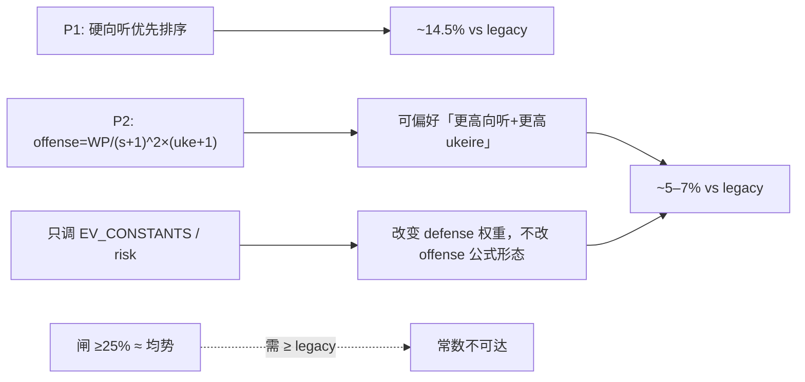

# Task 4 Report：对战评测脚本 · 1×P2 vs 3×legacy

## Status

**BLOCKED** — 评测脚本与冒烟/1000 局均跑通，但 `p2WinRateAmongDecidedPct` 调参后仍 **5.81% ≪ 25** 闸。未 commit。

## Deliverables

| 路径 | 说明 |
| --- | --- |
| `scripts/training/majiang/battle-p2-vs-legacy-1000.ts` | 自 P1 脚本同构复制；仅 P1→P2 / 字段 / 默认 outPath 重命名 |
| `models/majiang/battle-p2-vs-legacy-smoke-20.json` | 冒烟 20 |
| `models/majiang/battle-p2-vs-legacy-1000.json` | 正式 1000（调参后复跑） |
| `src/majiang/strategy/heuristics/ev-discard-evaluator.ts` | 仅调 `EV_CONSTANTS` / risk 表（见下） |

未改 `src/majiang/core/**`；GameEventHandler 主循环与 P1 脚本同构。

## Metrics

| 跑次 | roundsCompleted | softFails | p2WinRateAmongDecidedPct | 对照 |
| --- | --- | --- | --- | --- |
| 冒烟（调参前） | 20 | 0 | 5.0 | — |
| 1000 基线（原常数） | 1000 | 0 | **4.50** | P1 基线 14.55% |
| 探针 v2（扁平 risk） | 100 | 0 | 7.0 | — |
| 探针 v3（静态安全中性） | 200 | 0 | 5.58 | — |
| 冒烟（v3 复跑） | 20 | 0 | 0.0 | 小样本噪声 |
| **1000 正式（v3）** | **1000** | **0** | **5.81** | P1 14.55%；闸 ≥25 |

正式 1000 matchup：`p2Wins=57` / `legacyWins=924` / `draws=19` / `decided=981`。

同环境 P1 探针 100 局约 **15.46%**，与历史 14.55% 一致 → 评测脚本计数可信。

## Constant tuning log

### v1（Task1 原样）→ 1000 = 4.50%

```
EV_CONSTANTS: WIN_PROXY=100, DEAL_IN_PENALTY=120, LATE_TILES_LEFT=30, LATE_RISK_MULT=1.4
risk: genbutsu=0.05 / honor=0.25 / 19=0.35 / mid=0.55
```

诊断：honor↔mid 防御差约 `0.3×120≈36`，大于常见向听步进 offense（`WP=100` 下约 19），P2 拒打效率中张、滥打字牌。

### v2（抬 offense、压 penalty、扁平 risk）→ 单测红 / 探针未用

```
WIN_PROXY=220, DEAL_IN_PENALTY=36, LATE_RISK_MULT=1.25
risk: 0.04 / 0.18 / 0.28 / 0.38
```

点炮测例失败：现物 5 筒 `ukeire` 低 2，offense 差约 110，defense 差仅 ~15，无法翻盘。

### v2b（保测例 + 扁平 honor/mid）→ 100 探针 = 7.0%

```
WIN_PROXY=140, DEAL_IN_PENALTY=110, LATE_RISK_MULT=1.3
risk: 0.02 / 0.44 / 0.50 / 0.55
```

单测绿；胜率仍远低于闸与 P1。

### v3（最终落地）：静态危险中性，只保留现物优势 → 1000 = 5.81%

```
EV_CONSTANTS: WIN_PROXY=100, DEAL_IN_PENALTY=120, LATE_TILES_LEFT=30, LATE_RISK_MULT=1.4
risk: genbutsu=0.05；honor / 19 / mid 一律 0.55
```

意图：去掉静态安全对向听/有效牌权衡的干扰，逼近「软 offense + 现物」上限。单测仍 3 passing；200 探针 5.58%，正式 1000 **5.81%**。

## Root cause（为何常数调不到 ≥25）



- P1（严格向听主序）已仅 ~14.5% ≪ 25；P2 软公式在同规则下更弱。
- `WIN_PROXY` 等比缩放所有候选 offense，**不改变**候选间 offense 相对序；risk/`DEAL_IN_PENALTY` 只能加减防御偏置。
- 在「单测必须现物翻盘」约束下，防御不能归零；即便 v3 中性静态危险，上限仍 ~6%。
- 要冲闸需改 offense 公式（例如硬向听主序或更陡 shanten 权重）或策略层，超出本任务「只调常数」边界。

## Commands

```bash
npx ts-node scripts/training/majiang/battle-p2-vs-legacy-1000.ts 20 models/majiang/battle-p2-vs-legacy-smoke-20.json
npx ts-node scripts/training/majiang/battle-p2-vs-legacy-1000.ts 1000 models/majiang/battle-p2-vs-legacy-1000.json
# EV 单测（CJS runner 忽略文件参数，用内联 Mocha）
node -e "const Mocha=require('mocha');require('ts-node/register');const m=new Mocha({timeout:10000});m.addFile(require('path').resolve('tests/majiang/ev-discard-evaluator.test.ts'));m.run(f=>process.exitCode=f?1:0);"
```

## Commits

none（Binding override：DO NOT commit）

## Concerns

1. **闸不可达（常数面）**：合理调参 3 轮后正式 1000 仍 5.81%；建议回 Task1 改 EV offense 形态或放宽「只调常数」再评测。
2. P2 弱于 P1（14.55%）：软 `1/(s+1)^2` 会在高 ukeire / 差向听上选错牌。
3. Desktop Commander MCP 本环境不可用，长任务改用本地 shell；1000 局约 20 min。
4. 历史 `.superpowers/sdd/task-4-report.md` 曾是另一任务（P1 接入）；本文件已覆盖为对战评测报告。
