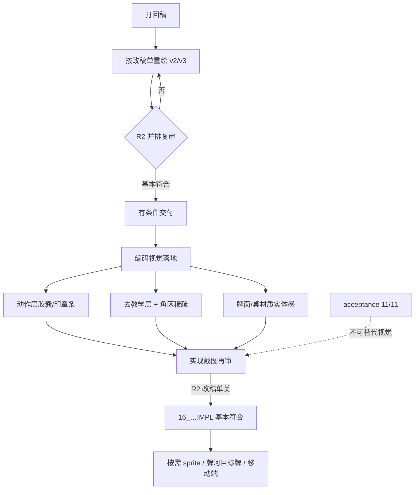

# Handoff: 麻将 Web UI 保真 · 目标图闸门

> 更新时间：2026-09-17（实现截图档位 B 并排 · R2 改稿单验收关闭）  
> 规范：`AGENTS.md` · `docs/standards/rules/development.md` · Skill `majiang-ui-review`（档位 B）

## 一句话状态
**桌面目标图 R2 有条件通过；实现截图档位 B 已并排——R2 改稿单 3 条关闭（胶囊动作层/弱高亮/角区稀疏）；整桌冲顶仍未满分（CSS 牌面/Web 原型质感）。acceptance 11/11 不可替代视觉终审。**

## 目标 / 用户意图
- 已完成：打回 → 重绘 → R2 复审 → 文档闸门 → 动作层胶囊 → 去教学层/角区稀疏 → 厚度/微透视 → 筒条经典印花 → **实现截图档位 B 并排关 R2 改稿单**。
- 进行中（按需）：印花若仍偏 CSS → PNG/SVG sprite；强化牌河目标牌首眼；弱化「等待操作」等 Web 副文案。
- 可选并行：补移动端目标/实现帧 / `final-evidence` 全链。

## 已完成
| 项 | 结果 | 产物 |
|---|---|---|
| 改稿重绘 | v2 去教学层；v3 保留并升采样为审核主图 | `target-assets/…-review.png`（1440×900） |
| 打回留档 | 旧审核主图保全 | `…-review-rejected-20260917.png` |
| R2 竞品复审 | **基本符合 · 有条件通过** | `15_HIFI_TARGET_COMPETITOR_REVIEW_20260917_R2.md` |
| 简报/主文档口径 | 「有条件通过 · 进入视觉落地」 | `13_…BRIEF` + 三份主文档 |
| 闸门文档提交 | `5e22a0f` | docs + target-assets |
| 动作层形态 | Web 矩形条 → **胶囊/印章字效条** | `4027d4d` · `web-ui-prototype/` |
| 去教学层 + 角区稀疏 | 关 beam/气泡/桌心说明条；角区仅头像+分数+南位轻量「可胡」；中心盘右缘脉冲 + 目标牌光效 | `e99d51a` · `web-ui-prototype/` |
| 牌面/桌材质起步 | 手牌/牌河陶瓷分层厚度 + 桌面接触阴影；桌毡加深 + 桌面/牌河微透视加大；手牌行 `rotateX` | `8301fd6` · `styles.css` |
| 牌面印花布局 | 筒/条改 3×3 经典格位；去套色「筒/条」字；筒点分色；白板框；陶瓷微纹；`?selfcheck=1` | `b5526db` · `web-ui-prototype/` |
| 实现截图档位 B | **R2 改稿单 3 条关闭 · 整桌仍有条件** | `12023b5` · `16_HIFI_IMPL_COMPETITOR_REVIEW_20260917.md` + `target-assets/impl-desktop-1440x900-20260917.png` |

### 相对打回稿的收敛
1. 说明型叠加层（大箭头/气泡/说明条）→ **目标图已移除**；实现层 beam/callout/`latest-action-wrap` 亦已退出主舞台。
2. 动作层 Web 矩形条 → **胶囊/印章字效条**（`4027d4d`；实现验收已关；**勿再退回圆钮或深色工具条**）。
3. 角区标签墙 → **已压缩**为头像+分数+南位轻量「可胡」。
4. 筒/条「点数堆叠 + 套字」→ **经典印花格位**（仍非 PNG sprite）。

## 未完成 / 阻塞
| 优先级 | 事项 | 责任 | 阻塞编码？ |
|---|---|---|---|
| P1 | 按需：印花 sprite + 牌河目标牌首眼 + 弱化 Web 副文案 | 编码 | 否 |
| P2 | 补 390×844 移动端同局势目标图/实现帧并复审 | 设计/工程 | 否 |
| P2 | 补 `final-evidence/` 全链截图采集（可选） | 工程 | 否 |
| P1 | 后续 adapter/`core` 接线（任务包 2+） | 编码 | 闸门已开 |

## 关键决策（勿推翻）
- 两层标准不可混判：基线合格 ≠ 竞品级；**11/11 ≠ 视觉终审通过**。
- 权威闸门：`13_…BRIEF` + `15_…R2` + **`16_…IMPL`（实现验收）**（覆盖 `14_…` 打回与旧「顶级已通过」）。
- 唯一主参考：`…/competitor-assets/riichi-city/steam-shot-2.jpg`。
- 术语：中文广东麻将；禁止荣和/立直/听牌等日式 UI 词。
- 固定局势：右家打出 → 可胡；主动作「胡」、次「过」、弱「碰/杠」。
- 旧打回稿 / 旧 Batch = 不可作效果图交付；原型仍非无约束终态。
- 动作层终态 = 胶囊/印章字效条；禁止圆钮 HUD、禁止深色 Web 工具条。
- 局势表达 = 牌光效 + 中心盘右缘脉冲 + 座位轻高亮；**禁止**大箭头/气泡/桌心说明条/多座位标签墙。
- **实现冲顶证据帧**必须注入 `majiangNextModelExample` / `response_window`；`开始对局` 默认 `player_turn`，不能当 R2 验收帧。
- 无 `.codegraph/`，勿调 codegraph。
- Glob 可能扫不到 `target-assets/`；用 `ls` 确认。

## 关键路径

### 必读
- `docs/majiang/design-freeze/stage-a-2026-05-10/16_HIFI_IMPL_COMPETITOR_REVIEW_20260917.md`
- `docs/majiang/design-freeze/stage-a-2026-05-10/15_HIFI_TARGET_COMPETITOR_REVIEW_20260917_R2.md`
- `docs/majiang/design-freeze/stage-a-2026-05-10/13_RIICHI_CITY_HIFI_TARGET_REDRAW_BRIEF.md`
- Skill：`~/.claude/skills/majiang-ui-review/SKILL.md`

### 图
- 实现审核帧：`…/target-assets/impl-desktop-1440x900-20260917.png`
- 审核主图：`…/target-assets/guangdong-hifi-target-desktop-1440x900-review.png`
- 打回留档：`…/target-assets/guangdong-hifi-target-desktop-1440x900-review-rejected-20260917.png`
- 主参考：`…/competitor-assets/riichi-city/steam-shot-2.jpg`

### 原型（视觉落地 · R2 实现验收已关）
- `docs/majiang/web-ui-prototype/`（动作层/弱高亮/厚度/印花已提交；整桌冲顶按需收敛）

## 工作区未提交改动（下一会话注意）
- 无（本轮 `16_…IMPL` + 实现截图 + handoff 已提交 `12023b5`）。
- `node_modules` / `.tmp` 勿提交（`.tmp/` 已 gitignore）。
- 已提交历史：`12023b5` 实现验收；`b5526db` 印花；`8301fd6` 厚度；`e99d51a` 去教学层；`4027d4d` 动作层；闸门 `5e22a0f`；哈希回填 `3e880f9`。

## 建议下一会话动作
1. **编码（按需）**：印花 sprite / 牌河目标牌首眼 / 弱化「等待操作」类 Web 副文案（见 `16_…IMPL` 改稿单）。
2. **设计/工程**：补移动端 390×844 同局势目标图或实现帧 → 档位 B 复审。
3. **证据链（可选）**：扩展 `final-evidence` 采集脚本（与视觉收敛并行）。
4. **接线**：任务包 2+ adapter/`core`（闸门已开，不阻塞于 R2 视觉条）。

## 坑
1. 不要信旧文「顶级判定口径：通过」或仅信 `14_…` 打回——以 `15_…R2` + `16_…IMPL` 为准。
2. 勿用局部 CSS 微调冒充整桌冲顶完成；R2 改稿单关 ≠ 无条件顶级通过。
3. `final-evidence/` 缺失 ≠ 功能失败；`.tmp/` 不进 git，证据图须落 `target-assets/`。
4. 生成图像素源多为 1280×720；审核主图已 `sips` 到 1440×900，实现勿依赖低清源稿细节。
5. **截实现冲顶帧时**：注入 `window.updateMajiangTableViewModel(window.majiangNextModelExample)` 并冻结 countdown；勿只点「开始对局」。
