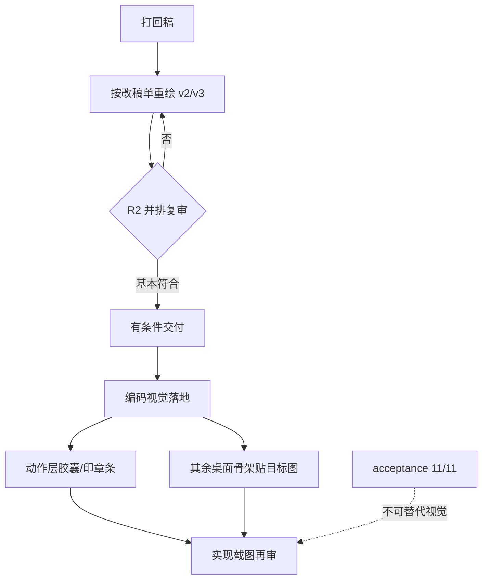

# Handoff: 麻将 Web UI 保真 · 目标图闸门

> 更新时间：2026-09-17（R2 闸门已提交 · 动作层胶囊落地起步）  
> 规范：`AGENTS.md` · `docs/standards/rules/development.md` · Skill `majiang-ui-review`（档位 B）

## 一句话状态
**桌面目标图 R2 有条件通过；视觉落地已开工——动作层已改为胶囊/印章字效条（非圆钮、非 Web 矩形条）。acceptance 11/11；实现截图尚未做档位 B 并排终审。**

## 目标 / 用户意图
- 已完成：打回 → 重绘 → R2 复审 → 文档闸门回填 → **git commit**。
- 进行中：按 `15_…R2` 改稿单做原型视觉落地（动作层 P1 已起步）。
- 可选并行：补移动端目标帧 / `final-evidence` 截图链。

## 已完成
| 项 | 结果 | 产物 |
|---|---|---|
| 改稿重绘 | v2 去教学层；v3 保留并升采样为审核主图 | `target-assets/…-review.png`（1440×900） |
| 打回留档 | 旧审核主图保全 | `…-review-rejected-20260917.png` |
| R2 竞品复审 | **基本符合 · 有条件通过** | `15_HIFI_TARGET_COMPETITOR_REVIEW_20260917_R2.md` |
| 简报/主文档口径 | 「有条件通过 · 进入视觉落地」 | `13_…BRIEF` + 三份主文档 |
| 闸门文档提交 | `5e22a0f` | docs + target-assets |
| 动作层形态（P1 起步） | Web 矩形条 → **胶囊/印章字效条**；`胡` 最大金光，`过` 冷色次级，`碰/杠` 弱金 | `web-ui-prototype/styles.css` + `index.html` |

### 相对打回稿的收敛
1. 说明型叠加层（大箭头/气泡/说明条）→ **已移除**；改为目标牌光效。
2. 动作层 Web 矩形条 → **目标图已去 Web 化**；实现层已贴胶囊/印章条（**勿再退回圆钮或深色工具条**）。
3. 角区标签墙 → **已压缩**为头像+分数+轻量「可胡」。

## 未完成 / 阻塞
| 优先级 | 事项 | 责任 | 阻塞编码？ |
|---|---|---|---|
| P1 | 桌面骨架继续贴目标图（桌心/牌面/角区密度约束） | 编码 | 否 |
| P1 | 实现截图 vs `steam-shot-2.jpg` 档位 B 并排复审（关动作层验收） | 审核 | 否 |
| P2 | 补 390×844 移动端同局势目标图并复审 | 设计 | 否 |
| P2 | 补 `final-evidence/` 截图采集（可选） | 工程 | 否 |
| P1 | 后续 adapter/`core` 接线（任务包 2+） | 编码 | 闸门已开 |

## 关键决策（勿推翻）
- 两层标准不可混判：基线合格 ≠ 竞品级；**11/11 ≠ 视觉终审通过**。
- 权威闸门：`13_…BRIEF` + `15_…R2`（覆盖 `14_…` 打回与旧「顶级已通过」）。
- 唯一主参考：`…/competitor-assets/riichi-city/steam-shot-2.jpg`。
- 术语：中文广东麻将；禁止荣和/立直/听牌等日式 UI 词。
- 固定局势：右家打出 → 可胡；主动作「胡」、次「过」、弱「碰/杠」。
- 旧打回稿 / 旧 Batch = 不可作效果图交付；原型仍非无约束终态。
- 动作层终态 = 胶囊/印章字效条；禁止圆钮 HUD、禁止深色 Web 工具条。
- 无 `.codegraph/`，勿调 codegraph。
- Glob 可能扫不到 `target-assets/`；用 `ls` 确认。

## 关键路径

### 必读
- `docs/majiang/design-freeze/stage-a-2026-05-10/15_HIFI_TARGET_COMPETITOR_REVIEW_20260917_R2.md`
- `docs/majiang/design-freeze/stage-a-2026-05-10/13_RIICHI_CITY_HIFI_TARGET_REDRAW_BRIEF.md`
- Skill：`~/.claude/skills/majiang-ui-review/SKILL.md`

### 图
- 审核主图：`…/target-assets/guangdong-hifi-target-desktop-1440x900-review.png`
- 打回留档：`…/target-assets/guangdong-hifi-target-desktop-1440x900-review-rejected-20260917.png`
- 主参考：`…/competitor-assets/riichi-city/steam-shot-2.jpg`

### 原型（视觉落地进行中）
- `docs/majiang/web-ui-prototype/`（动作层已胶囊化；整桌仍待贴目标图）

## 工作区未提交改动（下一会话注意）
- 原型：`web-ui-prototype/styles.css`、`index.html`（动作层胶囊/印章条）
- 本 handoff 进度回填
- `node_modules` / `.tmp` 勿提交。
- 闸门文档已在 `5e22a0f`；本轮视觉改动**尚未**要求二次 commit。

## 建议下一会话动作
1. **继续编码**：按目标图推进桌心/牌面/角区；保持动作层胶囊约束；勿恢复教学大箭头/标签墙。
2. **审核**：桌面实现截图 + `steam-shot-2.jpg` 档位 B 并排，关闭 `15_…R2` 改稿单第 1 条验收。
3. **设计**：补移动端 390×844 同局势目标图 → 档位 B 复审。
4. **证据链（可选）**：截图采集脚本，与视觉落地并行。

## 坑
1. 不要信旧文「顶级判定口径：通过」或仅信 `14_…` 打回——以 `15_…R2` 为准。
2. 勿用局部 CSS 微调冒充已达成本图；动作层收敛 ≠ 整桌冲顶完成。
3. `final-evidence/` 缺失 ≠ 功能失败。
4. 生成图像素源多为 1280×720；审核主图已 `sips` 到 1440×900，实现勿依赖低清源稿细节。
