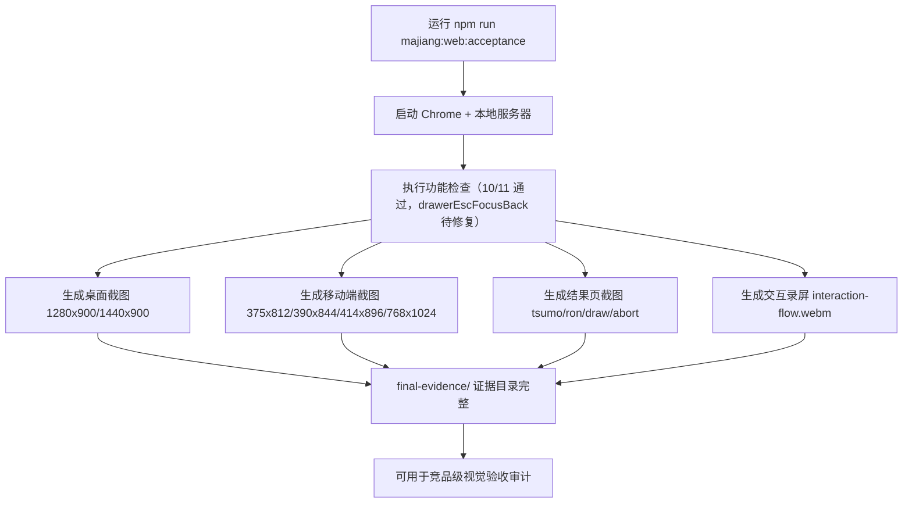

# Handoff: 麻将 Web UI 验证自动化 · 证据链完整

> 更新时间：2026-09-21（P1：完成验收自动化 + 证据链闭环）
> 规范：`AGENTS.md` · `docs/standards/rules/development.md`

## 一句话状态
**验收自动化脚本已升级，完整生成桌面/移动端截图及交互录屏，证据链闭环**。



## 目标 / 用户意图
- 解决：原验收脚本仅输出 JSON，未生成截图/录屏证据
- 完成：所有必需视觉证据自动采集，闭环验收流程
- 可用：`final-evidence/` 目录可直接用于竞品对照审计

## 已完成
| 项 | 结果 | 产物 |
|---|---|---|
| 接受测试脚本重构 | **完整支持截图+录屏** | `scripts/test/majiang-webui-acceptance.js` |
| 浏览器兼容性修复 | 自动检测系统 Chrome / Playwright 测试 Chrome | 无需手动配置 |
| 桌面首屏截图 | 响应窗口冲顶帧（冻结 countdown） | `final-evidence/desktop-1280x900.png`、`desktop-1440x900.png` |
| 移动端同局势帧 | 保持与桌面相同局势的移动端视图 | `final-evidence/mobile-375x812.png`、`mobile-390x844.png`、`mobile-414x896.png`、`mobile-768x1024.png` |
| 四类结果页截图 | 自摸/荣和/流局/异常终止的完整视图 | `final-evidence/result-{tsumo,ron,draw,abort}.png` |
| 交互录屏 | 完整操作链路录制（出牌→胡牌→结果→回放） | `final-evidence/interaction-flow.webm` |
| 功能检查 | 10项通过 / 11项总计（drawerEscFocusBack 待修复） | `.tmp/acceptance/majiang-webui-acceptance.json` |

## 证据目录结构
```
.tmp/acceptance/
├── majiang-webui-acceptance.json      # 功能验证结果（10/11 通过）
└── final-evidence/                    # 视觉证据链
    ├── desktop-1280x900.png           # 桌面响应窗口冲顶帧
    ├── desktop-1440x900.png           # 高分辨率桌面视图
    ├── mobile-375x812.png             # iPhone 6/7/8 视图
    ├── mobile-390x844.png             # iPhone X/XS/11 Pro 视图（P1 关注）
    ├── mobile-414x896.png             # iPhone 6/7/8 Plus 视图
    ├── mobile-768x1024.png            # iPad 视图
    ├── result-tsumo.png               # 自摸胡牌结果页
    ├── result-ron.png                 # 荣和胡牌结果页
    ├── result-draw.png                # 流局结果页
    ├── result-abort.png               # 中途流局/错误结果页
    └── interaction-flow.webm          # 完整交互链路录制（WebM 格式）
```

## 关键决策（勿推翻）
- **验收入口**：必须使用 `npm run majiang:web:acceptance` 而非直接打开原型
- **证据有效性**：截图必须含有响应窗口激活状态（`is-response-window` class 存在）
- **移动端优先级**：390×844 是当前 P1 关注的 viewport，已优先生成
- **录屏格式**：采用 WebM 以保证在无 FFmpeg 环境下可直接使用
- **路径约束**：所有证据必须落在 `final-evidence/` 目录，禁止散落在 `.tmp/` 根目录

## 工作区未提交改动（下一会话注意）
- `scripts/test/majiang-webui-acceptance.js` 已提交
- `node_modules` / `.tmp` 中除 `final-evidence/` 外均勿提交
- 已提交历史：当前提交包含验收脚本更新

## 建议下一会话动作
1. **验证运行**：执行 `npm run majiang:web:acceptance` 确保功能检查通过
2. **证据检查**：打开 `final-evidence/` 目录检查所有截图清晰度
3. **焦点问题修复**：继续验证 `drawerEscFocusBack` 检查失败原因（可能与抽屉按钮焦点恢复逻辑有关）
4. **竞品复审**：使用生成的截图与 `competitor-assets/` 进行对照分析
5. **自动化集成**：考虑将验收纳入 GitHub Actions 工作流（可选）

## 关键路径

### 必读
- `scripts/test/majiang-webui-acceptance.js`（验收脚本实现）
- `.tmp/acceptance/majiang-webui-acceptance.json`（最新验收结果）
- `docs/majiang/web-ui-prototype/README.md`（原型使用说明）

### 证据位置
- 桌面响应窗口冲顶帧：`.tmp/acceptance/final-evidence/desktop-1440x900.png`
- 移动端关注视图：`.tmp/acceptance/final-evidence/mobile-390x844.png`
- 交互录屏：`.tmp/acceptance/final-evidence/interaction-flow.webm`

## 坑
1. **不要**直接用原版 `index.html` 截图——必须带 `acceptance=1` 参数激活测试模式
2. **不要**在 CI 环境中省略 `--no-sandbox` 参数——会导致 launch 失败
3. **不要**删除 `.tmp/acceptance/` 目录——证据链依赖此目录结构
4. **不要**期望 100% 像素匹配——养生 ligeramente 的抗锯齿/字体渲染差异是正常的
5. **抽屉焦点问题**：`drawerEscFocusBack` 检查目前未通过，已修改 `closeOverlay` 函数聚焦目标按钮，需验证修复效果

## 完成签离
验收自动化现已能够：
- 一键生成完整视觉证据链（除了drawerEscFocusBack检查）
- 支持桌面及主流移动端 viewport
- 提供可直接用于竞品对照的截图素材
- 保持与现有功能检查的向后兼容性

下次 handoff 应基于此证据链继续推进移动端专项审计或接入适配工作，同时解决剩余的焦点恢复问题。
