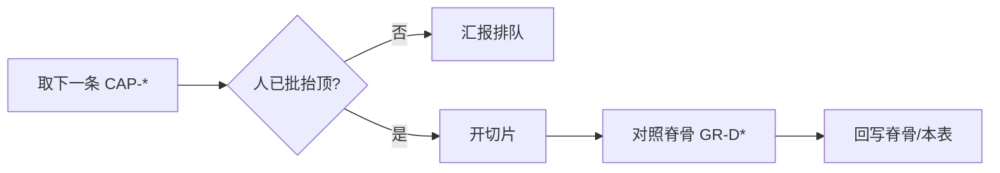

# 麻将双表面 — 全量封顶任务表（施工队列 SSOT）

> **角色**：CLI 训练 + Web 人测 / 共用引擎抬顶时的任务排队源；Agent / `/loop` 只从本表取下一切片。  
> **关联脊骨**：`docs/product/spines/majiang-dual-surface-target.md`  
> **波次**：`docs/product/waves/majiang-dual-surface-W9.md`  
> **规格**：`docs/superpowers/specs/2026-11-17-majiang-dual-surface-design.md`  
> **验收矩阵**：`docs/product/caps/majiang-dual-surface-acceptance-matrix.md`  
> **现状（2026-11-17）**：路径 **A** 人批；`CAP-ARCH-LEDGER` / `CAP-ENG-SESSION` / `CAP-ENG-SNAP` **已落地**。旧 `majiang-webui-cap-tasks.md` **只读防回退**，本波不取 `CAP-UI-*`。下一切片：`CAP-CLI-TRAIN`（可与 `CAP-API-GAME` 并行）。

## 1. 怎么用



| 规则 | 说明 |
|------|------|
| 一拍一切片 | `/loop` 默认每拍只动一条 `CAP-*` |
| 批序 | `0 → 1 → 2 → 3∥4 → 5 → 6 → 7 → 等人批 8` |
| 禁自批 GRAD | `CAP-DUAL-GRAD` 仅人批 |
| 禁改规则权威 | UI/API 适配不得重写胡吃碰杠/计分 |
| 禁毁训练 | `CAP-CLI-TRAIN` 未回归前不得宣称双表面可玩 |
| 视觉只读 | 不重开 `CAP-UI-COMP`；局内视觉防回退抽检即可 |

## 2. 任务总表

| 封顶任务 ID | 脊骨差距 | 切片 | 层 | 建议批序 | 账本状态 |
|-------------|----------|------|----|----------|----------|
| `CAP-ARCH-LEDGER` | G-D0 | `MJ-DUAL-LEDGER-01` | 流程 | **0** | **已落地** |
| `CAP-ENG-SESSION` | G-D1 / GR-D1 | `MJ-ENG-SESSION-01` | 引擎 | **1** | **已落地** |
| `CAP-ENG-SNAP` | G-D2 / GR-D2 | `MJ-ENG-SNAP-01` | 契约 | **2** | **已落地** |
| `CAP-CLI-TRAIN` | G-D3 / GR-D3 | `MJ-CLI-TRAIN-01` | CLI | **3** | 待做 |
| `CAP-API-GAME` | G-D4 / GR-D4 | `MJ-API-GAME-01` | API | **4**（可与 3 并行） | 待做 |
| `CAP-WEB-BRIDGE` | G-D5 / GR-D5 | `MJ-WEB-BRIDGE-01` | Web·U1 | **5** | 待做 |
| `CAP-WEB-LOBBY` | G-D6 / GR-D6 | `MJ-WEB-LOBBY-01` | Web·U0 | **6** | 待做 |
| `CAP-ACC-DUAL` | G-D7 / GR-D7 | `MJ-ACC-DUAL-01` | 验收 | **7** | 待做 |
| `CAP-DUAL-GRAD` | GR-D8 | （收官） | — | **8 · 仅人批** | 待人批 |

## 3. 各任务封顶线（可观察）

### `CAP-ARCH-LEDGER`（批序 0）

- **封顶**：脊骨 + 本表 + W9 + 设计规格齐；旧 Web UI 任务表页眉标明「只读 / 本波不施工」。  
- **禁止**：夹带引擎/UI 实现大改。

### `CAP-ENG-SESSION`（批序 1）

- **封顶**：`GameSession`（或等价）可：create → discard/response/AI step → end；无 readline、无 `displayManager` 硬依赖。  
- **须挂**：`MJ-ACC-ENG-01`（default / `tests/majiang/game-session.test.ts`）：auto 一局 `ENDED`。
- **验收**：Node 侧可跑通至少一局 headless（可断言终局或步数）。  
- **禁止**：把规则判定搬进 Session 外的新引擎；禁止改番型语义。

### `CAP-ENG-SNAP`（批序 2）

- **封顶**：书面 + 代码级快照字段：phase、seats、selfHand、discardRiver、availableActions、resultSummary 等，可喂现有 `createTableViewModelFromSnapshot`。  
- **须挂**：`MJ-ACC-SNAP-01`（default）：快照字段齐全且 `availableActions` 来自引擎，可喂 view-model。
- **禁止**：前端自造可用动作集合。

### `CAP-CLI-TRAIN`（批序 3）

- **封顶**：`runAutoGameLoop`（或训练入口）走 Session；自动对弈可完成 N 局并输出统计。  
- **须挂**：`MJ-ACC-CLI-01`（default 短路径终局）；`MJ-ACC-CLI-02`（nightly 统计形状，不进 `npm test`）。
- **禁止**：训练路径回退到仅 console 可跑的死耦合而 Web 不可复用。

### `CAP-API-GAME`（批序 4）

- **封顶**：本机 Express（或等价）至少：`POST /games`、`GET /games/:id`、`POST /games/:id/actions`；状态权威在服务端 Session。  
- **参考**：`src/othello/ui/api-server.ts` 形态。  
- **须挂**：`MJ-ACC-API-01`（smoke：POST/GET/actions，权威在服务端）；与 `CAP-WEB-BRIDGE` 共同支撑 `MJ-ACC-WEB-02`。
- **禁止**：把完整 Game 状态机下沉到浏览器。

### `CAP-WEB-BRIDGE`（批序 5）

- **封顶**：`docs/majiang/web-ui-prototype` 的 create/action handler 接 API；出牌后 AI 能回手；人测可到 ResultModal。  
- **须挂**：`MJ-ACC-WEB-01`（smoke 主链路完局）；`MJ-ACC-WEB-02`（非法动作拒绝且不脏写）。
- **禁止**：继续用假 `waiting_ai` 永久挂起冒充可玩。

### `CAP-WEB-LOBBY`（批序 6）

- **封顶**：大厅一主 CTA「开始对局」+ 固定配置摘要；诊断/JSON 默认折叠；非三栏调试仪表盘主视觉。  
- **须挂**：为 `MJ-ACC-WEB-01` 提供大厅开局入口（主 CTA）；本 CAP 本身不单独占用 smoke 行，但 WEB-01 依赖本 CAP 时矩阵须注明。
- **禁止**：借刀重开整桌竞品视觉冲顶。

### `CAP-ACC-DUAL`（批序 7）

- **封顶**：关键 default 子集已绿（至少 `MJ-ACC-ENG-01`；SNAP/CLI-01 落地后一并纳入）+ smoke 可重复跑通 `MJ-ACC-API-01` / `MJ-ACC-WEB-01` / `MJ-ACC-DUAL-01`（依赖未落地则不得宣称本 CAP 已绿）。
- **须挂**：`MJ-ACC-DUAL-01`；报告引用上述 ID。
- **禁止**：仅手工一次通过就关项；用 skip 装绿；自批 `CAP-DUAL-GRAD`。

### `CAP-DUAL-GRAD`（批序 8 · 仅人批）

- **封顶**：人确认 CLI 训练未毁 + Web 人测可完局。  
- **禁止**：Agent / `/loop` 自批。

## 4. 默认施工队列

| 顺序 | 打开条件 | 建议波次 |
|------|----------|----------|
| 0 | 人批路径 A（已满足 2026-11-17） | W9 · 账本 |
| 1 | 0 已落地 | W9 · Session |
| 2 | 1 已落地 | W9 · Snapshot |
| 3∥4 | 2 已落地（4 至少要 2；3 至少要 1） | W9/W10 |
| 5 | 4 已落地 | W10 · Web 桥 |
| 6 | 5 可并行偏后 | W10 · 大厅 |
| 7 | 5+3 已落地 | W11 · 验收 |
| 8 | 7 已落地 + 人点名 | 收官 |

## 5. `/loop` 提示词骨架

```text
从 docs/product/caps/majiang-dual-surface-cap-tasks.md 取下一条待做 CAP-*；
对照 docs/product/spines/majiang-dual-surface-target.md；
一拍一切片；禁止自批 CAP-DUAL-GRAD；禁止 Web 重写 core 规则；
禁止破坏 CLI 训练主路径；禁止重开 CAP-UI-COMP；
做完回写脊骨与本表状态。
```
