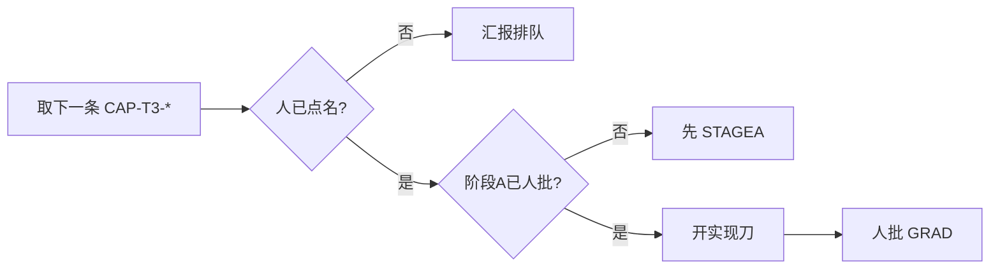

# 麻将 Web 局内桌三抬顶 — 封顶任务表

> **角色**：本抬顶施工排队源；Agent / `/loop` 只从本表取下一切片。  
> **关联脊骨**：`docs/product/spines/majiang-web-table-v3-target.md`  
> **规格**：`docs/superpowers/specs/2026-11-19-majiang-web-table-v3-design.md`  
> **波次**：`docs/product/waves/majiang-web-table-v3-W1.md`  
> **现状（2026-11-19）**：W1 已毕业（人批「批准毕业」）。旧 `majiang-webui-cap-tasks` 仍只读防回退。

## 1. 怎么用

| 规则 | 说明 |
|------|------|
| 一拍一切片 | 默认每拍只动一条 |
| 禁自批 GRAD | `CAP-T3-GRAD` 仅人批 |
| 功能绿 ≠ 视觉关 | e2e/挂测通过不关闭视觉项 |
| 大厅只读 | 禁止本表任务改 `#lobbyPage` |

## 2. 任务总表

| 封顶任务 ID | 脊骨差距 | 切片 | UI 层 | 阶段依赖 | 账本状态 |
|-------------|----------|------|-------|----------|----------|
| `CAP-T3-LEDGER` | G-T0 | `MJ-T3-LEDGER-01` | 流程 | — | **已落地** |
| `CAP-T3-STAGEA` | G-T1 / GR-T3 | `MJ-T3-STAGEA-01` | U2·视觉 | 人批自绘帧 | **已落地**（2026-11-19） |
| `CAP-T3-CENTER` | G-T2 / GR-T4 | `MJ-T3-CENTER-01` | U2·结构/视觉 | STAGEA 已批 | **已落地** |
| `CAP-T3-TILE` | G-T3 / GR-T5 | `MJ-T3-TILE-01` | U2·视觉 | STAGEA 已批 | **已落地** |
| `CAP-T3-FELT` | G-T4 / GR-T6 | `MJ-T3-FELT-01` | U2·视觉 | STAGEA 已批 | **已落地** |
| `CAP-T3-GRAD` | G-T5 / GR-T7 | `MJ-T3-GRAD-01` | 收官 | 实现对照齐全 | **已落地**（2026-11-19） |

## 3. 下一刀

本波已收官。无下一刀。
