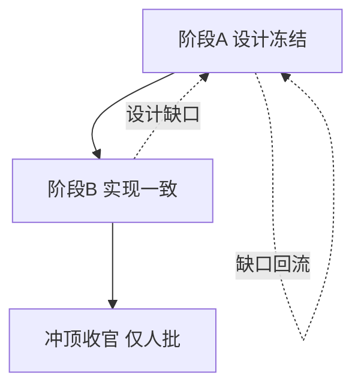

# 麻将 Web UI — 全阶段验收表

> **角色**：阶段闸门对照表；施工切片关闭时必须能指到本表某行。  
> **任务队列**：`docs/product/caps/majiang-webui-cap-tasks.md`  
> **细则**：`docs/majiang/WEB_UI_PRODUCT_INTERACTION_DESIGN.md` §13 / §14  
> **现状（2026-11-16）**：方案 **C** 一段 — TILE/LAYOUT/MOBILE/RESULT/LEDGER/`CAP-UI-GRAD`（人重批）**已关**；二段未开。功能绿仍不得单独充当视觉证据。

## 0. 证据类型约定

| 阶段 | 允许证据 | 禁止当作本阶段通过依据 |
|------|----------|------------------------|
| 阶段A | Figma/Pencil、线框、高保真、交互/状态图、书面合同 | 实现截图、DOM、运行态脚本、功能 acceptance 绿 |
| 阶段B | 桌面/移动截图、关键录屏、结果四态证据、必要 DOM/状态 | 「文档写了就算」「只有自动化绿」「基本有」 |
| 冲顶收官 | 阶段A+B 已收敛 + 档位B 人审结论 | Agent 自批、局部 CSS 微调冒充满分 |

**一段抬高规则**：毕业相关行 **禁止** 以「基本有」关闭；须可观察证据或明确「待做」。

---

## 1. 阶段A · 设计冻结验收

| ID | 检查项 | 通过标准 | 证据类型 | 绑定封顶任务 | 现状（账本） |
|----|--------|----------|----------|--------------|--------------|
| A-01 | 桌心主路径 | 谁打→目标牌→主动作可读 | 目标图/标注 | `CAP-UI-LAYOUT` / `CAP-UI-ACT` | 桌面有条件通过 |
| A-02 | 牌面系统 | 正式态资产化；文字仅降级/调试/占位 | 牌面合同/特写 | `CAP-UI-TILE` | **已关**（W4） |
| A-03 | 四方座位 | 底己、三家环桌、非列表 | 桌面目标图 | `CAP-UI-LAYOUT` | 版式成立（非毕业挡板；毕业看 GRAD） |
| A-04 | 移动策略 | 折叠/主次/热区写清；有同局势目标帧或等价策略节 | 移动目标帧或策略 | `CAP-UI-MOBILE` | **已关**（对齐 W6 · `stage-b-w6-mobile/` 目标合同+实现） |
| A-05 | 结果结构 | 赢家/支付/分差可读；四态语气可审 | 结果态设计 | `CAP-UI-RESULT` | **已关**（合同 `03_RESULT_MODAL_TYPES.md` + 实现帧 `stage-b-w7-result/`） |
| A-06 | 否决 13.3 | 未命中设计否决项 | 人审留档 | `CAP-UI-GRAD` | **已关**（人重批 GRAD · 2026-11-16） |

**阶段A 切换闸门**：未满足「可进入对应任务的阶段B」前，不得开该任务的实现刀。

---

## 2. 阶段B · 实现一致性验收

| ID | 检查项 | 通过标准 | 证据类型 | 绑定封顶任务 | 现状（账本） |
|----|--------|----------|----------|--------------|--------------|
| B-01 | 桌面对照 | 与阶段A 同向；主牌面非色点矩形主表达 | 1440×900 实现帧 | `CAP-UI-TILE` / `CAP-UI-LAYOUT` | **已关**（w4-tile + w5-layout） |
| B-02 | 动作层防回退 | 胶囊/印章条；不退回圆钮 HUD / 深色 Web 工具条 | 响应窗截图 | `CAP-UI-ACT` | **已关**（16_IMPL） |
| B-03 | 弱高亮/去教学 | 无大箭头/气泡/桌心说明条回流 | 实现帧 | `CAP-UI-LAYOUT` | **已关**（P1） |
| B-04 | 移动对照 | 同局势 390×844 与目标同向 | 实现帧 | `CAP-UI-MOBILE` | **已关**（w6-mobile impl） |
| B-05 | 结果四态 | tsumo / ron / draw / abort 可核且**入库** | 截图（`stage-b-w7-result/`） | `CAP-UI-RESULT` | **已关**（W7 · 四态 1440×900 入库） |
| B-06 | DOM/状态边界 | 动作可用性来自 core/适配层；不重写规则 | 抽检 | `CAP-UI-DIAG` | 守规 |
| B-07 | 否决 13.4 | 未命中实现否决项 | 人审留档 | `CAP-UI-GRAD` | **已关**（人重批 GRAD · 2026-11-16） |

**阶段B 说明**：`npm run majiang:web:acceptance` 等功能绿只支撑「可玩基线」，**不得**单独关闭冲顶行（B-05 已凭入库证据关闭，非凭功能绿）。

---

## 3. 冲顶收官（档位 B · 仅人批）

| ID | 检查项 | 通过标准 | 绑定 | 现状（账本） |
|----|--------|----------|------|--------------|
| C-01 | 14.7 硬标准 | 图案牌/唯一主动作/强桌心/成品感/非替代性等逐条可勾 | `CAP-UI-GRAD` | **已关**（人重批 2026-11-16 · 一段） |
| C-02 | 14.8 快检 | 任一否决命中即不通过 | `CAP-UI-GRAD` | **已关**（人重批 2026-11-16 · 一段） |
| C-03 | GR-5 移动 | 目标帧人审 + 实现对照 | `CAP-UI-MOBILE` | **已关**（W6） |
| C-04 | GR-6 口径 | 禁止用功能绿宣称顶级 | `CAP-UI-GRAD` | 强制守规（仍有效） |
| C-05 | 人批毕业 | 产品明确批准「一段视觉冲顶毕业」 | `CAP-UI-GRAD` | **已关**（聊天「符合 / 批准 GRAD」· 2026-11-16） |
| C-06 | GR-7 结果 | 四态入库证据可核 | `CAP-UI-RESULT` | **已关**（`stage-b-w7-result/`） |
| C-07 | GR-8 账本 | 无「基本有」毕业口径矛盾 | `CAP-UI-LEDGER` | **已关**（W7 · 活文档对齐） |

**硬规则**：Agent、`/loop`、automate **不得自批** C-01/02/05；二段竞品抬升不在本表关闭范围内。

---

## 4. 与既有留档的指针

| 留档 | 用途 |
|------|------|
| `design-freeze/.../15_…R2.md` | 桌面目标图阶段A/竞品复审 |
| `design-freeze/.../16_…IMPL.md` | 桌面实现 R2；动作层已关 |
| `design-freeze/stage-b-w6-mobile/` | 移动目标+实现 |
| `design-freeze/stage-b-w7-result/` | 结果四态实现证据（已入库） |
| `docs/product/waves/majiang-webui-W7.md` | 一段抬封顶波次蓝图 |
| `.tmp/acceptance/majiang-webui-acceptance.json` | 功能基线 only |
