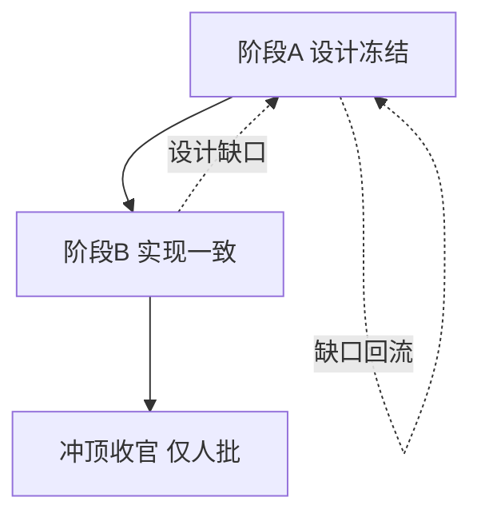

# 麻将 Web UI — 全阶段验收表

> **角色**：阶段闸门对照表；施工切片关闭时必须能指到本表某行。  
> **任务队列**：`docs/product/caps/majiang-webui-cap-tasks.md`  
> **细则**：`docs/majiang/WEB_UI_PRODUCT_INTERACTION_DESIGN.md` §13 / §14  
> **现状诚实（2026-11-15）**：桌面目标/实现 R2 **有条件**；移动端 **未审**；整桌冲顶 **未满分**。本表不因 W3 账本落盘而改写为通过。

## 0. 证据类型约定

| 阶段 | 允许证据 | 禁止当作本阶段通过依据 |
|------|----------|------------------------|
| 阶段A | Figma/Pencil、线框、高保真、交互/状态图、书面合同 | 实现截图、DOM、运行态脚本、功能 acceptance 绿 |
| 阶段B | 桌面/移动截图、关键录屏、结果四态证据、必要 DOM/状态 | 「文档写了就算」「只有自动化绿」 |
| 冲顶收官 | 阶段A+B 已收敛 + 档位B 人审结论 | Agent 自批、局部 CSS 微调冒充满分 |

---

## 1. 阶段A · 设计冻结验收

| ID | 检查项 | 通过标准 | 证据类型 | 绑定封顶任务 | 现状（账本） |
|----|--------|----------|----------|--------------|--------------|
| A-01 | 桌心主路径 | 谁打→目标牌→主动作可读 | 目标图/标注 | `CAP-UI-LAYOUT` / `CAP-UI-ACT` | 桌面有条件通过 |
| A-02 | 牌面系统 | 正式态资产化；文字仅降级/调试/占位 | 牌面合同/特写 | **`CAP-UI-TILE`** | 合同待实现波钉死资产形态 |
| A-03 | 四方座位 | 底己、三家环桌、非列表 | 桌面目标图 | `CAP-UI-LAYOUT` | 基本成立 |
| A-04 | 移动策略 | 折叠/主次/热区写清；有同局势目标帧或等价策略节 | 移动目标帧或策略 | **`CAP-UI-MOBILE`** | **未审 / 未达** |
| A-05 | 结果结构 | 赢家/支付/分差可读；四态语气可审 | 结果态设计 | `CAP-UI-RESULT` | 基本有 |
| A-06 | 否决 13.3 | 未命中设计否决项（含文字牌默认主表达等） | 人审留档 | `CAP-UI-GRAD` | 桌面有条件；移动缺帧 |

**阶段A 切换闸门**：未满足「可进入对应任务的阶段B」前，不得开该任务的实现刀。全站宣称「最顶级设计通过」仍受 A-04 / 冲顶表约束。

---

## 2. 阶段B · 实现一致性验收

| ID | 检查项 | 通过标准 | 证据类型 | 绑定封顶任务 | 现状（账本） |
|----|--------|----------|----------|--------------|--------------|
| B-01 | 桌面对照 | 与阶段A 同向；主牌面非色点矩形主表达 | 1440×900 实现帧 | `CAP-UI-TILE` / `CAP-UI-LAYOUT` | CSS 陶瓷/印花有；sprite 按需未关 |
| B-02 | 动作层防回退 | 胶囊/印章条；不退回圆钮 HUD / 深色 Web 工具条 | 响应窗截图 | `CAP-UI-ACT` | **已关**（16_IMPL） |
| B-03 | 弱高亮/去教学 | 无大箭头/气泡/桌心说明条回流 | 实现帧 | `CAP-UI-LAYOUT` | 已关（P1） |
| B-04 | 移动对照 | 同局势 390×844 与目标同向 | 实现帧 | **`CAP-UI-MOBILE`** | **未采** |
| B-05 | 结果四态 | tsumo / ron / draw / abort 可核 | 截图或录屏 | `CAP-UI-RESULT` | 基本有；缺口再开 |
| B-06 | DOM/状态边界 | 动作可用性来自 core/适配层；不重写规则 | 抽检 | `CAP-UI-DIAG` | 守规 |
| B-07 | 否决 13.4 | 未命中实现否决项 | 人审留档 | `CAP-UI-GRAD` | 视觉落地进行中 |

**阶段B 说明**：`npm run majiang:web:acceptance` 等功能绿只支撑「可玩基线」，**不得**单独关闭 B-01 / B-04 / 冲顶行。

---

## 3. 冲顶收官（档位 B · 仅人批）

| ID | 检查项 | 通过标准 | 绑定 | 现状（账本） |
|----|--------|----------|------|--------------|
| C-01 | 14.7 硬标准 | 图案牌/唯一主动作/强桌心/成品感/非替代性等逐条可勾 | `CAP-UI-GRAD` | **未满分** |
| C-02 | 14.8 快检 | 任一否决命中即不通过 | `CAP-UI-GRAD` | 有条件 |
| C-03 | GR-5 移动 | 目标帧人审 + 实现对照 | `CAP-UI-MOBILE` | **未达** |
| C-04 | GR-6 口径 | 禁止用功能绿宣称顶级 | `CAP-UI-GRAD` | 强制守规 |
| C-05 | 人批毕业 | 产品明确批准「视觉冲顶毕业」 | `CAP-UI-GRAD` | **未批** |

**硬规则**：Agent、`/loop`、automate **不得**将本表 C-* 标为通过。

---

## 4. 与既有留档的指针

| 留档 | 用途 |
|------|------|
| `design-freeze/.../15_…R2.md` | 桌面目标图阶段A/竞品复审 |
| `design-freeze/.../16_…IMPL.md` | 桌面实现 R2；动作层已关 |
| `docs/handoff-majiang-ui-fidelity-progress-20260917.md` | 保真 handoff；sprite 按需 |
| `.tmp/acceptance/majiang-webui-acceptance.json` | 功能基线 only |
