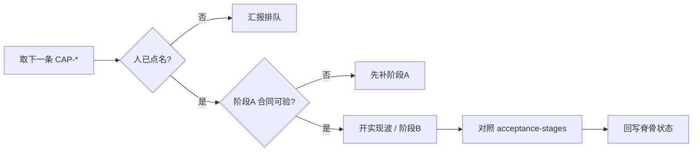

# 麻将 Web UI — 全量封顶任务表（施工队列 SSOT）

> **角色**：抬天花板时的任务排队源；Agent / 日后 `/loop` 只从本表取下一切片。  
> **关联脊骨**：`docs/product/spines/majiang-webui-target.md`  
> **阶段验收**：`docs/product/caps/majiang-webui-acceptance-stages.md`  
> **细则引用**：`docs/majiang/WEB_UI_PRODUCT_INTERACTION_DESIGN.md` §13 / §14（不另开第二套任务 ID）  
> **本波**：W3 仅定表；**不上码**。实现须人点名开波。

## 1. 怎么用



| 规则 | 说明 |
|------|------|
| 一拍一切片 | `/loop` 默认每拍只动一条 `CAP-*` |
| 批序 | 默认 1→3；改序须人点名 |
| 禁自批 GRAD | `CAP-UI-GRAD` 仅人批；loop / Agent 不得标通过 |
| 功能绿 ≠ 视觉关 | acceptance 自动化通过不关闭本表任一视觉项 |
| 防回退 | `CAP-UI-ACT` 已落地后，实现波禁止退回圆钮 HUD / 深色 Web 工具条 |

## 2. 任务总表

| 封顶任务 ID | 脊骨差距 | 切片 | UI 层 | 阶段依赖 | 建议批序 | 账本状态 |
|-------------|----------|------|-------|----------|----------|----------|
| `CAP-UI-ACT` | G1 / GR-4 动作层 | `MJ-UI-ACT-01` | U2·视觉 | A 目标形态已冻 → B R2 实现已关 | — | **已落地**（W2） |
| `CAP-UI-TILE` | G2 | `MJ-UI-TILE-01` | U2·视觉 | A：正式态资产/降级边界 → B：手牌·牌河·副露·目标牌同语义 | **1** | **待施工** |
| `CAP-UI-LAYOUT` | G3 | `MJ-UI-LAYOUT-01` | U2·结构 | A：桌心占比/角区合同 → B：实现对照 | **2** | **部分** |
| `CAP-UI-MOBILE` | G4 / GR-5 | `MJ-UI-MOBILE-01` | U0→U2 | A：390×844 同局势目标帧 → B：实现帧 | **3** | **未达** |
| `CAP-UI-RESULT` | G5 | `MJ-UI-RESULT-01` | U1 | A：四态语气 → B：四态证据 | **4**（有缺口再开） | **基本有** |
| `CAP-UI-DIAG` | G6 / GR-2 | `MJ-UI-DIAG-01` | U1 | 守规抽检（不伪造规则原因） | 持续 | **守规** |
| `CAP-UI-GRAD` | GR-1…6 | （收官） | — | A/B 双否决 + 冲顶清单 14.7/14.8 | **最后** | **冲顶未毕业** |

## 3. 各任务封顶线（可观察）

### `CAP-UI-ACT`（已落地）

- **封顶**：动作层为竞品向胶囊/印章条；`胡` 唯一最强；不退回圆钮 HUD / 深色 Web 工具条。  
- **证据**：`docs/majiang/design-freeze/stage-a-2026-05-10/16_HIFI_IMPL_COMPETITOR_REVIEW_20260917.md`  
- **后续**：仅防回退抽检，不再开大改视觉刀（除非人点名）。

### `CAP-UI-TILE`（批序 1）

- **封顶**：正式态主牌面为图案/资产牌（非色点矩形主表达）；文字牌仅调试/占位/降级。  
- **范围**：手牌、牌河、副露、目标牌 **同语义**；保持既有格位语义。  
- **阶段A**：资产边界与降级触发写清（可无新全桌重绘，但合同必须可审）。  
- **阶段B**：实现帧近距观感接近实体牌；acceptance 绿不替代本项。  
- **禁止**：重做整桌布局；引入日式术语；本任务波宣称整桌 GRAD 通过。

### `CAP-UI-LAYOUT`（批序 2）

- **封顶**：桌心主舞台优先；角区稀疏（头像+分数+至多一短状态）；去教学层回流。  
- **阶段A/B**：对照 acceptance-stages 桌心/角区行。  
- **禁止**：用侧栏/诊断抢主视觉；恢复大箭头/气泡说明条。

### `CAP-UI-MOBILE`（批序 3）

- **封顶**：390×844 同局势目标帧人审通过 + 实现对照通过（GR-5）。  
- **禁止**：无目标帧宣称移动端视觉通过；依赖 hover 才能读懂。

### `CAP-UI-RESULT`（批序 4 · 有缺口再开）

- **封顶**：结果页四态（自摸/点炮/流局/中止）语气与支付关系可读。  
- **现状**：基本有；仅当人审指出缺口时开实现波。

### `CAP-UI-DIAG`（持续）

- **封顶**：诊断/复盘诚实；UI 不重写胡吃碰杠权威（GR-2）。  
- **验收**：抽检即可；不单独抬视觉天花板。

### `CAP-UI-GRAD`（最后 · 仅人批）

- **封顶**：脊骨 GR-1…6 与冲顶清单全部可观察关闭，且人明确批准毕业。  
- **强制**：功能自动化 green ≠ 可宣称视觉顶级通过（GR-6）。  
- **禁止**：Agent / `/loop` / automate 自批通过。

## 4. 默认施工队列（实现波）

| 顺序 | 打开条件 | 建议波次名（人点名后） |
|------|----------|------------------------|
| 1 | 人点名 + TILE 阶段A 合同可验 | 例：W4 · `MJ-UI-TILE-01` |
| 2 | TILE 阶段B 人审可关或人改序 | 例：Wn · `MJ-UI-LAYOUT-01` |
| 3 | 人点名 + 移动目标帧策略齐 | 例：Wn · `MJ-UI-MOBILE-01` |
| 4 | 人审指出 RESULT 缺口 | 按需 |
| 最后 | 前述视觉项人审收敛后 | 仅人批 `CAP-UI-GRAD` |

## 5. `/loop` 提示词骨架（日后用，本波不启动）

```text
从 docs/product/caps/majiang-webui-cap-tasks.md 取下一条可施工 CAP-*；
若无人点名或阶段A未齐则只汇报排队；
禁止关闭 CAP-UI-GRAD；禁止改 core 规则；
对照 majiang-webui-acceptance-stages.md 勾验收并回写脊骨。
```
