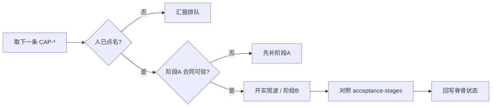

# 麻将 Web UI — 全量封顶任务表（施工队列 SSOT）

> **角色**：抬天花板时的任务排队源；Agent / 日后 `/loop` 只从本表取下一切片。  
> **关联脊骨**：`docs/product/spines/majiang-webui-target.md`  
> **阶段验收**：`docs/product/caps/majiang-webui-acceptance-stages.md`  
> **细则引用**：`docs/majiang/WEB_UI_PRODUCT_INTERACTION_DESIGN.md` §13 / §14（不另开第二套任务 ID）  
> **现状（2026-11-17）**：方案 **C** 一段已关；二段 `CAP-UI-COMP` **已落地**（人批 2026-11-17 · W8）。

## 1. 怎么用



| 规则 | 说明 |
|------|------|
| 一拍一切片 | `/loop` 默认每拍只动一条 `CAP-*` |
| 批序 | 一段默认 **RESULT → 账本 → 人重批 GRAD**；二段另批 |
| 禁自批 GRAD | `CAP-UI-GRAD` 仅人批；loop / Agent 不得标通过 |
| 禁「基本有」毕业 | 毕业相关行不得以「基本有」关闭 |
| 功能绿 ≠ 视觉关 | acceptance 自动化通过不关闭本表任一视觉/结果证据项 |
| 防回退 | `CAP-UI-ACT` 已落地后，实现波禁止退回圆钮 HUD / 深色 Web 工具条 |

## 2. 任务总表

| 封顶任务 ID | 脊骨差距 | 切片 | UI 层 | 阶段依赖 | 建议批序 | 账本状态 |
|-------------|----------|------|-------|----------|----------|----------|
| `CAP-UI-ACT` | G1 / GR-4 动作层 | `MJ-UI-ACT-01` | U2·视觉 | A 目标形态已冻 → B R2 实现已关 | — | **已落地**（W2） |
| `CAP-UI-TILE` | G2 | `MJ-UI-TILE-01` | U2·视觉 | A：正式态资产/降级边界 → B：手牌·牌河·副露·目标牌同语义 | — | **已落地**（W4） |
| `CAP-UI-LAYOUT` | G3 | `MJ-UI-LAYOUT-01` | U2·结构 | A：桌心占比/角区合同 → B：实现对照 | — | **已落地**（W5） |
| `CAP-UI-MOBILE` | G4 / GR-5 | `MJ-UI-MOBILE-01` | U0→U2 | A：390×844 同局势目标帧 → B：实现帧 | — | **已落地**（W6） |
| `CAP-UI-RESULT` | G5 / **GR-7** | `MJ-UI-RESULT-01` | U1 | A：四态语气 → B：**四态入库证据** | **1（一段）** | **已落地**（W7 · `stage-b-w7-result/`） |
| `CAP-UI-LEDGER` | G7 / **GR-8** | `MJ-STD-LEDGER-01` | 流程 | 与 W6/W7 事实对齐；清「基本有」 | **2（一段）** | **已落地**（W7） |
| `CAP-UI-DIAG` | G6 / GR-2 | `MJ-UI-DIAG-01` | U1 | 守规抽检（不伪造规则原因） | 持续 | **守规** |
| `CAP-UI-GRAD` | GR-1…9 | （收官） | — | 一段满分后 + 冲顶清单 14.7/14.8 | **最后（一段）** | **已毕业**（人重批 2026-11-16） |
| `CAP-UI-COMP` | G8（二段） | `MJ-UI-COMP-02` | U2·视觉 | W8-A/B 闭环；整桌人批通过 | 二段 | **已落地**（人批 2026-11-17） |

## 3. 各任务封顶线（可观察）

### `CAP-UI-ACT`（已落地）

- **封顶**：动作层为竞品向胶囊/印章条；`胡` 唯一最强；不退回圆钮 HUD / 深色 Web 工具条。  
- **证据**：`docs/majiang/design-freeze/stage-a-2026-05-10/16_HIFI_IMPL_COMPETITOR_REVIEW_20260917.md`  
- **后续**：仅防回退抽检。

### `CAP-UI-TILE` / `CAP-UI-LAYOUT` / `CAP-UI-MOBILE`（已落地）

- 见 W4 / W5 / W6 蓝图与 `design-freeze/stage-b-w4-tile|w5-layout|w6-mobile/`。  
- 一段内禁止借 RESULT 刀重开大改。

### `CAP-UI-RESULT`（一段批序 1 · 已落地）

- **封顶**：结果页四态（自摸/点炮/流局/中止）语气与支付关系可读，且 **阶段B 四态截图入库**（`stage-b-w7-result/`）。  
- **合同**：`03_RESULT_MODAL_TYPES.md`。  
- **证据**：`docs/majiang/design-freeze/stage-b-w7-result/`（tsumo/ron/draw/abort · 1440×900 + README/audit）。  
- **禁止**：用「基本有」或仅功能绿关闭本项；不借刀重绘整桌竞品目标。

### `CAP-UI-LEDGER`（一段批序 2 · 已落地）

- **封顶**：`acceptance-stages` A-04 与 W6 已关事实一致；B-05 / 脊骨 G5·GR-7/8 / 本表 RESULT 同步可观察关闭；活文档不得再用「基本有 / 移动未审」冒充毕业挡板。  
- **本拍核对**：A-04/B-05/C-06 已关；原型 README / 产品交互 / 实施蓝图页眉对齐 W6·W7；历史 `15/16` 留档保留原句、以 acceptance SSOT 为准。  
- **禁止**：只改文案不核证据；自批 GRAD。

### `CAP-UI-DIAG`（持续）

- **封顶**：诊断/复盘诚实；UI 不重写胡吃碰杠权威（GR-2）。  
- **验收**：抽检即可。

### `CAP-UI-GRAD`（一段最后 · 仅人批 · 已毕业）

- **封顶**：脊骨 GR-1…9 与冲顶清单可观察关闭，且人明确批准「一段视觉冲顶毕业」。  
- **现状**：人重批通过（聊天确认「符合 / 批准 GRAD」· **2026-11-16**）；旧撤回记录作废。  
- **禁止**：Agent / `/loop` 自批；本项关闭 **不等于** 自动开二段 `CAP-UI-COMP`。

### `CAP-UI-COMP`（二段 · **已落地**）

- **封顶**：相对雀魂/立直城等整桌竞品向观感可并排对照；先重冻目标图再实现。  
- **打开条件**：一段 GRAD 人重批 + 人点名 + 新波次蓝图 — **已满足**（2026-11-16 · 方案 A · `majiang-webui-W8.md`）。  
- **关闭**：人批 **通过**（2026-11-17）· 证据 `stage-b-w8-comp/`（至六刀移动帧收官）。  
- **禁止回退口径**：功能绿仍不得冒充本项；新抬天花板须另开波次/人点名。

## 4. 默认施工队列

| 顺序 | 打开条件 | 建议波次 |
|------|----------|----------|
| 一段 1…最后 | （已关） | W7 · RESULT / LEDGER / GRAD |
| 二段 A | 人点名方案 A | W8 · `MJ-UI-COMP-01` **已冻结** |
| 二段 B 首刀 | W8-A 人批 | `MJ-UI-COMP-02` 首刀 **已通过** |
| 二段 B 第二刀 | 人点名方案 A | 手牌/牌河 CSS **打回**（2026-11-17） |
| 二段 B 第三刀 | 人点名路径 A | PNG 图集 v1 · **打回**（质感） |
| 二段 B 第四刀 | 打回后续刀 | 图集 v2 质感加强 · **已通过**（`*-atlas-v2-*`） |
| 二段 B 第五刀 | 人点名角区 | 角区稀疏（头像+分数胶囊）· **已通过**（`*-corners-*`） |
| 二段 B 第六刀 | 默认队列移动帧 | 单排手牌 + 竖屏局内桌面 · **人批通过**（随整桌收官） |
| **二段当前** | 整桌已关 | **无默认下一刀**（新抬须人点名） |

## 5. `/loop` 提示词骨架

```text
从 docs/product/caps/majiang-webui-cap-tasks.md 取 CAP-UI-COMP / MJ-UI-COMP-02；
对照 docs/majiang/design-freeze/stage-a-w8-comp/ 目标帧做阶段B；
禁止自批二段毕业；禁止用功能绿关 W8-B；禁止改 core 规则；
截图入库后回写脊骨与 acceptance W8-B。
```
