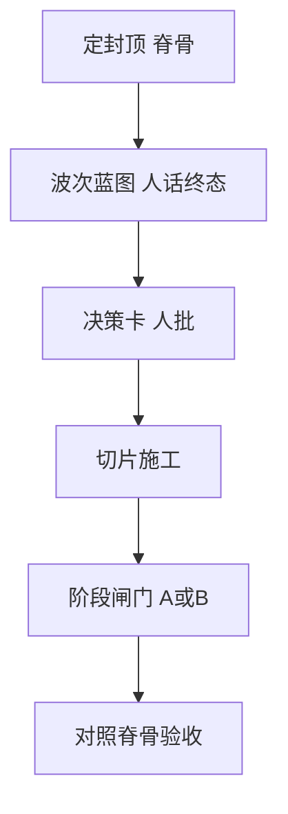
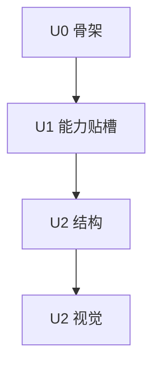

# 目标封顶 → 波次 → 切片落地流程

> **角色**：本仓产品/UI 抬天花板时的人审与施工合同（E0）。  
> **参考来源**：quantification 的脊骨/波次/U0·U1·U2 模型；**按本仓裁剪**，不引入 OpenSpec / Fast-lane / 厚卡机器轴。  
> **已有闸门**：麻将 Web UI 仍遵守阶段A设计冻结 / 阶段B实现一致性（见 `docs/majiang/WEB_UI_PRODUCT_INTERACTION_DESIGN.md`）。

## 为什么要定封顶

能力一刀刀加时，若不先钉「本页/本能力天花板」，会边做边胀范围。  
**定封顶** = 先写清「做到哪算毕业 + 硬不做」，再按波施工。



| 层 | 回答 | 给人还是给机器 |
|----|------|----------------|
| 脊骨（封顶账本） | 天花板、差距、切片 ID、硬不做 | 产品记忆 + Agent |
| 波次蓝图 | 本波故事、终态、UI 层、硬不做 | **给人审** |
| 决策卡 | 当前分叉拍板 | 聊天短确认 |
| 切片任务 | 本刀改什么、怎么验 | 执行清单 |
| 阶段A/B | 设计冻结 vs 实现一致 | 证据类型闸门 |

## 脊骨（目标封顶）

落盘：`docs/product/spines/<主题>-target.md`

必备小节：

1. **当前天花板**（一句话）  
2. **毕业标准**（可观察条目；Agent 不得自批毕业）  
3. **硬不做**  
4. **差距表 G1…** → 对应切片 ID  
5. **切片队列表**（状态：待做 / 施工中 / 已落地）  
6. **版式合同状态** / **观感合同状态**（可选；Web UI 必填）

当前主战场脊骨：[spines/majiang-webui-target.md](spines/majiang-webui-target.md)

## 波次蓝图

何时**必须**落盘 `docs/product/waves/<主题>-W<n>.md`：

- 抬天花板（改毕业线或新增真能力簇）  
- 一次跨 ≥2 切片  
- 改整页信息架构（U0）或开 U2·视觉  

蓝图最少字段：用户故事、终态效果、硬不做、本波 UI 层（U0/U1/U2·结构|视觉）、切片列表、施工状态。

纯文案 / 单文件小修 / 单测补强：**可免蓝图**，但仍须不偏离已批脊骨。

## UI 三层（叠在波次上）



- **U0**：区块、主次、空错忙；可低保真  
- **U1**：往约定槽塞能力；禁整页重排与美化混刀  
- **U2·结构**：减噪折叠；低保真可  
- **U2·视觉**：须高保真目标人批；功能绿 ≠ 视觉毕业  

## 与麻将阶段A/B 的衔接

| 本流程 | 阶段A 设计冻结 | 阶段B 实现一致性 |
|--------|----------------|------------------|
| U0 / U2·结构蓝图 | 可在 A 用线框/低保真过审 | — |
| U2·视觉 | A：高保真目标冻结 | B：实现对照目标图 |
| U1 能力 | A：交互合同；真规则仍在 core | B：DOM/状态/录屏证据 |
| 冲顶收官 | A 闸门未过不得宣视觉通过 | 功能自动化不得冒充视觉通过 |

## 切片施工节奏

1. `gate pre`（规范前门禁，可选注入任务描述）  
2. 读脊骨 + 本波蓝图（若有）+ 触发表对应规则  
3. 最小改动落地；UI 不重写 `core` 规则  
4. 按 `docs/standards/testing/quality.md` 回归  
5. 回写脊骨/蓝图状态（已落地 / 下一刀）  
6. `gate post`；用户要求再 commit（中文说明）

## 治理节奏（规则面）

| 节奏 | 动作 |
|------|------|
| 任务级 | 前 `gate pre` / 后 `gate post` |
| 日级 | `scan` +（有需求变更时）`fit` |
| 需求级 | 更新 `docs/standards/rule-evolution.md` |

脚本入口（本机 skill）：

```bash
bash ~/.claude/skills/project-standards-governance/scripts/standards_guard.sh gate pre
bash ~/.claude/skills/project-standards-governance/scripts/standards_guard.sh scan
bash ~/.claude/skills/project-standards-governance/scripts/standards_guard.sh fit
bash ~/.claude/skills/project-standards-governance/scripts/standards_guard.sh gate post
```

## 明确不做（相对 quantification）

- 不引入 `openspec/` 变更轴与 Fast-lane 门闩机  
- 不强制 worktree / 厚卡升格 / 自动 archive  
- 不挂 `standards/global` submodule（规则正文在本仓 `docs/standards/`）  

若将来单仓复杂度逼近量化仓，再单独立项升级，不在本封顶内偷扩。
