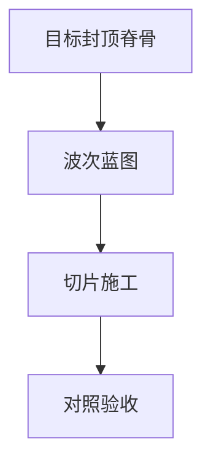

# Mermaid 语法规范

> **R1** — 画流程图 / 架构图 / 时序图时 **SHOULD Read**。

## 硬约束

1. **subgraph 必须用 ID**：`subgraph CFG["配置层"]`，禁止 `subgraph "配置层"`
2. **节点标签用双引号**：`A1["入口"]`；标签内禁止再嵌英文双引号（可用中文引号）
3. **避免裸特殊字符**：标签含 `[]`、`>>`、`&`、`/`、`:` 等时整段用双引号；`&` 写成 `&amp;`
4. **不用双向箭头** `<<->>`；改成两条单向箭头
5. **方向只在根图声明**：`flowchart TB` / `graph LR`；subgraph 内不写 `direction`
6. **优先可读**：节点名用人话；复杂关系拆多张小图，不堆一张巨图

## 推荐形态

