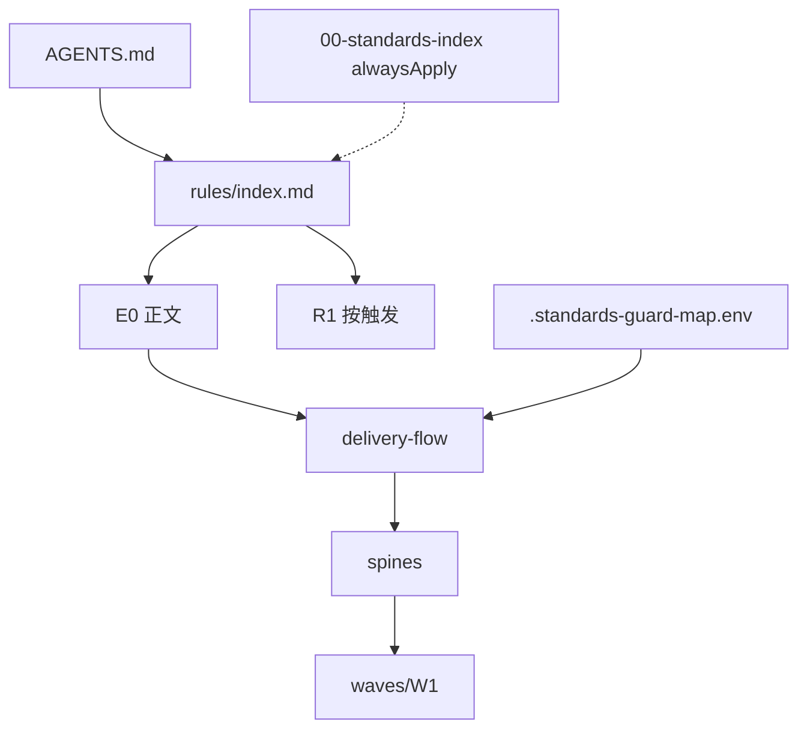

# majiang 规则面定封顶收口（W1）Implementation Plan

> **For agentic workers:** REQUIRED SUB-SKILL: Use superpowers:subagent-driven-development (recommended) or superpowers:executing-plans to implement this plan task-by-task. Steps use checkbox (`- [ ]`) syntax for tracking.

**Goal:** 把已批准设计 `docs/superpowers/specs/2026-11-15-majiang-standards-cap-design.md` 收成可验证终态：Agent 首读触发表、抬天花板必读 delivery-flow、IDE 只薄引读、功能绿≠视觉毕业写死，且门禁 `fit` 映射含 delivery-flow。

**Architecture:** 正文 SSOT 在 `docs/standards` + `docs/product`；`AGENTS.md` → `rules/index.md` 为首读链；Cursor 仅 `00-standards-index.mdc` alwaysApply；其余 IDE 入口转发；`standards_guard` 的 `WORKFLOW_RULE` 指向 `delivery-flow.md`。本批不改 `src/*/core/`，不夹带 prototype/acceptance。

**Tech Stack:** Markdown 规范面、Cursor `.mdc` 薄入口、`project-standards-governance`（`gate` / `fit`）、本仓 git（提交仅在你点名时）

## Global Constraints

- 不引入 `openspec/`、Fast-lane、厚卡升格机、强制 worktree
- 不挂 `standards/global` submodule（正文留在本仓）
- 本批不改 `src/*/core/` 规则语义
- 本批不夹带 `web-ui-prototype` / acceptance / backup / handoff 无关 diff
- 提交说明中文；仅当用户明确要求 commit 才提交
- 功能自动化绿 ≠ 视觉冲顶通过；Agent 不得自批视觉毕业

---

## File Structure

| 路径 | 职责 |
|------|------|
| `AGENTS.md` | 项目封顶：MUST Read 链、硬边界 |
| `docs/standards/rules/index.md` | 任务触发表 + 规则面封顶清单 |
| `docs/standards/rules/communication-for-beginners.md` | E0 沟通/决策卡 |
| `docs/standards/rules/commit-policy.md` | E0 提交 |
| `docs/standards/rules/security-baseline.md` | R1 安全 |
| `docs/standards/rules/mermaid-rules.md` | R1 图 |
| `docs/product/delivery-flow.md` | E0 定封顶→波次→切片 |
| `docs/product/spines/majiang-webui-target.md` | 毕业账本 |
| `docs/product/waves/majiang-webui-W1.md` | 本波合同 |
| `docs/standards/README.md` / `rule-evolution.md` | 索引与演进闭环 |
| `docs/standards/.standards-guard-map.env` | gate/scan/fit 规则映射 |
| `.cursor/rules/00-standards-index.mdc` | 唯一 alwaysApply 薄入口 |
| `.cursor/rules/shared-standards-entry.mdc` | 兼容转发，alwaysApply false |
| `.cursor/rules/git-automation-rules.mdc` | Git 薄入口，alwaysApply false |
| `.cursor/rules/desktop-commander-mcp-priority.mdc` | DC 薄入口，alwaysApply false |
| `.codex/AGENTS.md` / `.augment/rules/git-automation-rules.md` | 他 IDE 薄入口 |



---

### Task 1: 盘点正文齐全 + 修脊骨笔误

**Files:**
- Verify: `docs/standards/rules/index.md`
- Verify: `docs/standards/rules/communication-for-beginners.md`
- Verify: `docs/standards/rules/commit-policy.md`
- Verify: `docs/standards/rules/security-baseline.md`
- Verify: `docs/standards/rules/mermaid-rules.md`
- Verify: `docs/product/delivery-flow.md`
- Verify: `docs/product/spines/majiang-webui-target.md`
- Verify: `docs/product/waves/majiang-webui-W1.md`
- Modify: `docs/product/spines/majiang-webui-target.md`（`greenn` 笔误）

**Interfaces:**
- Consumes: 设计 §6 工作项 1
- Produces: 齐全的 E0/R1/product 正文；脊骨 GR-6 文案正确

- [ ] **Step 1: 写失败自检（缺文件则非零）**

在仓库根 `majiang1/` 运行：

```bash
missing=0
for f in \
  docs/standards/rules/index.md \
  docs/standards/rules/communication-for-beginners.md \
  docs/standards/rules/commit-policy.md \
  docs/standards/rules/security-baseline.md \
  docs/standards/rules/mermaid-rules.md \
  docs/product/delivery-flow.md \
  docs/product/spines/majiang-webui-target.md \
  docs/product/waves/majiang-webui-W1.md
do
  if [[ ! -f "$f" ]]; then echo "MISSING $f"; missing=1; fi
done
# 笔误应被检出为「未修好」
if rg -n 'greenn' docs/product/spines/majiang-webui-target.md; then
  echo "FAIL: greenn typo still present"; missing=1
fi
exit $missing
```

Expected: FAIL（至少因 `greenn` 仍在脊骨）

- [ ] **Step 2: 修脊骨笔误**

将 `docs/product/spines/majiang-webui-target.md` 中：

```markdown
| GR-6 | 功能自动化 greenn ≠ 可宣称视觉顶级通过 | 强制口径 |
```

改为：

```markdown
| GR-6 | 功能自动化 green ≠ 可宣称视觉顶级通过 | 强制口径 |
```

- [ ] **Step 3: 抽查关键口径（须全部命中）**

```bash
rg -n '功能自动化通过|功能绿|视觉冲顶|视觉毕业' \
  docs/standards/rules/communication-for-beginners.md \
  docs/product/delivery-flow.md \
  docs/product/spines/majiang-webui-target.md \
  AGENTS.md
rg -n 'openspec|Fast-lane|standards/global' docs/product/delivery-flow.md docs/product/waves/majiang-webui-W1.md
# 期望：openspec/Fast-lane 仅出现在「不引入」语境；无必读 openspec 路径
```

Expected: 沟通规范 / delivery-flow / 脊骨 / AGENTS 均含「功能绿≠视觉」口径；无「须读 openspec」

- [ ] **Step 4: 重跑 Step 1 自检**

Expected: PASS（`exit 0`，无 MISSING，无 greenn）

- [ ] **Step 5: Commit（仅当用户点名）**

```bash
git add docs/product/spines/majiang-webui-target.md
git commit -m "$(cat <<'EOF'
fix: 修正脊骨 GR-6 功能绿口径笔误

EOF
)"
```

若用户未点名 commit：跳过本步，仅记录待提交文件。

---

### Task 2: 对齐 AGENTS / README / rule-evolution / Codex·Augment 入口

**Files:**
- Verify/Modify: `AGENTS.md`
- Verify/Modify: `docs/standards/README.md`
- Verify/Modify: `docs/standards/rule-evolution.md`
- Verify/Modify: `.codex/AGENTS.md`
- Verify/Modify: `.augment/rules/git-automation-rules.md`

**Interfaces:**
- Consumes: Task 1 正文路径
- Produces: 入口链与触发表 MUST Read 一致；无 OpenSpec 必读

- [ ] **Step 1: 写失败自检（入口漂移检测）**

```bash
fail=0
# AGENTS 须指向触发表与 delivery-flow
rg -q 'docs/standards/rules/index\.md' AGENTS.md || { echo 'AGENTS missing index'; fail=1; }
rg -q 'docs/product/delivery-flow\.md' AGENTS.md || { echo 'AGENTS missing delivery-flow'; fail=1; }
rg -q '功能自动化通过' AGENTS.md || { echo 'AGENTS missing 功能绿口径'; fail=1; }
# Codex 薄入口
rg -q 'docs/standards/rules/index\.md' .codex/AGENTS.md || { echo 'codex missing index'; fail=1; }
# Augment 不得堆正文（行数粗检：正文文件通常远大于薄入口）
lines=$(wc -l < .augment/rules/git-automation-rules.md)
if [[ "$lines" -gt 40 ]]; then echo "augment git entry too thick: $lines lines"; fail=1; fi
# 禁止把 openspec 写成必读
if rg -n 'MUST Read.*openspec|必读.*openspec' AGENTS.md docs/standards .codex .augment 2>/dev/null; then
  echo 'FAIL: openspec marked MUST Read'; fail=1
fi
exit $fail
```

Expected: 若当前入口已对齐则 PASS；若 FAIL，按下列最小补丁改。

- [ ] **Step 2: 若 FAIL，对齐为下列最小内容（已对齐则跳过）**

`AGENTS.md` 规范读取要求须含（顺序可按现稿，路径不可少）：

```markdown
1. **首先**读取 `docs/standards/rules/index.md`（任务触发表）
4. **涉及抬天花板 / 波次 / 脊骨 / UI 层 U0·U1·U2 / 冲顶**：须 **MUST Read** `docs/product/delivery-flow.md`（E0）
```

硬边界须含：

```markdown
- 功能自动化通过 **≠** 视觉冲顶通过
```

`.codex/AGENTS.md` 须为薄引读，指向根 `AGENTS.md` + `index.md` + 按触发 `docs/product/delivery-flow.md`。

`.augment/rules/git-automation-rules.md` 只列路径，不复制 `git-mcp-automation.md` 正文。

`docs/standards/README.md` E0 行须含 `delivery-flow`；`rule-evolution.md` 映射项 6 须引用 `docs/product/delivery-flow.md`。

- [ ] **Step 3: 重跑 Step 1**

Expected: PASS

- [ ] **Step 4: Commit（仅当用户点名）**

```bash
git add AGENTS.md docs/standards/README.md docs/standards/rule-evolution.md \
  .codex/AGENTS.md .augment/rules/git-automation-rules.md
git commit -m "$(cat <<'EOF'
docs: 对齐规则面入口与 delivery-flow 演进映射

EOF
)"
```

---

### Task 3: Cursor 薄入口 — 仅 `00-standards-index` alwaysApply

**Files:**
- Create/Verify: `.cursor/rules/00-standards-index.mdc`
- Modify: `.cursor/rules/shared-standards-entry.mdc`
- Modify: `.cursor/rules/git-automation-rules.mdc`
- Modify: `.cursor/rules/desktop-commander-mcp-priority.mdc`

**Interfaces:**
- Consumes: 设计 §6 工作项 3
- Produces: 唯一 alwaysApply=`true` 的规范入口为 `00-standards-index.mdc`

- [ ] **Step 1: 写失败自检**

```bash
fail=0
# 00 必须 alwaysApply true
rg -A1 '^---' .cursor/rules/00-standards-index.mdc | rg -q 'alwaysApply: true' \
  || { echo '00 must alwaysApply true'; fail=1; }
# 其余三个必须 alwaysApply false
for f in shared-standards-entry.mdc git-automation-rules.mdc desktop-commander-mcp-priority.mdc; do
  if ! rg -q 'alwaysApply: false' ".cursor/rules/$f"; then
    echo "FAIL: $f should alwaysApply false"; fail=1
  fi
  if rg -q 'alwaysApply: true' ".cursor/rules/$f"; then
    echo "FAIL: $f still alwaysApply true"; fail=1
  fi
done
# 薄入口禁止超长正文（粗阈值）
for f in .cursor/rules/*.mdc; do
  n=$(wc -l < "$f")
  if [[ "$n" -gt 30 ]]; then echo "too thick: $f ($n lines)"; fail=1; fi
done
exit $fail
```

Expected: FAIL（当前 `git-automation-rules.mdc` 与 `desktop-commander-mcp-priority.mdc` 为 `alwaysApply: true`）

- [ ] **Step 2: 确保 `00-standards-index.mdc` 内容为**

```markdown
---
description: 本仓规范薄入口：先读任务触发表，再按需加载正文
alwaysApply: true
---

# 共享规范引读（Cursor）

本文件不承载规范正文。

1. **先读** `docs/standards/rules/index.md`（任务触发表）  
2. 再按触发加载对应 `docs/standards/rules/*.md` / `docs/product/*.md`  
3. 冲突以仓库根 `AGENTS.md` 与 `docs/standards/` 为准  

禁止在本文件追加大段规范正文。
```

- [ ] **Step 3: 改 `shared-standards-entry.mdc`**

```markdown
---
description: 兼容入口：转发到 00-standards-index
alwaysApply: false
---

# 共享规范引读（兼容）

请改用始终生效的 `.cursor/rules/00-standards-index.mdc`。  
正文入口：`docs/standards/rules/index.md`。
```

- [ ] **Step 4: 改 `git-automation-rules.mdc`（alwaysApply → false）**

```markdown
---
description: Git 自动化薄入口
alwaysApply: false
---

# Git MCP 自动化（入口引读）

不承载正文。请读：
- `docs/standards/rules/commit-policy.md`（E0）
- `docs/standards/rules/git-mcp-automation.md`

冲突以 `AGENTS.md` 与 `docs/standards/` 为准。
```

- [ ] **Step 5: 改 `desktop-commander-mcp-priority.mdc`（alwaysApply → false）**

```markdown
---
description: Desktop Commander 薄入口
alwaysApply: false
---

# Desktop Commander MCP（入口引读）

不承载正文。请读：
- `docs/standards/rules/desktop-commander-mcp-priority.md`
- `docs/standards/rules/index.md`

冲突以 `AGENTS.md` 与 `docs/standards/` 为准。
```

- [ ] **Step 6: 重跑 Step 1**

Expected: PASS

- [ ] **Step 7: Commit（仅当用户点名）**

```bash
git add .cursor/rules/00-standards-index.mdc \
  .cursor/rules/shared-standards-entry.mdc \
  .cursor/rules/git-automation-rules.mdc \
  .cursor/rules/desktop-commander-mcp-priority.mdc
git commit -m "$(cat <<'EOF'
chore: Cursor 规范入口仅保留 00 alwaysApply

EOF
)"
```

---

### Task 4: 触发表 ↔ AGENTS 一致 + `WORKFLOW_RULE` 映射 delivery-flow

**Files:**
- Verify: `docs/standards/rules/index.md`
- Modify: `docs/standards/.standards-guard-map.env`

**Interfaces:**
- Consumes: Task 2 的 MUST Read 路径
- Produces: `WORKFLOW_RULE=docs/product/delivery-flow.md`；触发表 E0 与 AGENTS 对齐

- [ ] **Step 1: 写失败自检**

```bash
fail=0
# 触发表 E0 三件套
for needle in communication-for-beginners commit-policy delivery-flow; do
  rg -q "$needle" docs/standards/rules/index.md || { echo "index missing $needle"; fail=1; }
done
# 映射须含 WORKFLOW_RULE → delivery-flow
if ! rg -q '^WORKFLOW_RULE=docs/product/delivery-flow\.md$' docs/standards/.standards-guard-map.env; then
  echo 'FAIL: WORKFLOW_RULE not mapped to delivery-flow'; fail=1
fi
exit $fail
```

Expected: FAIL（当前 `.standards-guard-map.env` 无 `WORKFLOW_RULE`）

- [ ] **Step 2: 更新映射文件为**

```bash
# docs/standards/.standards-guard-map.env
DEV_RULE=docs/standards/rules/development.md
GIT_RULE=docs/standards/rules/git-mcp-automation.md
MCP_RULE=docs/standards/rules/desktop-commander-mcp-priority.md
TEST_RULE=docs/standards/testing/quality.md
WORKFLOW_RULE=docs/product/delivery-flow.md
```

保留文件头注释即可；键值以上列为准。

- [ ] **Step 3: 确认 `index.md` 触发表含 delivery-flow E0 行**（已有则跳过编辑）

```markdown
| 抬天花板 / 波次 / 脊骨 / 页级毕业 / UI 层 U0·U1·U2 / 冲顶收官 | [../../product/delivery-flow.md](../../product/delivery-flow.md) | **MUST Read** | E0 |
```

- [ ] **Step 4: 重跑 Step 1**

Expected: PASS

- [ ] **Step 5: Commit（仅当用户点名）**

```bash
git add docs/standards/.standards-guard-map.env docs/standards/rules/index.md
git commit -m "$(cat <<'EOF'
chore: fit/gate 映射 WORKFLOW_RULE 到 delivery-flow

EOF
)"
```

---

### Task 5: 门禁验证 gate pre → fit → gate post + 人工首读链

**Files:**
- 无新增源码；产出：门禁报告 / 终端日志
- 可选：`logs/` 下 governance 报告（若脚本写入）

**Interfaces:**
- Consumes: Task 1–4 终态
- Produces: 设计 §7 验证通过证据

- [ ] **Step 1: 前门禁**

```bash
cd /Users/felix/Desktop/AIUse/majiang/majiang1
STANDARDS_GUARD_TASK="W1 规则面定封顶收口：触发表+delivery-flow+薄入口" \
  bash ~/.claude/skills/project-standards-governance/scripts/standards_guard.sh gate pre
```

Expected: 退出码 0 或报告可执行；映射引用含 `delivery-flow` / 已装载规则路径

- [ ] **Step 2: fit**

```bash
bash ~/.claude/skills/project-standards-governance/scripts/standards_guard.sh fit
```

Expected: 不因缺失 `delivery-flow` / `rule-evolution` 映射失败；若有「未映射」项，仅允许与本波硬不做无关的历史债务，并记入输出

- [ ] **Step 3: 后门禁**

```bash
STANDARDS_GUARD_TASK="W1 规则面定封顶收口" \
  bash ~/.claude/skills/project-standards-governance/scripts/standards_guard.sh gate post
```

Expected: 变更文件不违规堆正文进 `.mdc`；无高风险 git 命令引入

- [ ] **Step 4: 人工抽查首读链**

打开并确认：

1. `AGENTS.md` → 第一条指向 `docs/standards/rules/index.md`
2. `index.md` → delivery-flow 为 E0
3. W1 终态与 `docs/product/waves/majiang-webui-W1.md` 切片 `MJ-STD-01`/`MJ-STD-02` 一致
4. 工作区无关脏文件未进暂存：`docs/majiang/web-ui-prototype/**`、`scripts/test/majiang-webui-acceptance.js`、`docs/handoff-*`、`*.backup`

```bash
git status --short
# 允许的规则面路径示例见 Task 6；下列若出现在「拟提交」必须剔除：
# docs/majiang/web-ui-prototype/
# scripts/test/majiang-webui-acceptance.js
# docs/handoff-
# docs/requirements/（除非本波明确需要且人批）
```

- [ ] **Step 5: 无需代码 commit**（验证任务）；若门禁改了报告文件且用户要求纳入，另议

---

### Task 6: 规则面一次性收口提交（仅用户点名）

**Files:**
- Stage 仅下列（存在则加；不存在跳过）：

```
AGENTS.md
docs/standards/README.md
docs/standards/rule-evolution.md
docs/standards/rules/index.md
docs/standards/rules/commit-policy.md
docs/standards/rules/communication-for-beginners.md
docs/standards/rules/mermaid-rules.md
docs/standards/rules/security-baseline.md
docs/standards/rules/development.md
docs/standards/rules/git-mcp-automation.md
docs/standards/.standards-guard-map.env
docs/product/delivery-flow.md
docs/product/spines/majiang-webui-target.md
docs/product/waves/majiang-webui-W1.md
docs/superpowers/specs/2026-11-15-majiang-standards-cap-design.md
docs/superpowers/plans/2026-11-15-majiang-standards-cap.md
.cursor/rules/00-standards-index.mdc
.cursor/rules/shared-standards-entry.mdc
.cursor/rules/git-automation-rules.mdc
.cursor/rules/desktop-commander-mcp-priority.mdc
.codex/AGENTS.md
.augment/rules/git-automation-rules.md
```

**Interfaces:**
- Consumes: Task 1–5 全部 PASS
- Produces: 单次或分次中文 commit；工作区无关 diff 仍保持未暂存

- [ ] **Step 1: 确认用户明确要求 commit** — 未要求则停止，列出将提交路径请用户确认

- [ ] **Step 2: 暂存白名单**

```bash
git add -- \
  AGENTS.md \
  docs/standards/README.md \
  docs/standards/rule-evolution.md \
  docs/standards/rules/index.md \
  docs/standards/rules/commit-policy.md \
  docs/standards/rules/communication-for-beginners.md \
  docs/standards/rules/mermaid-rules.md \
  docs/standards/rules/security-baseline.md \
  docs/standards/rules/development.md \
  docs/standards/rules/git-mcp-automation.md \
  docs/standards/.standards-guard-map.env \
  docs/product/delivery-flow.md \
  docs/product/spines/majiang-webui-target.md \
  docs/product/waves/majiang-webui-W1.md \
  docs/superpowers/specs/2026-11-15-majiang-standards-cap-design.md \
  docs/superpowers/plans/2026-11-15-majiang-standards-cap.md \
  .cursor/rules/00-standards-index.mdc \
  .cursor/rules/shared-standards-entry.mdc \
  .cursor/rules/git-automation-rules.mdc \
  .cursor/rules/desktop-commander-mcp-priority.mdc \
  .codex/AGENTS.md \
  .augment/rules/git-automation-rules.md
git status --short
# 确认无 prototype / acceptance / backup / handoff 出现在 staged
```

- [ ] **Step 3: 提交**

```bash
git commit -m "$(cat <<'EOF'
docs: 落地规则面定封顶与交付流程触发表

对齐 AGENTS→index→delivery-flow，Cursor 仅 00 alwaysApply，
并写入 fit 的 WORKFLOW_RULE 映射；不含 UI prototype 无关变更。

EOF
)"
```

- [ ] **Step 4: 验证**

```bash
git status --short
# staged 应空；prototype/acceptance 若仍 modified 可保留为未提交
```

---

## Spec Coverage（自检）

| 设计要求 | 任务 |
|----------|------|
| Agent 首读触发表 | Task 2、5 |
| 抬天花板读 delivery-flow | Task 2、4 |
| 规则可演进（触发表 + rule-evolution） | Task 2、4 |
| IDE 薄入口不漂移 | Task 3 |
| 功能绿 ≠ 视觉毕业 | Task 1、2 |
| 硬不做 OpenSpec / submodule / core | Global + Task 5/6 排除 |
| 工作项 1 正文齐全 | Task 1 |
| 工作项 2 入口对齐 | Task 2 |
| 工作项 3 Cursor alwaysApply | Task 3 |
| 工作项 4 自检 + fit 含 delivery-flow | Task 4、5 |
| 工作项 5 提交范围 | Task 6 |
| 验证 gate/fit | Task 5 |

## Placeholder scan

无 TBD/TODO；命令与期望输出已写死。

## Type / path consistency

- 触发表、`AGENTS`、`WORKFLOW_RULE`、脊骨/波次路径统一为 `docs/product/delivery-flow.md`
- Cursor 唯一 `alwaysApply: true`：`00-standards-index.mdc`
