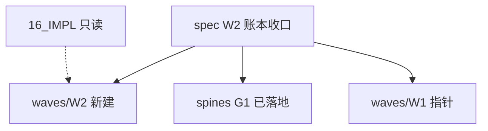

# 麻将 Web UI · W2（G1 动作层账本收口）Implementation Plan

> **For agentic workers:** REQUIRED SUB-SKILL: Use superpowers:subagent-driven-development (recommended) or superpowers:executing-plans to implement this plan task-by-task. Steps use checkbox (`- [ ]`) syntax for tracking.

**Goal:** 按已批准设计 `docs/superpowers/specs/2026-11-15-majiang-webui-w2-g1-ledger-design.md`，把脊骨 G1 与 R2/16_IMPL「动作层已通过」对齐，并落盘 W2 账本合同；零界面代码变更。

**Architecture:** 只改 `docs/product/` 账本三处：新建 W2 波次蓝图、脊骨 G1→已落地 + §6 下一刀、W1 下一波指针。证据只引用 `16_HIFI_IMPL_COMPETITOR_REVIEW_20260917.md`，不改正文。用 shell 自检 + `gate pre/post` 验收。

**Tech Stack:** Markdown 产品账本、`project-standards-governance`（gate）、本仓 git（提交仅用户点名）

## Global Constraints

- 本批 **零** `docs/majiang/web-ui-prototype/**` 与 `src/**` 变更
- 不改动作层 DOM/CSS/键盘绑定；不上牌面 sprite（G2）；不开移动端（G4）
- 不宣称整桌视觉冲顶已毕业 / 无条件竞品级
- 不引入 OpenSpec / Fast-lane；不改 `src/*/core/` 规则语义
- 提交说明中文；**仅当用户明确要求 commit 才提交**
- 功能自动化绿 ≠ 视觉冲顶通过；Agent 不得自批视觉毕业

---

## File Structure

| 路径 | 职责 |
|------|------|
| `docs/product/waves/majiang-webui-W2.md` | W2 账本合同（新建） |
| `docs/product/spines/majiang-webui-target.md` | G1 状态 + §6 下一刀 |
| `docs/product/waves/majiang-webui-W1.md` | 「下一波」指向 W2 |
| `docs/superpowers/specs/2026-11-15-majiang-webui-w2-g1-ledger-design.md` | 设计 SSOT（只读） |
| `docs/majiang/design-freeze/stage-a-2026-05-10/16_HIFI_IMPL_COMPETITOR_REVIEW_20260917.md` | 动作层通过证据（只读引用） |



---

### Task 1: 新建 W2 波次蓝图

**Files:**
- Create: `docs/product/waves/majiang-webui-W2.md`
- Verify: `docs/product/waves/majiang-webui-W1.md`（对照字段风格）
- Read-only: `docs/majiang/design-freeze/stage-a-2026-05-10/16_HIFI_IMPL_COMPETITOR_REVIEW_20260917.md`

**Interfaces:**
- Consumes: 设计 §5 蓝图字段；W1 蓝图版式
- Produces: 可人审的 W2 合同文件（路径固定如上）

- [ ] **Step 1: 写失败自检（W2 尚不存在则应非零）**

在仓库根 `majiang1/` 运行：

```bash
if [[ -f docs/product/waves/majiang-webui-W2.md ]]; then
  echo "UNEXPECTED: W2 already exists"; exit 1
fi
echo "OK: W2 missing (ready to create)"; exit 0
```

Expected: `OK: W2 missing`；若已存在则先读内容，仅当缺字段再补，勿盲目覆盖。

- [ ] **Step 2: 创建 W2 蓝图（全文如下）**

写入 `docs/product/waves/majiang-webui-W2.md`：

```markdown
# 波次蓝图：麻将 Web UI · W2（G1 动作层账本收口）

| 字段 | 内容 |
|------|------|
| 主题 | majiang-webui |
| 波次 | W2 |
| UI 层 | U2·视觉 · **账本收口**（无 DOM/CSS 施工） |
| 施工状态 | **账本已落盘** |
| 脊骨 | `docs/product/spines/majiang-webui-target.md` |
| 证据 | `docs/majiang/design-freeze/stage-a-2026-05-10/16_HIFI_IMPL_COMPETITOR_REVIEW_20260917.md`（动作层 R2 实现验收已关） |

## 用户故事

作为协作者，我希望脊骨上的 G1 与实现验收一致：动作层胶囊/印章条已关闭，不再被误开成大改视觉刀。

## 终态效果

- 脊骨差距表 G1 = **已落地**；切片 `MJ-UI-ACT-01` 账本关闭
- 本文件硬不做可查：禁止退回圆钮 HUD / 深色 Web 工具条；禁止宣称整桌视觉毕业
- 下一刀默认排队 G2 或 G4，**须人点名开波**后再施工

## 硬不做

- 不改 `docs/majiang/web-ui-prototype/` 动作层样式 / DOM / 键盘绑定
- 不退回圆钮 HUD 或深色 Web 工具条
- 不上牌面 sprite（属 G2）；不开移动端目标帧（属 G4）
- 不改 `src/*/core/` 规则语义
- 不宣称「整桌视觉冲顶已毕业」或「无条件竞品级」
- 不引入 OpenSpec / Fast-lane

## 本波切片

| 切片 | 内容 | 状态 |
|------|------|------|
| `MJ-UI-ACT-01` | 动作层向竞品胶囊/印章条收敛 — 账本对齐 16_IMPL 通过结论 | **账本关闭** |

## 下一波

默认候选：**G2** `MJ-UI-TILE-01`（牌面）或 **G4** `MJ-UI-MOBILE-01`（移动端）；须新人审蓝图后再施工。
```

- [ ] **Step 3: 自检关键字段命中**

```bash
f=docs/product/waves/majiang-webui-W2.md
missing=0
for needle in 'W2' '账本已落盘' 'MJ-UI-ACT-01' '圆钮' '深色 Web 工具条' '整桌视觉' 'G2' 'G4'; do
  if ! rg -q --fixed-strings "$needle" "$f"; then
    echo "MISSING: $needle"; missing=1
  fi
done
exit $missing
```

Expected: exit 0

- [ ] **Step 4: Commit（仅当用户点名）**

未点名则跳过。若点名：

```bash
git add docs/product/waves/majiang-webui-W2.md
git commit -m "$(cat <<'EOF'
docs(product): 新增 W2 波次蓝图（G1 动作层账本收口）

EOF
)"
```

---

### Task 2: 更新脊骨 G1 + §6 下一刀

**Files:**
- Modify: `docs/product/spines/majiang-webui-target.md`
- Read-only: `docs/product/waves/majiang-webui-W2.md`

**Interfaces:**
- Consumes: W2 终态口径；设计 §6
- Produces: 脊骨 G1=`已落地`；§6 指向 G2 或 G4（须人点名）

- [ ] **Step 1: 写失败自检（当前应仍为「进行中/残余」）**

```bash
if rg -n 'G1.*进行中/残余|进行中/残余.*MJ-UI-ACT-01' docs/product/spines/majiang-webui-target.md; then
  echo "OK: G1 still marked in-progress (ready to update)"; exit 0
fi
if rg -n '\| G1 \|.*\| 已落地 \|' docs/product/spines/majiang-webui-target.md; then
  echo "ALREADY: G1 already 已落地 — verify §6 then skip edit"; exit 0
fi
echo "FAIL: unexpected G1 row"; exit 1
```

Expected: `OK: G1 still marked…` 或 `ALREADY…`

- [ ] **Step 2: 改差距表 G1 状态列**

将脊骨 §4 表中 G1 行的状态从 `进行中/残余` 改为 `已落地`。保留摘要「动作层向竞品胶囊/印章条收敛」与切片 `MJ-UI-ACT-01`。

目标行形态：

```markdown
| G1 | 动作层向竞品胶囊/印章条收敛 | U2·视觉 | `MJ-UI-ACT-01` | 已落地 |
```

- [ ] **Step 3: 改 §6 下一刀建议**

将 §6 替换为：

```markdown
## 6. 下一刀建议

G1 动作层账本已与 `16_…IMPL` 对齐关闭。默认下一刀排队 **G2 牌面**（`MJ-UI-TILE-01`）或 **G4 移动端**（`MJ-UI-MOBILE-01`）；**须人点名开波**后再施工。  
禁止默认改推「换游戏页 / 只做无关美化 / 重开动作层大改」除非人点名。  
整桌观感合同不变：R2 有条件通过；**不得**因本波宣称视觉冲顶毕业。
```

- [ ] **Step 4: 确认 GR-4 / 观感合同未误抬**

```bash
rg -n 'GR-4|观感合同|整桌' docs/product/spines/majiang-webui-target.md
```

Expected: GR-4 仍含「整桌未满分」类表述；观感合同仍为有条件 / 未毕业。若被误改成满分，立刻改回。

- [ ] **Step 5: 自检**

```bash
missing=0
rg -q '\| G1 \|.*\| 已落地 \|' docs/product/spines/majiang-webui-target.md || { echo 'FAIL G1'; missing=1; }
rg -q 'G2|G4' docs/product/spines/majiang-webui-target.md || { echo 'FAIL §6 G2/G4'; missing=1; }
rg -q '须人点名' docs/product/spines/majiang-webui-target.md || { echo 'FAIL 人点名'; missing=1; }
# 不得残留「进行中/残余」在 G1 行
if rg -n '^\| G1 \|.*进行中' docs/product/spines/majiang-webui-target.md; then
  echo 'FAIL: G1 still 进行中'; missing=1
fi
exit $missing
```

Expected: exit 0

- [ ] **Step 6: Commit（仅当用户点名）**

```bash
git add docs/product/spines/majiang-webui-target.md
git commit -m "$(cat <<'EOF'
docs(product): 脊骨 G1 标为已落地并更新下一刀

EOF
)"
```

---

### Task 3: 更新 W1 下一波指针 + 门禁验收

**Files:**
- Modify: `docs/product/waves/majiang-webui-W1.md`
- Verify: 三文件一致性 + gate

**Interfaces:**
- Consumes: W2 路径已存在；脊骨 G1 已落地
- Produces: W1→W2 指针；gate 通过；diff 无 prototype/src

- [ ] **Step 1: 改 W1「下一波」小节**

将 `docs/product/waves/majiang-webui-W1.md` 末尾「下一波」替换为：

```markdown
## 下一波

已开 **W2**（G1 动作层账本收口）：`docs/product/waves/majiang-webui-W2.md`。  
其后默认候选 G2 / G4；须再人审蓝图后施工。
```

- [ ] **Step 2: 全量账本自检**

```bash
missing=0
[[ -f docs/product/waves/majiang-webui-W2.md ]] || { echo 'MISSING W2'; missing=1; }
rg -q '\| G1 \|.*\| 已落地 \|' docs/product/spines/majiang-webui-target.md || { echo 'FAIL G1'; missing=1; }
rg -q 'majiang-webui-W2' docs/product/waves/majiang-webui-W1.md || { echo 'FAIL W1 pointer'; missing=1; }
# 工作区不得出现本波对 prototype/src 的修改意图：检查未提交 diff
if git diff --name-only -- docs/majiang/web-ui-prototype src 2>/dev/null | rg -q .; then
  echo 'FAIL: unexpected prototype/src diff'; missing=1
fi
exit $missing
```

Expected: exit 0

- [ ] **Step 3: gate pre / post**

```bash
STANDARDS_GUARD_TASK="W2 G1 动作层账本收口" \
  bash ~/.claude/skills/project-standards-governance/scripts/standards_guard.sh gate pre
STANDARDS_GUARD_TASK="W2 G1 动作层账本收口" \
  bash ~/.claude/skills/project-standards-governance/scripts/standards_guard.sh gate post
```

Expected: 报告「检查结论」为 **通过**（允许仅有 logs 报告文件变更）

- [ ] **Step 4: 人工三抽查（执行者自检清单）**

1. 脊骨 G1 = 已落地  
2. W2 硬不做含圆钮 / 深色工具条 / 整桌毕业禁令  
3. `git diff --stat` 仅 `docs/product/**`（及既有 spec/plan）；无 `web-ui-prototype` / `src`

- [ ] **Step 5: Commit（仅当用户点名；可一次收口）**

白名单示例：

```bash
git add \
  docs/product/waves/majiang-webui-W2.md \
  docs/product/waves/majiang-webui-W1.md \
  docs/product/spines/majiang-webui-target.md \
  docs/superpowers/specs/2026-11-15-majiang-webui-w2-g1-ledger-design.md \
  docs/superpowers/plans/2026-11-15-majiang-webui-w2-g1-ledger.md
git commit -m "$(cat <<'EOF'
docs(product): W2 收口 G1 动作层账本与脊骨状态

对齐 16_IMPL 动作层已通过结论；禁止误开动作层大改或宣称整桌视觉毕业。
EOF
)"
```

勿加入 `logs/standards-governance-report.md`（除非用户要求）。

---

## Spec coverage（自检）

| 设计要求 | 任务 |
|----------|------|
| 新建 W2 蓝图 | Task 1 |
| 脊骨 G1 已落地 + §6 | Task 2 |
| W1 指针 → W2 | Task 3 |
| 硬不做 / 零界面 diff | Global + Task 1/3 自检 |
| gate + 人工抽查 | Task 3 |
| 提交仅用户点名 | 各 Task 最后一步 |
