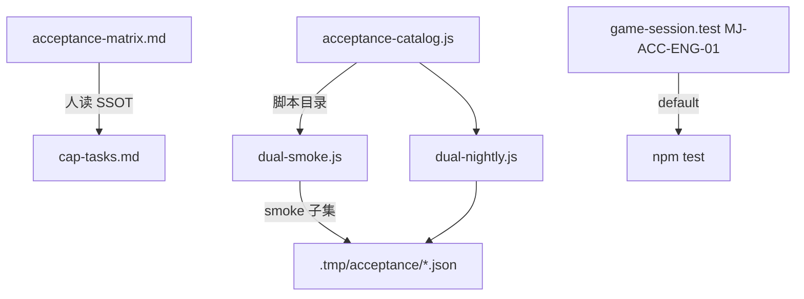

# 麻将双表面功能验收挂测脚手架 Implementation Plan

> **For agentic workers:** REQUIRED SUB-SKILL: Use superpowers:subagent-driven-development (recommended) or superpowers:executing-plans to implement this plan task-by-task. Steps use checkbox (`- [ ]`) syntax for tracking.

**Goal:** 落地双表面功能验收的「矩阵 SSOT + CAP 一本账引用 + ENG-01 挂测 + smoke/nightly 三档脚手架」，使未落地行可显式 skip、已落地失败必须红；不在本计划实现 SNAP/CLI/API/WEB 能力本体。

**Architecture:** 人读账本在 `docs/product/caps/majiang-dual-surface-acceptance-matrix.md`；施工仍只扩 `majiang-dual-surface-cap-tasks.md`。代码侧用 `scripts/test/majiang-dual-acceptance-catalog.js` 作为脚本可读的能力目录（与矩阵八行 ID 一一对应），由 `majiang-dual-smoke.js` / `majiang-dual-nightly.js` 按档位执行或 skip，并写 `.tmp/acceptance/` 报告（已在 `.gitignore`）。default 档继续走 `npm test`；本计划只给 `game-session.test.ts` 打上 `MJ-ACC-ENG-01` 标注。

**Tech Stack:** Markdown 账本、Node.js 脚本、Mocha + Chai（现有 `npm test`）、可选写 JSON 报告；不新增 npm 依赖。

**规格：** `docs/superpowers/specs/2026-11-17-majiang-dual-surface-acceptance-design.md`

## Global Constraints

- 不改 `src/majiang/core/` 胡吃碰杠/计分权威语义
- 功能自动化绿 ≠ 视觉冲顶；不重开已毕业 `CAP-UI-*`
- `npm test` 只跑 default；禁止把长训 / 必依赖浏览器塞进 default
- 未落地依赖 CAP：skip，不算回归红；已挂测断言失败必须红，禁止放宽装绿
- 一本账：缺口只扩展 `majiang-dual-surface-cap-tasks.md`，不另开平行测试任务表
- 禁止 Agent 自批 `CAP-DUAL-GRAD`；本计划**不**把 `CAP-ACC-DUAL` 标成已落地
- 提交说明中文；仅当用户明确要求 commit 才提交（计划 Step 里的 commit 在用户授权前改为「列出暂存文件，等用户点名再 commit」）
- 本计划范围 = 验收脚手架（规格 §9 第 1–4 步）；SNAP→CLI→API→WEB→ACC 能力实现仍服从 CAP 批序，另开计划

---

## File Structure

| 路径 | 职责 |
|------|------|
| `docs/product/caps/majiang-dual-surface-acceptance-matrix.md` | 功能矩阵 SSOT（八行 + 完整封顶标准） |
| `docs/product/caps/majiang-dual-surface-cap-tasks.md` | 各 CAP 封顶线补「须挂 MJ-ACC-*」 |
| `docs/product/spines/majiang-dual-surface-target.md` | GR-D7 注明矩阵/脚本已挂脚手架（能力仍待做） |
| `tests/majiang/game-session.test.ts` | describe/it 标注 `MJ-ACC-ENG-01` |
| `tests/majiang/dual-acceptance-catalog.test.ts` | 断言 catalog ID/档位与规格八行一致 |
| `scripts/test/majiang-dual-acceptance-catalog.js` | 八行能力目录 + skip/run 判定 |
| `scripts/test/majiang-dual-smoke.js` | smoke 档执行器 + JSON 报告 |
| `scripts/test/majiang-dual-nightly.js` | nightly 档执行器 + JSON 报告 |
| `package.json` | `majiang:dual:smoke` / `majiang:dual:nightly` |



**本计划不做：** `CAP-ENG-SNAP` / `CAP-CLI-TRAIN` / `CAP-API-GAME` / `CAP-WEB-*` 实现；Playwright 真跑 WEB；把矩阵行标「已绿」除非本计划已真正挂测（仅 ENG-01 → `已挂测`/`已绿`）。

---

### Task 1: 落盘功能矩阵 SSOT（八行完整封顶）

**Files:**
- Create: `docs/product/caps/majiang-dual-surface-acceptance-matrix.md`
- Modify: `docs/product/caps/majiang-dual-surface-cap-tasks.md`（页眉加矩阵链接一行即可；封顶线细化在 Task 2）

**Interfaces:**
- Consumes: 规格 §6.1–§6.2、§8
- Produces: 矩阵文件路径与八个稳定 ID：`MJ-ACC-ENG-01` … `MJ-ACC-DUAL-01`

- [ ] **Step 1: 创建矩阵文件**

写入 `docs/product/caps/majiang-dual-surface-acceptance-matrix.md`（全文如下，勿删字段）：

```markdown
# 麻将双表面 — 功能验收矩阵（SSOT）

> **角色**：目标态能力清单与封顶标准；测试/脚本/报告统一引用 `MJ-ACC-*`。  
> **施工账本**：缺口升格只写入 `majiang-dual-surface-cap-tasks.md`（一本账）。  
> **规格**：`docs/superpowers/specs/2026-11-17-majiang-dual-surface-acceptance-design.md`  
> **脊骨**：`docs/product/spines/majiang-dual-surface-target.md`  
> **质量**：`docs/standards/testing/quality.md`

## 1. 字段说明

| 字段 | 含义 |
|------|------|
| `MJ-ACC-*` | 能力 ID |
| 能力 | 人话一句话 |
| 封顶标准 | 可观察通过条件 |
| 档位 | `default` / `smoke` / `nightly` |
| 依赖 CAP | 未绿则 skip 或标待实现 |
| 状态 | `待实现` / `已挂测` / `已绿` / `人批` |

## 2. 总表

| ID | 能力 | 档位 | 依赖 CAP | 状态 |
|----|------|------|----------|------|
| `MJ-ACC-ENG-01` | 无头 Session 开局→步进→终局 | default | `CAP-ENG-SESSION` | 已绿 |
| `MJ-ACC-SNAP-01` | 快照可喂 view-model；动作来自引擎 | default | `CAP-ENG-SNAP` | 待实现 |
| `MJ-ACC-CLI-01` | 自动对弈入口走 Session | default | `CAP-CLI-TRAIN` | 待实现 |
| `MJ-ACC-CLI-02` | N 局统计可重复 | nightly | `CAP-CLI-TRAIN` | 待实现 |
| `MJ-ACC-API-01` | 对局 API 权威在服务端 | smoke | `CAP-API-GAME` | 待实现 |
| `MJ-ACC-WEB-01` | 人测主链路完局 | smoke | `CAP-WEB-BRIDGE`（大厅依赖 `CAP-WEB-LOBBY`） | 待实现 |
| `MJ-ACC-WEB-02` | 非法动作被拒且不脏写 | smoke | `CAP-API-GAME` + `CAP-WEB-BRIDGE` | 待实现 |
| `MJ-ACC-DUAL-01` | 双表面同引擎契约可重复 | smoke | `CAP-ACC-DUAL` | 待实现 |

## 3. 封顶标准正文

### `MJ-ACC-ENG-01`

- **通过**：`GameSession.create({ mode: 'auto' })` 后 `runFullRound()`，`getState() === ENDED`；无 readline 硬耦合。
- **挂测**：`tests/majiang/game-session.test.ts`；档位 default（含于 `npm test`）。
- **依赖**：`CAP-ENG-SESSION` 已落地。

### `MJ-ACC-SNAP-01`

- **通过**：快照含 phase、seats、selfHand、discardRiver、availableActions、resultSummary 等可喂 `createTableViewModelFromSnapshot`；`availableActions` 非前端自造。
- **挂测（落地后）**：`tests/majiang/**` default 用例标注本 ID。
- **未落地**：skip；状态保持 `待实现`。

### `MJ-ACC-CLI-01`

- **通过**：自动对弈短路径走 Session，可断言终局；不依赖 readline 硬耦合。
- **挂测（落地后）**：default 用例标注本 ID。
- **未落地**：skip。

### `MJ-ACC-CLI-02`

- **通过**：固定配置下 N 局输出含局数与统计字段形状稳定（可固定种子）；不进 `npm test`。
- **挂测（落地后）**：`npm run majiang:dual:nightly`。
- **未落地**：nightly 显式 skip。

### `MJ-ACC-API-01`

- **通过**：`POST /games`、`GET /games/:id`、`POST /games/:id/actions` 可用；状态以服务端 Session 为准。
- **挂测（落地后）**：`npm run majiang:dual:smoke`。
- **未落地**：smoke 显式 skip。

### `MJ-ACC-WEB-01`

- **通过**：大厅开局→出牌→AI 回手→结算；无假 `waiting_ai` 死等。
- **挂测（落地后）**：smoke（Playwright 类路径）；禁止前端自造规则。
- **未落地**：smoke 显式 skip。

### `MJ-ACC-WEB-02`

- **通过**：提交非法动作被拒后，服务端/会话状态不脏写。
- **挂测（落地后）**：smoke。
- **未落地**：smoke 显式 skip。

### `MJ-ACC-DUAL-01`

- **通过**：同一 Session 契约被 CLI 与 API 共用的可观察证据 + smoke 可重复；且约定 default 子集（至少 ENG-01，落地后含 SNAP/CLI-01）已绿。
- **挂测（落地后）**：`CAP-ACC-DUAL` 收束；不替代各能力 CAP。
- **未落地**：smoke 显式 skip；禁止装绿。

## 4. 跳过 / 失败

| 情况 | 行为 |
|------|------|
| 依赖 CAP 未落地 | skip；矩阵 `待实现`；不算回归红 |
| 已落地但断言失败 | 必须红 |
| 随机 / 多局长训 | 仅 nightly |
| `npm test` | 只跑 default |

## 5. 脚本入口

| 档位 | 命令 |
|------|------|
| default | `npm test` |
| smoke | `npm run majiang:dual:smoke` |
| nightly | `npm run majiang:dual:nightly` |
```

- [ ] **Step 2: CAP 表页眉挂矩阵链接**

在 `docs/product/caps/majiang-dual-surface-cap-tasks.md` 页眉「规格」行下增加：

```markdown
> **验收矩阵**：`docs/product/caps/majiang-dual-surface-acceptance-matrix.md`
```

- [ ] **Step 3: 人工核对**

确认矩阵恰好八行 ID，且与规格 §6.2 一致；ENG-01 状态为「已绿」，其余「待实现」。

- [ ] **Step 4: 暂存说明（等用户授权再 commit）**

```bash
git add docs/product/caps/majiang-dual-surface-acceptance-matrix.md docs/product/caps/majiang-dual-surface-cap-tasks.md
# 用户授权后：
# git commit -m "$(cat <<'EOF'
# docs(majiang): 落盘双表面功能验收矩阵 SSOT
#
# 建立 MJ-ACC-* 能力账本，与 CAP 施工表一本账衔接。
# EOF
# )"
```

---

### Task 2: CAP 封顶线补「须挂 MJ-ACC-*」

**Files:**
- Modify: `docs/product/caps/majiang-dual-surface-cap-tasks.md`

**Interfaces:**
- Consumes: 矩阵八行与 CAP 映射（规格 §7）
- Produces: 各相关 CAP 小节含可观察「须挂 / 断言」句

- [ ] **Step 1: 改写各 CAP 封顶线**

在「## 3. 各任务封顶线」中，把下列小节替换/增补为（保留原禁止句，补验收引用）：

**`CAP-ENG-SESSION`** — 在原封顶段落后追加：

```markdown
- **须挂**：`MJ-ACC-ENG-01`（default / `tests/majiang/game-session.test.ts`）：auto 一局 `ENDED`。
```

**`CAP-ENG-SNAP`** — 追加：

```markdown
- **须挂**：`MJ-ACC-SNAP-01`（default）：快照字段齐全且 `availableActions` 来自引擎，可喂 view-model。
```

**`CAP-CLI-TRAIN`** — 追加：

```markdown
- **须挂**：`MJ-ACC-CLI-01`（default 短路径终局）；`MJ-ACC-CLI-02`（nightly 统计形状，不进 `npm test`）。
```

**`CAP-API-GAME`** — 追加：

```markdown
- **须挂**：`MJ-ACC-API-01`（smoke：POST/GET/actions，权威在服务端）；与 `CAP-WEB-BRIDGE` 共同支撑 `MJ-ACC-WEB-02`。
```

**`CAP-WEB-BRIDGE`** — 追加：

```markdown
- **须挂**：`MJ-ACC-WEB-01`（smoke 主链路完局）；`MJ-ACC-WEB-02`（非法动作拒绝且不脏写）。
```

**`CAP-WEB-LOBBY`** — 追加：

```markdown
- **须挂**：为 `MJ-ACC-WEB-01` 提供大厅开局入口（主 CTA）；本 CAP 本身不单独占用 smoke 行，但 WEB-01 依赖本 CAP 时矩阵须注明。
```

**`CAP-ACC-DUAL`** — **替换**原封顶句为：

```markdown
- **封顶**：关键 default 子集已绿（至少 `MJ-ACC-ENG-01`；SNAP/CLI-01 落地后一并纳入）+ smoke 可重复跑通 `MJ-ACC-API-01` / `MJ-ACC-WEB-01` / `MJ-ACC-DUAL-01`（依赖未落地则不得宣称本 CAP 已绿）。
- **须挂**：`MJ-ACC-DUAL-01`；报告引用上述 ID。
- **禁止**：仅手工一次通过就关项；用 skip 装绿；自批 `CAP-DUAL-GRAD`。
```

- [ ] **Step 2: 现状行不改批序**

确认总表批序仍为 `0 → 1 → 2 → 3∥4 → 5 → 6 → 7 → 8`；**不要**把 `CAP-ACC-DUAL` 标已落地。

- [ ] **Step 3: 暂存说明**

```bash
git add docs/product/caps/majiang-dual-surface-cap-tasks.md
# 用户授权后 commit：docs(majiang): CAP 封顶线挂接 MJ-ACC 验收 ID
```

---

### Task 3: Catalog + 契约测试（先红后绿）

**Files:**
- Create: `scripts/test/majiang-dual-acceptance-catalog.js`
- Create: `tests/majiang/dual-acceptance-catalog.test.ts`

**Interfaces:**
- Consumes: 无
- Produces:
  - `getAcceptanceCases(): Array<{ id, tier, capIds, status, title }>`
  - `casesForTier(tier: 'default'|'smoke'|'nightly')`
  - `isRunnable(case): boolean` — 仅 `status === 'green' | 'wired'` 为 true；`pending` 为 false
  - 状态字面量：`pending` | `wired` | `green`（对应矩阵：待实现 / 已挂测 / 已绿）

- [ ] **Step 1: 写失败测试**

创建 `tests/majiang/dual-acceptance-catalog.test.ts`：

```typescript
import { expect } from 'chai';
// eslint-disable-next-line @typescript-eslint/no-var-requires
const catalog = require('../../scripts/test/majiang-dual-acceptance-catalog.js');

describe('dual acceptance catalog (MJ-ACC matrix mirror)', function () {
  it('暴露规格八行 ID 且档位/依赖 CAP 形状正确', function () {
    const cases = catalog.getAcceptanceCases();
    const ids = cases.map((c: { id: string }) => c.id);
    expect(ids).to.deep.equal([
      'MJ-ACC-ENG-01',
      'MJ-ACC-SNAP-01',
      'MJ-ACC-CLI-01',
      'MJ-ACC-CLI-02',
      'MJ-ACC-API-01',
      'MJ-ACC-WEB-01',
      'MJ-ACC-WEB-02',
      'MJ-ACC-DUAL-01',
    ]);

    const byId = Object.fromEntries(cases.map((c: { id: string }) => [c.id, c]));
    expect(byId['MJ-ACC-ENG-01'].tier).to.equal('default');
    expect(byId['MJ-ACC-ENG-01'].status).to.equal('green');
    expect(byId['MJ-ACC-CLI-02'].tier).to.equal('nightly');
    expect(byId['MJ-ACC-API-01'].tier).to.equal('smoke');
    expect(byId['MJ-ACC-SNAP-01'].status).to.equal('pending');
    expect(catalog.isRunnable(byId['MJ-ACC-ENG-01'])).to.equal(true);
    expect(catalog.isRunnable(byId['MJ-ACC-WEB-01'])).to.equal(false);
  });

  it('casesForTier 按档位过滤', function () {
    const smokeIds = catalog.casesForTier('smoke').map((c: { id: string }) => c.id);
    expect(smokeIds).to.deep.equal([
      'MJ-ACC-API-01',
      'MJ-ACC-WEB-01',
      'MJ-ACC-WEB-02',
      'MJ-ACC-DUAL-01',
    ]);
  });
});
```

- [ ] **Step 2: 跑测试确认失败**

Run:

```bash
npx mocha -r ts-node/register tests/majiang/dual-acceptance-catalog.test.ts --timeout 10000
```

Expected: FAIL（模块不存在）

- [ ] **Step 3: 写 catalog 实现**

创建 `scripts/test/majiang-dual-acceptance-catalog.js`：

```javascript
'use strict';

/**
 * 双表面功能验收目录（脚本侧镜像矩阵 SSOT）。
 * 人读 SSOT：docs/product/caps/majiang-dual-surface-acceptance-matrix.md
 * 能力落地后：改对应行 status 为 wired/green，并实现 runner；禁止把 pending 标 green。
 */

const CASES = [
  {
    id: 'MJ-ACC-ENG-01',
    title: '无头 Session 开局→步进→终局',
    tier: 'default',
    capIds: ['CAP-ENG-SESSION'],
    status: 'green',
  },
  {
    id: 'MJ-ACC-SNAP-01',
    title: '快照可喂 view-model；动作来自引擎',
    tier: 'default',
    capIds: ['CAP-ENG-SNAP'],
    status: 'pending',
  },
  {
    id: 'MJ-ACC-CLI-01',
    title: '自动对弈入口走 Session',
    tier: 'default',
    capIds: ['CAP-CLI-TRAIN'],
    status: 'pending',
  },
  {
    id: 'MJ-ACC-CLI-02',
    title: 'N 局统计可重复',
    tier: 'nightly',
    capIds: ['CAP-CLI-TRAIN'],
    status: 'pending',
  },
  {
    id: 'MJ-ACC-API-01',
    title: '对局 API 权威在服务端',
    tier: 'smoke',
    capIds: ['CAP-API-GAME'],
    status: 'pending',
  },
  {
    id: 'MJ-ACC-WEB-01',
    title: '人测主链路完局',
    tier: 'smoke',
    capIds: ['CAP-WEB-BRIDGE', 'CAP-WEB-LOBBY'],
    status: 'pending',
  },
  {
    id: 'MJ-ACC-WEB-02',
    title: '非法动作被拒且不脏写',
    tier: 'smoke',
    capIds: ['CAP-API-GAME', 'CAP-WEB-BRIDGE'],
    status: 'pending',
  },
  {
    id: 'MJ-ACC-DUAL-01',
    title: '双表面同引擎契约可重复',
    tier: 'smoke',
    capIds: ['CAP-ACC-DUAL'],
    status: 'pending',
  },
];

function getAcceptanceCases() {
  return CASES.map((c) => ({ ...c, capIds: c.capIds.slice() }));
}

function casesForTier(tier) {
  return getAcceptanceCases().filter((c) => c.tier === tier);
}

function isRunnable(acceptanceCase) {
  return acceptanceCase.status === 'green' || acceptanceCase.status === 'wired';
}

module.exports = {
  getAcceptanceCases,
  casesForTier,
  isRunnable,
};
```

- [ ] **Step 4: 跑测试确认通过**

Run:

```bash
npx mocha -r ts-node/register tests/majiang/dual-acceptance-catalog.test.ts --timeout 10000
```

Expected: PASS

- [ ] **Step 5: 暂存说明**

```bash
git add scripts/test/majiang-dual-acceptance-catalog.js tests/majiang/dual-acceptance-catalog.test.ts
# 用户授权后：test(majiang): 双表面验收 catalog 与矩阵八行对齐
```

---

### Task 4: 标注 `MJ-ACC-ENG-01` 挂测

**Files:**
- Modify: `tests/majiang/game-session.test.ts`

**Interfaces:**
- Consumes: 现有 `GameSession` API
- Produces: describe/it 文案含稳定 ID，供人与报告检索

- [ ] **Step 1: 改 describe / it 标题**

将文件改为（逻辑不变，仅标注 ID）：

```typescript
import { expect } from 'chai';
import sinon from 'sinon';
import { GameState } from '../../src/majiang/core/game';
import { GameSession } from '../../src/majiang/session/game-session';
import * as input from '../../src/majiang/ui/input';
import { setAutoPlayMode } from '../../src/majiang/config/runtime-state';

describe('GameSession (CAP-ENG-SESSION / MJ-ACC-ENG-01)', function () {
  this.timeout(120000);

  let consoleLogStub: sinon.SinonStub;
  let askQuestionStub: sinon.SinonStub;

  beforeEach(() => {
    consoleLogStub = sinon.stub(console, 'log');
    askQuestionStub = sinon.stub(input, 'askQuestion').resolves('n');
    setAutoPlayMode(true);
  });

  afterEach(() => {
    consoleLogStub.restore();
    askQuestionStub.restore();
  });

  it('MJ-ACC-ENG-01: auto 模式可无交互跑完一局并进入 ENDED', async () => {
    const session = GameSession.create({ mode: 'auto' });
    expect(session.game.getAllPlayers()).to.have.lengthOf(4);

    await session.runFullRound();

    expect(session.getState()).to.equal(GameState.ENDED);
  });
});
```

- [ ] **Step 2: 跑单测确认仍绿**

Run:

```bash
npx mocha -r ts-node/register tests/majiang/game-session.test.ts --timeout 120000
```

Expected: PASS

- [ ] **Step 3: 暂存说明**

```bash
git add tests/majiang/game-session.test.ts
# 用户授权后：test(majiang): Session 用例挂接 MJ-ACC-ENG-01
```

---

### Task 5: smoke / nightly 脚手架（pending 显式 skip）

**Files:**
- Create: `scripts/test/majiang-dual-smoke.js`
- Create: `scripts/test/majiang-dual-nightly.js`
- Modify: `package.json`（scripts 段增加两条）

**Interfaces:**
- Consumes: `casesForTier` / `isRunnable` from catalog
- Produces:
  - exit 0：本档全部 runnable 通过，且 pending 均记为 skip
  - exit 1：任一 runnable 失败，或 catalog/runner 内部错误
  - 报告：`.tmp/acceptance/majiang-dual-smoke.json` / `majiang-dual-nightly.json`
  - 报告字段：`{ tier, generatedAt, results: [{ id, outcome: 'pass'|'fail'|'skip', reason? }] }`

- [ ] **Step 1: 写 smoke 脚本**

创建 `scripts/test/majiang-dual-smoke.js`：

```javascript
'use strict';

const fs = require('fs');
const path = require('path');
const { casesForTier, isRunnable } = require('./majiang-dual-acceptance-catalog');

const ROOT = path.resolve(__dirname, '..', '..');
const OUT_DIR = path.join(ROOT, '.tmp', 'acceptance');
const OUT_FILE = path.join(OUT_DIR, 'majiang-dual-smoke.json');
const TIER = 'smoke';

/**
 * 已落地 smoke 行在此注册 runner。
 * 脚手架阶段：smoke 行均为 pending → 全部 skip → exit 0。
 * 禁止：把未实现 runner 标成 pass。
 */
const RUNNERS = {
  // 'MJ-ACC-API-01': async () => { ... },
};

async function runCase(acceptanceCase) {
  if (!isRunnable(acceptanceCase)) {
    return {
      id: acceptanceCase.id,
      outcome: 'skip',
      reason: `pending caps: ${acceptanceCase.capIds.join(',')}`,
    };
  }
  const runner = RUNNERS[acceptanceCase.id];
  if (!runner) {
    return {
      id: acceptanceCase.id,
      outcome: 'fail',
      reason: `status=${acceptanceCase.status} but no runner registered`,
    };
  }
  try {
    await runner();
    return { id: acceptanceCase.id, outcome: 'pass' };
  } catch (err) {
    return {
      id: acceptanceCase.id,
      outcome: 'fail',
      reason: err && err.message ? err.message : String(err),
    };
  }
}

async function main() {
  const cases = casesForTier(TIER);
  const results = [];
  for (const c of cases) {
    // eslint-disable-next-line no-await-in-loop
    results.push(await runCase(c));
  }

  fs.mkdirSync(OUT_DIR, { recursive: true });
  const report = {
    tier: TIER,
    generatedAt: new Date().toISOString(),
    results,
  };
  fs.writeFileSync(OUT_FILE, JSON.stringify(report, null, 2));

  const failed = results.filter((r) => r.outcome === 'fail');
  const skipped = results.filter((r) => r.outcome === 'skip');
  const passed = results.filter((r) => r.outcome === 'pass');
  console.log(
    `[majiang-dual-smoke] pass=${passed.length} skip=${skipped.length} fail=${failed.length}`
  );
  for (const r of results) {
    console.log(`  ${r.outcome.toUpperCase()} ${r.id}${r.reason ? ` — ${r.reason}` : ''}`);
  }
  console.log(`report: ${OUT_FILE}`);

  if (failed.length > 0) {
    process.exitCode = 1;
  }
}

main().catch((err) => {
  console.error(err);
  process.exitCode = 1;
});
```

- [ ] **Step 2: 写 nightly 脚本**

创建 `scripts/test/majiang-dual-nightly.js`（与 smoke 同构，仅常量不同）：

```javascript
'use strict';

const fs = require('fs');
const path = require('path');
const { casesForTier, isRunnable } = require('./majiang-dual-acceptance-catalog');

const ROOT = path.resolve(__dirname, '..', '..');
const OUT_DIR = path.join(ROOT, '.tmp', 'acceptance');
const OUT_FILE = path.join(OUT_DIR, 'majiang-dual-nightly.json');
const TIER = 'nightly';

/** 已落地 nightly 行在此注册 runner。脚手架阶段仅 CLI-02 pending → skip。 */
const RUNNERS = {
  // 'MJ-ACC-CLI-02': async () => { ... },
};

async function runCase(acceptanceCase) {
  if (!isRunnable(acceptanceCase)) {
    return {
      id: acceptanceCase.id,
      outcome: 'skip',
      reason: `pending caps: ${acceptanceCase.capIds.join(',')}`,
    };
  }
  const runner = RUNNERS[acceptanceCase.id];
  if (!runner) {
    return {
      id: acceptanceCase.id,
      outcome: 'fail',
      reason: `status=${acceptanceCase.status} but no runner registered`,
    };
  }
  try {
    await runner();
    return { id: acceptanceCase.id, outcome: 'pass' };
  } catch (err) {
    return {
      id: acceptanceCase.id,
      outcome: 'fail',
      reason: err && err.message ? err.message : String(err),
    };
  }
}

async function main() {
  const cases = casesForTier(TIER);
  const results = [];
  for (const c of cases) {
    // eslint-disable-next-line no-await-in-loop
    results.push(await runCase(c));
  }

  fs.mkdirSync(OUT_DIR, { recursive: true });
  const report = {
    tier: TIER,
    generatedAt: new Date().toISOString(),
    results,
  };
  fs.writeFileSync(OUT_FILE, JSON.stringify(report, null, 2));

  const failed = results.filter((r) => r.outcome === 'fail');
  const skipped = results.filter((r) => r.outcome === 'skip');
  const passed = results.filter((r) => r.outcome === 'pass');
  console.log(
    `[majiang-dual-nightly] pass=${passed.length} skip=${skipped.length} fail=${failed.length}`
  );
  for (const r of results) {
    console.log(`  ${r.outcome.toUpperCase()} ${r.id}${r.reason ? ` — ${r.reason}` : ''}`);
  }
  console.log(`report: ${OUT_FILE}`);

  if (failed.length > 0) {
    process.exitCode = 1;
  }
}

main().catch((err) => {
  console.error(err);
  process.exitCode = 1;
});
```

- [ ] **Step 3: 注册 npm scripts**

在 `package.json` 的 `"scripts"` 中，紧挨 `"majiang:web:acceptance"` 后插入：

```json
    "majiang:dual:smoke": "node scripts/test/majiang-dual-smoke.js",
    "majiang:dual:nightly": "node scripts/test/majiang-dual-nightly.js",
```

- [ ] **Step 4: 跑 smoke / nightly 确认 skip 不红**

Run:

```bash
npm run majiang:dual:smoke
npm run majiang:dual:nightly
```

Expected:

- smoke：`pass=0 skip=4 fail=0`，exit 0；写出 `.tmp/acceptance/majiang-dual-smoke.json`
- nightly：`pass=0 skip=1 fail=0`，exit 0；写出 `.tmp/acceptance/majiang-dual-nightly.json`

- [ ] **Step 5: 故意失败自检（可选但推荐一次）**

临时把 catalog 里 `MJ-ACC-API-01` 的 `status` 改成 `wired`（不注册 runner），再跑：

```bash
npm run majiang:dual:smoke
```

Expected: `fail>=1`，exit 1。  
然后**立刻改回** `pending`，再跑确认 exit 0。

- [ ] **Step 6: 暂存说明**

```bash
git add scripts/test/majiang-dual-smoke.js scripts/test/majiang-dual-nightly.js package.json
# 用户授权后：test(majiang): 双表面 smoke/nightly 验收脚手架
```

---

### Task 6: 脊骨回写 + 默认回归冒烟

**Files:**
- Modify: `docs/product/spines/majiang-dual-surface-target.md`
- Modify: `docs/superpowers/specs/2026-11-17-majiang-dual-surface-acceptance-design.md`（状态行：规格已落计划）

**Interfaces:**
- Consumes: Task 1–5 产物路径
- Produces: GR-D7 仍为「待做」，但注明脚手架已挂；规格状态更新

- [ ] **Step 1: 脊骨 GR-D7 / 下一切片说明**

在 `majiang-dual-surface-target.md`：

1. GR-D7 状态保持「待做」，备注改为：

```markdown
| GR-D7 | 双表面验收：引擎契约测 + Web 人测主链路可自动化 | 待做（矩阵+smoke/nightly 脚手架已挂；能力跟 CAP 批序变绿） |
```

2. 「## 6. 下一刀建议」保持默认 `CAP-ENG-SNAP`，并追加一句：

```markdown
验收账本：`docs/product/caps/majiang-dual-surface-acceptance-matrix.md`；命令：`npm run majiang:dual:smoke` / `majiang:dual:nightly`。
```

- [ ] **Step 2: 规格页眉状态**

把验收规格页眉状态改为：

```markdown
> **状态**：设计已批准；实现计划见 `docs/superpowers/plans/2026-11-17-majiang-dual-surface-acceptance.md`
```

- [ ] **Step 3: 跑默认回归中与本计划相关的子集**

Run:

```bash
npx mocha -r ts-node/register \
  tests/majiang/dual-acceptance-catalog.test.ts \
  tests/majiang/game-session.test.ts \
  --timeout 120000
npm run majiang:dual:smoke
npm run majiang:dual:nightly
```

Expected: 全部 exit 0。

（可选）全量：

```bash
npm test
```

Expected: 既有绿保持；新增 catalog 测通过。若全量有与本计划无关的既有失败，在交接说明中点名，不在本计划「修无关红」。

- [ ] **Step 4: 暂存说明**

```bash
git add docs/product/spines/majiang-dual-surface-target.md \
  docs/superpowers/specs/2026-11-17-majiang-dual-surface-acceptance-design.md
# 用户授权后：docs(majiang): 脊骨回写双表面验收脚手架入口
```

---

## 后续计划（本文件不写实现任务）

| 顺序 | 计划主题 | 矩阵变绿 |
|------|----------|----------|
| 下一切片 | `CAP-ENG-SNAP` | `MJ-ACC-SNAP-01` → default 挂测 |
| 其后 | `CAP-CLI-TRAIN` | `MJ-ACC-CLI-01` default；`MJ-ACC-CLI-02` 注册 nightly runner |
| 可并行 | `CAP-API-GAME` | `MJ-ACC-API-01` 注册 smoke runner |
| 其后 | `CAP-WEB-BRIDGE` / `LOBBY` | `MJ-ACC-WEB-01/02` smoke |
| 收束 | `CAP-ACC-DUAL` | `MJ-ACC-DUAL-01` + 子集全绿；**仍等人批** `CAP-DUAL-GRAD` |

能力落地时的固定改法：① 矩阵状态；② catalog `status`；③ 对应 `RUNNERS[id]`；④ CAP 表账本状态。三者必须同拍，禁止只改文档装绿。

---

## Self-Review（写盘后）

| 检查 | 结果 |
|------|------|
| 规格 §2 矩阵 SSOT | Task 1 |
| 规格 §2 一本账 | Task 2（只扩 cap-tasks） |
| 规格 §2 三档回归 | Task 3–5（default=npm test；smoke/nightly 脚本） |
| 规格 §2 未实现可追踪 | Task 5 skip；Step 5 失败自检 |
| 规格 §2 规则边界 | Global Constraints |
| 规格 §6 八行 | Task 1 + Task 3 ID 列表 |
| 规格 §8 路径/脚本名 | File Structure 与 Task 5 一致 |
| 规格 §9 顺序 1–4 | Task 1→2→4→5；§9.5 能力实现显式外置 |
| 无 TBD/TODO 占位 | 通过（后续表是排期，非未决需求） |
| 类型/命名一致 | `MJ-ACC-*`、`pending/wired/green`、`casesForTier` 前后一致 |
| 不自批 ACC/GRAD | Task 2/6 明确禁止 |

---
