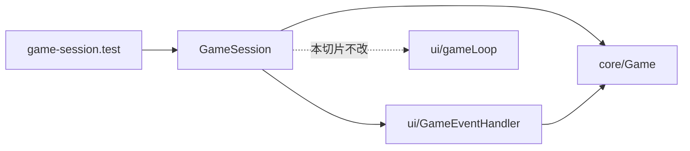

# CAP-ENG-SESSION 无头对局会话 Implementation Plan

> **For agentic workers:** REQUIRED SUB-SKILL: Use superpowers:subagent-driven-development (recommended) or superpowers:executing-plans to implement this plan task-by-task. Steps use checkbox (`- [ ]`) syntax for tracking.

**Goal:** 抽出可被 CLI / 未来 API 共用的无头 `GameSession`：不依赖 readline 交互即可跑完至少一局自动对弈，且不改 `core` 规则语义。

**Architecture:** 在 `src/majiang/session/` 新增薄门面，内部复用现有 `Game` + `GameEventHandler.safeStartGameAndEnd()`；本切片只交付 `mode: 'auto'` 全自动一局。人类步进 / Snapshot / Express / Web 桥分别属于后续 `CAP-ENG-SNAP`、`CAP-API-GAME`、`CAP-WEB-BRIDGE` 计划，本文件不实现。

**Tech Stack:** TypeScript、`ts-node`、Mocha + Chai + Sinon（与 `tests/majiang/game-event-handler.test.ts` 同构）

## Global Constraints

- 不改 `src/majiang/core/` 胡吃碰杠/计分权威语义
- 不把 core 打进浏览器；本切片不改 `docs/majiang/web-ui-prototype/`
- 不破坏现有 `npm start` / `majiang:auto` 对外入口（本切片可不改 CLI 接线；接线属 `CAP-CLI-TRAIN`）
- 不重开 `CAP-UI-COMP`；不自批 `CAP-DUAL-GRAD`
- 提交说明中文；仅当用户明确要求 commit 才提交（本计划 Step 里的 commit 在用户授权前改为「暂存说明，等用户点名再 commit」）
- 一拍一切片：本计划范围 = `CAP-ENG-SESSION` / `MJ-ENG-SESSION-01` / GR-D1

---

## File Structure

| 路径 | 职责 |
|------|------|
| `src/majiang/session/game-session.ts` | 无头会话门面：`create` + `runFullRound` + `getState` |
| `src/majiang/session/index.ts` | 桶导出 |
| `tests/majiang/game-session.test.ts` | headless 一局可结束断言 |
| `docs/majiang/FOLDER_STRUCTURE.md` | 登记 `session/` 层（最小补丁） |
| `docs/product/spines/majiang-dual-surface-target.md` | G-D1 / GR-D1 回写 |
| `docs/product/caps/majiang-dual-surface-cap-tasks.md` | `CAP-ENG-SESSION` → 已落地 |
| `docs/product/waves/majiang-dual-surface-W9.md` | 切片状态回写 |



**后续计划（本文件不写任务）：** `CAP-ENG-SNAP` → `CAP-CLI-TRAIN` ∥ `CAP-API-GAME` → `CAP-WEB-BRIDGE` → …

---

### Task 1: 失败测试锁定 headless 一局可结束

**Files:**
- Create: `tests/majiang/game-session.test.ts`
- Create: `src/majiang/session/game-session.ts`（下一步才写实现；本任务先让 import 失败或空壳）

**Interfaces:**
- Consumes: 无
- Produces: 测试约定的公开 API（实现须对齐）：
  - `GameSession.create(options?: { mode?: 'auto' }): GameSession`
  - `session.runFullRound(): Promise<void>`
  - `session.getState(): GameState`
  - `session.game: Game`（只读暴露，便于断言玩家数）

- [ ] **Step 1: 写失败测试**

创建 `tests/majiang/game-session.test.ts`：

```typescript
import { expect } from 'chai';
import sinon from 'sinon';
import { GameState } from '../../src/majiang/core/game';
import { GameSession } from '../../src/majiang/session/game-session';
import * as input from '../../src/majiang/ui/input';
import { setAutoPlayMode } from '../../src/majiang/config/runtime-state';

describe('GameSession (CAP-ENG-SESSION)', function () {
  this.timeout(120000);

  let consoleLogStub: sinon.SinonStub;
  let askQuestionStub: sinon.SinonStub;

  beforeEach(() => {
    consoleLogStub = sinon.stub(console, 'log');
    askQuestionStub = sinon.stub(input, 'askQuestion').resolves('n');
    setAutoPlayMode(true);
  });

  afterEach(() => {
    consoleLogStub.restore();
    askQuestionStub.restore();
  });

  it('auto 模式可无交互跑完一局并进入 ENDED', async () => {
    const session = GameSession.create({ mode: 'auto' });
    expect(session.game.getAllPlayers()).to.have.lengthOf(4);

    await session.runFullRound();

    expect(session.getState()).to.equal(GameState.ENDED);
  });
});
```

- [ ] **Step 2: 跑测试确认失败**

Run:

```bash
npx mocha -r ts-node/register tests/majiang/game-session.test.ts --timeout 120000
```

Expected: FAIL（模块不存在或 `GameSession` 未定义）

- [ ] **Step 3: 写最小 `GameSession` 实现**

创建 `src/majiang/session/game-session.ts`：

```typescript
import { Game, GameState } from '../core/game';
import { TileManager } from '../core/tile-manager';
import { GameEventHandler } from '../ui/game-event-handler';
import { setAutoPlayMode } from '../config/runtime-state';

export interface GameSessionOptions {
  mode?: 'auto';
}

/**
 * 无头对局会话（CAP-ENG-SESSION）。
 * 本切片仅支持 auto：4 AI，复用 GameEventHandler.safeStartGameAndEnd。
 * ponytail: 人类步进 / Snapshot 留给 CAP-ENG-SNAP + CAP-API-GAME。
 */
export class GameSession {
  readonly game: Game;
  private readonly handler: GameEventHandler;
  private started = false;

  private constructor(game: Game, handler: GameEventHandler) {
    this.game = game;
    this.handler = handler;
  }

  static create(options: GameSessionOptions = {}): GameSession {
    const mode = options.mode ?? 'auto';
    if (mode !== 'auto') {
      throw new Error(`GameSession: unsupported mode "${mode}" in CAP-ENG-SESSION`);
    }
    setAutoPlayMode(true);
    const game = new Game();
    game.setupPlayers(true);
    const handler = new GameEventHandler(game, TileManager.getInstance());
    // 单局验收：抬高 currentRound，避免 handleGameEnd 按 AUTO_PLAY_ROUNDS=1000 判定「还要下一局」时误导调用方
    handler.currentRound = Number.MAX_SAFE_INTEGER;
    return new GameSession(game, handler);
  }

  async runFullRound(): Promise<void> {
    if (this.started) {
      throw new Error('GameSession: runFullRound already called');
    }
    this.started = true;
    await this.handler.safeStartGameAndEnd();
    if (this.game.state !== GameState.ENDED) {
      this.game.setState(GameState.ENDED);
    }
  }

  getState(): GameState {
    return this.game.state;
  }
}
```

创建 `src/majiang/session/index.ts`：

```typescript
export { GameSession, GameSessionOptions } from './game-session';
```

- [ ] **Step 4: 再跑测试确认通过**

Run:

```bash
npx mocha -r ts-node/register tests/majiang/game-session.test.ts --timeout 120000
```

Expected: PASS（1 passing）

若超时或卡在 `askQuestion`：确认 `setAutoPlayMode(true)` 与 `askQuestion` stub 仍在；必要时在测试里 `sinon.stub(input, 'askConfirmation').resolves(true)`。

- [ ] **Step 5: 提交（仅当用户点名 commit）**

```bash
git add src/majiang/session/game-session.ts src/majiang/session/index.ts tests/majiang/game-session.test.ts
git commit -m "$(cat <<'EOF'
feat(majiang): 新增无头 GameSession 跑通自动一局

为 CLI/Web 共用引擎抽出 Session 门面，复用 safeStartGameAndEnd，不改 core 规则。

EOF
)"
```

---

### Task 2: 目录约定与双表面账本回写

**Files:**
- Modify: `docs/majiang/FOLDER_STRUCTURE.md`（速览树 + 依赖说明各补 `session/` 一行）
- Modify: `docs/product/spines/majiang-dual-surface-target.md`
- Modify: `docs/product/caps/majiang-dual-surface-cap-tasks.md`
- Modify: `docs/product/waves/majiang-dual-surface-W9.md`

**Interfaces:**
- Consumes: Task 1 已绿的 `GameSession`
- Produces: 账本 G-D1 / `CAP-ENG-SESSION` / W9 切片标为已落地；下一切片指向 `CAP-ENG-SNAP`

- [ ] **Step 1: 更新 FOLDER_STRUCTURE 速览**

在 `docs/majiang/FOLDER_STRUCTURE.md` 的速览树中，于 `ui/` 旁增加：

```text
├── session/   # 无头对局会话（CLI/API 共用，不进浏览器）
```

在依赖方向段补一句：`session/ → ui/GameEventHandler + core/`（Session 编排，规则仍在 core）。

- [ ] **Step 2: 回写脊骨**

在 `majiang-dual-surface-target.md`：

- `GR-D1` 状态 → **已关**（附：`tests/majiang/game-session.test.ts`）
- 差距表 `G-D1` → **已落地**
- 「下一刀建议」→ `CAP-ENG-SNAP`

- [ ] **Step 3: 回写任务表与 W9**

在 `majiang-dual-surface-cap-tasks.md`：`CAP-ENG-SESSION` 账本状态 → **已落地**；现状行写明下一切片 `CAP-ENG-SNAP`。

在 `majiang-dual-surface-W9.md`：`MJ-ENG-SESSION-01` → **已落地**；施工状态可写「Session 已关；Snapshot 另波/续刀」。

- [ ] **Step 4: 快速回归**

Run:

```bash
npx mocha -r ts-node/register tests/majiang/game-session.test.ts --timeout 120000
```

Expected: PASS

- [ ] **Step 5: 提交（仅当用户点名 commit）**

```bash
git add docs/majiang/FOLDER_STRUCTURE.md docs/product/spines/majiang-dual-surface-target.md docs/product/caps/majiang-dual-surface-cap-tasks.md docs/product/waves/majiang-dual-surface-W9.md
git commit -m "$(cat <<'EOF'
docs(product): 回写 CAP-ENG-SESSION 已落地并指向 Snapshot

EOF
)"
```

---

## Spec coverage（自检）

| 规格要求 | 本计划任务 |
|----------|------------|
| 无头 Session、不依赖 readline | Task 1（auto + stub） |
| 开局→动作→终局可断言 | Task 1 `GameState.ENDED` |
| 不改 core 规则 | Global Constraints + 未列 core 文件 |
| 账本回写 | Task 2 |
| Snapshot / API / Web / 大厅 | **故意不在本计划**（后续独立 plan） |

## Placeholder scan

无 TBD /「稍后实现」步骤；人类步进明确标为后续 CAP。

## Type consistency

- `GameSession.create` / `runFullRound` / `getState` / `game` 在 Task 1 测试与实现一致
- `GameState.ENDED` 来自 `src/majiang/core/game.ts`
