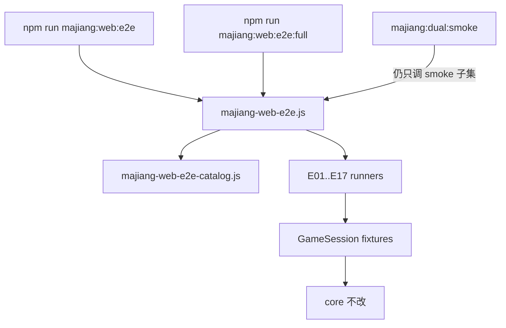

# 广东麻将 Web e2e 场景目录表 Implementation Plan

> **For agentic workers:** REQUIRED SUB-SKILL: Use superpowers:subagent-driven-development (recommended) or superpowers:executing-plans to implement this plan task-by-task. Steps use checkbox (`- [ ]`) syntax for tracking.

**Goal:** 以场景目录表驱动 Web 真浏览器 e2e：默认 `majiang:web:e2e` = smoke（E01–E08），`majiang:web:e2e:full` = 全表（含新夹具与 defer）；不改 `src/majiang/core/` 权威判定。

**Architecture:** 新建 `majiang-web-e2e-catalog.js` 为 E01–E17 单一真相源；`majiang-web-e2e.js` 按 `MAJIANG_E2E_SUITE=smoke|full` 过滤、逐场景执行、不短路、汇总 JSON。新夹具只在 `GameSession` 装牌面/开响应窗；api-bridge 只透传 `?fixture=`。`majiang:dual:smoke` 继续只挂 smoke，不拉 full。

**Tech Stack:** Node.js、Playwright Core（现有）、Mocha + Chai（Session 单测）、现有 `GameSession` / `createMajiangApiApp`；不新增 npm 依赖。

**规格：** `docs/superpowers/specs/2026-11-18-majiang-web-e2e-catalog-design.md`

## Global Constraints

- 不改 `src/majiang/core/` 胡/吃/碰/杠/计分权威语义；夹具只改手牌/河牌/pending/牌山计数
- 功能自动化绿 ≠ 视觉冲顶；本波不做截图对比
- 不扫全部番种（仍归 `tests/majiang/win-conditions/`）
- 默认 `npm run majiang:web:e2e` = smoke；full 不进 `majiang:dual:smoke`
- full：非 defer 失败 → 非 0；未声明 skip → 失败；`MAJIANG_E2E_ALLOW_DEFER=1` 仅本地排障
- 单场景失败不短路：跑完汇总再设 `process.exitCode`
- 提交说明中文；计划内 Commit 步默认改为「列出暂存，等用户点名再 commit」（见 `docs/standards/rules/commit-policy.md`）
- `majiang-dual-smoke.js` 现有对 `assertStaticFailClosed` / `runApiBackedE2e` 的 require 必须保持可用（或同步改 dual-smoke 到等价 smoke 入口）

---

## File Structure

| 路径 | 职责 |
|------|------|
| `scripts/test/majiang-web-e2e-catalog.js` | E01–E17：id、title、tier、runner、fixture、defer |
| `tests/majiang/web-e2e-catalog.test.ts` | catalog ID/档位/runner 与规格一致 |
| `scripts/test/majiang-web-e2e.js` | suite 过滤、逐场景执行、JSON 汇总、各 runner |
| `package.json` | `majiang:web:e2e`（smoke）+ `majiang:web:e2e:full` |
| `src/majiang/session/game-session.ts` | 扩展 fixture 类型与 install*；player_turn 支持 `hu`（自摸） |
| `tests/majiang/meld-fixture.test.ts` | 扩 pass/gang/discard（或拆 `session-fixture.test.ts`） |
| `tests/majiang/score-settlement.test.ts` | 扩 tsumo-ready / draw-ready 分数断言 |
| `docs/majiang/web-ui-prototype/api-bridge.js` | 注释扩 fixture 列表（不解析规则） |
| `docs/majiang/web-ui-prototype/README.md` | smoke / full 口径 |
| `docs/product/caps/majiang-dual-surface-acceptance-matrix.md` | WEB-01 挂测句回写 e2e/full |



**本计划不做：** 视觉冲顶、CLI e2e、改 core 判定、把 full 挂进 dual smoke。

---

### Task 1: 场景目录表 + catalog 单测

**Files:**
- Create: `scripts/test/majiang-web-e2e-catalog.js`
- Create: `tests/majiang/web-e2e-catalog.test.ts`

**Interfaces:**
- Consumes: 规格 §3 E01–E17 表
- Produces:
  - `getE2eCases(): Array<{ id, title, tier: 'smoke'|'full', runner: string, fixture?: string|null, defer?: boolean, deferReason?: string }>`
  - `casesForSuite(suite: 'smoke'|'full'):` smoke → 仅 `tier==='smoke'`；full → 全部
  - `assertCatalogInvariants(cases)`（可选内联）

- [ ] **Step 1: 写失败单测（规格对齐）**

```typescript
import { expect } from 'chai';
// eslint-disable-next-line @typescript-eslint/no-var-requires
const catalog = require('../../scripts/test/majiang-web-e2e-catalog');

describe('majiang-web-e2e-catalog', () => {
  it('E01–E17 齐全且 id 唯一', () => {
    const cases = catalog.getE2eCases();
    expect(cases.map((c: { id: string }) => c.id)).to.deep.equal(
      Array.from({ length: 17 }, (_, i) => `E${String(i + 1).padStart(2, '0')}`)
    );
  });

  it('smoke 恰为 E01–E08；full 含全部', () => {
    const smoke = catalog.casesForSuite('smoke').map((c: { id: string }) => c.id);
    const full = catalog.casesForSuite('full').map((c: { id: string }) => c.id);
    expect(smoke).to.deep.equal(['E01', 'E02', 'E03', 'E04', 'E05', 'E06', 'E07', 'E08']);
    expect(full).to.have.length(17);
  });

  it('每条有 runner；E16/E17 允许 defer:true', () => {
    for (const c of catalog.getE2eCases()) {
      expect(c.runner, c.id).to.be.a('string').and.not.empty;
      if (c.id === 'E16' || c.id === 'E17') {
        expect(c.defer === true || c.defer === false).to.equal(true);
      }
    }
  });
});
```

- [ ] **Step 2: 跑测确认失败**

Run: `npx mocha --require ts-node/register/transpile-only tests/majiang/web-e2e-catalog.test.ts`

Expected: FAIL（模块不存在）

- [ ] **Step 3: 实现 catalog**

写入 `scripts/test/majiang-web-e2e-catalog.js`：

```javascript
'use strict';

/**
 * Web e2e 场景目录（规格 SSOT 的脚本镜像）
 * docs/superpowers/specs/2026-11-18-majiang-web-e2e-catalog-design.md
 */
const CASES = [
  { id: 'E01', title: '静态拒开局', tier: 'smoke', runner: 'staticFailClosed', fixture: null },
  { id: 'E02', title: '演示假对局', tier: 'smoke', runner: 'prototypeDemo', fixture: null },
  { id: 'E03', title: '结果四态示意', tier: 'smoke', runner: 'resultExamples', fixture: null },
  { id: 'E04', title: 'API 完局烟雾', tier: 'smoke', runner: 'apiPlayToEnd', fixture: null },
  { id: 'E05', title: '非法出牌', tier: 'smoke', runner: 'illegalDiscard', fixture: null },
  // 说明：E04/E05 现网由 playToEndViaUi 同程覆盖；catalog 分条，runner 可共享实现并去重执行（见 Task 2）
  { id: 'E06', title: '必现碰', tier: 'smoke', runner: 'meldPeng', fixture: 'peng-ready' },
  { id: 'E07', title: '必现吃', tier: 'smoke', runner: 'meldChi', fixture: 'chi-ready' },
  { id: 'E08', title: '点炮胡+分数', tier: 'smoke', runner: 'huReadyScore', fixture: 'hu-ready' },
  { id: 'E09', title: '必现过', tier: 'full', runner: 'passReady', fixture: 'pass-ready' },
  { id: 'E10', title: '必现明杠', tier: 'full', runner: 'gangReady', fixture: 'gang-ready' },
  { id: 'E11', title: '自摸胡+分数', tier: 'full', runner: 'tsumoReady', fixture: 'tsumo-ready' },
  { id: 'E12', title: '真流局', tier: 'full', runner: 'drawReady', fixture: 'draw-ready' },
  { id: 'E13', title: '合法出牌', tier: 'full', runner: 'discardReady', fixture: 'discard-ready' },
  { id: 'E14', title: '非法动作 ID', tier: 'full', runner: 'illegalActionId', fixture: null },
  { id: 'E15', title: '广东术语文案', tier: 'full', runner: 'cantoneseCopy', fixture: null },
  {
    id: 'E16',
    title: '暗杠/补杠',
    tier: 'full',
    runner: 'concealedOrBuGang',
    fixture: 'angang-ready',
    defer: true,
    deferReason: 'Session 暗杠/补杠夹具本波先占位，能装再改 defer:false',
  },
  {
    id: 'E17',
    title: '异常终止 abort',
    tier: 'full',
    runner: 'abortTrue',
    fixture: null,
    defer: true,
    deferReason: '真 abort 无 API 入口则保持 defer；E03 示意已覆盖样式',
  },
];

function getE2eCases() {
  return CASES.map((c) => ({ ...c }));
}

function casesForSuite(suite) {
  const all = getE2eCases();
  if (suite === 'smoke') return all.filter((c) => c.tier === 'smoke');
  if (suite === 'full') return all;
  throw new Error(`unknown suite: ${suite}`);
}

module.exports = { getE2eCases, casesForSuite, CASES };
```

- [ ] **Step 4: 再跑单测**

Run: `npx mocha --require ts-node/register/transpile-only tests/majiang/web-e2e-catalog.test.ts`

Expected: PASS

- [ ] **Step 5: 暂存（等用户授权再 commit）**

```bash
git add scripts/test/majiang-web-e2e-catalog.js tests/majiang/web-e2e-catalog.test.ts
# 待用户说「提交」后再：
# git commit -m "$(cat <<'EOF'
# test(majiang): 新增 Web e2e 场景目录表与对齐单测
#
# EOF
# )"
```

---

### Task 2: Driver 表驱动 + suite 过滤（行为等价现网 smoke）

**Files:**
- Modify: `scripts/test/majiang-web-e2e.js`
- Modify: `package.json`（scripts 两行）

**Interfaces:**
- Consumes: `casesForSuite`；现有 `assertStaticFailClosed` / `assertPrototypeDemoAllowsFakeGame` / `assertResultExamples` / `playToEndViaUi` / `assertMeldFixtureViaUi` / `assertHuReadyScoreViaUi`
- Produces:
  - `resolveSuite(): 'smoke'|'full'` ← `process.env.MAJIANG_E2E_SUITE` 默认 `smoke`
  - `RUNNERS: Record<string, () => Promise<unknown>>`
  - `main()`：逐条执行；`result.scenarios[]`；`ok` 仅当无 fail；defer 写入结果；`MAJIANG_E2E_ALLOW_DEFER=1` 时 defer 当 skip
  - 保持 `module.exports` 含 dual-smoke 已用符号

**E04/E05 去重约定：** `apiPlayToEnd` 与 `illegalDiscard` 共享一次 `playToEndViaUi` 结果（缓存 promise）；E05 断言 `illegalChecked===true`，E04 断言 `ended===true`。禁止 smoke 里真跑两遍完整对局。

- [ ] **Step 1: 改 package.json scripts**

```json
"majiang:web:e2e": "MAJIANG_E2E_SUITE=smoke node scripts/test/majiang-web-e2e.js",
"majiang:web:e2e:full": "MAJIANG_E2E_SUITE=full node scripts/test/majiang-web-e2e.js"
```

（若 Windows 无 env 前缀问题：本仓以 darwin/CI bash 为准；也可用 `node -e` 包装，但优先与现有脚本风格一致。macOS/Linux OK。）

- [ ] **Step 2: 重构 main 为表驱动（核心骨架）**

在 `majiang-web-e2e.js` 顶部增加：

```javascript
const { casesForSuite } = require('./majiang-web-e2e-catalog');

function resolveSuite() {
  const raw = (process.env.MAJIANG_E2E_SUITE || 'smoke').toLowerCase();
  if (raw !== 'smoke' && raw !== 'full') {
    throw new Error(`MAJIANG_E2E_SUITE must be smoke|full, got ${raw}`);
  }
  return raw;
}
```

将 `main` 改为：

```javascript
async function main() {
  const wallStart = Date.now();
  const suite = resolveSuite();
  const cases = casesForSuite(suite);
  const allowDefer = process.env.MAJIANG_E2E_ALLOW_DEFER === '1';
  const result = {
    startedAt: new Date().toISOString(),
    suite,
    scenarios: [],
    ok: false,
    timingsMs: {},
  };

  // 共享 API 完局缓存，供 E04/E05
  let playToEndCache = null;
  const getPlayToEnd = () => {
    if (!playToEndCache) playToEndCache = runApiBackedE2e();
    return playToEndCache;
  };

  const RUNNERS = {
    staticFailClosed: () => assertStaticFailClosed(),
    prototypeDemo: () => assertPrototypeDemoAllowsFakeGame(),
    resultExamples: () => assertResultExamples(),
    apiPlayToEnd: async () => {
      const play = await getPlayToEnd();
      if (!play.ended) throw new Error('E04 expected ended');
      return play;
    },
    illegalDiscard: async () => {
      const play = await getPlayToEnd();
      if (!play.illegalChecked) throw new Error('E05 expected illegalChecked');
      return { illegalChecked: true };
    },
    meldPeng: () =>
      withApiServer((base) => assertMeldFixtureViaUi(base, 'peng-ready', 'peng')),
    meldChi: () =>
      withApiServer((base) => assertMeldFixtureViaUi(base, 'chi-ready', 'chi')),
    huReadyScore: () => runScoreSettlementE2e(),
    // full runners：Task 5+ 再填；此处先抛明确错误，避免 silent skip
    passReady: async () => {
      throw new Error('runner passReady not implemented');
    },
    gangReady: async () => {
      throw new Error('runner gangReady not implemented');
    },
    tsumoReady: async () => {
      throw new Error('runner tsumoReady not implemented');
    },
    drawReady: async () => {
      throw new Error('runner drawReady not implemented');
    },
    discardReady: async () => {
      throw new Error('runner discardReady not implemented');
    },
    illegalActionId: async () => {
      throw new Error('runner illegalActionId not implemented');
    },
    cantoneseCopy: async () => {
      throw new Error('runner cantoneseCopy not implemented');
    },
    concealedOrBuGang: async () => {
      throw new Error('runner concealedOrBuGang not implemented');
    },
    abortTrue: async () => {
      throw new Error('runner abortTrue not implemented');
    },
  };

  let failed = 0;
  let deferred = 0;
  for (const c of cases) {
    const t0 = Date.now();
    const entry = {
      id: c.id,
      title: c.title,
      tier: c.tier,
      status: 'pending',
      fixture: c.fixture || null,
    };
    if (c.defer) {
      deferred += 1;
      entry.status = allowDefer ? 'skip' : 'defer';
      entry.deferReason = c.deferReason || 'deferred by catalog';
      if (!allowDefer) {
        // full 默认：声明的 defer 记入 JSON，不算 fail；未声明的 skip 才 fail（规格 §4）
        entry.status = 'defer';
      }
      result.scenarios.push(entry);
      result.timingsMs[c.id] = Date.now() - t0;
      continue;
    }
    const fn = RUNNERS[c.runner];
    if (!fn) {
      failed += 1;
      entry.status = 'fail';
      entry.error = `unknown runner: ${c.runner}`;
      result.scenarios.push(entry);
      result.timingsMs[c.id] = Date.now() - t0;
      continue;
    }
    try {
      entry.detail = await fn();
      entry.status = 'pass';
    } catch (err) {
      failed += 1;
      entry.status = 'fail';
      entry.error = String(err && err.stack ? err.stack : err);
    }
    result.scenarios.push(entry);
    result.timingsMs[c.id] = Date.now() - t0;
  }

  result.timingsMs.total = Date.now() - wallStart;
  result.finishedAt = new Date().toISOString();
  result.ok = failed === 0;
  result.summary = {
    pass: result.scenarios.filter((s) => s.status === 'pass').length,
    fail: failed,
    defer: result.scenarios.filter((s) => s.status === 'defer').length,
    skip: result.scenarios.filter((s) => s.status === 'skip').length,
  };

  fs.mkdirSync(OUT_DIR, { recursive: true });
  fs.writeFileSync(OUT_FILE, JSON.stringify(result, null, 2));
  if (!result.ok) {
    console.error(
      `majiang-web-e2e fail suite=${suite}: ${JSON.stringify(result.summary)}`
    );
    process.exitCode = 1;
    return;
  }
  console.log(`majiang-web-e2e ok: ${JSON.stringify({ suite, summary: result.summary, timingsMs: result.timingsMs })}`);
}
```

**注意：** smoke 套件不含 E09+，未实现 runner 不会在默认 e2e 触发。full 在未实现前会红——符合 TDD；后续 Task 填 runner 后转绿。

保留文件末尾：

```javascript
module.exports = {
  assertStaticFailClosed,
  assertPrototypeDemoAllowsFakeGame,
  runApiBackedE2e,
  runMeldFixtureE2e,
  runScoreSettlementE2e,
  assertScoreSettlement,
  resolveSuite,
};
```

- [ ] **Step 3: 跑 smoke 确认等价绿**

Run: `npm run majiang:web:e2e`

Expected: `suite=smoke`，E01–E08 `pass`，`ok`，写出 `.tmp/acceptance/majiang-web-e2e.json`

- [ ] **Step 4: 确认 dual-smoke 仍能 require 旧导出**

Run: `node -e "const w=require('./scripts/test/majiang-web-e2e'); console.log(typeof w.assertStaticFailClosed, typeof w.runApiBackedE2e)"`

Expected: `function function`

- [ ] **Step 5: 暂存（等授权再 commit）**

```bash
git add scripts/test/majiang-web-e2e.js package.json
# commit message 候选：
# test(majiang): Web e2e 改目录表驱动并拆分 smoke/full 入口
```

---

### Task 3: Session 夹具类型扩展 + `pass-ready`

**Files:**
- Modify: `src/majiang/session/game-session.ts`（约 L19–L137、install 段）
- Modify: `tests/majiang/meld-fixture.test.ts`（追加 pass 用例）
- Modify: `docs/majiang/web-ui-prototype/api-bridge.js`（注释列表）

**Interfaces:**
- Consumes: 现有 `installPengReadyFixture` / `listHumanResponseActions` / `openResponseWindow`
- Produces:
  - `export type SessionFixtureId = 'peng-ready' | 'chi-ready' | 'hu-ready' | 'pass-ready' | 'gang-ready' | 'tsumo-ready' | 'draw-ready' | 'discard-ready' | 'angang-ready'`
  - 兼容别名：`export type MeldFixtureId = SessionFixtureId`（避免一次改爆调用方）
  - `installPassReadyFixture()`：开局即 `response_window` 且含 `pass`（可复用 peng 牌面，断言含 pass）

- [ ] **Step 1: 写失败单测**

在 `tests/majiang/meld-fixture.test.ts` 追加：

```typescript
  it('pass-ready：响应窗必有 pass，apply 后不崩且离 response_window', async () => {
    const session = GameSession.create({
      mode: 'api',
      gameId: 'fx-pass',
      fixture: 'pass-ready',
    });
    session.start();
    const before = session.getTableSnapshot();
    expect(before.phase).to.equal('response_window');
    expect(before.availableActions.some((a) => a.id === 'pass' && a.available)).to.equal(true);

    const after = await session.applyAction({ id: 'pass' });
    expect(after.phase).to.not.equal('response_window');
    expect([GameState.PLAYING, GameState.WAITING_ACTION, GameState.ENDED]).to.include(
      session.getState()
    );
  });
```

- [ ] **Step 2: 跑测确认失败**

Run: `npx mocha --require ts-node/register/transpile-only tests/majiang/meld-fixture.test.ts --grep pass-ready`

Expected: FAIL（`unknown fixture` 或类型/装夹失败）

- [ ] **Step 3: 扩展类型并实现 install**

在 `game-session.ts`：

1. 扩展 `MELD_FIXTURE_IDS`（或改名 `SESSION_FIXTURE_IDS`）加入 `'pass-ready'`（本 Task 只加 pass；其余 ID 可先列入数组，install 分支暂 throw `fixture X not installed`，或按 Task 逐步加——**推荐本 Task 只加 pass-ready，避免 full catalog 误用未装夹具**）。
2. `start()` 增加：

```typescript
} else if (this.fixture === 'pass-ready') {
  this.installPassReadyFixture();
}
```

3. 实现（复用碰牌面，强制带 PASS）：

```typescript
  /** 必现过：同 peng 牌面开窗，确保 pass 可选 */
  private installPassReadyFixture(): void {
    this.installPengReadyFixture();
    const pending = this.game.pendingAction;
    if (!pending || !pending.allowedActions.includes(PlayerAction.PASS)) {
      throw new Error('fixture pass-ready: PASS not available');
    }
  }
```

4. `api-bridge.js` 注释改为：

```javascript
// 可选 ?fixture=peng-ready|chi-ready|hu-ready|pass-ready|...：测试夹具；默认不传
```

- [ ] **Step 4: 单测绿**

Run: `npx mocha --require ts-node/register/transpile-only tests/majiang/meld-fixture.test.ts --grep pass-ready`

Expected: PASS

- [ ] **Step 5: 暂存**

```bash
git add src/majiang/session/game-session.ts tests/majiang/meld-fixture.test.ts docs/majiang/web-ui-prototype/api-bridge.js
# feat(majiang): 新增 pass-ready 会话夹具
```

---

### Task 4: `gang-ready` 明杠夹具

**Files:**
- Modify: `src/majiang/session/game-session.ts`
- Modify: `tests/majiang/meld-fixture.test.ts`

**Interfaces:**
- Consumes: `RuleEngine.canGang`、`listHumanResponseActions`、`handler.handleGang`
- Produces: `installGangReadyFixture()` — 南家打出东风，人类手握三张东风 → 响应窗含 `gang`

- [ ] **Step 1: 失败单测**

```typescript
  it('gang-ready：响应窗必有 gang，apply 后明杠出现', async () => {
    const session = GameSession.create({
      mode: 'api',
      gameId: 'fx-gang',
      fixture: 'gang-ready',
    });
    session.start();
    const before = session.getTableSnapshot();
    expect(before.phase).to.equal('response_window');
    expect(before.availableActions.some((a) => a.id === 'gang' && a.available)).to.equal(true);

    const after = await session.applyAction({ id: 'gang' });
    expect(session.getState()).to.equal(GameState.PLAYING);
    const east = session.game.getAllPlayers()[0];
    expect(east.revealedSets.some((s) => s.type === 'GANG')).to.equal(true);
    expect(after.phase).to.equal('player_turn');
  });
```

- [ ] **Step 2: 跑测 FAIL**

Run: `npx mocha --require ts-node/register/transpile-only tests/majiang/meld-fixture.test.ts --grep gang-ready`

- [ ] **Step 3: 实现 installGangReadyFixture**

```typescript
  private installGangReadyFixture(): void {
    const players = this.game.getAllPlayers();
    const human = this.getHumanPlayer();
    const discarderIndex = 1;
    this.game.setCurrentPlayerIndex(discarderIndex);
    const discarder = players[discarderIndex];

    const type = TileType.FENG;
    const value = FengValue.DONG;
    for (const p of players) {
      p.handTiles = p.handTiles.filter((t) => !(t.type === type && t.value === value));
    }
    this.normalizeHumanHandSize(human, 13);
    human.handTiles[0] = new Tile(type, value, 9501);
    human.handTiles[1] = new Tile(type, value, 9502);
    human.handTiles[2] = new Tile(type, value, 9503);
    human.sortHand();

    const discarded = new Tile(type, value, 9504);
    discarder.discardedTiles.push(discarded);
    this.game.setLastDiscardedTile(discarded);

    const actions = this.listHumanResponseActions(discarded);
    if (!actions.includes(PlayerAction.GANG)) {
      throw new Error('fixture gang-ready: GANG not available');
    }
    this.openResponseWindow(discarded, actions);
  }
```

把 `'gang-ready'` 加入 fixture 白名单与 `start()` 分支。

- [ ] **Step 4: 单测 PASS**

- [ ] **Step 5: 暂存** — `feat(majiang): 新增 gang-ready 明杠夹具`

---

### Task 5: `tsumo-ready` + player_turn 支持 `hu`

**Files:**
- Modify: `src/majiang/session/game-session.ts`（`applyAction` + install）
- Modify: `tests/majiang/score-settlement.test.ts`

**Interfaces:**
- Consumes: `RuleEngine.canHu(player, null, { isDrawn: true })`、`handler.handlePlayerHu`
- Produces:
  - `applyAction` 在非 `WAITING_ACTION` 时：若 `action.id==='hu'` 且快照允许 → 自摸结算
  - `installTsumoReadyFixture()`：人类为当前玩家、14 张听牌手、`availableActions` 含 `hu`

**根因说明（必做）：** 现网 `applyAction` 只处理响应窗或 `discard`，player_turn 点胡会 `unsupported action`。E11 必须先修此缺口（仍不改 core）。

- [ ] **Step 1: 失败单测**

```typescript
  it('fixture=tsumo-ready：自摸后 resultSummary.type=tsumo，分数非全 0 且零和', async () => {
    const session = GameSession.create({
      mode: 'api',
      gameId: 'score-tsumo-ready',
      fixture: 'tsumo-ready',
    });
    session.start();
    const before = session.getTableSnapshot();
    expect(before.phase).to.equal('player_turn');
    expect(before.availableActions.some((a) => a.id === 'hu' && a.available)).to.equal(true);

    await session.applyAction({ id: 'hu' });
    const snap = session.getTableSnapshot();
    expect(snap.phase).to.equal('ended');
    expect(snap.resultSummary?.type).to.equal('tsumo');
    const deltas = (snap.resultSummary?.rows || []).map((r) => Number(r.delta));
    expect(deltas.some((d) => d !== 0)).to.equal(true);
    expect(deltas.reduce((a, b) => a + b, 0)).to.equal(0);
  });
```

- [ ] **Step 2: 跑测 FAIL**

- [ ] **Step 3: 扩展 applyAction**

将动作分发改为（示意，保持指纹/脏写守卫）：

```typescript
    if (this.game.state === GameState.WAITING_ACTION) {
      await this.applyHumanResponse(action.id);
    } else if (action.id === 'discard') {
      await this.applyHumanDiscard(action.tileIndex);
    } else if (action.id === 'hu') {
      await this.applyHumanTsumoHu();
    } else {
      throw new SessionActionError(`unsupported action: ${action.id}`);
    }
```

```typescript
  private async applyHumanTsumoHu(): Promise<void> {
    const human = this.getHumanPlayer();
    const current = this.game.getCurrentPlayer();
    if (!current || current.id !== human.id) {
      throw new SessionActionError('tsumo hu only on human turn');
    }
    if (!RuleEngine.canHu(human, null, { isDrawn: true })) {
      throw new SessionActionError('tsumo hu not available');
    }
    // 自摸：winTile 取手牌最后一张或引擎约定；与 handler 现有自摸路径对齐
    const winTile = human.handTiles[human.handTiles.length - 1];
    this.handler.handlePlayerHu(human, winTile /*, 若 handler 有 isSelfDrawn 参数则传入 */);
    this.markWinnerStats();
  }
```

**实现时须对照** `GameEventHandler.handlePlayerHu` / `getLastWinKind` 签名：确保 `resultTypeHint` 为 `tsumo`。若现有 API 用 `lastWinBySelfDrawn`，在自摸路径置 true。

- [ ] **Step 4: installTsumoReadyFixture**

复用 `hu-ready` 13 张听东风形，再摸入东风成 14 张；`setCurrentPlayerIndex` 为人类；清 pending；`GameState.PLAYING`。断言 `RuleEngine.canHu(human, null, { isDrawn: true })`，否则 throw。

牌面可与 `installHuReadyFixture` 同构：

```typescript
  private installTsumoReadyFixture(): void {
    const human = this.getHumanPlayer();
    this.game.setCurrentPlayerIndex(0);
    this.game.setState(GameState.PLAYING);
    this.game.setLastDiscardedTile(null);
    this.clearResponseWindow();

    // 与 hu-ready 相同 13 张 + 自摸东风
    human.handTiles = [
      new Tile(TileType.WAN, 1, 9601),
      new Tile(TileType.WAN, 1, 9602),
      new Tile(TileType.WAN, 1, 9603),
      new Tile(TileType.WAN, 2, 9604),
      new Tile(TileType.WAN, 3, 9605),
      new Tile(TileType.WAN, 4, 9606),
      new Tile(TileType.TIAO, 3, 9607),
      new Tile(TileType.TIAO, 4, 9608),
      new Tile(TileType.TIAO, 5, 9609),
      new Tile(TileType.TONG, 7, 9610),
      new Tile(TileType.TONG, 8, 9611),
      new Tile(TileType.TONG, 9, 9612),
      new Tile(TileType.FENG, FengValue.DONG, 9613),
      new Tile(TileType.FENG, FengValue.DONG, 9614),
    ];
    human.sortHand();

    if (!RuleEngine.canHu(human, null, { isDrawn: true })) {
      throw new Error('fixture tsumo-ready: HU not available');
    }
  }
```

若 14 张东风对导致牌型不胡，按单测失败调整为「13 张听 + 自摸张」且从各家手牌剔除冲突张（对齐 hu-ready 清洗逻辑）。

- [ ] **Step 5: 单测 PASS + 暂存** — `feat(majiang): tsumo-ready 夹具与 player_turn 自摸提交`

---

### Task 6: `draw-ready` 真流局夹具

**Files:**
- Modify: `src/majiang/session/game-session.ts`
- Modify: `tests/majiang/score-settlement.test.ts`

**Interfaces:**
- Produces: `installDrawReadyFixture()` — `start()` 后进入 `ended` 且 `resultSummary.type==='draw'`，delta 全 `'0'`（或数值 0）

**装夹策略（选能通的最小刀）：**

1. 优先：清空牌山剩余（`TileManager` / `game` 上现有 remaining 写入点）+ 人类 `pass` 或调用与 `checkGameEnd` 相同路径；
2. 若无安全 API：在 fixture install 末尾直接 `this.game.setState(GameState.ENDED)` 且 **不** 设赢家，走 `markWinnerStats`/快照的流局分支（须确认 `buildResultSummary` 对无赢家输出 `draw`）。

禁止改 core 流局判定语义；只装「已流局可观察态」。

- [ ] **Step 1: 失败单测**

```typescript
  it('fixture=draw-ready：开局即 ended/draw，delta 全 0', async () => {
    const session = GameSession.create({
      mode: 'api',
      gameId: 'score-draw-ready',
      fixture: 'draw-ready',
    });
    session.start();
    const snap = session.getTableSnapshot();
    expect(snap.phase).to.equal('ended');
    expect(snap.resultSummary?.type).to.equal('draw');
    const deltas = (snap.resultSummary?.rows || []).map((r) => String(r.delta));
    expect(deltas.length).to.be.at.least(4);
    expect(deltas.every((d) => d === '0' || d === '+0')).to.equal(true);
  });
```

- [ ] **Step 2–4: FAIL → 实现 → PASS**

- [ ] **Step 5: 暂存** — `feat(majiang): 新增 draw-ready 流局夹具`

---

### Task 7: `discard-ready` 合法出牌夹具

**Files:**
- Modify: `src/majiang/session/game-session.ts`
- Modify: `tests/majiang/meld-fixture.test.ts`

**Interfaces:**
- Produces: 开局 `player_turn`；人类手牌稳定；`discard` + `tileIndex:0` 后河牌+1、手牌-1

- [ ] **Step 1: 失败单测**

```typescript
  it('discard-ready：player_turn 可出牌，discard 后手牌/河变化', async () => {
    const session = GameSession.create({
      mode: 'api',
      gameId: 'fx-discard',
      fixture: 'discard-ready',
    });
    session.start();
    const before = session.getTableSnapshot();
    expect(before.phase).to.equal('player_turn');
    expect(before.availableActions.some((a) => a.id === 'discard')).to.equal(true);
    const handBefore = before.selfHand.length;

    const after = await session.applyAction({ id: 'discard', tileIndex: 0 });
    // 可能进入 response_window（他家）或继续；至少人类手牌减少或对局推进
    const east = session.game.getAllPlayers()[0];
    expect(east.discardedTiles.length).to.be.at.least(1);
    expect(east.handTiles.length).to.equal(handBefore - 1);
    expect(after.phase).to.be.oneOf(['player_turn', 'response_window', 'ended', 'waiting_ai']);
    // 禁止假 waiting_ai 死等：若 phase 为 waiting_ai 则本用例 FAIL
    expect(after.phase).to.not.equal('waiting_ai');
  });
```

- [ ] **Step 2–4: 实现**

`installDiscardReadyFixture`：`setCurrentPlayerIndex(0)`、`PLAYING`、清响应窗；`normalizeHumanHandSize(human, 14)`（须出牌态）；剔除极端冲突即可。

- [ ] **Step 5: 暂存** — `feat(majiang): 新增 discard-ready 出牌夹具`

---

### Task 8: full runners E09–E15

**Files:**
- Modify: `scripts/test/majiang-web-e2e.js`（替换 Task 2 占位 runner）

**Interfaces:**
- Consumes: 新夹具 + `__majiangE2e` + `assertScoreSettlement` + `assertMeldFixtureViaUi` 模式
- Produces: 可跑通的 E09–E15（非 defer）

- [ ] **Step 1: 实现通用夹具动作 helper（若尚未抽象）**

```javascript
async function assertFixtureActionViaUi(base, fixture, actionId, expectPhase) {
  return withBrowser(async (page) => {
    await page.goto(`${base}/index.html?fixture=${fixture}`, {
      waitUntil: 'domcontentloaded',
      timeout: 60000,
    });
    await page.waitForFunction(() => window.__majiangApiBridgeInstalled === true, null, {
      timeout: 10000,
    });
    await page.click('#startGameBtn');
    await page.waitForFunction(
      (want) => {
        const api = window.__majiangE2e;
        return api && api.getAvailableActionIds().includes(want);
      },
      actionId,
      { timeout: 30000 }
    );
    await Promise.all([
      page.waitForResponse(
        (r) => r.url().includes('/actions') && r.request().method() === 'POST',
        { timeout: 60000 }
      ),
      page.evaluate(async (id) => {
        await window.__majiangE2e.submit(id);
      }, actionId),
    ]);
    await page.waitForFunction(
      (phase) => {
        const api = window.__majiangE2e;
        return api && !api.isSubmitting() && (!phase || api.getPhase() === phase);
      },
      expectPhase || null,
      { timeout: 30000 }
    );
    return {
      fixture,
      did: actionId,
      phase: await page.evaluate(() => window.__majiangE2e.getPhase()),
    };
  });
}
```

- [ ] **Step 2: 接线 runners**

```javascript
    passReady: () =>
      withApiServer((base) => assertFixtureActionViaUi(base, 'pass-ready', 'pass', null)),
    gangReady: () =>
      withApiServer((base) => assertFixtureActionViaUi(base, 'gang-ready', 'gang', 'player_turn')),
    tsumoReady: () =>
      withApiServer(async (base) => {
        // 同 hu-ready，但断言 type===tsumo
        return withBrowser(async (page) => {
          await page.goto(`${base}/index.html?fixture=tsumo-ready`, {
            waitUntil: 'domcontentloaded',
            timeout: 60000,
          });
          await page.waitForFunction(() => window.__majiangApiBridgeInstalled === true);
          await page.click('#startGameBtn');
          await page.waitForFunction(() => {
            const api = window.__majiangE2e;
            return api && api.getPhase() === 'player_turn' && api.getAvailableActionIds().includes('hu');
          }, null, { timeout: 30000 });
          await Promise.all([
            page.waitForResponse((r) => r.url().includes('/actions') && r.request().method() === 'POST'),
            page.evaluate(async () => window.__majiangE2e.submit('hu')),
          ]);
          await page.waitForFunction(() => window.__majiangE2e.getPhase() === 'ended');
          const scoreInfo = await page.evaluate(() => ({
            seats: window.__majiangE2e.getSeatScores(),
            resultSummary: window.__majiangE2e.getResultSummary(),
          }));
          const scoreCheck = assertScoreSettlement(scoreInfo, { requireWinner: true });
          if (scoreCheck.resultSummary.type !== 'tsumo') {
            throw new Error(`tsumo-ready expected tsumo, got ${scoreCheck.resultSummary.type}`);
          }
          return { fixture: 'tsumo-ready', did: 'hu', scoreCheck };
        });
      }),
    drawReady: () =>
      withApiServer(async (base) =>
        withBrowser(async (page) => {
          await page.goto(`${base}/index.html?fixture=draw-ready`, {
            waitUntil: 'domcontentloaded',
            timeout: 60000,
          });
          await page.waitForFunction(() => window.__majiangApiBridgeInstalled === true);
          await page.click('#startGameBtn');
          await page.waitForFunction(() => window.__majiangE2e.getPhase() === 'ended', null, {
            timeout: 30000,
          });
          const summary = await page.evaluate(() => window.__majiangE2e.getResultSummary());
          if (!summary || summary.type !== 'draw') {
            throw new Error(`draw-ready expected draw, got ${JSON.stringify(summary)}`);
          }
          const deltas = (summary.rows || []).map((r) => r.delta);
          if (deltas.some((d) => d !== '0' && d !== '+0')) {
            throw new Error(`draw deltas must be 0: ${JSON.stringify(deltas)}`);
          }
          return { fixture: 'draw-ready', type: 'draw' };
        })
      ),
    discardReady: () =>
      withApiServer(async (base) =>
        withBrowser(async (page) => {
          await page.goto(`${base}/index.html?fixture=discard-ready`, {
            waitUntil: 'domcontentloaded',
            timeout: 60000,
          });
          await page.waitForFunction(() => window.__majiangApiBridgeInstalled === true);
          await page.click('#startGameBtn');
          await page.waitForFunction(() => {
            const api = window.__majiangE2e;
            return api && api.getPhase() === 'player_turn' && api.getAvailableActionIds().includes('discard');
          }, null, { timeout: 30000 });
          const before = await page.evaluate(() => window.__majiangE2e.getSelfHand());
          await Promise.all([
            page.waitForResponse((r) => r.url().includes('/actions') && r.request().method() === 'POST'),
            page.evaluate(async () => window.__majiangE2e.discardFirst()),
          ]);
          await page.waitForFunction(() => !window.__majiangE2e.isSubmitting());
          const after = await page.evaluate(() => ({
            hand: window.__majiangE2e.getSelfHand(),
            phase: window.__majiangE2e.getPhase(),
          }));
          if (after.hand.length !== before.length - 1 && after.phase === 'player_turn') {
            // 若已切响应窗，手牌仍应减少
          }
          if (after.hand.length !== before.length - 1) {
            throw new Error(`discard-ready hand not decreased: ${JSON.stringify({ before, after })}`);
          }
          if (after.phase === 'waiting_ai') {
            throw new Error('discard-ready hit fake waiting_ai');
          }
          return { fixture: 'discard-ready', did: 'discard' };
        })
      ),
    illegalActionId: () =>
      withApiServer(async (base) =>
        withBrowser(async (page) => {
          await page.goto(`${base}/index.html`, { waitUntil: 'domcontentloaded', timeout: 60000 });
          await page.waitForFunction(() => window.__majiangApiBridgeInstalled === true);
          await page.click('#startGameBtn');
          await page.waitForFunction(() => {
            const api = window.__majiangE2e;
            return api && (api.getPhase() === 'player_turn' || api.getPhase() === 'response_window');
          }, null, { timeout: 30000 });
          const before = await page.evaluate(() => ({
            hand: window.__majiangE2e.getSelfHand(),
            phase: window.__majiangE2e.getPhase(),
          }));
          await page.evaluate(async () => {
            try {
              await window.__majiangE2e.submit('not-a-real-action');
            } catch (_e) {
              /* UI 可能吞错 */
            }
          });
          await page.waitForFunction(() => !window.__majiangE2e.isSubmitting(), null, { timeout: 30000 });
          const after = await page.evaluate(() => ({
            hand: window.__majiangE2e.getSelfHand(),
            phase: window.__majiangE2e.getPhase(),
            err: window.__majiangE2e.getInlineErrorMessage(),
          }));
          if (JSON.stringify(after.hand) !== JSON.stringify(before.hand)) {
            throw new Error('illegal action id dirty hand');
          }
          if (after.phase !== before.phase) {
            throw new Error(`illegal action id changed phase: ${JSON.stringify({ before, after })}`);
          }
          if (!after.err) {
            throw new Error('illegal action id must surface inline error');
          }
          return { illegalActionId: true };
        })
      ),
    cantoneseCopy: () =>
      withApiServer(async (base) =>
        withBrowser(async (page) => {
          await page.goto(`${base}/index.html?fixture=hu-ready`, {
            waitUntil: 'domcontentloaded',
            timeout: 60000,
          });
          await page.waitForFunction(() => window.__majiangApiBridgeInstalled === true);
          await page.click('#startGameBtn');
          await page.waitForFunction(() => window.__majiangE2e.getPhase() === 'response_window');
          const banned = ['荣和', '立直', '听牌'];
          const texts = await page.evaluate(() => {
            const nodes = [
              document.getElementById('turnHint'),
              document.getElementById('actionBar'),
              document.getElementById('resultModal'),
              document.getElementById('inlineError'),
            ].filter(Boolean);
            return nodes.map((n) => (n.textContent || '').trim()).join('\n');
          });
          for (const w of banned) {
            if (texts.includes(w)) {
              throw new Error(`E15 banned term visible: ${w}`);
            }
          }
          return { scanned: true, banned };
        })
      ),
```

- [ ] **Step 3: 跑 full（此时 E16/E17 为声明 defer）**

Run: `npm run majiang:web:e2e:full`

Expected: E01–E15 `pass`；E16/E17 `defer`；`ok: true`（声明 defer 不算 fail）

若某夹具装不上：将该条 catalog `defer:true` 并写 `deferReason`（诚实 defer），不得空 skip。

- [ ] **Step 4: 暂存** — `test(majiang): 落地 E09–E15 Web e2e full runners`

---

### Task 9: E16/E17 诚实 defer 或装夹

**Files:**
- Modify: `scripts/test/majiang-web-e2e-catalog.js`（按能力更新 defer）
- Modify: `scripts/test/majiang-web-e2e.js`（runner 实现或保持 throw+defer）
- Optional: `src/majiang/session/game-session.ts`（仅当能装暗杠时）

**规则：**

- 能装 `angang-ready`：实现 install + runner，catalog `defer:false`
- 不能装：保持 `defer:true`，runner 可留空（main 在 defer 分支不调用）
- E17：无真 abort API → 保持 defer；禁止用 E03 示意冒充实 abort

- [ ] **Step 1: 尝试 Session 暗杠夹具（限时）**

若 `RuleEngine.canGang(human, null)` 在 player_turn 可真 → 写 `installAngangReadyFixture` + 扩展 `applyAction` 支持 turn 内 `gang`；否则 **立即** 停并保留 defer。

- [ ] **Step 2: 更新 catalog 单测期望（若 defer 标志变化）**

- [ ] **Step 3: `npm run majiang:web:e2e:full` 再确认 summary**

- [ ] **Step 4: 暂存** — `test(majiang): E16/E17 按能力挂 runner 或诚实 defer`

---

### Task 10: 文档与 caps 回写

**Files:**
- Modify: `docs/majiang/web-ui-prototype/README.md`
- Modify: `docs/product/caps/majiang-dual-surface-acceptance-matrix.md`（`MJ-ACC-WEB-01` 挂测句）
- Modify: `docs/superpowers/specs/2026-11-18-majiang-web-e2e-catalog-design.md`（状态改为已落地/实现中）

- [ ] **Step 1: README 增 smoke/full 表**

| 命令 | 含义 |
|------|------|
| `npm run majiang:web:e2e` | smoke：E01–E08 |
| `npm run majiang:web:e2e:full` | full：E01–E17（含声明 defer） |

强调：dual smoke 仍只依赖 smoke；功能绿 ≠ 视觉通过。

- [ ] **Step 2: 矩阵 WEB-01 挂测句追加**

在现有 Playwright 描述后追加：`场景目录见 scripts/test/majiang-web-e2e-catalog.js；默认 smoke；全量 `npm run majiang:web:e2e:full`（不进 dual smoke）。`

- [ ] **Step 3: 规格文首状态改为「已批准并已有实现计划」或「已落地」**（按实际完成度）

- [ ] **Step 4: 回归命令**

```bash
npx mocha --require ts-node/register/transpile-only tests/majiang/web-e2e-catalog.test.ts tests/majiang/meld-fixture.test.ts tests/majiang/score-settlement.test.ts
npm run majiang:web:e2e
npm run majiang:web:e2e:full
```

Expected: 单测绿；smoke 绿；full 非 defer 全绿。

- [ ] **Step 5: 暂存** — `docs(majiang): 回写 Web e2e smoke/full 验收口径`

---

## Self-Review（写计划后已核对）

| 规格项 | 对应 Task |
|--------|-----------|
| 目录表 E01–E17 + smoke/full | Task 1–2 |
| 方案 A 夹具驱动、不改 core | Task 3–7 |
| 新夹具 Session 单测 | Task 3–7 |
| E09–E15 runners | Task 8 |
| E16/E17 defer | Task 9 |
| package scripts + dual 仍 smoke | Task 2、10 |
| 错误/defer/不短路 JSON | Task 2 |
| api-bridge 注释、README、caps | Task 3、10 |
| player_turn 自摸缺口 | Task 5（规格隐含，代码已证实） |

**Placeholder scan：** 无 TBD；E16 装夹「限时尝试」是规格允许的诚实 defer，不是空洞 TODO。

**类型一致性：** fixture 字符串与 catalog `fixture` 字段、`parseMeldFixture` 白名单、api-bridge 注释三者必须同名：`pass-ready` / `gang-ready` / `tsumo-ready` / `draw-ready` / `discard-ready` / `angang-ready`。
