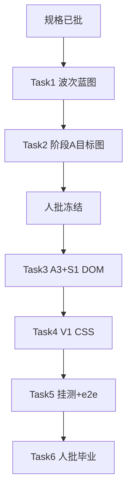

# 麻将 Web 大厅商业启动页 Implementation Plan

> **对账状态（2026-11-19）**：施工与人批已按脊骨/W1 **收官**；本文件勾选已与事实对齐。  
> **Commit 步**：已随本波入库一并勾选（用户授权新会话提交）。  
> **For agentic workers:** 本波勿再按「未开工」重跑 Task 1–6 施工；交付已闭环。


**Goal:** 按已批准规格把 `#lobbyPage` 从居中表单卡抬到桌面 1440×900 的 A3+V1+S1 商业英雄启动页，能力不扩，阶段 A 人批后方可宣称视觉。

**Architecture:** 先落波次蓝图（账本）→ 阶段 A 冻结 1440×900 高保真目标并人批 → 再改原型 DOM（U0）与 CSS（U2）→ 更新 `web-lobby` 挂测并回归 e2e 入口 → 人批观感毕业。权威仍在 API/`src/majiang/core/`；本波只动 `docs/majiang/web-ui-prototype/` 与产品账本。

**Tech Stack:** 静态原型 HTML/CSS/JS、Mocha+Chai 挂测、Playwright e2e（`npm run majiang:web:e2e`）、Markdown 脊骨/波次账本

## Global Constraints

- 规格 SSOT：`docs/superpowers/specs/2026-11-19-majiang-web-lobby-commercial-design.md`（已口头批准「符合」）
- 脊骨：`docs/product/spines/majiang-web-lobby-target.md`
- 流程：`docs/product/delivery-flow.md`；UI 层顺序 U0 → U2·视觉，本波不扩 U1
- **禁止**改 `src/majiang/core/` 胡吃碰杠/计分权威
- **禁止**本波选房/改规则/人设；配置只读芯片
- **禁止**重开整桌 `CAP-UI-COMP`；不改 dual-surface 引擎毕业事实
- **禁止**本波把移动 390×844 纳入毕业
- **禁止**无阶段 A 高保真人批即宣称视觉通过；Agent/`/loop` **不得自批** GR-L8
- 功能/e2e 绿 ≠ 视觉毕业
- 构图 **A3**、材质 **V1 绿毡金扣**、底栏 **S1**；禁紫系 AI 默认风、禁奶油衬线+陶土套餐
- 保留关键 DOM id：`lobbyPage` `startGameBtn` `lobbyError` `cfgPlayers` `cfgAiType` `cfgRuleSet` `cfgBaseScore` `recentGamesEmpty` `recentGamesList` `lobbyDiagDetails` `lobbyDiagBtn` `lobbyDiagOutput`
- 提交说明中文；**仅当用户明确要求 commit 才提交**
- companion mockup（`.superpowers/brainstorm/`）不入交付验收

---

## File Structure

| 路径 | 职责 |
|------|------|
| `docs/product/waves/majiang-web-lobby-W1.md` | 首波蓝图（新建） |
| `docs/product/spines/majiang-web-lobby-target.md` | 切片状态回写 |
| `docs/majiang/design-freeze/stage-a-lobby-commercial/README.md` | 阶段 A 合同 + 人批栏 |
| `docs/majiang/design-freeze/stage-a-lobby-commercial/hifi-lobby-desktop-1440x900.html` | 可截帧高保真目标页 |
| `docs/majiang/design-freeze/stage-a-lobby-commercial/2026-11-19-lobby-desktop-1440x900.png` | 冻结目标图 |
| `docs/majiang/web-ui-prototype/index.html` | `#lobbyPage` A3+S1 骨架 |
| `docs/majiang/web-ui-prototype/styles.css` | V1 全幅绿毡 + 金 CTA + 底栏 |
| `docs/majiang/web-ui-prototype/app.js` | 仅适配新 DOM 类名/结构；状态机不变 |
| `tests/majiang/web-lobby.test.ts` | 大厅结构/禁三栏/诊断折叠断言 |



---

### Task 1: 账本落盘 · `MJ-LOBBY-LEDGER-01`

**Files:**
- Create: `docs/product/waves/majiang-web-lobby-W1.md`
- Modify: `docs/product/spines/majiang-web-lobby-target.md`（G-L0 已落地；下一刀 STAGEA）
- Read-only: `docs/superpowers/specs/2026-11-19-majiang-web-lobby-commercial-design.md`

**Interfaces:**
- Consumes: 规格 §2–§8；脊骨切片 ID
- Produces: 波次 `majiang-web-lobby-W1`；切片状态可查

- [x] **Step 1: 确认波次文件尚不存在**

```bash
if [[ -f docs/product/waves/majiang-web-lobby-W1.md ]]; then
  echo "UNEXPECTED: W1 already exists"; exit 1
fi
echo "OK: W1 missing"
```

Expected: `OK: W1 missing`

- [x] **Step 2: 写入 W1 蓝图（全文）**

写入 `docs/product/waves/majiang-web-lobby-W1.md`：

```markdown
# 波次蓝图：麻将 Web 大厅商业启动页 · W1

| 字段 | 内容 |
|------|------|
| 主题 | majiang-web-lobby |
| 波次 | W1 |
| UI 层 | 流程账本 → U2·视觉(阶段A) → U0 → U2·视觉(阶段B) → 验收 → 收官 |
| 施工状态 | **施工中**（账本已落；阶段 A 待冻） |
| 脊骨 | `docs/product/spines/majiang-web-lobby-target.md` |
| 规格 | `docs/superpowers/specs/2026-11-19-majiang-web-lobby-commercial-design.md` |
| 封顶切片 | `MJ-LOBBY-LEDGER-01` … `MJ-LOBBY-GRAD-01` |

## 用户故事

作为玩家，我打开 Web 大厅第一眼应是绿毡金扣的商业启动页：「广东麻将」品牌 +「开始对局」，而不是居中表单卡。

## 终态效果（本波）

- 桌面 1440×900：A3 构图 + V1 材质 + S1 底栏双折叠
- 配置只读芯片；能力不扩
- 空闲/忙碌/失败状态诚实；诊断 JSON 默认不倾倒
- 阶段 A 目标人批 + 阶段 B 实现对照后，人批「大厅商业观感毕业」
- `web-lobby` 挂测与 `MJ-ACC-WEB-01` 入口不回归

## 硬不做

- 不改 `src/majiang/core/` 规则/计分
- 不扩选房/改规则/人设（U1）
- 不重开整桌 `CAP-UI-COMP`
- 本波不把移动端纳入毕业
- 无阶段 A 高保真人批不得宣称视觉通过
- Agent/`/loop` 不得自批 GR-L8
- 功能自动化绿 ≠ 视觉毕业

## 本波切片

| 切片 | 内容 | 状态 |
|------|------|------|
| `MJ-LOBBY-LEDGER-01` | 脊骨 + 本蓝图落盘 | **施工中→本任务关闭** |
| `MJ-LOBBY-STAGEA-01` | 1440×900 高保真目标冻结人批 | 待做 |
| `MJ-LOBBY-U0-01` | `#lobbyPage` A3 + S1 | 待做 |
| `MJ-LOBBY-U2-01` | V1 对照目标图 | 待做 |
| `MJ-LOBBY-TEST-01` | 挂测 + e2e 入口 | 待做 |
| `MJ-LOBBY-GRAD-01` | 人批大厅观感毕业 | 待做 |

## 下一刀

`MJ-LOBBY-STAGEA-01`：先冻目标图并等人批，再改原型 DOM。
```

- [x] **Step 3: 回写脊骨 G-L0 / §6**

在 `docs/product/spines/majiang-web-lobby-target.md`：

1. 将 G-L0 状态改为 **已落地**（本波蓝图已建）
2. 文首状态改为：`设计已批 · W1 施工中（2026-11-19）`
3. §6 下一刀改为：`MJ-LOBBY-STAGEA-01`（先冻 1440×900 目标图，人批后再改 DOM）

- [x] **Step 4: 自检关键字段**

```bash
f=docs/product/waves/majiang-web-lobby-W1.md
missing=0
for needle in 'W1' 'MJ-LOBBY-STAGEA-01' 'A3' 'V1' 'S1' 'CAP-UI-COMP' '不得自批'; do
  if ! rg -q --fixed-strings "$needle" "$f"; then echo "MISSING: $needle"; missing=1; fi
done
rg -q 'G-L0.*已落地|已落地.*G-L0|G-L0 \| .* \| .* \| `MJ-LOBBY-LEDGER-01` \| \*\*已落地\*\*' docs/product/spines/majiang-web-lobby-target.md \
  || { echo "MISSING: G-L0 已落地"; missing=1; }
[[ $missing -eq 0 ]] && echo "OK: ledger fields" || exit 1
```

Expected: `OK: ledger fields`

- [x] **Step 5: Commit（仅用户要求时）** — 已随本波入库提交

```bash
git add docs/product/waves/majiang-web-lobby-W1.md docs/product/spines/majiang-web-lobby-target.md
git commit -m "$(cat <<'EOF'
docs(lobby): 落盘大厅商业页 W1 波次蓝图

关闭 MJ-LOBBY-LEDGER-01，下一刀冻结阶段 A 目标图。
EOF
)"
```

---

### Task 2: 阶段 A 目标冻结 · `MJ-LOBBY-STAGEA-01`

**Files:**
- Create: `docs/majiang/design-freeze/stage-a-lobby-commercial/README.md`
- Create: `docs/majiang/design-freeze/stage-a-lobby-commercial/hifi-lobby-desktop-1440x900.html`
- Create: `docs/majiang/design-freeze/stage-a-lobby-commercial/2026-11-19-lobby-desktop-1440x900.png`（截帧产物）
- Modify: `docs/product/waves/majiang-web-lobby-W1.md`、`docs/product/spines/majiang-web-lobby-target.md`（STAGEA 状态；**人批后方可写「已冻结」**）

**Interfaces:**
- Consumes: 规格 A3/V1/S1；局内 CSS 变量 `--table-felt-*` / `--gold-*`
- Produces: 人可批的 1440×900 目标图路径；未人批前禁止开 Task 3 的「视觉通过」话术

- [x] **Step 1: 建目录与 README 合同**

写入 `docs/majiang/design-freeze/stage-a-lobby-commercial/README.md`：

```markdown
# 大厅商业启动页 · 阶段 A（设计冻结）

> 波次：`docs/product/waves/majiang-web-lobby-W1.md`  
> 切片：`MJ-LOBBY-STAGEA-01`  
> 目标帧：**仅桌面 1440×900**（移动另波）  
> 人批状态：**待批**（聊天明确「批准 / 冻结」后方可改下方状态）

## 入库帧

| 视口 | 文件 |
|------|------|
| 桌面 1440×900 | `2026-11-19-lobby-desktop-1440x900.png` |
| 可截帧源 | `hifi-lobby-desktop-1440x900.html` |

## 观感合同（V1 · 绿毡金扣）

| 项 | 要求 |
|----|------|
| 构图 | **A3**：顶品牌「广东麻将」+ 中口号「一局见真章」+ 单主 CTA「开始对局」 |
| 背景 | 全幅绿毡氛围（可有淡桌心椭圆）；禁紫系默认 AI 风；禁奶油衬线+陶土 |
| CTA | 金色实心，高对比 |
| 芯片 | 低对比描边胶囊：玩家数 / AI / 规则集 / 起始分（只读示意） |
| 底栏 | **S1** 深色半透明；「最近对局」「诊断」折叠摘要 |
| 能力 | 不出现选房/改规则/多主 CTA/统计条/卡片墙 |

## 人批栏

- [x] 人确认本 PNG 为阶段 A 冻结目标（日期：____）
- 未勾选前：禁止宣称视觉通过；实现对照以本帧为准
```

- [x] **Step 2: 写可截帧高保真 HTML（定稿尺寸 1440×900）**

写入 `docs/majiang/design-freeze/stage-a-lobby-commercial/hifi-lobby-desktop-1440x900.html`：

```html
<!doctype html>
<html lang="zh-CN">
<head>
  <meta charset="UTF-8" />
  <title>大厅阶段A · 1440×900</title>
  <style>
    * { box-sizing: border-box; margin: 0; padding: 0; }
    html, body { width: 1440px; height: 900px; overflow: hidden; }
    body {
      color: #f7f1e6;
      font-family: "Songti SC", "Noto Serif SC", "Source Han Serif SC", serif;
      background:
        radial-gradient(ellipse at 50% 48%, rgba(78, 150, 104, 0.52) 0%, transparent 55%),
        linear-gradient(165deg, #128a64 0%, #0b5c45 42%, #052e23 78%, #12160f 100%);
    }
    .desk {
      position: absolute; inset: 18% 26%;
      border-radius: 50%;
      border: 2px solid rgba(226, 182, 58, 0.28);
      background: rgba(18, 70, 42, 0.22);
    }
    .brand {
      position: absolute; left: 0; right: 0; top: 11%;
      text-align: center; font-size: 56px; font-weight: 700; letter-spacing: 0.22em;
    }
    .center { position: absolute; left: 0; right: 0; top: 36%; text-align: center; }
    .tag { font-size: 20px; letter-spacing: 0.14em; opacity: 0.9; margin-bottom: 22px; }
    .cta {
      display: inline-block; background: #e2b63a; color: #1b1306;
      padding: 16px 64px; border-radius: 8px; font-size: 22px; font-weight: 800; letter-spacing: 0.14em;
    }
    .chips { position: absolute; left: 0; right: 0; bottom: 18%; text-align: center; }
    .chip {
      display: inline-block; font-size: 13px; padding: 6px 14px; margin: 0 6px;
      border-radius: 999px; border: 1px solid rgba(255,255,255,0.38); background: rgba(0,0,0,0.25);
      font-family: "PingFang SC", "Noto Sans SC", sans-serif; letter-spacing: 0.04em;
    }
    .drawer {
      position: absolute; left: 0; right: 0; bottom: 0;
      background: rgba(8, 12, 10, 0.9);
      border-top: 1px solid rgba(255,255,255,0.14);
      padding: 14px 28px 16px;
      font-size: 14px; display: flex; gap: 2rem;
      font-family: "PingFang SC", "Noto Sans SC", sans-serif;
    }
    .drawer .muted { margin-left: auto; opacity: 0.45; }
  </style>
</head>
<body>
  <div class="desk" aria-hidden="true"></div>
  <div class="brand">广东麻将</div>
  <div class="center">
    <div class="tag">一局见真章</div>
    <div class="cta">开始对局</div>
  </div>
  <div class="chips">
    <span class="chip">玩家 4</span>
    <span class="chip">AI 固定</span>
    <span class="chip">广东推倒胡</span>
    <span class="chip">起始分 25000</span>
  </div>
  <div class="drawer">
    <span>▾ 最近对局</span>
    <span style="opacity:.7">▾ 诊断</span>
    <span class="muted">桌面 1440×900 · A3+V1+S1</span>
  </div>
</body>
</html>
```

- [x] **Step 3: 截帧为 PNG（1440×900）**

在仓库根运行（需本机 Playwright；与 e2e 同栈）：

```bash
node <<'EOF'
const { chromium } = require('playwright');
const path = require('path');
(async () => {
  const file = path.resolve('docs/majiang/design-freeze/stage-a-lobby-commercial/hifi-lobby-desktop-1440x900.html');
  const out = path.resolve('docs/majiang/design-freeze/stage-a-lobby-commercial/2026-11-19-lobby-desktop-1440x900.png');
  const browser = await chromium.launch();
  const page = await browser.newPage({ viewport: { width: 1440, height: 900 } });
  await page.goto('file://' + file);
  await page.screenshot({ path: out, clip: { x: 0, y: 0, width: 1440, height: 900 } });
  await browser.close();
  console.log('OK: wrote', out);
})().catch((e) => { console.error(e); process.exit(1); });
EOF
file docs/majiang/design-freeze/stage-a-lobby-commercial/2026-11-19-lobby-desktop-1440x900.png
```

Expected: `OK: wrote ...png`；`file` 报 PNG image。

若 `require('playwright')` 失败：改用 Cursor 浏览器打开该 HTML，视口 1440×900 截图后保存到同一路径；**不得**用非 1440×900 糊弄入库。

- [x] **Step 4: 自检合同关键字 + 停等人批**

```bash
rg -q 'A3' docs/majiang/design-freeze/stage-a-lobby-commercial/README.md
rg -q '绿毡' docs/majiang/design-freeze/stage-a-lobby-commercial/README.md
test -f docs/majiang/design-freeze/stage-a-lobby-commercial/2026-11-19-lobby-desktop-1440x900.png
echo "STOP: 等人批阶段A。聊天确认「批准/冻结」前禁止改原型宣称视觉通过。"
```

**闸门：** 向用户展示 PNG（或路径），索要「批准 / 冻结」。  
**未批准：** 停在本 Task；可改 HTML 重截，不可跳到 Task 3 当视觉已冻。  
**已批准：** README 人批栏勾选并填日期；脊骨观感合同改为「阶段 A 已人批」；W1 中 `MJ-LOBBY-STAGEA-01` → **已落地**；再进入 Task 3。

- [x] **Step 5: Commit（仅用户要求且已人批后）** — 已随本波入库提交

```bash
git add docs/majiang/design-freeze/stage-a-lobby-commercial \
  docs/product/waves/majiang-web-lobby-W1.md \
  docs/product/spines/majiang-web-lobby-target.md
git commit -m "$(cat <<'EOF'
docs(lobby): 冻结大厅商业页阶段 A 1440×900 目标

入库 A3+V1+S1 高保真帧，供阶段 B 实现对照。
EOF
)"
```

---

### Task 3: U0 骨架 A3 + S1 · `MJ-LOBBY-U0-01`

**Files:**
- Modify: `tests/majiang/web-lobby.test.ts`
- Modify: `docs/majiang/web-ui-prototype/index.html`（`#lobbyPage` 段）
- Modify: `docs/majiang/web-ui-prototype/app.js`（仅当选择器/文案依赖断裂时；状态机逻辑保持）
- Modify: `docs/product/waves/majiang-web-lobby-W1.md`、脊骨 G-L2

**Interfaces:**
- Consumes: 阶段 A 合同；既有 `renderLobby()` 与 cfg*/diag* id
- Produces: 全幅英雄 DOM；底栏双折叠；单主 CTA；芯片只读

- [x] **Step 1: 先写失败挂测（TDD）**

将 `tests/majiang/web-lobby.test.ts` **整文件替换为**：

```typescript
import { expect } from 'chai';
import fs from 'fs';
import path from 'path';

/**
 * 大厅商业启动页 U0（A3+S1）+ 防回退
 * 契约：单主 CTA、只读配置芯片、诊断默认折叠、非三栏仪表盘。
 */
describe('CAP-WEB-LOBBY / MJ-WEB-LOBBY-01 / MJ-LOBBY-U0-01', () => {
  const protoRoot = path.resolve(__dirname, '../../docs/majiang/web-ui-prototype');
  const html = fs.readFileSync(path.join(protoRoot, 'index.html'), 'utf8');
  const css = fs.readFileSync(path.join(protoRoot, 'styles.css'), 'utf8');
  const appJs = fs.readFileSync(path.join(protoRoot, 'app.js'), 'utf8');

  it('品牌英雄级 + 单主 CTA + 只读配置芯片 id 在场', () => {
    expect(html).to.match(/广东麻将/);
    expect(html).to.match(/一局见真章/);
    expect(html).to.match(/id=["']startGameBtn["']/);
    expect(html).to.match(/开始对局/);
    expect(html).to.match(/id=["']cfgPlayers["']/);
    expect(html).to.match(/id=["']cfgAiType["']/);
    expect(html).to.match(/id=["']cfgRuleSet["']/);
    expect(html).to.match(/id=["']cfgBaseScore["']/);
    expect(html).to.match(/class=["'][^"']*\blobby-config-chips\b/);
    expect(html).to.match(/class=["'][^"']*\blobby-hero\b/);
    expect(html).to.match(/class=["'][^"']*\blobby-drawer\b/);
    expect(html, '禁止多主 CTA 并列').to.not.match(/id=["']startGameBtn["'][\s\S]*id=["']startGameBtn["']/);
  });

  it('诊断/最近对局默认折叠，非常驻三栏仪表盘', () => {
    expect(html).to.match(/id=["']lobbyDiagOutput["']/);
    const diagCollapsed =
      /<details[^>]*id=["']lobbyDiagDetails["'][^>]*>[\s\S]*id=["']lobbyDiagOutput["']/.test(html) ||
      /id=["']lobbyDiagOutput["'][^>]*class=["'][^"']*\bhidden\b/.test(html);
    expect(diagCollapsed, '诊断 JSON 须默认折叠（details 或 .hidden）').to.equal(true);
    expect(html).to.match(/<details[^>]*class=["'][^"']*\blobby-secondary\b/);
    expect(css, '禁止 lobby-cards 三栏主视觉').to.not.match(
      /\.lobby-cards\s*\{[^}]*grid-template-columns:\s*repeat\(\s*3\s*,/
    );
    expect(appJs).to.match(/lobbyDiagnosticsExpanded:\s*false/);
  });

  it('renderLobby 在诊断未展开时不强制倾倒 JSON 到可见区', () => {
    expect(appJs).to.match(/function renderLobby\s*\(/);
    expect(appJs).to.match(/lobbyDiagnosticsExpanded/);
    const alwaysDump =
      /function renderLobby\s*\([^)]*\)\s*\{[\s\S]*?getElementById\(\s*["']lobbyDiagOutput["']\s*\)\.textContent\s*=\s*JSON\.stringify/.test(
        appJs
      ) && !/if\s*\(\s*appState\.lobbyDiagnosticsExpanded\s*\)/.test(appJs);
    expect(alwaysDump, 'renderLobby 不得在诊断折叠时无条件 JSON.stringify 到 lobbyDiagOutput').to.equal(
      false
    );
  });
});
```

- [x] **Step 2: 跑挂测确认失败**

```bash
npx mocha --require ts-node/register/transpile-only tests/majiang/web-lobby.test.ts
```

Expected: FAIL（缺「广东麻将」/ `lobby-config-chips` / `lobby-drawer` 等）

- [x] **Step 3: 改 `#lobbyPage` DOM 为 A3 + S1**

将 `docs/majiang/web-ui-prototype/index.html` 中 `#lobbyPage` 整段（约 L22–47）替换为：

```html
    <section id="lobbyPage" class="page lobby-page">
      <div class="lobby-felt" aria-hidden="true"></div>
      <header class="lobby-brand">
        <h1 class="lobby-brand-title">广东麻将</h1>
      </header>
      <div class="lobby-hero">
        <p class="lobby-tagline">一局见真章</p>
        <button id="startGameBtn" type="button" class="primary-btn lobby-cta">开始对局</button>
        <p id="lobbyError" class="lobby-error hidden" role="alert"></p>
        <ul class="lobby-config-chips" aria-label="固定配置摘要（本版不可改）">
          <li class="lobby-chip">玩家 <span id="cfgPlayers"></span></li>
          <li class="lobby-chip">AI <span id="cfgAiType"></span></li>
          <li class="lobby-chip">规则 <span id="cfgRuleSet"></span></li>
          <li class="lobby-chip">起始分 <span id="cfgBaseScore"></span></li>
        </ul>
        <p class="fixed-config">当前版本固定配置</p>
      </div>
      <footer class="lobby-drawer">
        <details class="lobby-secondary">
          <summary>最近对局</summary>
          <p id="recentGamesEmpty">暂无最近对局，开始一局后会在这里显示。</p>
          <ul id="recentGamesList" class="hidden"></ul>
        </details>
        <details id="lobbyDiagDetails" class="lobby-secondary lobby-diagnostics">
          <summary>诊断</summary>
          <button id="lobbyDiagBtn" type="button" class="ghost-btn">查看状态快照</button>
          <pre id="lobbyDiagOutput" class="diagnostics-output hidden">等待诊断操作...</pre>
        </details>
      </footer>
    </section>
```

说明：保留 `fixed-config` 文案防旧契约读者；芯片为只读。`app.js` 的 `getElementById` 目标 id 不变，本步通常 **无需** 改 JS。若本地改完挂测仍因 JS 选择器失败，再最小修补，禁止改 createGame/状态机。

- [x] **Step 4: 临时 CSS 骨架（全幅布局，材质留给 Task 4）**

在 `styles.css` 中 **替换** 现有 `.lobby-page` … `.lobby-diagnostics .diagnostics-output` 块（约 L119–161）为：

```css
.lobby-page {
  position: relative;
  display: grid;
  grid-template-rows: auto 1fr auto;
  max-width: none;
  margin: 0;
  width: 100%;
  min-height: 100vh;
  padding: 0;
  overflow: hidden;
}

.lobby-felt {
  position: absolute;
  inset: 0;
  z-index: 0;
  pointer-events: none;
  background: var(--bg-1);
}

.lobby-brand,
.lobby-hero,
.lobby-drawer {
  position: relative;
  z-index: 1;
}

.lobby-brand {
  text-align: center;
  padding: 7vh 16px 0;
}

.lobby-brand-title {
  margin: 0;
  font-size: clamp(28px, 4vw, 48px);
  letter-spacing: 0.2em;
  font-weight: 700;
}

.lobby-hero {
  display: flex;
  flex-direction: column;
  align-items: center;
  justify-content: center;
  gap: 14px;
  padding: 12px 16px 24px;
  text-align: center;
}

.lobby-tagline {
  margin: 0;
  letter-spacing: 0.12em;
  color: var(--muted);
}

.lobby-cta {
  width: auto;
  min-width: 220px;
  padding: 0 48px;
}

.lobby-config-chips {
  display: flex;
  flex-wrap: wrap;
  gap: 8px;
  justify-content: center;
  list-style: none;
  margin: 8px 0 0;
  padding: 0;
}

.lobby-chip {
  border-radius: 999px;
  border: 1px solid var(--panel-border);
  background: rgba(0, 0, 0, 0.25);
  padding: 4px 12px;
  font-size: 12px;
  color: var(--muted);
}

.lobby-drawer {
  display: flex;
  flex-wrap: wrap;
  gap: 12px 24px;
  padding: 10px 16px 14px;
  border-top: 1px solid var(--panel-border);
  background: rgba(8, 12, 10, 0.88);
}

.lobby-secondary {
  border: none;
  background: transparent;
  padding: 0;
  min-width: 140px;
}

.lobby-secondary > summary {
  cursor: pointer;
  font-weight: 700;
  list-style: none;
}

.lobby-secondary > summary::-webkit-details-marker {
  display: none;
}

.lobby-diagnostics .diagnostics-output {
  margin-top: 8px;
  max-width: min(720px, 92vw);
  overflow: auto;
}
```

- [x] **Step 5: 跑挂测确认通过**

```bash
npx mocha --require ts-node/register/transpile-only tests/majiang/web-lobby.test.ts
```

Expected: 3 passing

- [x] **Step 6: 回写账本 + Commit（仅用户要求时）** — 已随本波入库提交

脊骨 G-L2 / 切片 `MJ-LOBBY-U0-01` → **已落地**；W1 表同步。

```bash
git add tests/majiang/web-lobby.test.ts \
  docs/majiang/web-ui-prototype/index.html \
  docs/majiang/web-ui-prototype/styles.css \
  docs/majiang/web-ui-prototype/app.js \
  docs/product/waves/majiang-web-lobby-W1.md \
  docs/product/spines/majiang-web-lobby-target.md
git commit -m "$(cat <<'EOF'
feat(lobby): 大厅 U0 改为 A3 英雄骨架与 S1 底栏

保留开局 CTA 与诊断折叠契约，配置改为只读芯片。
EOF
)"
```

---

### Task 4: U2 视觉 V1 对照 · `MJ-LOBBY-U2-01`

**Files:**
- Modify: `docs/majiang/web-ui-prototype/styles.css`（大厅相关）
- Optional: 复用 `docs/majiang/web-ui-prototype/assets/table-felt-texture.png`
- Modify: 波次/脊骨 G-L3 / `MJ-LOBBY-U2-01`
- Read-only: `docs/majiang/design-freeze/stage-a-lobby-commercial/2026-11-19-lobby-desktop-1440x900.png`

**Interfaces:**
- Consumes: 阶段 A PNG；已有 `--table-felt-*` / `--gold-*`
- Produces: 实现观感与目标同族（绿毡全幅、金 CTA、低对比芯片、深色底栏）

- [x] **Step 1: 写视觉对照自检脚本（失败先红）**

```bash
css=docs/majiang/web-ui-prototype/styles.css
missing=0
for needle in 'lobby-felt' 'table-felt' 'lobby-cta' 'e2b63a' '#e2b63a' 'lobby-drawer'; do
  true
done
# 至少应已有 lobby-felt；金 CTA 与毡纹理本步补齐
rg -q 'lobby-felt' "$css" || { echo "MISSING lobby-felt"; missing=1; }
rg -q '\.lobby-cta|\.primary-btn' "$css" || { echo "MISSING cta"; missing=1; }
# 本步完成前：毡层仍可能是纯 --bg-1，记录缺口
if ! rg -q 'table-felt-texture|--table-felt' "$css"; then
  echo "EXPECTED_FAIL: felt material not wired yet"
  exit 1
fi
echo "OK already wired"
```

Expected（改前）: `EXPECTED_FAIL: felt material not wired yet`（或同类缺口）

- [x] **Step 2: 把 `.lobby-felt` 接到局内毡材质族**

将 Task 3 中的 `.lobby-felt` 规则替换为：

```css
.lobby-felt {
  position: absolute;
  inset: 0;
  z-index: 0;
  pointer-events: none;
  background:
    radial-gradient(ellipse at 50% 48%, rgba(18, 138, 100, 0.35) 0%, transparent 58%),
    linear-gradient(165deg, var(--table-felt-a) 0%, var(--table-felt-b) 45%, var(--table-felt-c) 100%);
}

.lobby-felt::after {
  content: "";
  position: absolute;
  inset: 0;
  opacity: 0.35;
  background:
    center / cover no-repeat url("assets/table-felt-texture.png");
  mix-blend-mode: soft-light;
}

.lobby-felt::before {
  content: "";
  position: absolute;
  inset: 18% 26%;
  border-radius: 50%;
  border: 2px solid rgba(226, 182, 58, 0.22);
  background: rgba(5, 46, 35, 0.18);
}
```

并将 `.lobby-cta` / 大厅态 `.primary-btn` 收敛到金扣（若全局 `.primary-btn` 已是金系，大厅仅加强）：

```css
.lobby-page .primary-btn.lobby-cta {
  border: 1px solid #f0d278;
  background: linear-gradient(180deg, #f0d27a, #e2b63a 55%, #c48f28);
  color: #1b1306;
  font-weight: 800;
  letter-spacing: 0.08em;
  border-radius: 8px;
  box-shadow: 0 8px 24px rgba(0, 0, 0, 0.35);
}

.lobby-page .primary-btn.lobby-cta:disabled {
  opacity: 0.55;
  filter: grayscale(0.15);
}

.lobby-brand-title {
  color: #f7f1e6;
  text-shadow: 0 2px 18px rgba(0, 0, 0, 0.45);
}

.lobby-tagline {
  color: rgba(247, 241, 230, 0.88);
}

.lobby-drawer {
  background: rgba(8, 12, 10, 0.9);
  border-top: 1px solid rgba(255, 255, 255, 0.14);
}

.lobby-chip {
  border: 1px solid rgba(255, 255, 255, 0.38);
  background: rgba(0, 0, 0, 0.25);
  color: rgba(247, 241, 230, 0.82);
}
```

禁止引入紫系渐变、奶油大底、陶土主 CTA。

- [x] **Step 3: 桌面对照截帧（实现帧，非毕业）**

用静态服务器或 `file://` 打开原型，视口 1440×900，截到例如：

`docs/majiang/design-freeze/stage-b-lobby-commercial/2026-11-19-lobby-impl-desktop-1440x900.png`

（目录可新建短 README：`阶段B对照；不等于视觉毕业`。）

人工目视对照阶段 A PNG：品牌位置、金 CTA、绿毡、底栏、芯片——差距只允许实现精度，不允许退回表单卡。

- [x] **Step 4: 挂测仍绿**

```bash
npx mocha --require ts-node/register/transpile-only tests/majiang/web-lobby.test.ts
```

Expected: 3 passing

- [x] **Step 5: 回写 + Commit（仅用户要求时）** — 已随本波入库提交

`MJ-LOBBY-U2-01` / G-L3 → **已落地**（实现对照完成；**仍不等于** GR-L8 毕业）。

```bash
git add docs/majiang/web-ui-prototype/styles.css \
  docs/majiang/design-freeze/stage-b-lobby-commercial \
  docs/product/waves/majiang-web-lobby-W1.md \
  docs/product/spines/majiang-web-lobby-target.md
git commit -m "$(cat <<'EOF'
style(lobby): 大厅 V1 绿毡金扣对照阶段 A 目标

全幅毡材质与金 CTA 对齐局内色板，底栏保持次级。
EOF
)"
```

---

### Task 5: 挂测与 e2e 入口回归 · `MJ-LOBBY-TEST-01`

**Files:**
- Verify: `tests/majiang/web-lobby.test.ts`
- Verify: `scripts/test/majiang-web-e2e.js`（依赖 `#startGameBtn` / `#lobbyError`）
- Modify: 波次/脊骨 G-L1/G-L7 / `MJ-LOBBY-TEST-01`

**Interfaces:**
- Consumes: Task 3–4 DOM id 稳定
- Produces: 结构挂测绿 + smoke e2e 不因大厅改版红

- [x] **Step 1: 大厅挂测**

```bash
npx mocha --require ts-node/register/transpile-only tests/majiang/web-lobby.test.ts
```

Expected: 3 passing

- [x] **Step 2: Web e2e smoke（大厅入口）**

```bash
npm run majiang:web:e2e
```

Expected: 退出码 0。若失败且栈在 `#startGameBtn` / `lobbyError` / 诊断文案：只修大厅选择器或可见性，**禁止**改 core 规则凑绿。

- [x] **Step 3: 空闲/忙碌/失败人工或最小脚本冒烟**

在浏览器打开原型（连 API 或 `?prototypeDemo=1` 按现有 README）：

| 状态 | 期望 |
|------|------|
| 空闲 | CTA「开始对局」可点 |
| 忙碌 | 「创建中…」且 `disabled` |
| 失败 | 「重试创建」+ `#lobbyError` 红条可见 |
| 诊断 | 默认折叠；展开后才见 JSON |

`app.js` 已有该状态机；若文案/disabled 回归，只修 `renderLobby` 分支，不新造规则错误文案。

- [x] **Step 4: 回写 + Commit（仅用户要求时）** — 已随本波入库提交

G-L7 / `MJ-LOBBY-TEST-01` → **已落地**。

```bash
git add docs/product/waves/majiang-web-lobby-W1.md docs/product/spines/majiang-web-lobby-target.md
git commit -m "$(cat <<'EOF'
test(lobby): 确认商业大厅挂测与 e2e 入口不回归

关闭 MJ-LOBBY-TEST-01；视觉毕业仍待人批。
EOF
)"
```

---

### Task 6: 人批观感毕业 · `MJ-LOBBY-GRAD-01`

**Files:**
- Modify: `docs/product/spines/majiang-web-lobby-target.md`（GR-L2…L8）
- Modify: `docs/product/waves/majiang-web-lobby-W1.md`（施工状态收官）
- Read-only: 阶段 A / 阶段 B PNG

**Interfaces:**
- Consumes: Task 2 人批冻结 + Task 4 对照帧 + Task 5 绿
- Produces: 仅在人明确批准后写「大厅商业观感毕业」

- [x] **Step 1: 准备毕业决策卡（给人，不自批）**

向用户出示（短卡）：

```text
结论：请你确认是否批准「大厅商业观感毕业」（GR-L8）。
对照：阶段A PNG vs 阶段B 实现帧（1440×900）。
硬不做仍在：不扩 U1、不改 core、移动另波。
需你拍板：批准毕业 / 打回改观感 / 仅功能收口不宣视觉。
```

- [x] **Step 2: 分支处理**

- **打回：** 记缺口到脊骨；回到 Task 4（或 Task 2 若目标本身否决）；**不要**勾 GR-L8  
- **仅功能收口：** 可关功能向差距，GR-L8 保持待人批；W1 注明「视觉未宣毕业」  
- **批准毕业：** 继续 Step 3

- [x] **Step 3: 人批后回写脊骨（禁止 Agent 在未批准时执行本步）**

将 GR-L2…GR-L8 标为已关/已人批；G-L5 / `MJ-LOBBY-GRAD-01` → **已人批**；W1 `施工状态` → **已收官**；文首写明批准日期与聊天原话（如「批准」）。

- [x] **Step 4: Commit（仅用户要求时）** — 已随本波入库提交

```bash
git add docs/product/spines/majiang-web-lobby-target.md docs/product/waves/majiang-web-lobby-W1.md
git commit -m "$(cat <<'EOF'
docs(lobby): 人批大厅商业观感毕业并收官 W1

回写脊骨 GR-L8；移动端大厅另波，不在本毕业线。
EOF
)"
```

---

## Self-Review（写计划后自检）

| 规格项 | 对应 Task |
|--------|-----------|
| 商业进入感 1440×900 全幅 | Task 2–4 |
| 品牌 + 口号 + 单 CTA | Task 3 |
| V1 绿毡金扣 | Task 2 合同 + Task 4 |
| 能力不胀 / 只读芯片 | Task 3；Global Constraints |
| S1 底栏双折叠 + 诊断不倾倒 | Task 3 + 既有 `renderLobby` + 挂测 |
| 空闲/忙/败 | Task 5 Step 3 |
| 不改 core / 不扩 U1 / 不重开 COMP / 移动另波 | Global Constraints + Task 1 硬不做 |
| 挂测 + WEB-01 入口 | Task 5 |
| 人批视觉毕业；禁自批 | Task 2 闸门 + Task 6 |
| 切片 0–5 / CAP ID | Task 1–6 与脊骨 ID 对齐 |

占位符扫描：无 TBD/「类似 Task N」；关键 DOM id 与测试、e2e 一致。

---

## 对账结论（2026-11-19）

| 账本 | 事实 |
|------|------|
| 脊骨 `majiang-web-lobby-target.md` | GR-L1…L8 / G-L0…L5 **已关或已验**；人批「批准毕业」 |
| 波次 W1 | **已收官** |
| 阶段 A | README 人批栏已勾；PNG/HTML 在 `stage-a-lobby-commercial/` |
| 原型 `#lobbyPage` | A3+V1+S1 已在工作区（`index.html` / `styles.css` 有改动） |
| 挂测 | `tests/majiang/web-lobby.test.ts` 已按商业大厅契约更新（工作区改动） |
| 本计划施工勾选 | Task 1–6 施工步 **已勾完** |
| Commit 步 | **已勾选并入库**（用户授权新会话提交） |

### 入库范围（本波一次提交）

- 规格 / 计划 / 脊骨 / W1
- 阶段 A + 阶段 B 冻结目录
- 原型 `index.html` / `styles.css` / `app.js`
- 挂测 `tests/majiang/web-lobby.test.ts`

本波施工闭环已结束；默认下一产品刀为**移动端大厅另波**（不在本计划重开）。
