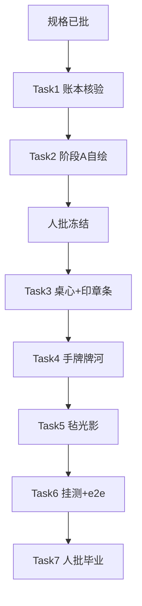

# 麻将 Web 局内桌三抬顶 Implementation Plan

> **For agentic workers:** REQUIRED SUB-SKILL: Use superpowers:subagent-driven-development (recommended) or superpowers:executing-plans to implement this plan task-by-task. Steps use checkbox (`- [ ]`) syntax for tracking.

**Goal:** 按已批准规格把 `#tablePage` 抬到桌面 1440×900 自绘高保真局内桌（强桌心、印章动作条、实体牌、绿毡金扣与大厅同族），经阶段 A 人批后再实现，并以竞品并排人批毕业。

**Architecture:** 账本已落盘 → 阶段 A 冻结 1440×900 自绘主帧并人批 → 按 CENTER → TILE → FELT 对照目标改原型 DOM/CSS（必要时极小量 `app.js` 选择器适配）→ 挂测 + e2e 防回退 → 人批 GRAD。权威仍在 API/`src/majiang/core/`；本波只动 `docs/majiang/web-ui-prototype/`、`docs/majiang/design-freeze/stage-a-v3-table/`（及阶段 B 对照目录）与产品账本状态回写。

**Tech Stack:** 静态原型 HTML/CSS/JS、Mocha+Chai 挂测、Playwright e2e（`npm run majiang:web:e2e`）、Markdown 脊骨/波次/封顶任务表

## Global Constraints

- 规格 SSOT：`docs/superpowers/specs/2026-11-19-majiang-web-table-v3-design.md`（聊天设计三段已「符合 / OK」；落盘规格以人审为准）
- 脊骨：`docs/product/spines/majiang-web-table-v3-target.md`
- 波次：`docs/product/waves/majiang-web-table-v3-W1.md`
- 封顶任务：`docs/product/caps/majiang-web-table-v3-cap-tasks.md`
- 流程：`docs/product/delivery-flow.md`；施工顺序账本 → STAGEA 人批 → CENTER → TILE → FELT → GRAD
- **禁止**改 `#lobbyPage` 或重开大厅毕业账本
- **禁止**前端重写 `src/majiang/core/` 胡吃碰杠/计分权威
- **禁止**用旧 W8 截图或竞品原图冒充本波阶段 A 自绘目标
- **禁止**本波将移动 390×844 纳入视觉毕业（仅 GRAD 前后防回退抽检）
- **禁止**无阶段 A 人批即大改视觉并宣称通过；Agent/`/loop` **不得自批** GR-T7
- 功能/e2e 绿 ≠ 视觉毕业
- 桌心形态锁定：**方盘**（与现有 `center-score-disk` 同构；禁止半透明说明墙）
- 材质：复用 `--table-felt-*` / `--gold-*`；禁紫霓虹 / 平板灰面板 / 色点矩形回潮
- 动作：印章/胶囊条；胡最大；禁止 Web 工具条圆钮排
- 保留关键 DOM id（实现刀不得删除）：`tablePage` `tableLoadingPanel` `turnHint` `wallCount` `roundInfo` `seat-north` `seat-west` `seat-east` `seat-south` `centerRoundInfo` `centerWallCount` `scoreNorth` `scoreEast` `scoreSouth` `scoreWest` `scoreCoreWall` `stageActor` `stageVerb` `responseTargetTile` `stageToYou` `stagePriorityTag` `primaryFocusHint` `stageMainPath` `secondaryContext` `latestActionMain` `latestActionSub` `responseLinkHint` `responseCountdown` `toggleContextBtn` `river-north` `river-west` `river-east` `river-south` `responseCallout` `sidePanel` `toggleSidePanelBtn` `sidePanelPeek` `sidePanelBody` `tabEvents` `tabScores` `eventTimeline` `scoreBridge` `scoreDeltaTimeline` `toggleDiagnosticsBtn` `diagnosticsContent` `openSnapshot` `copyLogs` `diagnosticsOutput` `actionStageSummary` `toggleMoreActionsBtn` `openResult` `handTiles` `actionReason` `responseBeam` `availableActionTitle` `availableActionReasons` `toggleDisabledReasonBtn` `openActionExplainDrawerBtn` `disabledReasonPanel` `disabledActionReason` `inlineError` `interactionFeedback` `feedbackText` 以及 `data-action-id` 为 `hu|pass|peng|gang|chi|discard|confirm|cancel` 的动作钮
- 提交说明中文；**仅当用户明确要求 commit 才提交**
- companion mockup（`.superpowers/brainstorm/`）不入交付验收

---

## File Structure

| 路径 | 职责 |
|------|------|
| `docs/product/spines/majiang-web-table-v3-target.md` | 切片/毕业状态回写 |
| `docs/product/waves/majiang-web-table-v3-W1.md` | 波次状态回写 |
| `docs/product/caps/majiang-web-table-v3-cap-tasks.md` | 封顶排队状态回写 |
| `docs/majiang/design-freeze/stage-a-v3-table/README.md` | 阶段 A 合同 + 人批栏 |
| `docs/majiang/design-freeze/stage-a-v3-table/hifi-table-desktop-1440x900.html` | 可截帧自绘高保真目标页 |
| `docs/majiang/design-freeze/stage-a-v3-table/2026-11-19-table-desktop-1440x900.png` | 冻结目标图（响应态：胡高亮） |
| `docs/majiang/design-freeze/stage-b-v3-table/README.md` | 阶段 B 对照说明（实现后） |
| `docs/majiang/design-freeze/stage-b-v3-table/2026-11-19-table-impl-desktop-1440x900.png` | 实现对照帧 |
| `docs/majiang/web-ui-prototype/index.html` | `#tablePage` 结构收敛（桌心/动作/手牌/牌河） |
| `docs/majiang/web-ui-prototype/styles.css` | 方盘桌心、印章条、实体牌、毡光影 |
| `docs/majiang/web-ui-prototype/app.js` | 仅当选择器/类名断裂时适配；状态机不变 |
| `tests/majiang/web-table-v3.test.ts` | 局内桌 v3 结构/禁说明墙/关键 id 挂测 |



---

### Task 1: 账本核验 · `MJ-T3-LEDGER-01`

**Files:**
- Read-only: `docs/product/spines/majiang-web-table-v3-target.md`
- Read-only: `docs/product/waves/majiang-web-table-v3-W1.md`
- Read-only: `docs/product/caps/majiang-web-table-v3-cap-tasks.md`
- Read-only: `docs/superpowers/specs/2026-11-19-majiang-web-table-v3-design.md`
- Modify（仅当状态未对齐）: 上述账本中 `MJ-T3-LEDGER-01` / `CAP-T3-LEDGER` / G-T0 标为已落地；下一刀指向 STAGEA

**Interfaces:**
- Consumes: 规格 §2–§9；脊骨切片 ID
- Produces: 确认账本可查；下一刀仅为 `MJ-T3-STAGEA-01`

- [ ] **Step 1: 核验四件套存在且 LEDGER 已落地**

```bash
test -f docs/superpowers/specs/2026-11-19-majiang-web-table-v3-design.md
test -f docs/product/spines/majiang-web-table-v3-target.md
test -f docs/product/waves/majiang-web-table-v3-W1.md
test -f docs/product/caps/majiang-web-table-v3-cap-tasks.md
rg -n 'MJ-T3-LEDGER-01|已落地|STAGEA' docs/product/spines/majiang-web-table-v3-target.md docs/product/waves/majiang-web-table-v3-W1.md docs/product/caps/majiang-web-table-v3-cap-tasks.md
echo "OK: ledger files present"
```

Expected: 四文件存在；脊骨/波次/任务表显示 LEDGER **已落地**，下一刀 STAGEA。

- [ ] **Step 2: 若规格文首仍写「待人审」，向用户确认一句**

聊天决策卡结论：本计划按规格施工；若用户对落盘规格有修改点，先改规格再继续 Task 2。用户回「规格 OK / 继续」即可进入 STAGEA。

- [ ] **Step 3: Commit（仅用户要求时）**

```bash
git add docs/product/spines/majiang-web-table-v3-target.md \
  docs/product/waves/majiang-web-table-v3-W1.md \
  docs/product/caps/majiang-web-table-v3-cap-tasks.md
git commit -m "$(cat <<'EOF'
docs(table-v3): 核验局内桌三抬顶账本已落地

确认 LEDGER 完成，下一刀指向阶段 A 自绘冻结。
EOF
)"
```

若无文件变更：跳过 commit，直接 Task 2。

---

### Task 2: 阶段 A 自绘冻结 · `MJ-T3-STAGEA-01`

**Files:**
- Create: `docs/majiang/design-freeze/stage-a-v3-table/README.md`
- Create: `docs/majiang/design-freeze/stage-a-v3-table/hifi-table-desktop-1440x900.html`
- Create: `docs/majiang/design-freeze/stage-a-v3-table/2026-11-19-table-desktop-1440x900.png`（截帧产出）
- Modify: `docs/product/spines/majiang-web-table-v3-target.md`（GR-T3 / G-T1 人批后）
- Modify: `docs/product/waves/majiang-web-table-v3-W1.md`
- Modify: `docs/product/caps/majiang-web-table-v3-cap-tasks.md`

**Interfaces:**
- Consumes: 规格 §4–§5；色板 `--table-felt-*` / `--gold-*`
- Produces: 人批冻结的 1440×900 主帧（响应态胡高亮）；方盘桌心合同

- [ ] **Step 1: 写入阶段 A README**

写入 `docs/majiang/design-freeze/stage-a-v3-table/README.md`：

```markdown
# 局内桌三抬顶 · 阶段 A（设计冻结）

> 波次：`docs/product/waves/majiang-web-table-v3-W1.md`  
> 切片：`MJ-T3-STAGEA-01`  
> 目标帧：**仅桌面 1440×900**（移动本波不冻）  
> 人批状态：**待冻结**

## 入库帧

| 视口 | 文件 |
|------|------|
| 桌面 1440×900 | `2026-11-19-table-desktop-1440x900.png` |
| 可截帧源 | `hifi-table-desktop-1440x900.html` |

## 观感合同（自绘 · 方盘桌心）

| 项 | 要求 |
|----|------|
| 构图 | 第一眼锁桌心方盘 + 底部动作/手牌；顶栏次级弱化 |
| 桌心 | **方盘**；风向局 + 余牌可读；禁止半透明说明墙 |
| 动作 | 印章/胶囊条贴手牌上方；**胡最大**且本帧可见高亮 |
| 牌 | 实体感手牌 + 四方牌河；最近一张高亮 |
| 角区 | 头像 + 昵称/风 + 分数胶囊，稀疏 |
| 材质 | 绿毡 + 金强调，与大厅同族；禁紫霓虹 / 平板灰 |
| 竞品 | 只学空间节奏；本 PNG 为自绘交付目标，非竞品截图 |

## 人批栏

- [ ] 人确认本 PNG 为阶段 A 冻结目标（日期：____）
- 未勾选前：禁止宣称视觉通过；实现对照以本帧为准
```

- [ ] **Step 2: 写可截帧高保真 HTML（定稿 1440×900，响应态）**

写入 `docs/majiang/design-freeze/stage-a-v3-table/hifi-table-desktop-1440x900.html`：

```html
<!doctype html>
<html lang="zh-CN">
<head>
  <meta charset="UTF-8" />
  <title>局内桌阶段A · 1440×900</title>
  <style>
    * { box-sizing: border-box; margin: 0; padding: 0; }
    html, body { width: 1440px; height: 900px; overflow: hidden; }
    :root {
      --table-felt-a: #128a64;
      --table-felt-b: #0b5c45;
      --table-felt-c: #052e23;
      --gold-1: #f4d68a;
      --gold-2: #d89f40;
      --tile-face-cream: #fffaf0;
      --tile-face-mid: #f3e6cc;
      --tile-face-base: #e5d4b0;
    }
    body {
      color: #ebf3ee;
      font-family: "PingFang SC", "Noto Sans SC", "Microsoft YaHei", sans-serif;
      background:
        radial-gradient(ellipse at 50% 42%, rgba(40, 120, 80, 0.55) 0%, transparent 52%),
        linear-gradient(165deg, var(--table-felt-a) 0%, var(--table-felt-b) 45%, var(--table-felt-c) 100%);
    }
    .topbar {
      position: absolute; left: 24px; right: 24px; top: 12px;
      display: flex; gap: 28px; opacity: 0.42; font-size: 13px; letter-spacing: 0.04em;
    }
    .felt {
      position: absolute; inset: 48px 56px 168px;
      border-radius: 28px;
      border: 3px solid rgba(244, 214, 138, 0.22);
      box-shadow: inset 0 0 80px rgba(0, 0, 0, 0.35);
      background:
        radial-gradient(ellipse at 50% 45%, rgba(18, 90, 60, 0.35) 0%, transparent 60%),
        linear-gradient(180deg, rgba(8, 40, 28, 0.2), rgba(4, 22, 16, 0.45));
    }
    .corner {
      position: absolute; display: flex; align-items: center; gap: 10px;
      font-size: 13px;
    }
    .corner .avatar {
      width: 36px; height: 36px; border-radius: 50%;
      background: linear-gradient(145deg, #2a4a3a, #13261c);
      border: 1px solid rgba(244, 214, 138, 0.35);
    }
    .corner .score {
      padding: 4px 10px; border-radius: 999px;
      background: rgba(0, 0, 0, 0.35); border: 1px solid rgba(244, 214, 138, 0.28);
      color: var(--gold-1); font-variant-numeric: tabular-nums;
    }
    .c-n { left: 50%; top: 18px; transform: translateX(-50%); }
    .c-w { left: 18px; top: 46%; }
    .c-e { right: 18px; top: 46%; }
    .c-s { left: 50%; bottom: 18px; transform: translateX(-50%); }
    .disk {
      position: absolute; left: 50%; top: 46%; transform: translate(-50%, -50%);
      width: 220px; height: 220px; border-radius: 18px;
      background:
        linear-gradient(145deg, rgba(20, 48, 36, 0.95), rgba(8, 24, 18, 0.98));
      border: 2px solid rgba(244, 214, 138, 0.45);
      box-shadow: 0 12px 28px rgba(0, 0, 0, 0.45), inset 0 0 24px rgba(244, 214, 138, 0.08);
      display: grid; place-items: center; text-align: center;
    }
    .disk .round { font-size: 22px; letter-spacing: 0.12em; color: var(--gold-1); }
    .disk .wall { margin-top: 10px; font-size: 15px; opacity: 0.9; }
    .disk .wall strong { color: #fff; font-size: 28px; margin-left: 8px; }
    .river {
      position: absolute; display: flex; gap: 4px; flex-wrap: wrap;
    }
    .r-n { left: 50%; top: 88px; transform: translateX(-50%); width: 280px; justify-content: center; }
    .r-w { left: 72px; top: 38%; width: 120px; }
    .r-e { right: 72px; top: 38%; width: 120px; justify-content: flex-end; }
    .r-s { left: 50%; bottom: 72px; transform: translateX(-50%); width: 320px; justify-content: center; }
    .mini {
      width: 28px; height: 38px; border-radius: 4px;
      background: linear-gradient(180deg, var(--tile-face-cream), var(--tile-face-base));
      border: 1px solid rgba(80, 60, 30, 0.35);
      box-shadow: 1px 2px 0 rgba(40, 90, 60, 0.35);
      color: #1a1208; font-size: 10px; display: grid; place-items: center; font-weight: 700;
    }
    .mini.latest {
      outline: 2px solid var(--gold-2);
      transform: translateY(-3px);
      box-shadow: 0 6px 10px rgba(0, 0, 0, 0.35);
    }
    .bottom {
      position: absolute; left: 0; right: 0; bottom: 0; height: 156px;
      background: linear-gradient(180deg, transparent, rgba(4, 12, 10, 0.72) 28%, rgba(4, 12, 10, 0.92));
      display: flex; flex-direction: column; align-items: center; justify-content: flex-end;
      padding-bottom: 18px; gap: 12px;
    }
    .seals { display: flex; align-items: flex-end; gap: 14px; }
    .seal {
      min-width: 72px; height: 44px; border-radius: 10px;
      border: 1px solid rgba(244, 214, 138, 0.35);
      background: linear-gradient(180deg, #1c3328, #0f1c16);
      color: #e8f2ec; font-size: 16px; font-weight: 700; letter-spacing: 0.12em;
      display: grid; place-items: center;
    }
    .seal.hu {
      min-width: 96px; height: 56px; font-size: 22px;
      background: linear-gradient(180deg, #e2b63a, #b88428);
      color: #1b1306; border-color: #f4d68a;
      box-shadow: 0 8px 18px rgba(216, 159, 64, 0.45);
    }
    .hand { display: flex; gap: 6px; }
    .tile {
      width: 52px; height: 72px; border-radius: 6px;
      background: linear-gradient(180deg, var(--tile-face-cream) 0%, var(--tile-face-mid) 70%, var(--tile-face-base) 100%);
      border: 1px solid rgba(90, 70, 40, 0.4);
      box-shadow: 2px 3px 0 rgba(40, 90, 60, 0.4), 0 8px 14px rgba(0, 0, 0, 0.28);
      color: #1a1208; font-size: 15px; font-weight: 800; display: grid; place-items: center;
    }
    .tile.sel { transform: translateY(-10px); border-color: var(--gold-2); }
    .badge {
      position: absolute; right: 28px; bottom: 170px; font-size: 12px; opacity: 0.5;
    }
  </style>
</head>
<body>
  <header class="topbar">
    <span>局势 · 右家打出三万，你可胡</span>
    <span>余牌 36</span>
    <span>东风局</span>
  </header>
  <div class="felt">
    <div class="corner c-n"><span class="avatar"></span><span>北 · AI-北</span><span class="score">24200</span></div>
    <div class="corner c-w"><span class="avatar"></span><span>西 · AI-西</span><span class="score">21800</span></div>
    <div class="corner c-e"><span class="avatar"></span><span>东 · AI-东</span><span class="score">25600</span></div>
    <div class="corner c-s"><span class="avatar"></span><span>南 · 你</span><span class="score">28400</span></div>
    <div class="river r-n">
      <span class="mini">二万</span><span class="mini">五饼</span><span class="mini">东</span>
    </div>
    <div class="river r-w">
      <span class="mini">三索</span><span class="mini">九万</span>
    </div>
    <div class="river r-e">
      <span class="mini">一饼</span><span class="mini latest">三万</span>
    </div>
    <div class="river r-s">
      <span class="mini">七万</span><span class="mini">八饼</span><span class="mini">中</span>
    </div>
    <div class="disk">
      <div>
        <div class="round">东风局</div>
        <div class="wall">余牌<strong>36</strong></div>
      </div>
    </div>
  </div>
  <div class="bottom">
    <div class="seals">
      <div class="seal hu">胡</div>
      <div class="seal">过</div>
      <div class="seal">碰</div>
      <div class="seal">杠</div>
    </div>
    <div class="hand">
      <span class="tile">一万</span><span class="tile">二万</span><span class="tile sel">三万</span>
      <span class="tile">四万</span><span class="tile">五索</span><span class="tile">六索</span>
      <span class="tile">七饼</span><span class="tile">八饼</span><span class="tile">九饼</span>
      <span class="tile">白</span><span class="tile">发</span><span class="tile">中</span>
      <span class="tile">东</span>
    </div>
  </div>
  <div class="badge">桌面 1440×900 · 方盘 · 响应态</div>
</body>
</html>
```

- [ ] **Step 3: 截帧为 PNG（1440×900）**

在仓库根运行：

```bash
node <<'EOF'
const { chromium } = require('playwright');
const path = require('path');
(async () => {
  const file = path.resolve('docs/majiang/design-freeze/stage-a-v3-table/hifi-table-desktop-1440x900.html');
  const out = path.resolve('docs/majiang/design-freeze/stage-a-v3-table/2026-11-19-table-desktop-1440x900.png');
  const browser = await chromium.launch();
  const page = await browser.newPage({ viewport: { width: 1440, height: 900 } });
  await page.goto('file://' + file);
  await page.screenshot({ path: out, clip: { x: 0, y: 0, width: 1440, height: 900 } });
  await browser.close();
  console.log('OK: wrote', out);
})().catch((e) => { console.error(e); process.exit(1); });
EOF
file docs/majiang/design-freeze/stage-a-v3-table/2026-11-19-table-desktop-1440x900.png
```

Expected: `OK: wrote ...png`；`file` 报 PNG image。

若 `require('playwright')` 失败：用 Cursor 浏览器打开该 HTML，视口 1440×900 截图后保存到同一路径；**不得**用非 1440×900 糊弄入库；**不得**用 W8/竞品图顶替。

- [ ] **Step 4: 自检合同关键字 + 停等人批**

```bash
rg -q '方盘' docs/majiang/design-freeze/stage-a-v3-table/README.md
rg -q '胡最大' docs/majiang/design-freeze/stage-a-v3-table/README.md
test -f docs/majiang/design-freeze/stage-a-v3-table/2026-11-19-table-desktop-1440x900.png
echo "STOP: 等人批阶段A。聊天确认「批准/冻结」前禁止改原型宣称视觉通过。"
```

**闸门：** 向用户展示 PNG（或路径），索要「批准 / 冻结」。  
**未批准：** 停在本 Task；可改 HTML 重截，不可跳到 Task 3。  
**已批准：** README 人批栏勾选并填日期；脊骨 GR-T3 / G-T1 → 已落地；W1 `MJ-T3-STAGEA-01` → 已落地；`CAP-T3-STAGEA` → 已落地；观感合同改为「阶段 A 已人批」。

- [ ] **Step 5: Commit（仅用户要求且已人批后）**

```bash
git add docs/majiang/design-freeze/stage-a-v3-table \
  docs/product/spines/majiang-web-table-v3-target.md \
  docs/product/waves/majiang-web-table-v3-W1.md \
  docs/product/caps/majiang-web-table-v3-cap-tasks.md
git commit -m "$(cat <<'EOF'
docs(table-v3): 冻结局内桌阶段 A 1440×900 自绘目标

入库方盘桌心+印章动作响应态高保真帧，供阶段 B 对照。
EOF
)"
```

---

### Task 3: 桌心盘 + 动作印章条 · `MJ-T3-CENTER-01`

**前置：** Task 2 人批完成。未批则禁止本 Task。

**Files:**
- Create: `tests/majiang/web-table-v3.test.ts`
- Modify: `docs/majiang/web-ui-prototype/index.html`（`#tablePage` 内桌心与动作区）
- Modify: `docs/majiang/web-ui-prototype/styles.css`（`.table-center` / `.center-score-disk` / `.action-seal-bar`）
- Modify: `docs/majiang/web-ui-prototype/app.js`（仅当类名/选择器断裂）
- Modify: 脊骨 G-T2 / W1 / caps `CAP-T3-CENTER`

**Interfaces:**
- Consumes: 阶段 A 方盘合同；既有 `score*` / `data-action-id` id
- Produces: 桌心无说明墙；印章条贴手牌；胡主路径视觉可辨

- [ ] **Step 1: 先写失败挂测（TDD）**

创建 `tests/majiang/web-table-v3.test.ts`：

```typescript
import { expect } from 'chai';
import fs from 'fs';
import path from 'path';

/**
 * 局内桌三抬顶：结构合同 + 关键 id 防回退
 * 契约：方盘桌心、印章动作条、手牌/牌河槽位在场；禁止说明墙抢桌心。
 */
describe('CAP-T3 / MJ-T3-CENTER-01 / MJ-T3-TILE-01', () => {
  const protoRoot = path.resolve(__dirname, '../../docs/majiang/web-ui-prototype');
  const html = fs.readFileSync(path.join(protoRoot, 'index.html'), 'utf8');
  const css = fs.readFileSync(path.join(protoRoot, 'styles.css'), 'utf8');

  it('tablePage 关键 id 与四方座位/牌河在场', () => {
    expect(html).to.match(/id=["']tablePage["']/);
    expect(html).to.match(/id=["']handTiles["']/);
    expect(html).to.match(/id=["']scoreCoreWall["']/);
    expect(html).to.match(/id=["']river-north["']/);
    expect(html).to.match(/id=["']river-west["']/);
    expect(html).to.match(/id=["']river-east["']/);
    expect(html).to.match(/id=["']river-south["']/);
    expect(html).to.match(/id=["']seat-north["']/);
    expect(html).to.match(/id=["']seat-south["']/);
    expect(html).to.match(/data-action-id=["']hu["']/);
    expect(html).to.match(/data-action-id=["']pass["']/);
    expect(html).to.match(/data-action-id=["']peng["']/);
    expect(html).to.match(/data-action-id=["']gang["']/);
  });

  it('桌心为方盘合同类名，动作条为印章条', () => {
    expect(html).to.match(/class=["'][^"']*\bcenter-score-disk\b/);
    expect(html).to.match(/class=["'][^"']*\baction-seal-bar\b/);
    expect(css).to.match(/\.center-score-disk\s*\{/);
    expect(css).to.match(/\.action-seal-bar/);
  });

  it('禁止桌心半透明说明墙回潮（primaryFocusHint 不得常驻抢主）', () => {
    // 允许节点存在，但默认应可折叠/弱化：须带 table-aux 或 hidden 父级策略类
    expect(html).to.match(/id=["']primaryFocusHint["']/);
    expect(css, '须复用大厅同族毡色变量').to.match(/--table-felt-a/);
    expect(css).to.match(/--gold-2/);
    expect(css, '禁紫霓虹主强调').to.not.match(/#a855f7|#8b5cf6|purple\s*!important/i);
  });

  it('胡钮具备主路径类钩子', () => {
    expect(css).to.match(/data-action-id=["']hu["'].*action-main-path|action-main-path[\s\S]*data-action-id=["']hu["']|\.action-btn\[data-action-id=["']hu["']\]\.action-main-path/);
  });
});
```

- [ ] **Step 2: 跑测确认失败点可定位**

```bash
npx mocha --require ts-node/register tests/majiang/web-table-v3.test.ts -v
```

Expected: 至少有与「说明墙/印章/变量」相关的 FAIL，或结构断言已绿而视觉钩子 FAIL；不得整文件空过。

- [ ] **Step 3: 收敛桌心 DOM（去掉抢主说明墙）**

在 `index.html` 的 `.table-center` 内：

1. **保留** `.center-score-disk` 及全部 `score*` / `centerRoundInfo` / `centerWallCount` id。
2. 将 `.center-public-info`（若与方盘重复）改为 `hidden` 或并入顶栏次级，避免双份大字抢桌心。
3. 将 `.latest-action-wrap` 内长文案（`primaryFocusHint` / `stageMainPath` / `secondaryContext`）默认收入可折叠区：外层加 `class="table-aux center-detail-drawer"`，默认不加展开态；`toggleContextBtn` 仍负责展开。
4. **不要**删除 id；只调整可见性与层级。
5. 确认 `.action-seal-bar` 仍在 `.table-bottom-anchor` 内、紧贴 `.hand-panel` 上方。

示意（保留 id，收敛结构）：

```html
<section class="table-center">
  <div class="center-score-disk" aria-hidden="false">
    <!-- 既有 score-wind / score-core 不变 -->
  </div>
  <div class="center-detail-drawer table-aux">
    <div class="stage-keyline">
      <span id="stageActor" class="stage-actor">玩家4</span>
      <span id="stageVerb" class="stage-verb">打出</span>
      <span id="responseTargetTile" class="tile-face tile-face--target">三万</span>
      <span id="stageToYou" class="stage-to-you">→ 可胡</span>
      <span id="stagePriorityTag" class="stage-priority-tag">主动作：胡</span>
    </div>
    <div id="secondaryContext" class="secondary-context hidden">
      <p id="primaryFocusHint" class="primary-focus-hint"></p>
      <p id="stageMainPath" class="stage-main-path"></p>
      <p id="latestActionMain" class="latest-action"></p>
      <p id="latestActionSub" class="latest-action-sub"></p>
      <p id="responseLinkHint" class="response-link-hint"></p>
      <p id="responseCountdown" class="response-countdown"></p>
    </div>
    <button id="toggleContextBtn" type="button" class="ghost-inline-btn table-aux">展开局势细节</button>
  </div>
  <div class="river-board">
    <!-- 既有 river-* 不变 -->
  </div>
  <div id="responseCallout" class="response-callout hidden">右家打出</div>
</section>
```

若 `app.js` 依赖 `.latest-action-wrap` 选择器：同步改选择器为 `.center-detail-drawer`，或保留空壳 class `latest-action-wrap` 作别名。

- [ ] **Step 4: CSS 对齐方盘 + 印章条（对照阶段 A）**

在 `styles.css` 调整（数值以阶段 A PNG 为准，下列为最小合同）：

```css
/* MJ-T3-CENTER-01：方盘桌心 + 印章条主路径 */
.center-score-disk {
  width: 220px;
  height: 220px;
  border-radius: 18px; /* 方盘圆角，非圆形大盘冒充 */
  border: 2px solid rgba(244, 214, 138, 0.45);
  background: linear-gradient(145deg, rgba(20, 48, 36, 0.95), rgba(8, 24, 18, 0.98));
  box-shadow: 0 12px 28px rgba(0, 0, 0, 0.45), inset 0 0 24px rgba(244, 214, 138, 0.08);
}

.center-detail-drawer,
.latest-action-wrap.table-aux {
  opacity: 0.55;
  max-width: 320px;
}

.action-seal-bar {
  display: flex;
  align-items: flex-end;
  justify-content: center;
  gap: 12px;
}

.action-btn.action-seal[data-action-id="hu"].action-main-path,
.action-btn.action-seal[data-action-id="hu"].action-primary {
  min-width: 96px;
  min-height: 56px;
  font-size: 1.35rem;
  background: linear-gradient(180deg, var(--gold-1), var(--gold-2));
  color: #1b1306;
  border-color: var(--gold-1);
  box-shadow: 0 8px 18px rgba(216, 159, 64, 0.45);
}

.action-btn.action-seal {
  border-radius: 10px;
  letter-spacing: 0.12em;
  background: linear-gradient(180deg, #1c3328, #0f1c16);
  border: 1px solid rgba(244, 214, 138, 0.35);
}
```

禁止把动作钮改回大圆 pill 工具条。

- [ ] **Step 5: 再跑挂测至本 Task 相关断言通过**

```bash
npx mocha --require ts-node/register tests/majiang/web-table-v3.test.ts -v
```

Expected: PASS（若 TILE 断言尚未改 CSS 可暂留，但 CENTER 相关须绿）。

- [ ] **Step 6: 回写账本 + Commit（仅用户要求）**

脊骨 G-T2 / GR-T4 → 施工中或已落地（以人眼对照阶段 A 桌心+动作为准；未 GRAD 前勿关 GR-T7）。

```bash
git add tests/majiang/web-table-v3.test.ts \
  docs/majiang/web-ui-prototype/index.html \
  docs/majiang/web-ui-prototype/styles.css \
  docs/majiang/web-ui-prototype/app.js \
  docs/product/spines/majiang-web-table-v3-target.md \
  docs/product/waves/majiang-web-table-v3-W1.md \
  docs/product/caps/majiang-web-table-v3-cap-tasks.md
git commit -m "$(cat <<'EOF'
feat(table-v3): 收敛方盘桌心与印章动作条

对照阶段 A 去掉说明墙抢主，胡钮主路径放大。
EOF
)"
```

---

### Task 4: 手牌 / 牌河 / 最近牌 · `MJ-T3-TILE-01`

**前置：** STAGEA 已批；建议 CENTER 已合入。

**Files:**
- Modify: `docs/majiang/web-ui-prototype/styles.css`（`.hand-tiles` / `.tile` / `.river-grid` / `.tile-mini--latest`）
- Modify: `docs/majiang/web-ui-prototype/index.html`（仅当牌河 DOM 层级阻碍布局）
- Modify: `docs/majiang/web-ui-prototype/app.js`（选中态 class：保持 `sel` / `is-selected` / `tile-mini--latest` 之一与现逻辑一致）
- Modify: `tests/majiang/web-table-v3.test.ts`（补 TILE 断言）
- Modify: 脊骨 G-T3 / caps `CAP-T3-TILE`

**Interfaces:**
- Consumes: 既有图集钩子 `has-tile-atlas`；阶段 A 手牌尺寸节奏
- Produces: 手牌主角感；选中抬起；最近弃牌高亮

- [ ] **Step 1: 扩展挂测**

在 `tests/majiang/web-table-v3.test.ts` 追加：

```typescript
  it('手牌与最近牌高亮钩子在 CSS 合同内', () => {
    expect(css).to.match(/\.hand-tiles\s*\{/);
    expect(css).to.match(/\.tile\.sel|\.tile\.is-selected|\.hand-tiles\s+\.sel/);
    expect(css).to.match(/tile-mini--latest|\.mini\.latest|\.river-grid[\s\S]*latest/);
    expect(css).to.match(/has-tile-atlas/);
  });
```

- [ ] **Step 2: 跑测确认新断言失败**

```bash
npx mocha --require ts-node/register tests/majiang/web-table-v3.test.ts -v
```

Expected: 新 TILE 断言 FAIL 或已部分满足；记录缺口再改。

- [ ] **Step 3: CSS 收敛手牌/牌河（禁止色点矩形）**

```css
/* MJ-T3-TILE-01 */
.hand-tiles {
  display: flex;
  justify-content: center;
  gap: 6px;
  padding: 8px 12px 16px;
}

.hand-tiles .tile {
  width: 52px;
  height: 72px;
  border-radius: 6px;
  background: linear-gradient(180deg, var(--tile-face-cream) 0%, var(--tile-face-mid) 70%, var(--tile-face-base) 100%);
  border: 1px solid rgba(90, 70, 40, 0.4);
  box-shadow: 2px 3px 0 rgba(40, 90, 60, 0.4), 0 8px 14px rgba(0, 0, 0, 0.28);
}

.hand-tiles .tile.sel,
.hand-tiles .tile.is-selected {
  transform: translateY(-10px);
  border-color: var(--gold-2);
}

.river-grid .tile-mini--latest,
.river-grid .mini.latest {
  outline: 2px solid var(--gold-2);
  transform: translateY(-3px);
  box-shadow: 0 6px 10px rgba(0, 0, 0, 0.35);
}
```

若已有 `has-tile-atlas` 图集路径：保持启用，禁止退回纯色块文字牌。核对 `app.js` 给最近弃牌加 `tile-mini--latest`（或现有等价类）的逻辑仍在。

- [ ] **Step 4: 跑挂测 PASS**

```bash
npx mocha --require ts-node/register tests/majiang/web-table-v3.test.ts -v
```

Expected: PASS。

- [ ] **Step 5: Commit（仅用户要求）**

```bash
git add docs/majiang/web-ui-prototype/styles.css \
  docs/majiang/web-ui-prototype/index.html \
  docs/majiang/web-ui-prototype/app.js \
  tests/majiang/web-table-v3.test.ts \
  docs/product/spines/majiang-web-table-v3-target.md \
  docs/product/waves/majiang-web-table-v3-W1.md \
  docs/product/caps/majiang-web-table-v3-cap-tasks.md
git commit -m "$(cat <<'EOF'
feat(table-v3): 强化手牌主角感与牌河最近牌高亮

对照阶段 A 抬选中态，禁色点矩形回潮。
EOF
)"
```

---

### Task 5: 毡光影与大厅色板连续 · `MJ-T3-FELT-01`

**Files:**
- Modify: `docs/majiang/web-ui-prototype/styles.css`（`.table-page` / `.table-stage` / 毡纹理）
- Modify: 脊骨 G-T4 / GR-T6；W1；caps `CAP-T3-FELT`
- Test: `tests/majiang/web-table-v3.test.ts`（已含 `--table-felt-a` / `--gold-2`）

**Interfaces:**
- Consumes: 大厅已毕业色板变量；阶段 A 毡氛围
- Produces: 局内毡与大厅同族；无紫霓虹/灰面板回潮

- [ ] **Step 1: 确认大厅变量未被局内覆盖成另一套**

```bash
rg -n '--table-felt-a|--gold-2' docs/majiang/web-ui-prototype/styles.css | head -40
```

Expected: `:root` 与 `.table-page` / `.table-stage` 使用同族值（允许局内加深，禁止换成灰紫）。

- [ ] **Step 2: 收敛 `.table-stage` 毡光影**

```css
/* MJ-T3-FELT-01：与大厅同族绿毡金扣 */
.table-page {
  background:
    radial-gradient(ellipse at 50% 42%, rgba(40, 120, 80, 0.35) 0%, transparent 52%),
    linear-gradient(165deg, var(--table-felt-a) 0%, var(--table-felt-b) 45%, var(--table-felt-c) 100%);
}

.table-stage-frame {
  border: 3px solid rgba(244, 214, 138, 0.22);
  box-shadow: inset 0 0 80px rgba(0, 0, 0, 0.35);
}

/* 若叠加 table-felt-texture.png：仅当资产为纯毡；含牌/中控的截图不得当纹理 */
```

对照大厅注释：若 `assets/table-felt-texture.png` 是整桌截图，局内也**不要**硬叠；用渐变+内阴影即可。

- [ ] **Step 3: 跑挂测 + 快速目视 1440×900**

```bash
npx mocha --require ts-node/register tests/majiang/web-table-v3.test.ts -v
```

用浏览器打开原型进入 `#tablePage`，视口 1440×900，确认毡色与大厅同族。

- [ ] **Step 4: Commit（仅用户要求）**

```bash
git add docs/majiang/web-ui-prototype/styles.css \
  docs/product/spines/majiang-web-table-v3-target.md \
  docs/product/waves/majiang-web-table-v3-W1.md \
  docs/product/caps/majiang-web-table-v3-cap-tasks.md
git commit -m "$(cat <<'EOF'
feat(table-v3): 对齐局内绿毡光影与大厅色板

复用毡/金变量，避免灰面板与紫霓虹回潮。
EOF
)"
```

---

### Task 6: 挂测回归 + 阶段 B 对照帧 · 防回退

**Files:**
- Create: `docs/majiang/design-freeze/stage-b-v3-table/README.md`
- Create: `docs/majiang/design-freeze/stage-b-v3-table/2026-11-19-table-impl-desktop-1440x900.png`
- Modify: 无逻辑变更则不改原型；失败则回 Task 3–5 修

**Interfaces:**
- Consumes: 实现后的 `#tablePage`
- Produces: 阶段 B 对照 PNG；e2e smoke 绿

- [ ] **Step 1: 写阶段 B README**

```markdown
# 局内桌三抬顶 · 阶段 B（实现对照）

> 对照目标：`../stage-a-v3-table/2026-11-19-table-desktop-1440x900.png`  
> 本目录帧为实现截图，**不能**单独作为阶段 A 目标。

## 入库帧

| 视口 | 文件 |
|------|------|
| 桌面 1440×900 | `2026-11-19-table-impl-desktop-1440x900.png` |

## 对照清单

- [ ] 方盘桌心可读（风向局/余牌）
- [ ] 印章条 + 胡主路径
- [ ] 手牌实体感 + 选中抬起
- [ ] 牌河有序 + 最近牌高亮
- [ ] 毡/金与大厅同族
```

- [ ] **Step 2: 截实现帧**

优先用既有验收/e2e 截图能力；若无，则本地起原型后 Playwright 打开对局页截 1440×900 存到阶段 B 路径。验收模式若提供固定响应态，优先截「可胡」态。

- [ ] **Step 3: 跑回归**

```bash
npx mocha --require ts-node/register tests/majiang/web-table-v3.test.ts tests/majiang/web-lobby.test.ts -v
npm run majiang:web:e2e
```

Expected: 挂测 PASS；e2e smoke 绿。大厅挂测不得回归。

- [ ] **Step 4: 移动防回退抽检（不计入毕业）**

浏览器 390×844 打开 `#tablePage`，目视不比现网明显恶化（可参考旧 W8 mobile 实现帧作「不恶化」下限，**不是**本波目标）。

- [ ] **Step 5: Commit（仅用户要求）**

```bash
git add docs/majiang/design-freeze/stage-b-v3-table \
  tests/majiang/web-table-v3.test.ts
git commit -m "$(cat <<'EOF'
test(table-v3): 入库阶段 B 对照帧并回归挂测 e2e

功能绿仅作防回退，不宣称视觉毕业。
EOF
)"
```

---

### Task 7: 桌面竞品并排毕业 · `MJ-T3-GRAD-01`

**前置：** CENTER + TILE + FELT 已落地；阶段 B 对照帧在库。

**Files:**
- Modify: 脊骨 GR-T4…GR-T8 状态；W1 施工状态收官；caps `CAP-T3-GRAD`
- 可选：在 `docs/majiang/design-freeze/stage-b-v3-table/README.md` 增加人批栏

**Interfaces:**
- Consumes: 阶段 A 目标 + 阶段 B 实现 +（可选）竞品参考截图（只读，不作交付目标）
- Produces: **仅人批**可关闭 GR-T7

- [ ] **Step 1: 准备并排材料**

并排展示：

1. `stage-a-v3-table/2026-11-19-table-desktop-1440x900.png`
2. `stage-b-v3-table/2026-11-19-table-impl-desktop-1440x900.png`
3. （可选）立直城等竞品局内截图 — **仅学架构，不入库为交付目标**

- [ ] **Step 2: 决策卡请人批**

结论请求：是否批准「局内桌三抬顶视觉毕业（GR-T7）」。  
Agent **不得**自勾。

- [ ] **Step 3: 人批通过后回写账本**

- 脊骨 GR-T3…GR-T7 按事实勾选；GR-T8 抽检结果记录  
- W1 施工状态 → **收官**  
- `CAP-T3-GRAD` → 已落地（人批日期）  
- 规格文首状态可改为「W1 已毕业」

- [ ] **Step 4: Commit（仅用户要求）**

```bash
git add docs/product/spines/majiang-web-table-v3-target.md \
  docs/product/waves/majiang-web-table-v3-W1.md \
  docs/product/caps/majiang-web-table-v3-cap-tasks.md \
  docs/majiang/design-freeze/stage-b-v3-table/README.md \
  docs/superpowers/specs/2026-11-19-majiang-web-table-v3-design.md
git commit -m "$(cat <<'EOF'
docs(table-v3): 人批局内桌三抬顶视觉毕业

回写脊骨与 W1 收官状态；功能绿仍不替代视觉口径。
EOF
)"
```

---

## Self-Review

| 检查 | 结果 |
|------|------|
| Spec coverage | §2 目标 → Task2–7；§3 硬不做 → Global Constraints；§4 U0 → Task3；§5 U2 → Task2/3/4/5；§6 切片 → Task1–7 一一对应；§7 旧账本只读 → Constraints；§8 风险 → STAGEA 闸门 |
| Placeholder scan | 无 TBD/TODO；截帧失败有明确兜底路径 |
| Type/ID consistency | 动作 `data-action-id`、河/座/手牌 id 与现原型一致；桌心形态统一「方盘」 |
| 闸门 | 无 STAGEA 人批不得 Task3+；GRAD 仅人批 |

---

## Execution Handoff

Plan complete and saved to `docs/superpowers/plans/2026-11-19-majiang-web-table-v3.md`.

**Two execution options:**

1. **Subagent-Driven（推荐）** — 每 Task 派生子代理，Task 间人工/父代理复查  
2. **Inline Execution** — 本会话按 `executing-plans` 连续执行，设检查点  

**Which approach?**
