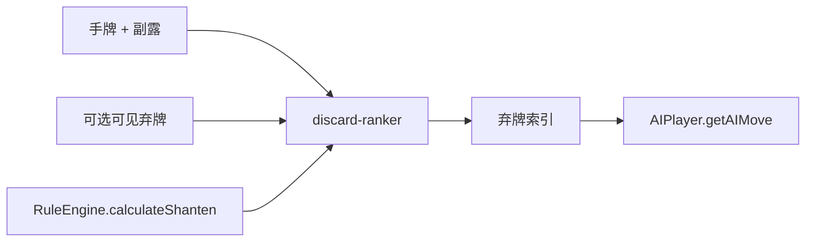

# 麻将 AI · P1 加固启发式 Implementation Plan

> **For agentic workers:** REQUIRED SUB-SKILL: Use superpowers:subagent-driven-development (recommended) or superpowers:executing-plans to implement this plan task-by-task. Steps use checkbox (`- [ ]`) syntax for tracking.

**Goal:** 让人机对局主路径的 `AIPlayer` 出牌决策优先按「打出后向听数更低 → 有效牌更多 → 危险度更低」排序，立刻减少「瞎打」感，且不碰 `core/` 权威判定与训练栈。

**Architecture:** 在 `strategy/heuristics/` 新增纯函数弃牌排序器（Discard Ranker，弃牌排序器），只**消费**现有 `RuleEngine.calculateShanten`；`AIPlayer.getAIMove` 改为调用该排序器，旧权重评分退居次级破平；可选注入桌面可见弃牌做现物（genbutsu，现物安全牌）危险度。不改 Session / Web / AlphaZero。

**Tech Stack:** TypeScript、Mocha + Chai（`npm test` / 单测过滤）、现有 `src/majiang/core/rule-engine.ts` 向听 API

## Global Constraints

- 规格 SSOT：`docs/superpowers/specs/2026-11-20-majiang-ai-algorithms-survey-design.md` §7.2（推荐 P1→可选 P2；P3 单独立项）
- **本计划只做 P1**；P2 期望值审牌层、P3 深度 RL、轻量蒙特卡洛局终模拟均**不在本计划施工范围**
- **禁止**改 `src/majiang/core/` 胡/吃/碰/杠/计分权威；策略层只读调用 `RuleEngine.calculateShanten` 等
- **禁止**引入新 npm 依赖；**禁止**改 `ai-alphazero/*` 训练/权重路径
- **禁止**把日麻/国标权重或开源权重直接当本仓规则权重
- `RuleEngine.calculateShanten` 现状为简化估算（含测试硬编码牌型）；P1 **接受其误差**，不在本计划「修准向听公式」（若测例被迫碰到硬编码，只绕开构造，不删硬编码）
- 提交说明中文；**仅当用户明确要求 commit 才提交**
- 规范：`docs/standards/rules/superpowers-artifacts.md`、`docs/standards/testing/quality.md`、`AGENTS.md`

---

## File Structure

| 路径 | 职责 |
|------|------|
| `src/majiang/strategy/heuristics/discard-ranker.ts` | 纯函数：候选弃牌评分与选索引；向听差 / 有效牌 / 危险度 |
| `src/majiang/strategy/heuristics/index.ts` | 启发式子模块导出 |
| `src/majiang/strategy/agents/ai-player.ts` | `getAIMove` / `handleDiscard` 接入排序器；可选注入可见弃牌 |
| `src/majiang/strategy/index.ts` | 导出 heuristics（供测试与后续 P2） |
| `tests/majiang/discard-ranker.test.ts` | 弃牌排序器单测（确定性手牌） |



---

### Task 1: 弃牌排序器 · 向听差主排序

**Files:**
- Create: `src/majiang/strategy/heuristics/discard-ranker.ts`
- Create: `src/majiang/strategy/heuristics/index.ts`
- Create: `tests/majiang/discard-ranker.test.ts`
- Modify: `src/majiang/strategy/index.ts`（末尾增加一行 re-export）

**Interfaces:**
- Consumes: `RuleEngine.calculateShanten(player: Player): number`；`Player` / `Tile` / `TileSet`
- Produces:
  - `export interface DiscardRankContext { handTiles: Tile[]; revealedSets: TileSet[]; visibleDiscards?: Tile[]; }`
  - `export interface DiscardCandidateScore { index: number; tile: Tile; shantenAfter: number; ukeire: number; danger: number; legacyValue: number; }`
  - `export function scoreDiscardCandidates(ctx: DiscardRankContext, legacyValueAt?: (index: number, tile: Tile) => number): DiscardCandidateScore[]`
  - `export function pickDiscardIndex(ctx: DiscardRankContext, legacyValueAt?: (index: number, tile: Tile) => number): number`
  - 排序键（升序优先打出）：`shantenAfter` ↑ → `ukeire` ↓ → `danger` ↑ → `legacyValue` ↑ → `index` ↑

- [ ] **Step 1: 写失败测例（向听：打孤张优于拆完整面子）**

```typescript
import { expect } from 'chai';
import { Player, PlayerType } from '../../src/majiang/core/player';
import { Tile, TileType } from '../../src/majiang/core/tile';
import { pickDiscardIndex, scoreDiscardCandidates } from '../../src/majiang/strategy/heuristics/discard-ranker';

function tid(): { next: () => number } {
  let n = 1;
  return { next: () => n++ };
}

describe('discard-ranker · 向听主排序', () => {
  it('有明显孤张字牌时，应优先打出该孤张而非拆万子顺子', () => {
    const id = tid();
    // 123万 456万 789万 + 东风孤张（13 张听前形态的简化：12 张面子向 + 1 孤张）
    const handTiles = [
      new Tile(TileType.WAN, 1, id.next()),
      new Tile(TileType.WAN, 2, id.next()),
      new Tile(TileType.WAN, 3, id.next()),
      new Tile(TileType.WAN, 4, id.next()),
      new Tile(TileType.WAN, 5, id.next()),
      new Tile(TileType.WAN, 6, id.next()),
      new Tile(TileType.WAN, 7, id.next()),
      new Tile(TileType.WAN, 8, id.next()),
      new Tile(TileType.WAN, 9, id.next()),
      new Tile(TileType.TIAO, 1, id.next()),
      new Tile(TileType.TIAO, 1, id.next()),
      new Tile(TileType.TIAO, 1, id.next()),
      new Tile(TileType.FENG, 1, id.next()), // 东 · 孤张
      new Tile(TileType.TONG, 5, id.next()), // 摸进后第 14 张：另一张孤立筒
    ];
    const idx = pickDiscardIndex({ handTiles, revealedSets: [] });
    const picked = handTiles[idx];
    expect(picked.type === TileType.FENG || picked.type === TileType.TONG).to.equal(true);
    // 不应拆 123/456/789 万中的一张
    expect(picked.type === TileType.WAN).to.equal(false);
  });
});
```

- [ ] **Step 2: 跑测确认失败**

```bash
npx mocha -r ts-node/register tests/majiang/discard-ranker.test.ts --timeout 10000
```

Expected: FAIL（模块不存在 / `pickDiscardIndex` 未定义）

- [ ] **Step 3: 最小实现（仅向听差 + 占位 ukeire/danger）**

`src/majiang/strategy/heuristics/discard-ranker.ts`:

```typescript
import { Player, PlayerType } from '../../core/player';
import { Tile } from '../../core/tile';
import { TileSet } from '../../core/rule-types';
import { RuleEngine } from '../../core/rule-engine';

export interface DiscardRankContext {
  handTiles: Tile[];
  revealedSets: TileSet[];
  visibleDiscards?: Tile[];
}

export interface DiscardCandidateScore {
  index: number;
  tile: Tile;
  shantenAfter: number;
  ukeire: number;
  danger: number;
  legacyValue: number;
}

function cloneProbe(handTiles: Tile[], revealedSets: TileSet[], dropIndex: number): Player {
  const p = new Player(0, 'probe', PlayerType.AI);
  p.handTiles = handTiles.filter((_, i) => i !== dropIndex).map(t => t.clone());
  p.revealedSets = revealedSets.map(s => ({
    type: s.type,
    tiles: s.tiles.map(t => t.clone()),
    source: s.source
  }));
  return p;
}

export function scoreDiscardCandidates(
  ctx: DiscardRankContext,
  legacyValueAt: (index: number, tile: Tile) => number = () => 0
): DiscardCandidateScore[] {
  const { handTiles, revealedSets } = ctx;
  const scores: DiscardCandidateScore[] = handTiles.map((tile, index) => {
    const probe = cloneProbe(handTiles, revealedSets, index);
    const shantenAfter = RuleEngine.calculateShanten(probe);
    return {
      index,
      tile,
      shantenAfter,
      ukeire: 0, // Task 2 填充
      danger: 0, // Task 3 填充
      legacyValue: legacyValueAt(index, tile)
    };
  });

  scores.sort((a, b) => {
    if (a.shantenAfter !== b.shantenAfter) return a.shantenAfter - b.shantenAfter;
    if (a.ukeire !== b.ukeire) return b.ukeire - a.ukeire;
    if (a.danger !== b.danger) return a.danger - b.danger;
    if (a.legacyValue !== b.legacyValue) return a.legacyValue - b.legacyValue;
    return a.index - b.index;
  });
  return scores;
}

export function pickDiscardIndex(
  ctx: DiscardRankContext,
  legacyValueAt?: (index: number, tile: Tile) => number
): number {
  if (ctx.handTiles.length === 0) return -1;
  return scoreDiscardCandidates(ctx, legacyValueAt)[0].index;
}
```

`src/majiang/strategy/heuristics/index.ts`:

```typescript
export {
  scoreDiscardCandidates,
  pickDiscardIndex,
  DiscardRankContext,
  DiscardCandidateScore
} from './discard-ranker';
```

`src/majiang/strategy/index.ts` 在 agents 导出后增加：

```typescript
export * from './heuristics';
```

- [ ] **Step 4: 跑测确认通过**

```bash
npx mocha -r ts-node/register tests/majiang/discard-ranker.test.ts --timeout 10000
```

Expected: PASS。若因 `calculateShanten` 估算误差导致「万子被拆」，调整测例手牌使「打东/筒后 shantenAfter 严格更小」，**不要**改 core 向听公式。

- [ ] **Step 5: Commit（仅用户要求时）**

```bash
git add src/majiang/strategy/heuristics/discard-ranker.ts \
  src/majiang/strategy/heuristics/index.ts \
  src/majiang/strategy/index.ts \
  tests/majiang/discard-ranker.test.ts
git commit -m "$(cat <<'EOF'
feat(majiang): 新增弃牌排序器并以向听差为主键

为 P1 启发式加固提供可单测的纯函数入口，暂不改 AIPlayer 行为。
EOF
)"
```

---

### Task 2: 有效牌（ukeire）破平

**Files:**
- Modify: `src/majiang/strategy/heuristics/discard-ranker.ts`
- Modify: `tests/majiang/discard-ranker.test.ts`

**Interfaces:**
- Consumes: Task 1 的 `scoreDiscardCandidates` / `cloneProbe`
- Produces: `ukeire` = 打出后，对「剩余牌种类」枚举一张加入手牌能使 `calculateShanten` **严格下降**的种类数（每种最多计 1；不乘剩余张数，避免依赖牌山状态）
- 辅助：`function countUkeire(probeHand: Player): number`（内部，可不 export）

- [ ] **Step 1: 写失败测例（同向听时选有效牌更多的打法）**

```typescript
describe('discard-ranker · 有效牌破平', () => {
  it('向听差相同时，应选择 ukeire 更大的弃牌', () => {
    const id = tid();
    // 构造两张都「打出后向听不变」的候选；其中一张打出后进张种类更多
    // 具体牌面：在实现后用 scoreDiscardCandidates 断言 max ukeire 的那张被 pick
    const handTiles = [
      new Tile(TileType.WAN, 1, id.next()),
      new Tile(TileType.WAN, 2, id.next()),
      new Tile(TileType.WAN, 3, id.next()),
      new Tile(TileType.WAN, 4, id.next()),
      new Tile(TileType.WAN, 5, id.next()),
      new Tile(TileType.WAN, 6, id.next()),
      new Tile(TileType.TIAO, 2, id.next()),
      new Tile(TileType.TIAO, 3, id.next()),
      new Tile(TileType.TIAO, 4, id.next()),
      new Tile(TileType.TONG, 7, id.next()),
      new Tile(TileType.TONG, 8, id.next()),
      new Tile(TileType.TONG, 9, id.next()),
      new Tile(TileType.FENG, 2, id.next()), // 南 · 孤张
      new Tile(TileType.FENG, 4, id.next()), // 北 · 孤张
    ];
    const scores = scoreDiscardCandidates({ handTiles, revealedSets: [] });
    const best = scores[0];
    // 两张风牌孤张中，至少应打风牌；且 best.ukeire >= 同 shantenAfter 组内其他候选
    expect(best.tile.type).to.equal(TileType.FENG);
    const sameShanten = scores.filter(s => s.shantenAfter === best.shantenAfter);
    const maxUkeire = Math.max(...sameShanten.map(s => s.ukeire));
    expect(best.ukeire).to.equal(maxUkeire);
  });
});
```

- [ ] **Step 2: 跑测确认失败**

```bash
npx mocha -r ts-node/register tests/majiang/discard-ranker.test.ts --timeout 10000
```

Expected: FAIL（`ukeire` 仍为 0 导致破平断言失败，或行为未区分）

- [ ] **Step 3: 实现 countUkeire 并写入 score**

在 `discard-ranker.ts` 增加（贴进文件，替换 `ukeire: 0`）：

```typescript
import { TileType } from '../../core/tile';

const SUIT_MAX: Partial<Record<TileType, number>> = {
  [TileType.WAN]: 9,
  [TileType.TIAO]: 9,
  [TileType.TONG]: 9,
  [TileType.FENG]: 4,
  [TileType.JIAN]: 3
};

function countUkeire(probe: Player): number {
  const base = RuleEngine.calculateShanten(probe);
  let kinds = 0;
  let syntheticId = 10_000;
  for (const type of Object.values(TileType)) {
    const max = SUIT_MAX[type as TileType] ?? 0;
    for (let value = 1; value <= max; value++) {
      const drawn = new Tile(type as TileType, value, syntheticId++);
      const trial = new Player(0, 'ukeire', PlayerType.AI);
      trial.handTiles = [...probe.handTiles.map(t => t.clone()), drawn];
      trial.revealedSets = probe.revealedSets.map(s => ({
        type: s.type,
        tiles: s.tiles.map(t => t.clone()),
        source: s.source
      }));
      if (RuleEngine.calculateShanten(trial) < base) kinds += 1;
    }
  }
  return kinds;
}
```

在 `scoreDiscardCandidates` 的 map 内：

```typescript
const shantenAfter = RuleEngine.calculateShanten(probe);
const ukeire = countUkeire(probe);
```

- [ ] **Step 4: 跑测确认通过**

```bash
npx mocha -r ts-node/register tests/majiang/discard-ranker.test.ts --timeout 10000
```

Expected: PASS。单测内 `countUkeire` 对最多约 34 种牌 × 手牌候选，应在数秒内结束；若超时将 `--timeout` 提到 `20000`，禁止改为异步训练式搜索。

- [ ] **Step 5: Commit（仅用户要求时）**

```bash
git add src/majiang/strategy/heuristics/discard-ranker.ts tests/majiang/discard-ranker.test.ts
git commit -m "$(cat <<'EOF'
feat(majiang): 弃牌排序器用有效牌种类数破平

同向听时优先保留进张面更宽的打法。
EOF
)"
```

---

### Task 3: 简单危险度（现物安全）

**Files:**
- Modify: `src/majiang/strategy/heuristics/discard-ranker.ts`
- Modify: `tests/majiang/discard-ranker.test.ts`

**Interfaces:**
- Consumes: `ctx.visibleDiscards?: Tile[]`（桌上已见弃牌，含各家 `discardedTiles`）
- Produces: `danger` 数值：
  - 若存在 `visibleDiscards` 中 `type+value` 与候选相同 → `danger = 0`（现物，相对安全）
  - 否则字牌/箭牌孤张 → `danger = 1`
  - 否则数牌 → `danger = 2`
  - （P1 不做对手听牌概率模型）

- [ ] **Step 1: 写失败测例**

```typescript
describe('discard-ranker · 现物危险度', () => {
  it('向听与 ukeire 相同时，优先打出现物安全牌', () => {
    const id = tid();
    const handTiles = [
      new Tile(TileType.WAN, 1, id.next()),
      new Tile(TileType.WAN, 2, id.next()),
      new Tile(TileType.WAN, 3, id.next()),
      new Tile(TileType.WAN, 4, id.next()),
      new Tile(TileType.WAN, 5, id.next()),
      new Tile(TileType.WAN, 6, id.next()),
      new Tile(TileType.TIAO, 2, id.next()),
      new Tile(TileType.TIAO, 3, id.next()),
      new Tile(TileType.TIAO, 4, id.next()),
      new Tile(TileType.TONG, 7, id.next()),
      new Tile(TileType.TONG, 8, id.next()),
      new Tile(TileType.TONG, 9, id.next()),
      new Tile(TileType.FENG, 2, id.next()),
      new Tile(TileType.JIAN, 1, id.next()), // 中
    ];
    const visibleDiscards = [new Tile(TileType.JIAN, 1, id.next())]; // 中已现物
    const idx = pickDiscardIndex({ handTiles, revealedSets: [], visibleDiscards });
    expect(handTiles[idx].type).to.equal(TileType.JIAN);
    expect(handTiles[idx].value).to.equal(1);
  });
});
```

- [ ] **Step 2: 跑测确认失败**

```bash
npx mocha -r ts-node/register tests/majiang/discard-ranker.test.ts --timeout 20000
```

Expected: FAIL（`danger` 未区分现物）

- [ ] **Step 3: 实现 danger**

```typescript
function tileKey(t: Tile): string {
  return `${t.type}-${t.value}`;
}

function scoreDanger(tile: Tile, visibleDiscards: Tile[] | undefined): number {
  const seen = new Set((visibleDiscards ?? []).map(tileKey));
  if (seen.has(tileKey(tile))) return 0;
  if (tile.type === TileType.FENG || tile.type === TileType.JIAN) return 1;
  return 2;
}
```

在 `scoreDiscardCandidates`：

```typescript
danger: scoreDanger(tile, ctx.visibleDiscards),
```

- [ ] **Step 4: 跑测确认通过**

```bash
npx mocha -r ts-node/register tests/majiang/discard-ranker.test.ts --timeout 20000
```

Expected: PASS

- [ ] **Step 5: Commit（仅用户要求时）**

```bash
git add src/majiang/strategy/heuristics/discard-ranker.ts tests/majiang/discard-ranker.test.ts
git commit -m "$(cat <<'EOF'
feat(majiang): 弃牌排序加入现物安全危险度

同向听/有效牌时优先打出已见弃牌，避免无对手模型时的盲目危牌。
EOF
)"
```

---

### Task 4: 接入 `AIPlayer.getAIMove`

**Files:**
- Modify: `src/majiang/strategy/agents/ai-player.ts`
- Modify: `tests/majiang/discard-ranker.test.ts`（可增 AIPlayer 烟测，或新建极短 describe）

**Interfaces:**
- Consumes: `pickDiscardIndex`；保留现有 `evaluateTileValue` 作为 `legacyValueAt`
- Produces:
  - `AIPlayer` 实例字段 `private visibleDiscards: Tile[] = []`
  - `public setVisibleDiscards(tiles: Tile[]): void`（防御拷贝）
  - `getAIMove(): number` 改为：空手 → `-1`；否则 `pickDiscardIndex({ handTiles, revealedSets, visibleDiscards: this.visibleDiscards }, (i,t) => this.evaluateTileValue(t,i))`
  - **保留** `getAllTileValues` / `evaluateTileValue` 私有方法供 legacy 破平与调试日志；可在 `getAIMove` 打一条 debug：最终索引与 `scoreDiscardCandidates` 首项摘要

- [ ] **Step 1: 写失败烟测（AIPlayer 走排序器）**

在 `tests/majiang/discard-ranker.test.ts` 追加：

```typescript
import { AIPlayer } from '../../src/majiang/strategy/agents/ai-player';

describe('AIPlayer · P1 接入', () => {
  it('getAIMove 在现物场景下打出安全字牌', () => {
    const id = tid();
    const ai = new AIPlayer('测AI');
    ai.handTiles = [
      new Tile(TileType.WAN, 1, id.next()),
      new Tile(TileType.WAN, 2, id.next()),
      new Tile(TileType.WAN, 3, id.next()),
      new Tile(TileType.WAN, 4, id.next()),
      new Tile(TileType.WAN, 5, id.next()),
      new Tile(TileType.WAN, 6, id.next()),
      new Tile(TileType.TIAO, 2, id.next()),
      new Tile(TileType.TIAO, 3, id.next()),
      new Tile(TileType.TIAO, 4, id.next()),
      new Tile(TileType.TONG, 7, id.next()),
      new Tile(TileType.TONG, 8, id.next()),
      new Tile(TileType.TONG, 9, id.next()),
      new Tile(TileType.FENG, 2, id.next()),
      new Tile(TileType.JIAN, 1, id.next()),
    ];
    ai.setVisibleDiscards([new Tile(TileType.JIAN, 1, id.next())]);
    const idx = ai.getAIMove();
    expect(ai.handTiles[idx].type).to.equal(TileType.JIAN);
  });
});
```

- [ ] **Step 2: 跑测确认失败**

```bash
npx mocha -r ts-node/register tests/majiang/discard-ranker.test.ts --timeout 20000
```

Expected: FAIL（`setVisibleDiscards` 不存在，或仍走旧权重打出非中）

- [ ] **Step 3: 改 AIPlayer**

在 `ai-player.ts` 顶部增加：

```typescript
import { pickDiscardIndex } from '../heuristics/discard-ranker';
```

类内增加：

```typescript
private visibleDiscards: Tile[] = [];

public setVisibleDiscards(tiles: Tile[]): void {
  this.visibleDiscards = tiles.map(t => t.clone());
}
```

将 `getAIMove` 的核心选牌（`needsToDiscard` 为真的分支与正常分支）收敛为：

```typescript
const index = pickDiscardIndex(
  {
    handTiles: this.handTiles,
    revealedSets: this.revealedSets ?? [],
    visibleDiscards: this.visibleDiscards
  },
  (i, tile) => this.evaluateTileValue(tile, i)
);
if (index >= 0 && index < this.handTiles.length) {
  debugLog(`AI P1排序选择索引 ${index}: ${this.handTiles[index].toString()}`);
  return index;
}
return this.handTiles.length - 1;
```

删除或绕开「仅 `getAllTileValues()[0]`」作为唯一决策的路径；异常 fallback 仍打最后一张。**不要**改 `handleDiscard` 的 `process.exit` 行为（本计划不修该历史问题）。

- [ ] **Step 4: 跑测确认通过**

```bash
npx mocha -r ts-node/register tests/majiang/discard-ranker.test.ts --timeout 20000
```

Expected: PASS

- [ ] **Step 5: Commit（仅用户要求时）**

```bash
git add src/majiang/strategy/agents/ai-player.ts tests/majiang/discard-ranker.test.ts
git commit -m "$(cat <<'EOF'
feat(majiang): AIPlayer 出牌接入向听启发式排序

人机主路径弃牌改为向听/有效牌/现物优先，旧权重仅作破平。
EOF
)"
```

---

### Task 5: 出牌前注入桌上可见弃牌

**Files:**
- Modify: `src/majiang/strategy/agents/ai-player.ts`（`handleDiscard`）
- Modify: `src/majiang/ui/game-event-handler.ts`（仅当 AI 无 Game 引用时的最小桥；优先在 `handleDiscard` 内用已有 `gameEventHandler`）

**Interfaces:**
- Consumes: `GameEventHandler` 上可读的 `game.getAllPlayers()`（若当前为 `protected game`，在 handler 增加窄方法，禁止把整个 Game 塞进策略层乱调用）
- Produces:
  - `GameEventHandler.collectVisibleDiscards(): Tile[]` — 拼接所有玩家 `discardedTiles` 的 clone 列表
  - `AIPlayer.handleDiscard` 在 `getAIMove` 前调用：`this.setVisibleDiscards(gameEventHandler.collectVisibleDiscards())`

- [ ] **Step 1: 写失败测例（handler 收集）**

新建短测或追加到 `tests/majiang/discard-ranker.test.ts`：

```typescript
import { Game } from '../../src/majiang/core/game';
import { TileManager } from '../../src/majiang/core/tile-manager';
import { GameEventHandler } from '../../src/majiang/ui/game-event-handler';

describe('GameEventHandler · 可见弃牌', () => {
  it('collectVisibleDiscards 汇总各家弃牌', () => {
    const game = new Game();
    // 按仓库现有测例方式塞玩家与 discardedTiles；若 Game 构造已带 AI，直接取 getAllPlayers()
    const players = game.getAllPlayers();
    expect(players.length).to.be.greaterThan(0);
    players[0].discardedTiles = [new Tile(TileType.WAN, 1, 1)];
    if (players[1]) players[1].discardedTiles = [new Tile(TileType.TIAO, 9, 2)];
    const handler = new GameEventHandler(game, new TileManager());
    const visible = handler.collectVisibleDiscards();
    expect(visible.some(t => t.type === TileType.WAN && t.value === 1)).to.equal(true);
  });
});
```

若 `Game` 构造/玩家初始化与上文不符，以 `tests/majiang/game-session.test.ts` 或 `game.test.ts` 里**已有**建局方式为准改写本测例，禁止新造第二套 Game 工厂。

- [ ] **Step 2: 跑测确认失败**

```bash
npx mocha -r ts-node/register tests/majiang/discard-ranker.test.ts --timeout 20000
```

Expected: FAIL（`collectVisibleDiscards` 不存在）

- [ ] **Step 3: 实现收集 + 注入**

`game-event-handler.ts`:

```typescript
public collectVisibleDiscards(): Tile[] {
  const out: Tile[] = [];
  for (const p of this.game.getAllPlayers()) {
    for (const t of p.discardedTiles ?? []) {
      out.push(t.clone());
    }
  }
  return out;
}
```

`ai-player.ts` `handleDiscard` 在 `await AIPlayer.pauseForThinking()` 之后、`getAIMove()` 之前：

```typescript
this.setVisibleDiscards(gameEventHandler.collectVisibleDiscards());
```

- [ ] **Step 4: 跑测确认通过**

```bash
npx mocha -r ts-node/register tests/majiang/discard-ranker.test.ts --timeout 20000
```

Expected: PASS

- [ ] **Step 5: Commit（仅用户要求时）**

```bash
git add src/majiang/strategy/agents/ai-player.ts \
  src/majiang/ui/game-event-handler.ts \
  tests/majiang/discard-ranker.test.ts
git commit -m "$(cat <<'EOF'
feat(majiang): 出牌前注入桌上可见弃牌供危险度评估

打通 GameEventHandler 到 AIPlayer 的现物信号，不改规则权威。
EOF
)"
```

---

### Task 6: 回归与规格回写

**Files:**
- Modify: `docs/superpowers/specs/2026-11-20-majiang-ai-algorithms-survey-design.md`（§9/§10：标注 P1 plan 已落盘；**不**把 P1 实现勾成已交付，除非本 Task 测绿且用户确认）
- Read-only 验证：既有 `tests/majiang/rule-engine.test.ts`、`tests/majiang/game-session.test.ts`

**Interfaces:**
- Consumes: Task 1–5 交付物
- Produces: 回归绿；规格闸门句子更新为「P1 计划：`docs/superpowers/plans/2026-11-20-majiang-ai-p1-heuristic-plan.md`」

- [ ] **Step 1: 跑弃牌测 + 规则/会话烟测**

```bash
npx mocha -r ts-node/register \
  tests/majiang/discard-ranker.test.ts \
  tests/majiang/rule-engine.test.ts \
  tests/majiang/game-session.test.ts \
  --timeout 20000
```

Expected: 全部 PASS。若 `game-session` 因 AI 出牌选择变化导致脆弱断言失败：只放宽「具体打哪张」类断言，**禁止**为过测回退排序器。

- [ ] **Step 2: 规格闸门回写（文档）**

在调研规格 §9 将「方可开 writing-plans」改为已开，并链到本 plan；§10.1 保持「P2 另开 plan」。

- [ ] **Step 3: Commit（仅用户要求时）**

```bash
git add docs/superpowers/specs/2026-11-20-majiang-ai-algorithms-survey-design.md \
  docs/superpowers/plans/2026-11-20-majiang-ai-p1-heuristic-plan.md
git commit -m "$(cat <<'EOF'
docs(majiang): 登记 P1 启发式 AI 实现计划与规格闸门

调研结论落地为可执行 P1 计划，P2/P3 仍单独立项。
EOF
)"
```

---

## Self-Review（对照规格）

| 规格条目 | 本计划任务 |
|----------|------------|
| §7.1 P1 向听数、有效牌、简单危险度 | Task 1–3 |
| §7.1 可选轻量蒙特卡洛 | **刻意不做**（YAGNI；需另开刀） |
| §7.2 P1→P2，P3 单独立项 | Global Constraints；无 P2/P3 施工 Task |
| §3 / §7 不碰 core 权威、不引入依赖、不抄权重 | Global Constraints + Task 1 只读 `calculateShanten` |
| §6 本仓 `agents/ai-player` 对照 | Task 4–5 |
| §6 差距「对手听牌概率」 | 仅现物危险度，**不**宣称已补 Bakuuchi 级模型 |
| 验收可观察「不像瞎打」 | Task 1/4 测例 + 人机主观仍属上线后观察，不在自动化内自批 |

**Placeholder scan:** 无 TBD；测例牌面若与简化向听冲突，步骤已要求改测例不改 core。  
**类型一致性:** `DiscardRankContext` / `pickDiscardIndex` / `setVisibleDiscards` / `collectVisibleDiscards` 命名在 Task 1–5 一致。
