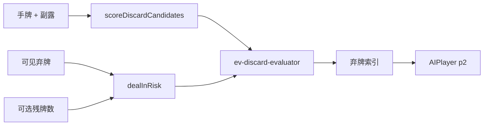

# 麻将 AI · P2 期望值审牌层 Implementation Plan

> **For agentic workers:** REQUIRED SUB-SKILL: Use superpowers:subagent-driven-development (recommended) or superpowers:executing-plans to implement this plan task-by-task. Steps use checkbox (`- [ ]`) syntax for tracking.

**Goal:** 让弃牌决策按「进攻期望 − 点炮代价」选牌（期望值 / Expected Value，期望值），在可解释、无 GPU 前提下压过旧启发式与已失败的纯 P1 向听排序，且不碰 `core/` 权威判定与训练栈。

**Architecture:** 在 `strategy/heuristics/` 新增纯函数期望值评估器（EV Discard Evaluator），复用 P1 的向听差 / 有效牌 / 现物信号，叠加简化点炮率与残牌加压；`AIPlayer` 增加策略开关 `p2`（默认仍 `legacy`，需显式打开）；新增 `1×P2 vs 3×legacy` 对战脚本做可观察验收。不实现完整 Akochan 动态规划，不引入蒙特卡洛局终模拟（留给后续可选切片）。

**Tech Stack:** TypeScript、Mocha + Chai、现有 `RuleEngine.calculateShanten`、现有 `discard-ranker` 信号、`scripts/training/majiang/` 对战脚本模式

## Global Constraints

- 规格 SSOT：`docs/superpowers/specs/2026-11-20-majiang-ai-algorithms-survey-design.md` §7.1 **P2**、§10.2
- **本计划只做 P2**；P3 深度 RL、完整对手听牌贝叶斯、轻量蒙特卡洛局终模拟均**不在本计划施工范围**
- **禁止**改 `src/majiang/core/` 胡/吃/碰/杠/计分权威；策略层只读调用已有 API
- **禁止**引入新 npm 依赖；**禁止**改 `ai-alphazero/*` 训练/权重路径
- **禁止**把日麻 Akochan / 国标权重直接当本仓规则权重；本仓用可调常数代理「期望得分 / 点炮罚」
- 接受 `calculateShanten` 简化估算误差；测例绕开硬编码牌型，不修向听公式
- 默认对局策略保持 `legacy`；`p2` 仅显式 `setDiscardStrategy('p2')` 或 `MAJIANG_DISCARD_STRATEGY=p2`
- 提交说明中文；**仅当用户明确要求 commit 才提交**（计划内 Commit 步骤默认跳过，除非用户下令）
- 规范：`docs/standards/rules/superpowers-artifacts.md`、`docs/standards/testing/quality.md`、`AGENTS.md`

---

## File Structure

| 路径 | 职责 |
|------|------|
| `src/majiang/strategy/heuristics/ev-discard-evaluator.ts` | 纯函数：候选弃牌 EV；进攻期望 / 点炮代价 / 选索引 |
| `src/majiang/strategy/heuristics/discard-ranker.ts` | 只读复用（不删 P1）；可选导出 `countUkeire` 若需共享——**本计划默认不改其公开 API**，EV 内部自算或调用 `scoreDiscardCandidates` |
| `src/majiang/strategy/heuristics/index.ts` | 导出 EV API |
| `src/majiang/strategy/agents/ai-player.ts` | `DiscardStrategy` 增加 `p2`；`getAIMove` 分支 |
| `tests/majiang/ev-discard-evaluator.test.ts` | EV 确定性单测 |
| `tests/majiang/ai-player-p2.test.ts` | AIPlayer `p2` 开关冒烟（可与现有 AIPlayer 测例同文件扩展，优先新建小文件） |
| `scripts/training/majiang/battle-p2-vs-legacy-1000.ts` | 1×P2 vs 3×legacy；座位轮换 |
| `models/majiang/battle-p2-vs-legacy-1000.json` | 评测产物（运行后生成；可入库） |
| `docs/superpowers/specs/2026-11-20-majiang-ai-algorithms-survey-design.md` | §9/§10 勾 P2 plan 已开 |



### 期望值公式（本仓简化，写死在实现注释与单测常数）

对候选弃牌 \(i\)：

- 取 P1 信号：`shantenAfter`、`ukeire`、`danger`（现物 → danger=0）
- `offense = WIN_PROXY / (shantenAfter + 1)^2 * (ukeire + 1)`
- `dealInRisk`：现物 `0.05`；字牌 `0.25`；边张 1/9 `0.35`；中张 `0.55`；再乘残牌加压 `late = tilesLeft!=null && tilesLeft < 30 ? 1.4 : 1.0`（封顶 risk≤1）
- `defense = dealInRisk * DEAL_IN_PENALTY`
- `ev = offense - defense`
- 排序：`ev` ↓ → `shantenAfter` ↑ → `ukeire` ↓ → `index` ↑

常数默认：`WIN_PROXY = 100`，`DEAL_IN_PENALTY = 120`（使「中张高危」能压过「向听略优但危险」的进攻项；单测锁行为，调参只改常数导出）。

---

### Task 1: EV 评估器 · 进攻期望主序

**Files:**
- Create: `src/majiang/strategy/heuristics/ev-discard-evaluator.ts`
- Create: `tests/majiang/ev-discard-evaluator.test.ts`
- Modify: `src/majiang/strategy/heuristics/index.ts`

**Interfaces:**
- Consumes: `scoreDiscardCandidates` / `DiscardRankContext` from `./discard-ranker`；`Tile` / `TileType`
- Produces:
  - `export interface EvDiscardContext extends DiscardRankContext { tilesLeft?: number; }`
  - `export interface EvDiscardScore { index: number; tile: Tile; shantenAfter: number; ukeire: number; dealInRisk: number; offense: number; defense: number; ev: number; }`
  - `export const EV_CONSTANTS: { WIN_PROXY: number; DEAL_IN_PENALTY: number; LATE_TILES_LEFT: number; LATE_RISK_MULT: number; }`
  - `export function estimateDealInRisk(tile: Tile, visibleDiscards?: Tile[], tilesLeft?: number): number`
  - `export function scoreDiscardByEv(ctx: EvDiscardContext, legacyValueAt?: (index: number, tile: Tile) => number): EvDiscardScore[]`
  - `export function pickDiscardIndexByEv(ctx: EvDiscardContext, legacyValueAt?: (index: number, tile: Tile) => number): number`

- [ ] **Step 1: 写失败测例（同向听时，有效牌更宽者 EV 更高并被选中）**

```typescript
import { expect } from 'chai';
import { Tile, TileType } from '../../src/majiang/core/tile';
import {
  pickDiscardIndexByEv,
  scoreDiscardByEv
} from '../../src/majiang/strategy/heuristics/ev-discard-evaluator';

function tid() {
  let n = 1;
  return { next: () => n++ };
}

describe('ev-discard-evaluator · 进攻期望', () => {
  it('有明显孤张字牌时，应优先打出该孤张（offense 主导）', () => {
    const id = tid();
    const handTiles = [
      new Tile(TileType.WAN, 1, id.next()),
      new Tile(TileType.WAN, 2, id.next()),
      new Tile(TileType.WAN, 3, id.next()),
      new Tile(TileType.WAN, 4, id.next()),
      new Tile(TileType.WAN, 5, id.next()),
      new Tile(TileType.WAN, 6, id.next()),
      new Tile(TileType.WAN, 7, id.next()),
      new Tile(TileType.WAN, 8, id.next()),
      new Tile(TileType.WAN, 9, id.next()),
      new Tile(TileType.TIAO, 1, id.next()),
      new Tile(TileType.TIAO, 2, id.next()),
      new Tile(TileType.TIAO, 3, id.next()),
      new Tile(TileType.FENG, 1, id.next()) // 东风孤张
    ];
    const idx = pickDiscardIndexByEv({ handTiles, revealedSets: [] });
    expect(handTiles[idx].type).to.equal(TileType.FENG);
    const scores = scoreDiscardByEv({ handTiles, revealedSets: [] });
    expect(scores[0].tile.type).to.equal(TileType.FENG);
    expect(scores[0].ev).to.be.greaterThan(scores[scores.length - 1].ev);
  });
});
```

- [ ] **Step 2: 跑测确认失败**

Run: `npx mocha -r ts-node/register tests/majiang/ev-discard-evaluator.test.ts --timeout 10000`  
Expected: FAIL（模块不存在 / 导出名未定义）

- [ ] **Step 3: 最小实现（进攻项 + 基础点炮风险；先让孤张字牌测例绿）**

`src/majiang/strategy/heuristics/ev-discard-evaluator.ts`:

```typescript
import { Tile, TileType } from '../../core/tile';
import {
  DiscardRankContext,
  scoreDiscardCandidates
} from './discard-ranker';

export interface EvDiscardContext extends DiscardRankContext {
  tilesLeft?: number;
}

export interface EvDiscardScore {
  index: number;
  tile: Tile;
  shantenAfter: number;
  ukeire: number;
  dealInRisk: number;
  offense: number;
  defense: number;
  ev: number;
}

export const EV_CONSTANTS = {
  WIN_PROXY: 100,
  DEAL_IN_PENALTY: 120,
  LATE_TILES_LEFT: 30,
  LATE_RISK_MULT: 1.4
};

function tileKey(t: Tile): string {
  return `${t.type}-${t.value}`;
}

export function estimateDealInRisk(
  tile: Tile,
  visibleDiscards?: Tile[],
  tilesLeft?: number
): number {
  const seen = new Set((visibleDiscards ?? []).map(tileKey));
  let risk: number;
  if (seen.has(tileKey(tile))) risk = 0.05;
  else if (tile.type === TileType.FENG || tile.type === TileType.JIAN) risk = 0.25;
  else if (tile.value === 1 || tile.value === 9) risk = 0.35;
  else risk = 0.55;

  if (
    tilesLeft != null &&
    tilesLeft < EV_CONSTANTS.LATE_TILES_LEFT
  ) {
    risk = Math.min(1, risk * EV_CONSTANTS.LATE_RISK_MULT);
  }
  return risk;
}

export function scoreDiscardByEv(
  ctx: EvDiscardContext,
  legacyValueAt?: (index: number, tile: Tile) => number
): EvDiscardScore[] {
  const ranked = scoreDiscardCandidates(ctx, legacyValueAt);
  const scores: EvDiscardScore[] = ranked.map(r => {
    const dealInRisk = estimateDealInRisk(
      r.tile,
      ctx.visibleDiscards,
      ctx.tilesLeft
    );
    const offense =
      (EV_CONSTANTS.WIN_PROXY / Math.pow(r.shantenAfter + 1, 2)) *
      (r.ukeire + 1);
    const defense = dealInRisk * EV_CONSTANTS.DEAL_IN_PENALTY;
    return {
      index: r.index,
      tile: r.tile,
      shantenAfter: r.shantenAfter,
      ukeire: r.ukeire,
      dealInRisk,
      offense,
      defense,
      ev: offense - defense
    };
  });

  scores.sort((a, b) => {
    if (a.ev !== b.ev) return b.ev - a.ev;
    if (a.shantenAfter !== b.shantenAfter) return a.shantenAfter - b.shantenAfter;
    if (a.ukeire !== b.ukeire) return b.ukeire - a.ukeire;
    return a.index - b.index;
  });
  return scores;
}

export function pickDiscardIndexByEv(
  ctx: EvDiscardContext,
  legacyValueAt?: (index: number, tile: Tile) => number
): number {
  if (ctx.handTiles.length === 0) return -1;
  return scoreDiscardByEv(ctx, legacyValueAt)[0].index;
}
```

`index.ts` 增加：

```typescript
export {
  scoreDiscardByEv,
  pickDiscardIndexByEv,
  estimateDealInRisk,
  EV_CONSTANTS,
  EvDiscardContext,
  EvDiscardScore
} from './ev-discard-evaluator';
```

- [ ] **Step 4: 跑测确认通过**

Run: `npx mocha -r ts-node/register tests/majiang/ev-discard-evaluator.test.ts --timeout 10000`  
Expected: PASS

- [ ] **Step 5: Commit（仅用户明确要求时）**

```bash
# 用户要求提交后再执行
git add src/majiang/strategy/heuristics/ev-discard-evaluator.ts \
  src/majiang/strategy/heuristics/index.ts \
  tests/majiang/ev-discard-evaluator.test.ts
git commit -m "$(cat <<'EOF'
feat(majiang): 新增 P2 弃牌期望值评估器进攻主序

EOF
)"
```

---

### Task 2: 点炮代价 · 现物与残牌加压

**Files:**
- Modify: `tests/majiang/ev-discard-evaluator.test.ts`
- Modify: `src/majiang/strategy/heuristics/ev-discard-evaluator.ts`（若 Task1 已含完整 `estimateDealInRisk`，本任务只锁测例）

**Interfaces:**
- Consumes: `estimateDealInRisk`、`pickDiscardIndexByEv`、`EV_CONSTANTS`
- Produces: 行为契约——现物风险低于中张；残牌不足时风险上升；两张同向听候选时优先打现物

- [ ] **Step 1: 写失败测例（现物优先于危险中张）**

```typescript
describe('ev-discard-evaluator · 点炮代价', () => {
  it('两张候选进攻接近时，应优先打出现物（可见弃牌中已有同型）', () => {
    const id = tid();
    // 构造：两张孤张风 + 一张中张孤张；把中张做成「可见现物」应打现物中张，
    // 若未注入 visibleDiscards 则倾向打风；注入后应打出已现物的中张。
    const mid = new Tile(TileType.TONG, 5, id.next());
    const handTiles = [
      new Tile(TileType.WAN, 1, id.next()),
      new Tile(TileType.WAN, 2, id.next()),
      new Tile(TileType.WAN, 3, id.next()),
      new Tile(TileType.WAN, 4, id.next()),
      new Tile(TileType.WAN, 5, id.next()),
      new Tile(TileType.WAN, 6, id.next()),
      new Tile(TileType.WAN, 7, id.next()),
      new Tile(TileType.WAN, 8, id.next()),
      new Tile(TileType.WAN, 9, id.next()),
      new Tile(TileType.TIAO, 2, id.next()),
      new Tile(TileType.TIAO, 3, id.next()),
      new Tile(TileType.TIAO, 4, id.next()),
      mid
    ];
    const visibleDiscards = [new Tile(TileType.TONG, 5, 9999)];
    const idx = pickDiscardIndexByEv({
      handTiles,
      revealedSets: [],
      visibleDiscards,
      tilesLeft: 20
    });
    expect(handTiles[idx].type).to.equal(TileType.TONG);
    expect(handTiles[idx].value).to.equal(5);
  });

  it('残牌加压：tilesLeft 小时 dealInRisk 不小于无加压', () => {
    const t = new Tile(TileType.TONG, 5, 1);
    const base = estimateDealInRisk(t, [], 80);
    const late = estimateDealInRisk(t, [], 20);
    expect(late).to.be.greaterThan(base);
  });
});
```

- [ ] **Step 2: 跑测**

Run: `npx mocha -r ts-node/register tests/majiang/ev-discard-evaluator.test.ts --timeout 10000`  
Expected: 若实现已完整则 PASS；若现物分支缺失则 FAIL 后按 Task1 公式补全

- [ ] **Step 3: 必要时微调公式常数（禁止改 core）**

仅允许改 `EV_CONSTANTS` 数值使上述测例稳定通过；禁止为过测硬编码「若是 5 筒就返回」。

- [ ] **Step 4: Commit（仅用户明确要求时）**

```bash
git add tests/majiang/ev-discard-evaluator.test.ts src/majiang/strategy/heuristics/ev-discard-evaluator.ts
git commit -m "$(cat <<'EOF'
test(majiang): 锁定 P2 现物与残牌点炮加压行为

EOF
)"
```

---

### Task 3: AIPlayer 接入策略 `p2`

**Files:**
- Modify: `src/majiang/strategy/agents/ai-player.ts`
- Create: `tests/majiang/ai-player-p2.test.ts`

**Interfaces:**
- Consumes: `pickDiscardIndexByEv`
- Produces: `DiscardStrategy = 'p1' | 'p2' | 'legacy'`；`resolveDiscardStrategy` 识别 `p2` / env `MAJIANG_DISCARD_STRATEGY=p2`；`getAIMove` 在 `p2` 时走 EV

- [ ] **Step 1: 写失败测例**

```typescript
import { expect } from 'chai';
import { AIPlayer } from '../../src/majiang/strategy/agents/ai-player';
import { Tile, TileType } from '../../src/majiang/core/tile';

describe('AIPlayer · P2 接入', () => {
  it('显式 p2 策略时 getDiscardStrategy 为 p2', () => {
    const ai = new AIPlayer('测P2', 'p2');
    expect(ai.getDiscardStrategy()).to.equal('p2');
  });

  it('p2 在孤张字牌局面应打出字牌', () => {
    const ai = new AIPlayer('测P2出牌', 'p2');
    let n = 1;
    ai.handTiles = [
      new Tile(TileType.WAN, 1, n++),
      new Tile(TileType.WAN, 2, n++),
      new Tile(TileType.WAN, 3, n++),
      new Tile(TileType.WAN, 4, n++),
      new Tile(TileType.WAN, 5, n++),
      new Tile(TileType.WAN, 6, n++),
      new Tile(TileType.WAN, 7, n++),
      new Tile(TileType.WAN, 8, n++),
      new Tile(TileType.WAN, 9, n++),
      new Tile(TileType.TIAO, 1, n++),
      new Tile(TileType.TIAO, 2, n++),
      new Tile(TileType.TIAO, 3, n++),
      new Tile(TileType.FENG, 1, n++)
    ];
    const idx = ai.getAIMove();
    expect(ai.handTiles[idx].type).to.equal(TileType.FENG);
  });
});
```

- [ ] **Step 2: 跑测确认失败**

Run: `npx mocha -r ts-node/register tests/majiang/ai-player-p2.test.ts --timeout 10000`  
Expected: FAIL（`'p2'` 不在类型联合 / 未分支）

- [ ] **Step 3: 最小改动接入**

在 `ai-player.ts`：

1. `export type DiscardStrategy = 'p1' | 'p2' | 'legacy';`
2. `resolveDiscardStrategy`：`explicit === 'p2'` 或 env `=== 'p2'` → `'p2'`
3. `getAIMove`：在 `legacy` 分支后、`p1` 默认分支前增加：

```typescript
if (this.discardStrategy === 'p2') {
  const index = pickDiscardIndexByEv(
    {
      handTiles: this.handTiles,
      revealedSets: this.revealedSets ?? [],
      visibleDiscards: this.visibleDiscards
      // tilesLeft：本切片不强制注入；后续可在 EventHandler 设可选 setter
    },
    (i, tile) => this.evaluateTileValue(tile, i)
  );
  if (index >= 0 && index < this.handTiles.length) {
    debugLog(`AI P2期望值选择索引 ${index}: ${this.handTiles[index].toString()}`);
    return index;
  }
  return this.handTiles.length - 1;
}
```

4. import：`import { pickDiscardIndex } from '../heuristics/discard-ranker';` 旁增加 `pickDiscardIndexByEv` from `../heuristics/ev-discard-evaluator`（或从 `../heuristics`）。

可选（同一 Task 内若改动仍小）：增加 `private tilesLeft?: number` + `setTilesLeft(n: number)`，`getAIMove` 传入 `tilesLeft`；**不**强制改 `GameEventHandler`——残牌加压在单测用 ctx 覆盖即可，对战切片可后补。

- [ ] **Step 4: 跑测通过**

Run: `npx mocha -r ts-node/register tests/majiang/ai-player-p2.test.ts tests/majiang/ev-discard-evaluator.test.ts --timeout 10000`  
Expected: PASS

- [ ] **Step 5: Commit（仅用户明确要求时）**

```bash
git add src/majiang/strategy/agents/ai-player.ts tests/majiang/ai-player-p2.test.ts
git commit -m "$(cat <<'EOF'
feat(majiang): AIPlayer 接入 P2 期望值弃牌策略

EOF
)"
```

---

### Task 4: 对战评测脚本 · 1×P2 vs 3×legacy

**Files:**
- Create: `scripts/training/majiang/battle-p2-vs-legacy-1000.ts`
- Runtime out: `models/majiang/battle-p2-vs-legacy-1000.json`

**Interfaces:**
- Consumes: 复制 `battle-p1-vs-legacy-1000.ts` 结构；`setDiscardStrategy(idx === p2Seat ? 'p2' : 'legacy')`
- Produces: JSON 字段 `algorithm: "1xP2-vs-3xlegacy"`；`matchup.p2Wins` / `legacyWins` / `p2WinRateAmongDecidedPct`；`expectedP2WinRatePct: 25`

- [ ] **Step 1: 以 P1 对战脚本为模板新建文件**

从 `scripts/training/majiang/battle-p1-vs-legacy-1000.ts` 复制后全局替换：

- 注释 / 用法中的 P1 → P2
- `setDiscardStrategy(... 'p1' ...)` → `'p2'`
- 变量名 `p1Wins` → `p2Wins`，`p1Seat` → `p2Seat`，`p1Won` → `p2Won`
- `algorithm` / `outPath` 默认改为 `battle-p2-vs-legacy-1000.json`
- `expectedP1WinRatePct` → `expectedP2WinRatePct`

禁止改 GameEventHandler 主循环逻辑（与 P1 脚本保持同构，保证可比）。

- [ ] **Step 2: 冒烟 20 局**

Run: `npx ts-node scripts/training/majiang/battle-p2-vs-legacy-1000.ts 20 models/majiang/battle-p2-vs-legacy-smoke-20.json`  
Expected: 进程退出码 0；JSON `roundsCompleted: 20`；无未捕获崩溃

- [ ] **Step 3: 完整 1000 局（验收闸）**

Run: `npx ts-node scripts/training/majiang/battle-p2-vs-legacy-1000.ts 1000 models/majiang/battle-p2-vs-legacy-1000.json`  
Expected: `roundsCompleted: 1000`；**人话验收**：`p2WinRateAmongDecidedPct` **≥ 25**（不低于均势）；理想 **≥ 30**（明显强于 legacy）。若 &lt; 25，回到 Task1/2 只调 `EV_CONSTANTS` 或 risk 表，不改 core，再复测冒烟+1000。

对照基线：P1 同脚本形态曾得约 **14.55%**（`models/majiang/battle-p1-vs-legacy-1000.json`）——P2 必须显著高于该值。

- [ ] **Step 4: Commit（仅用户明确要求时）**

```bash
git add scripts/training/majiang/battle-p2-vs-legacy-1000.ts \
  models/majiang/battle-p2-vs-legacy-1000.json \
  models/majiang/battle-p2-vs-legacy-smoke-20.json
git commit -m "$(cat <<'EOF'
test(majiang): 增加 P2 对战 legacy 的 1000 局评测

EOF
)"
```

---

### Task 5: 规格收口与回归

**Files:**
- Modify: `docs/superpowers/specs/2026-11-20-majiang-ai-algorithms-survey-design.md` §9 / §10
- 可选：`.superpowers/sdd/` 进度备注（若本波用 SDD）

- [ ] **Step 1: 跑相关单测 + 既有 discard-ranker / AIPlayer 测例**

Run:

```bash
npx mocha -r ts-node/register \
  tests/majiang/ev-discard-evaluator.test.ts \
  tests/majiang/ai-player-p2.test.ts \
  tests/majiang/discard-ranker.test.ts \
  --timeout 20000
```

Expected: PASS

- [ ] **Step 2: 更新调研规格勾选**

在 §9：

- 将「P2 期望值审牌层：P1 落地后再另开 plan」改为已开，并链到本文件  
- 增加「P2 实现交付验收（人确认）」未勾项，待 1000 局与人审后再勾

在 §10：

- 注明 P2 plan 路径与对战结果文件路径；P3 仍单独立项

- [ ] **Step 3: Self-review（执行者自检，非子代理）**

| 检查 | 通过标准 |
|------|----------|
| Spec 覆盖 | P2「期望 pt / 点炮率」有 Task1–2；接入有 Task3；可观察验收有 Task4 |
| 无占位符 | 计划内无 TBD /「类似 Task N」 |
| 类型一致 | `EvDiscardContext` / `pickDiscardIndexByEv` / `DiscardStrategy='p2'` 前后一致 |
| 硬边界 | 无 `core/` 改动、无新依赖、无 P3 训练 |

- [ ] **Step 4: Commit（仅用户明确要求时）**

```bash
git add docs/superpowers/specs/2026-11-20-majiang-ai-algorithms-survey-design.md \
  docs/superpowers/plans/2026-11-20-majiang-ai-p2-ev-discard-plan.md
git commit -m "$(cat <<'EOF'
docs(majiang): 收口 P2 期望值审牌计划与规格闸门

EOF
)"
```

---

## Self-Review（写计划时已过）

1. **Spec coverage：** §7.1 P2 → Task1–4；§7.3 不碰 AlphaZero → Global Constraints；§10.2 独立 plan → 本文件；P3 未纳入。  
2. **Placeholder scan：** 无 TBD；对战脚本要求「复制后替换」给出字段清单。  
3. **Type consistency：** `EvDiscardContext` / `EvDiscardScore` / `pickDiscardIndexByEv` / `DiscardStrategy` 含 `p2` 全文一致。

## 验收（对人）

| 项 | 标准 |
|----|------|
| 单测 | EV + AIPlayer p2 + 既有 discard-ranker 绿 |
| 对战 | 1000 局 `p2WinRateAmongDecidedPct` ≥ 25（目标 ≥ 30） |
| 边界 | 未改 `core/`；默认策略仍 legacy |
| 文档 | 调研 §9/§10 链到本 plan |

---

## 执行交接

Plan complete and saved to `docs/superpowers/plans/2026-11-20-majiang-ai-p2-ev-discard-plan.md`.

**两种执行方式：**

1. **Subagent-Driven（推荐）** — 每 Task 新开子代理，Task 间人工/主代理评审  
2. **Inline Execution** — 本会话按 `executing-plans` 连续推进并设检查点  

选哪种？
