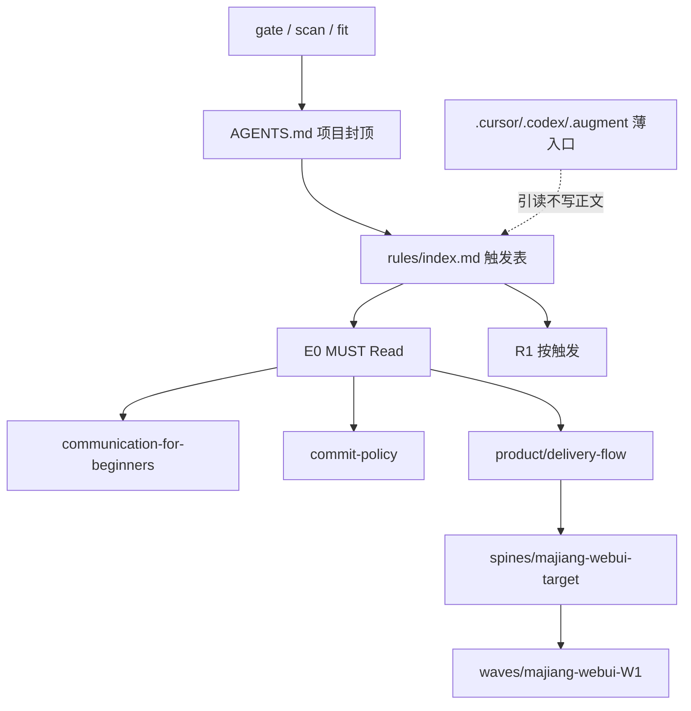

# 设计：majiang 规则面定封顶收口（W1）

> **状态**：已口头批准（方案 A）  
> **日期**：2026-11-15  
> **参考**：quantification 的脊骨/波次/E0·R1 触发表模型  
> **范围**：仅规则面与交付流程；不扩 OpenSpec / Fast-lane / `standards/global` submodule

## 1. 问题

能力与 UI 冲顶并行时，若无「做到哪算毕业 + Agent 读哪」，范围会边做边胀，且功能自动化绿易被误当成视觉毕业。

## 2. 目标（封顶）

| 目标 | 可观察验收 |
|------|------------|
| Agent 首读触发表 | `AGENTS.md` → `docs/standards/rules/index.md` |
| 抬天花板有人审合同 | 必读 `docs/product/delivery-flow.md`；脊骨记录毕业线与硬不做 |
| 规则可演进 | 新规则先进触发表 + `rule-evolution.md`，再改 IDE 薄入口 |
| 入口不漂移 | Cursor / Codex / Augment 只薄引读，正文在 `docs/standards` / `docs/product` |
| 功能绿 ≠ 视觉毕业 | 写进脊骨与沟通规范；Agent 不得自批视觉冲顶 |

## 3. 硬不做

- 不引入 `openspec/`、Fast-lane、厚卡升格机、强制 worktree
- 不挂 `standards/global` submodule（正文留在本仓）
- 本批不改 `src/*/core/` 规则语义
- 本批不夹带 `web-ui-prototype` / acceptance 等无关 diff

## 4. 架构



### 分层职责

| 层 | 路径 | 职责 |
|----|------|------|
| 项目封顶 | `AGENTS.md` | 优先级、MUST Read、本仓硬边界 |
| 触发表 | `docs/standards/rules/index.md` | 任务 → 规则；规则面封顶清单 |
| E0/R1 正文 | `docs/standards/rules/*`、`testing/*` | 可执行约束 |
| 交付流程 | `docs/product/delivery-flow.md` | 定封顶 → 波次 → 切片 |
| 脊骨 / 波次 | `docs/product/spines|waves/*` | 毕业账本与本波合同 |
| IDE 入口 | `.cursor/rules/*.mdc` 等 | 薄引读；`00-standards-index` alwaysApply |
| 演进 | `docs/standards/rule-evolution.md` | 需求 → 规则 → 验证 |

## 5. 相对 quantification 的裁剪

| quantification | 本仓 |
|----------------|------|
| OpenSpec + Fast-lane | 不用；用 `delivery-flow` + 阶段 A/B |
| `standards/global` submodule | 不用；正文本仓维护 |
| agent-io-contract / 厚卡升格 | 不引入 |
| 脊骨 / 波次 / U0·U1·U2 | **保留并落地** |
| E0 沟通决策卡 | **保留**（受众改为棋类/麻将产品读者） |

## 6. 收口工作项（实现清单将据此拆）

1. 确认未跟踪正文齐全：`index`、E0 三件套、`security`、`mermaid`、`delivery-flow`、脊骨、W1  
2. 对齐已改入口：`AGENTS.md`、`docs/standards/README.md`、`rule-evolution.md`、`.codex/AGENTS.md`、`.augment` Git 入口  
3. Cursor：保留 `00-standards-index.mdc`（alwaysApply）；`shared-standards-entry` 降为兼容、不 alwaysApply；其余 `.mdc` 仅薄引读  
4. 自检：触发表与 `AGENTS` MUST Read 一致；`fit` 映射含 delivery-flow；无 OpenSpec 路径被写成必读  
5. 提交范围（仅当你点名 commit）：规则面文件；排除 prototype/acceptance/backup/handoff 无关项

## 7. 验证

```bash
# 规范门禁（本机 skill）
bash ~/.claude/skills/project-standards-governance/scripts/standards_guard.sh gate pre
bash ~/.claude/skills/project-standards-governance/scripts/standards_guard.sh fit
bash ~/.claude/skills/project-standards-governance/scripts/standards_guard.sh gate post
```

人工抽查：打开 `AGENTS.md` 与 `rules/index.md`，确认首读链与 W1 终态一致。

## 8. 非目标（明确）

下一波视觉/移动端切片（脊骨 G1/G4）不在本设计内；须另开波次蓝图人审后再施工。
