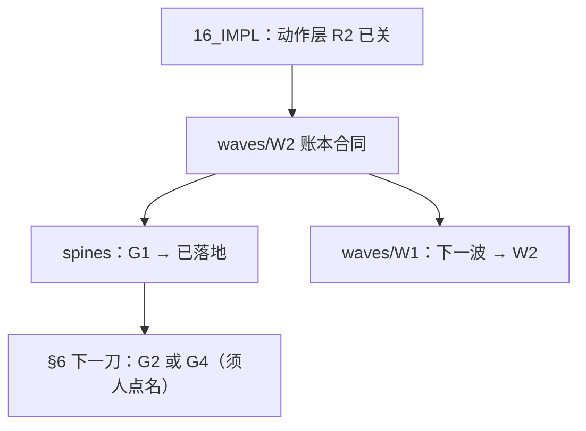

# 设计：麻将 Web UI · W2（G1 动作层账本收口）

> **状态**：已口头批准（方案 1 · 账本收口）  
> **日期**：2026-11-15  
> **范围**：仅产品账本（脊骨 / 波次）；**不改** `web-ui-prototype` DOM/CSS，不改 `src/*/core/`  
> **前置**：W1 规则面定封顶已齐；实现验收 `16_HIFI_IMPL_COMPETITOR_REVIEW_20260917.md` 已关闭动作层 R2 改稿单

## 1. 问题

脊骨仍写 G1「进行中/残余」，与实现验收「动作层已通过」不一致。Agent 易误开动作层大改或把整桌冲顶残余当成 G1 未完成。

## 2. 目标（封顶）

| 目标 | 可观察验收 |
|------|------------|
| G1 状态诚实 | 脊骨差距表 G1 = **已落地**；切片 `MJ-UI-ACT-01` 账本关闭 |
| W2 合同可人审 | 存在 `docs/product/waves/majiang-webui-W2.md`，字段齐全 |
| 防回退写死 | W2 硬不做：禁止退回圆钮 HUD / 深色 Web 工具条；禁止宣称整桌视觉毕业 |
| 下一刀不偷跑 | 脊骨 §6 默认指向 G2 或 G4，**须人点名开波**后再施工 |
| 零界面 diff | 本波无 `web-ui-prototype/**`、无 `src/**` 变更 |

## 3. 硬不做

- 不改动作层样式 / DOM / 键盘绑定
- 不上牌面 sprite（属 G2）
- 不开移动端目标帧（属 G4）
- 不改 `src/*/core/` 规则语义
- 不宣称「整桌视觉冲顶已毕业」或「无条件竞品级」
- 不引入 OpenSpec / Fast-lane

## 4. 架构



| 层 | 路径 | 本波动作 |
|----|------|----------|
| 波次蓝图 | `docs/product/waves/majiang-webui-W2.md` | **新建** |
| 脊骨 | `docs/product/spines/majiang-webui-target.md` | G1 状态 + §6 下一刀 |
| 上一波指针 | `docs/product/waves/majiang-webui-W1.md` | 「下一波」指向 W2 |
| 证据（只读引用） | `docs/majiang/design-freeze/.../16_…IMPL.md` | 不改正文 |

## 5. W2 蓝图字段（落盘内容）

| 字段 | 内容 |
|------|------|
| 主题 / 波次 | majiang-webui · W2 |
| UI 层 | U2·视觉 · 账本收口（无界面施工） |
| 脊骨 | `docs/product/spines/majiang-webui-target.md` |
| 用户故事 | 协作者看到 G1 与 R2/16_IMPL 一致，不再误开动作层大改 |
| 终态效果 | G1=已落地；W2 施工状态=账本已落盘；防回退硬不做可查 |
| 硬不做 | 见 §3 |
| 切片 | `MJ-UI-ACT-01`：账本关闭（引用 16_IMPL 动作层通过） |
| 施工状态 | 账本已落盘 |

## 6. 脊骨同步要点

- 差距表 G1：状态 → **已落地**（摘要仍保留「胶囊/印章条」语义，便于后人）
- GR-4：不因本波改为「整桌满分」；仅动作层残余清零，整桌观感合同不变
- §6 下一刀：默认排队 **G2（牌面）或 G4（移动端）**；禁止默认改推无关美化
- 观感合同：仍为「R2 有条件通过；整桌冲顶未毕业」

## 7. 验证

```bash
# 规范门禁（本机 skill；任务描述可注入）
STANDARDS_GUARD_TASK="W2 G1 动作层账本收口" \
  bash ~/.claude/skills/project-standards-governance/scripts/standards_guard.sh gate pre
STANDARDS_GUARD_TASK="W2 G1 动作层账本收口" \
  bash ~/.claude/skills/project-standards-governance/scripts/standards_guard.sh gate post
```

人工抽查：

1. 打开脊骨：G1 = 已落地  
2. 打开 W2：硬不做含「不退回圆钮/深色工具条」「不宣称整桌毕业」  
3. `git diff --stat`：仅 `docs/product/**`（及本 spec）；**无** `web-ui-prototype` / `src`

## 8. 非目标

- G2 牌面 sprite、G3 布局、G4 移动端、整桌商业冲顶满分  
- 重跑档位 B 视觉复审（本波无新实现帧）  
- 自动 commit（仅当用户点名）

## 9. 实现清单（供 writing-plans）

1. 新建 `docs/product/waves/majiang-webui-W2.md`  
2. 更新 `docs/product/spines/majiang-webui-target.md`（G1 + §6）  
3. 更新 `docs/product/waves/majiang-webui-W1.md` 下一波指针  
4. 跑 gate pre/post + 人工三抽查  
5. 用户点名后再中文 commit
