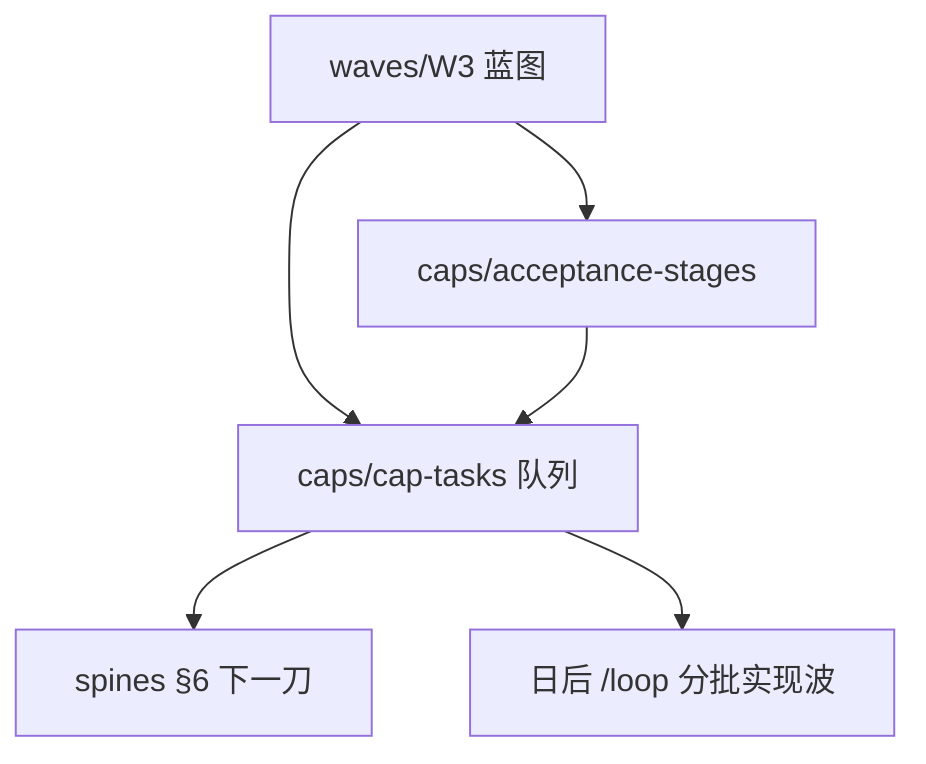

# 设计：麻将 Web UI · W3（全量 UI 封顶任务账本）

> **状态**：已口头批准（蓝图 + 全量封顶任务 + A/B/冲顶验收表）  
> **日期**：2026-11-15  
> **范围**：仅产品账本（脊骨 / 波次 / caps）；**不改** `web-ui-prototype` DOM/CSS，不改 `src/*/core/`  
> **前置**：W2 G1 账本已收口；脊骨默认下一刀排队 G2/G4

## 1. 问题

脊骨有 G1–G6 / GR-1–6，但缺少「施工队列 SSOT」：哪些封顶任务、绑哪一阶段验收、批序如何、日后 `/loop` 怎么一拍一切片。若不先定全表，后续实现波易漏项或用功能绿冒充视觉毕业。

## 2. 目标（封顶）

| 目标 | 可观察验收 |
|------|------------|
| 全量封顶任务可查 | 存在 `docs/product/caps/majiang-webui-cap-tasks.md`，覆盖 ACT/TILE/LAYOUT/MOBILE/RESULT/DIAG/GRAD |
| 全阶段验收可查 | 存在 `docs/product/caps/majiang-webui-acceptance-stages.md`（阶段A / 阶段B / 冲顶收官） |
| W3 合同可人审 | 存在 `docs/product/waves/majiang-webui-W3.md`，字段齐全 |
| 脊骨诚实 | §6 指向「W3 封顶账本已定；下一刀须人点名开实现波」；不因本波宣称整桌毕业 |
| 零界面 diff | 本波无 `web-ui-prototype/**`、无 `src/**` 变更 |
| loop 合同可查 | W3 / cap-tasks 写明：一拍一切片、禁自批 GRAD、须人点名才施工 |

## 3. 硬不做

- 不上牌面 sprite / 不改牌面 DOM/CSS（属后续 TILE 实现波）
- 不开移动端目标帧或实现帧（属 MOBILE 实现波）
- 不改动作层样式（G1 已关；仅防回退引用）
- 不改 `src/*/core/` 规则语义
- 不宣称「整桌视觉冲顶已毕业」或「无条件竞品级」
- 不启动 `/loop` 或 automate 施工（本波只写合同）
- 不引入 OpenSpec / Fast-lane

## 4. 架构



| 层 | 路径 | 本波动作 |
|----|------|----------|
| 设计定稿 | `docs/superpowers/specs/2026-11-15-majiang-webui-w3-cap-ledger-design.md` | **新建** |
| 波次蓝图 | `docs/product/waves/majiang-webui-W3.md` | **新建** |
| 封顶任务表 | `docs/product/caps/majiang-webui-cap-tasks.md` | **新建**（施工队列 SSOT） |
| 阶段验收表 | `docs/product/caps/majiang-webui-acceptance-stages.md` | **新建** |
| 脊骨 | `docs/product/spines/majiang-webui-target.md` | §6 + 可选引用 caps |
| 上一波指针 | `docs/product/waves/majiang-webui-W2.md` | 「下一波」→ W3 |

**SSOT 约定**：施工排队与批序以 `cap-tasks` 为准；交互设计文档 14.x / 13.x 为细则引用，不另开第二套任务 ID。

## 5. 封顶任务一览（摘要）

| 封顶任务 ID | 脊骨 | 切片 | 建议批序 | 账本状态 |
|-------------|------|------|----------|----------|
| `CAP-UI-ACT` | G1 | `MJ-UI-ACT-01` | — | 已落地 |
| `CAP-UI-TILE` | G2 | `MJ-UI-TILE-01` | 1 | 待施工 |
| `CAP-UI-LAYOUT` | G3 | `MJ-UI-LAYOUT-01` | 2 | 部分 |
| `CAP-UI-MOBILE` | G4 | `MJ-UI-MOBILE-01` | 3 | 未达 |
| `CAP-UI-RESULT` | G5 | `MJ-UI-RESULT-01` | 4（有缺口再开） | 基本有 |
| `CAP-UI-DIAG` | G6 | `MJ-UI-DIAG-01` | 持续 | 守规 |
| `CAP-UI-GRAD` | GR-1…6 | 收官 | 最后 | 冲顶未毕业 |

## 6. 阶段验收（摘要）

- **阶段A**：设计冻结；无实现证据；绑定 TILE/LAYOUT/MOBILE/RESULT/GRAD  
- **阶段B**：实现一致；必交截图/录屏/DOM；绑定同批任务 + ACT 防回退  
- **冲顶收官**：14.7 / 14.8 + GR-6；**仅人批**，Agent/`loop` 不得自批通过  

现状诚实行写进 acceptance-stages：桌面 R2 有条件；移动未审；整桌未满分。

## 7. 日后 `/loop` + automate 合同

1. 一拍只取队列下一条未关闭的 `CAP-*`（默认批序 1→3）  
2. 未被人点名开波 → 跳过并汇报排队  
3. 该任务阶段A 合同未齐 → 禁止进阶段B 施工拍  
4. 禁止把 `CAP-UI-GRAD` 标成通过  
5. 停：人说停 / 队列无可施工项 / 闸门失败  

本波**不**启动 loop。

## 8. 验证

人工抽查：

1. `cap-tasks` 含全部 7 个 `CAP-UI-*`  
2. `acceptance-stages` 含阶段A / 阶段B / 冲顶收官三表  
3. W3 硬不做含「不上 sprite / 不开移动端帧 / 不启动 loop」  
4. 脊骨 §6 含 W3 封顶账本 + 须人点名开实现波  
5. `git diff --stat`：仅 `docs/product/**` 与本 spec；**无** `web-ui-prototype` / `src`

可选：

```bash
STANDARDS_GUARD_TASK="W3 UI 封顶账本" \
  bash ~/.claude/skills/project-standards-governance/scripts/standards_guard.sh gate pre
STANDARDS_GUARD_TASK="W3 UI 封顶账本" \
  bash ~/.claude/skills/project-standards-governance/scripts/standards_guard.sh gate post
```

## 9. 非目标

- TILE sprite 实现、LAYOUT 大改、MOBILE 出图、GRAD 毕业  
- 重跑档位 B 视觉复审（本波无新实现帧）  
- 自动 commit（仅当用户点名）

## 10. 实现清单

1. 新建本 spec  
2. 新建 `waves/majiang-webui-W3.md`  
3. 新建 `caps/majiang-webui-cap-tasks.md`  
4. 新建 `caps/majiang-webui-acceptance-stages.md`  
5. 更新脊骨 §6（及必要交叉引用）  
6. 更新 W2「下一波」→ W3  
7. 自检五条抽查  
8. 用户点名后再中文 commit  
