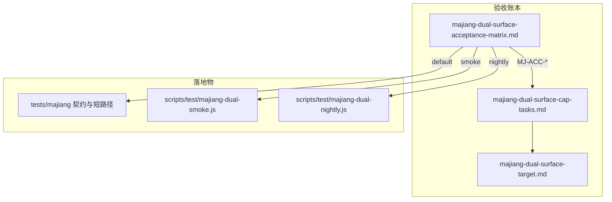
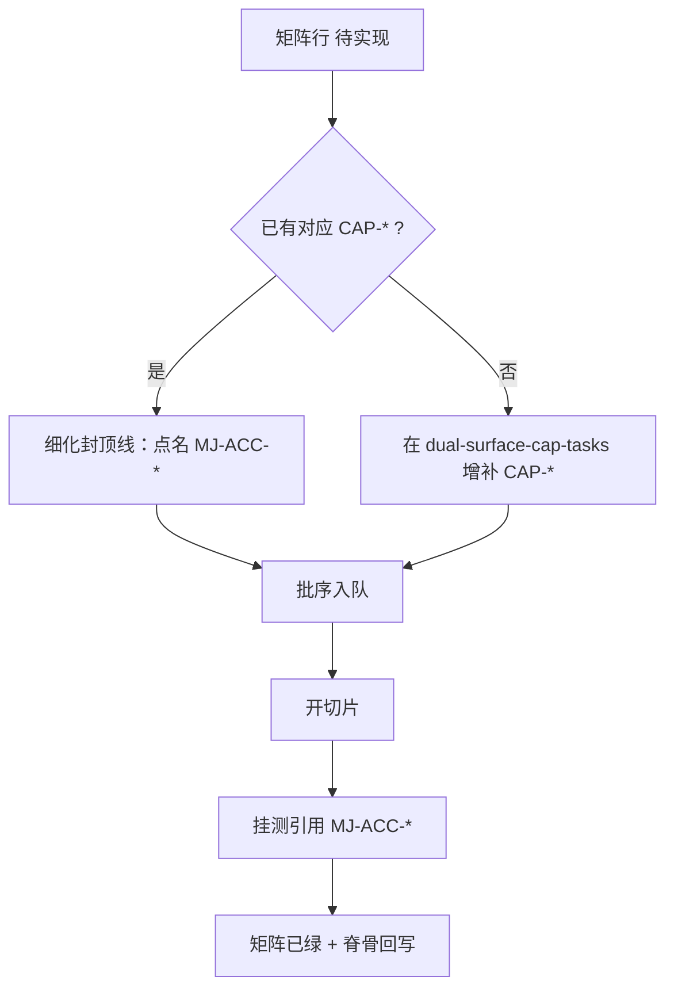

# 设计：麻将双表面功能验收测试模块

> **状态**：设计已批准；实现计划见 `docs/superpowers/plans/2026-11-17-majiang-dual-surface-acceptance.md` 
> **日期**：2026-11-17  
> **父设计**：`docs/superpowers/specs/2026-11-17-majiang-dual-surface-design.md`  
> **脊骨**：`docs/product/spines/majiang-dual-surface-target.md`  
> **任务表**：`docs/product/caps/majiang-dual-surface-cap-tasks.md`  
> **质量规范**：`docs/standards/testing/quality.md`

## 1. 问题

CLI（命令行）侧重训练、Web 侧重人测，双表面共用引擎的方向已定，但验收仍分散：

- 规则/Session 有 Mocha 测，Web 有偏视觉的 acceptance 脚本
- 缺少「按功能逐项」的目标态矩阵
- 未落地能力没有统一「清单 → 封顶标准 → CAP 开任务」闭环
- `GR-D7` / `CAP-ACC-DUAL` 需要可观察、可重复的挂测方式

## 2. 目标（封顶）

| 目标 | 可观察验收 |
|------|------------|
| 功能矩阵 SSOT | 目标态全能力列入矩阵，每行有 `MJ-ACC-*`、封顶标准、档位、依赖 CAP、状态 |
| 一本账施工 | 缺口只扩展双表面 `CAP-*` 表，不另开平行测试任务表 |
| 三档回归 | `npm test`（default）/ `majiang:dual:smoke` / `majiang:dual:nightly` |
| 未实现可追踪 | 未落地行可 skip，不算装绿；落地后失败必须红 |
| 规则边界 | 测试与 Web 均不重写 `src/majiang/core/` 胡吃碰杠/计分权威 |

## 3. 已批准决策

| 决策 | 选项 |
|------|------|
| 范围 | **B** 完整功能矩阵（CLI / API / Web） |
| 覆盖 | **B1** 按目标态列全；未落地后续清单化 + 封顶 + 开任务 |
| 账本 | **T1** 扩展现有 `majiang-dual-surface-cap-tasks.md` |
| 回归分档 | **R1** default / smoke / nightly 三档 |
| 形态 | **C** 文档矩阵 + 代码/脚本按 `MJ-ACC-*` 落地 |

## 4. 硬不做

- 用功能自动化绿冒充视觉冲顶（已毕业 `CAP-UI-*` 不重开）
- 默认 `npm test` 拉长时间训练或必依赖浏览器
- 前端/测试辅助层重写规则判定
- Agent 自批 `CAP-DUAL-GRAD` 或把「待实现」标成「已绿」
- 另建与双表面 CAP 表平行的第二套施工 SSOT

## 5. 架构

| 块 | 职责 |
|----|------|
| 功能矩阵 | 目标态能力清单与封顶标准（验收 SSOT） |
| CAP 表 | 施工队列；缺口从矩阵升格为可开切片 |
| 脊骨 GR-D* | 毕业标准回写 |
| 三档脚本/测试 | 按档位执行；用例与报告引用 `MJ-ACC-*` |

## 6. 矩阵字段与首版能力行

### 6.1 字段

| 字段 | 含义 |
|------|------|
| `MJ-ACC-*` | 能力 ID（测试/脚本/报告统一引用） |
| 能力 | 人话一句话 |
| 封顶标准 | 可观察通过条件 |
| 档位 | `default` / `smoke` / `nightly` |
| 依赖 CAP | 实现封顶任务；未绿则 skip 或标待实现 |
| 状态 | `待实现` / `已挂测` / `已绿` / `人批` |

### 6.2 首版行

| ID | 能力 | 封顶标准（摘要） | 档位 | 依赖 CAP |
|----|------|------------------|------|----------|
| `MJ-ACC-ENG-01` | 无头 Session 开局→步进→终局 | Session auto 可无交互跑完并 `ENDED` | default | `CAP-ENG-SESSION` |
| `MJ-ACC-SNAP-01` | 快照可喂 view-model；动作来自引擎 | 快照字段齐全；`availableActions` 非前端自造 | default | `CAP-ENG-SNAP` |
| `MJ-ACC-CLI-01` | 自动对弈入口走 Session | 短路径可断言终局；不依赖 readline 硬耦合 | default | `CAP-CLI-TRAIN` |
| `MJ-ACC-CLI-02` | N 局统计可重复 | 固定配置下输出局数/统计字段形状稳定 | nightly | `CAP-CLI-TRAIN` |
| `MJ-ACC-API-01` | 对局 API 权威在服务端 | `POST/GET/actions` 可用；状态以服务端 Session 为准 | smoke | `CAP-API-GAME` |
| `MJ-ACC-WEB-01` | 人测主链路完局 | 大厅开局→出牌→AI 回手→结算（无假 `waiting_ai` 死等） | smoke | `CAP-WEB-BRIDGE`（大厅依赖 `CAP-WEB-LOBBY` 时注明） |
| `MJ-ACC-WEB-02` | 非法动作被拒 | 拒绝后状态不脏写 | smoke | `CAP-API-GAME` + `CAP-WEB-BRIDGE` |
| `MJ-ACC-DUAL-01` | 双表面同引擎契约 | 同一 Session 契约被 CLI 与 API 共用；smoke 可重复 | smoke | `CAP-ACC-DUAL` |

## 7. 缺口 → CAP 扩展规则

| 规则 | 说明 |
|------|------|
| 一本账 | 只扩展 `majiang-dual-surface-cap-tasks.md` |
| 矩阵先行 | 先有 `MJ-ACC-*` + 封顶标准，再改/增 `CAP-*` |
| CAP 可观察 | 封顶线写明：哪条 `MJ-ACC-*`、哪档脚本、断言什么 |
| 细化优先 | 能挂现有 CAP 则细化；仅跨边界时新建 |
| `CAP-ACC-DUAL` | 收束：关键 default 子集已绿 + smoke 的 API/WEB/DUAL 可重复；不替代各能力 CAP |
| 禁自批 | `CAP-DUAL-GRAD` 仅人批 |

### CAP ↔ 矩阵（首版）

| CAP | 矩阵行 |
|-----|--------|
| `CAP-ENG-SESSION` | `MJ-ACC-ENG-01` |
| `CAP-ENG-SNAP` | `MJ-ACC-SNAP-01` |
| `CAP-CLI-TRAIN` | `MJ-ACC-CLI-01`、`MJ-ACC-CLI-02` |
| `CAP-API-GAME` | `MJ-ACC-API-01`（及 WEB-02 一半） |
| `CAP-WEB-BRIDGE` / `CAP-WEB-LOBBY` | `MJ-ACC-WEB-01`、`MJ-ACC-WEB-02` |
| `CAP-ACC-DUAL` | `MJ-ACC-DUAL-01` + 上表约定子集全绿 |

## 8. 目录、脚本与跳过策略

### 8.1 路径

| 类型 | 路径 |
|------|------|
| 矩阵 SSOT | `docs/product/caps/majiang-dual-surface-acceptance-matrix.md` |
| 任务表 | `docs/product/caps/majiang-dual-surface-cap-tasks.md` |
| 脊骨 | `docs/product/spines/majiang-dual-surface-target.md` |
| default | `tests/majiang/**`（用例标注 `MJ-ACC-*`） |
| smoke | `scripts/test/majiang-dual-smoke.js` → `npm run majiang:dual:smoke` |
| nightly | `scripts/test/majiang-dual-nightly.js` → `npm run majiang:dual:nightly` |
| 报告（可选） | `.tmp/acceptance/majiang-dual-*.json`（可不入库） |

### 8.2 跳过 / 失败

| 情况 | 行为 |
|------|------|
| 依赖 CAP 未落地 | skip；矩阵保持 `待实现`；不算回归红 |
| 已落地但断言失败 | 必须红；禁止放宽装绿 |
| 随机 / 多局长训 | 仅 nightly；固定种子或只断言统计形状 |
| Web | smoke 走 Playwright 类路径；禁止前端自造规则 |
| `npm test` | 只跑 default |

## 9. 实现阶段交付顺序（本规格批准后的计划输入）

1. 落盘矩阵文件（§6 八行 + 完整封顶标准正文）
2. CAP 表补「须挂 `MJ-ACC-*`」引用；细化各 CAP 封顶线
3. 挂已有 `MJ-ACC-ENG-01`（现有 `tests/majiang/game-session.test.ts`）
4. 脚手架：`majiang:dual:smoke` / `majiang:dual:nightly`（未落地行显式 skip）
5. 后续按双表面批序实现 SNAP → CLI → API → WEB → ACC，矩阵逐行变绿

**说明**：批准本规格 ≠ 立刻实现全部能力；施工仍服从 `majiang-dual-surface-cap-tasks.md` 批序。

## 10. 与规范关系

- `docs/standards/testing/quality.md`：分层、默认可重复、训练不进默认回归
- `docs/product/delivery-flow.md`：封顶任务可观察；功能绿 ≠ 视觉冲顶
- `AGENTS.md`：UI/测试不重写 `core` 权威判定

## 11. 规格自检（写盘时）

| 检查 | 结果 |
|------|------|
| 无 TBD/TODO 占位 | 通过（实现顺序在 §9，非未决需求） |
| 与父设计/脊骨一致 | 通过（路径 A、CAP 0–8、GR-D7） |
| 范围可单计划落地 | 通过（先矩阵+挂测脚手架；能力实现跟 CAP） |
| 歧义 | 已钉死：B1/T1/R1/C；未实现 skip 不装绿 |
