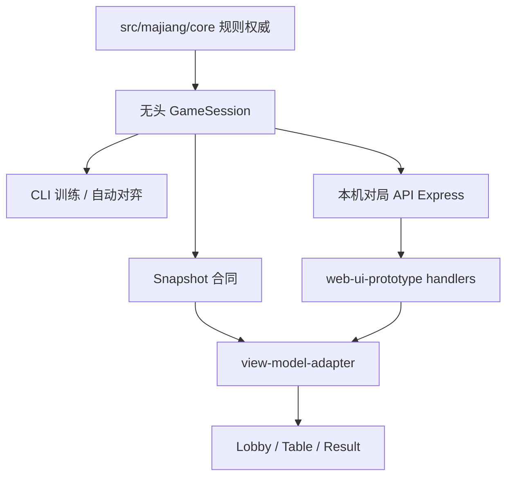

# 设计：麻将双表面共用引擎（CLI 训练 + Web 人测）

> **状态**：已口头批准（路径 A · 2026-11-17「符合」）  
> **日期**：2026-11-17  
> **脊骨**：`docs/product/spines/majiang-dual-surface-target.md`  
> **任务表**：`docs/product/caps/majiang-dual-surface-cap-tasks.md`  
> **首波**：`docs/product/waves/majiang-dual-surface-W9.md`

## 1. 问题

Web UI 视觉封顶（一段/二段）已毕业，但原型对局仍是假 handler：出牌后 `waiting_ai` 永不回手，无法人测完局。  
产品目标要求 **CLI 训练** 与 **Web 人测** 并存，且 **复用同一游戏引擎**；继续假循环或把 core 打进浏览器都不符合目标。

## 2. 目标（封顶）

| 目标 | 可观察验收 |
|------|------------|
| 共用引擎 | 无头 Session 驱动对局；CLI 与 API 同调 |
| CLI 训练 | 自动对弈/训练入口走 Session，统计可回归 |
| Web 人测 | 大厅开局 → 真对局步进 → 结算；无假 AI 死等 |
| 规则边界 | 胡吃碰杠/计分权威仍在 `src/majiang/core/` |
| 自动化 | `/loop` 从双表面任务表一拍一切片；禁自批毕业 |

## 3. 硬不做

- Web 重写规则引擎或计分  
- 默认路径把 core 打包进浏览器（已否决 B）  
- 破坏 CLI 训练主路径  
- 重开已毕业 `CAP-UI-COMP` 视觉冲顶冒充本波交付  
- Agent 自批 `CAP-DUAL-GRAD`

## 4. 架构（路径 A）

| 层 | 职责 |
|----|------|
| `core` | 牌、规则、可用动作、终局判定（不改权威语义） |
| Session | 无头对局编排：开局、玩家动作、AI 步、终局；无 console/readline 硬依赖 |
| Snapshot | 稳定 JSON 合同，供适配层与测试 |
| CLI | 训练与批量对弈壳 |
| API | HTTP（可选 WS）会话；状态权威在服务端 |
| Web | 表现 + 提交动作；消费快照 |

## 5. 封顶任务（0–8）

见 `majiang-dual-surface-cap-tasks.md` 总表。摘要：

0. 账本 → 1. Session → 2. Snapshot → 3. CLI 训练 ∥ 4. API → 5. Web 桥 → 6. 大厅 → 7. 双表面验收 → 8. 人批毕业

## 6. 与旧 Web UI 账本关系

- `majiang-webui-target` / `majiang-webui-cap-tasks`：**已毕业，只读防回退**  
- 本设计 **不** 将视觉 COMP 未完成项重新打开  
- 大厅 U0 属于 `CAP-WEB-LOBBY`，不做竞品整桌重绘

## 7. 验收与自动化

- 每切片：可观察验收 + 回写脊骨/任务表  
- `/loop` 提示词见任务表 §5  
- `CAP-DUAL-GRAD` 仅人批

## 8. 首波（W9）范围

- 落地账本（本规格 + 脊骨 + 任务表 + W9）  
- 下一施工刀：`CAP-ENG-SESSION`  
- 本规格批准后：写实现计划再改码
