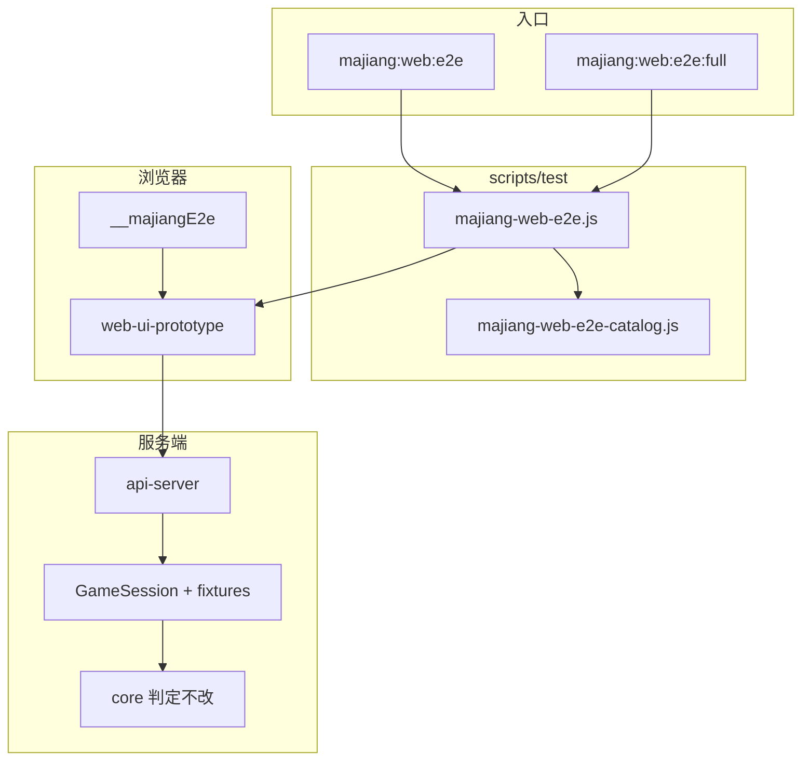

# 广东麻将 Web e2e 场景目录表设计

> 日期：2026-11-18  
> 状态：待用户审阅（brainstorming 已口头对齐方案 A）  
> 范围：仅 Web 端真浏览器 e2e；CLI / 其他端另波

## 1. 背景与目标

现有 `npm run majiang:web:e2e`（`scripts/test/majiang-web-e2e.js`）已覆盖：

- 静态拒开局、演示假对局、结果四态示意
- API 随机完局 + 非法出牌
- 夹具 `peng-ready` / `chi-ready` / `hu-ready`（点炮胡分数）

缺口（广东麻将玩家可操作主路径）：过、明杠、自摸结算、真流局、合法出牌专用项、非法动作 ID、术语文案扫描；暗杠/补杠与真 abort 视能力可 defer。

**目标**：以「场景目录表」为单一真相源，穷举 Web 可观察主路径（非番种穷举）；默认回归跑 smoke，全量跑 full。

## 2. 已批准共识

| 项 | 选择 |
|----|------|
| 覆盖深度 | C：尽量穷举主路径 + 非法 + 文案（不扫全部番种） |
| 夹具层 | Session/API 可扩 fixture；禁止前端伪造规则判定 |
| 回归形态 | B：`e2e` = smoke；`e2e:full` = 全表 |
| 架构 | 方案 A：夹具目录表驱动 |

## 3. 场景目录（E01–E17）

| ID | 场景 | 夹具/入口 | 断言要点 | 档 |
|----|------|-----------|----------|----|
| E01 | 静态拒开局 | 纯静态 | 留大厅 + API 提示 | smoke |
| E02 | 演示假对局 | `?prototypeDemo=1` | 进桌、无 offline guard | smoke |
| E03 | 结果四态示意 | demo + `showMajiangResultExample` | 自摸 / 点炮胡 / 流局 / 异常终止样式 | smoke |
| E04 | API 完局烟雾 | 无夹具 | 开局→终局；优先胡/副露 | smoke |
| E05 | 非法出牌 | 无夹具 | 手牌不脏写 + 行内错误 | smoke |
| E06 | 必现碰 | `peng-ready` | did:peng → `player_turn` | smoke |
| E07 | 必现吃 | `chi-ready` | did:chi → `player_turn` | smoke |
| E08 | 点炮胡 + 分数 | `hu-ready` | `ron`；分非全 0；零和 | smoke |
| E09 | 必现过 | **新** `pass-ready` | 有副露可过 → 过后续局不崩 | full |
| E10 | 必现明杠 | **新** `gang-ready` | did:gang → 可继续 | full |
| E11 | 自摸胡 + 分数 | **新** `tsumo-ready` | `tsumo`；分校验同 E08 | full |
| E12 | 真流局 | **新** `draw-ready` | `draw`；delta 全 0 | full |
| E13 | 合法出牌 | **新** `discard-ready` 或开局即出 | 河牌/手牌变化正确 | full |
| E14 | 非法动作 ID | API 桌 | 拒绝且不脏写 | full |
| E15 | 广东术语文案 | 局内关键态 | 可见文案无「荣和 / 立直 / 听牌」 | full |
| E16 | 暗杠 / 补杠 | **新** 若 Session 能装 | 点杠后状态合理 | full；不能装则 `defer` |
| E17 | 异常终止 abort | 示意已有；真 abort 若无入口 | 无入口则 `defer` | full / defer |

### 硬不做（本波）

- 不扫全部番种 / 牌型（留 `tests/majiang/win-conditions/`）
- 不做视觉冲顶截图对比（功能绿 ≠ 视觉通过）
- 不改 `src/majiang/core/` 权威判定（只装牌面 / 响应窗夹具）
- 不把 full 默认挂进 `majiang:dual:smoke`

## 4. 架构

| 部件 | 职责 | 不做什么 |
|------|------|----------|
| `majiang-web-e2e-catalog.js` | E01–E17：id、档位、fixture、runner 名、defer 标记 | 不启浏览器 |
| `majiang-web-e2e.js` | 按 `MAJIANG_E2E_SUITE=smoke\|full` 过滤执行；汇总 JSON | 不造规则 |
| `GameSession` | 新 fixture 装牌面开窗 | 不改 canHu / canPeng 等 |
| `api-bridge` | 透传 `?fixture=` | 不解析业务规则 |
| Session 单测 | 每新夹具 ≥1 条 | 不替代浏览器 e2e |

### 错误与 defer

- 夹具装不上 → 场景标 `defer`，写入结果 JSON。
- **full 默认**：非 defer 失败 → 进程非 0；存在未声明的 skip → 失败。
- 仅本地排障可用 `MAJIANG_E2E_ALLOW_DEFER=1` 将已知 defer 当 skip（不进 CI 默认）。
- 单场景失败不短路：跑完汇总再退出，便于一次看清缺口。

## 5. 文件改动面

| 路径 | 改动 |
|------|------|
| `scripts/test/majiang-web-e2e-catalog.js` | **新建** 场景表 |
| `scripts/test/majiang-web-e2e.js` | 表驱动；复用现有 assert；实现新 runner |
| `package.json` | 增 `majiang:web:e2e:full`；默认 e2e = smoke（`MAJIANG_E2E_SUITE=smoke`） |
| `src/majiang/session/game-session.ts` | `pass-ready` / `gang-ready` / `tsumo-ready` / `draw-ready` /（可选）`discard-ready` |
| `docs/majiang/web-ui-prototype/api-bridge.js` | 注释扩 fixture 列表 |
| `tests/majiang/*fixture*` / 分数相关 | 新夹具 Session 单测 |
| `docs/majiang/web-ui-prototype/README.md` | smoke / full 口径 |
| `docs/product/caps/majiang-dual-surface-acceptance-matrix.md` | 挂测句回写（dual smoke 仍挂默认 e2e=smoke） |

## 6. 验收

| 命令 | 通过标准 |
|------|----------|
| `npm run majiang:web:e2e` | E01–E08 全绿 |
| `npm run majiang:web:e2e:full` | 非 defer 场景全绿；JSON 列出 defer/fail |
| 相关 `npm test` | 新夹具 Session 单测绿 |
| 文案 E15 | 关键可见节点无禁用日式术语 |

## 7. 风险

1. 明杠 / 自摸 / 流局装牌成本高 → 可先落地 E09–E15，E16/E17 诚实 defer。
2. full 变慢 → 仅手跑 / nightly，不进默认 dual smoke。
3. E15 文案断言易脆 → 只扫关键可见文案节点，不做全 DOM。

## 8. 实现顺序（供后续 plan）

1. 抽出 catalog + suite 过滤（行为与现网 smoke 等价）。
2. Session：`pass-ready` → `gang-ready` → `tsumo-ready` → `draw-ready` → `discard-ready`。
3. e2e runner：E09–E15；E16/E17 能装则装，否则 defer。
4. 文档与 caps 回写；dual smoke 确认仍只挂 smoke。

## 9. 非目标回顾

- 非视觉冲顶验收
- 非 CLI e2e 本波
- 非改写 core 胡/吃/碰/杠判定
