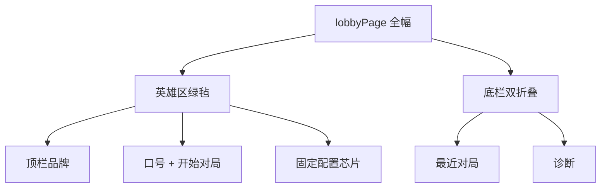

# 设计：麻将 Web 大厅商业启动页（抬天花板）

> **状态**：已口头批准（2026-11-19「符合」）  
> **日期**：2026-11-19  
> **决策**：商业大厅 B · 骨架重排不扩能力 · 桌面 1440×900 先冻 · α 全幅 · **A3** 构图 · **V1** 绿毡金扣 · **S1** 底栏双折叠  
> **脊骨**：`docs/product/spines/majiang-web-lobby-target.md`  
> **流程**：`docs/product/delivery-flow.md`  
> **原型**：`docs/majiang/web-ui-prototype/`（`#lobbyPage`）  
> **companion 示意**：`.superpowers/brainstorm/`（会话内 mockup；不入交付验收）

## 1. 问题

大厅仅完成双表面 **U0**（一主 CTA + 固定配置 + 诊断折叠），功能可开局，但观感仍是 Web 表单卡，与已毕业局内桌（绿毡竞品向）气质脱节。玩家进入感弱，不适合作为商业启动页。

## 2. 目标（封顶）

| 目标 | 可观察验收 |
|------|------------|
| 商业进入感 | 桌面 1440×900 第一眼为全幅英雄启动页，而非居中表单卡 |
| 品牌优先 | 「广东麻将」为英雄级信号；一句口号 + 单一主 CTA「开始对局」 |
| 与局内连续 | 绿毡 + 金 CTA 材质族，与已毕业牌桌同向 |
| 能力不胀 | 配置仍只读芯片；不新增选房/改规则/人设 |
| 次级收纳 | 最近对局 + 诊断在底栏折叠；诊断 JSON 默认不倾倒 |
| 状态诚实 | 空闲可点；忙碌锁 CTA；失败红条 + 重试；错误不伪造规则原因 |
| 闸门 | 阶段 A 高保真目标人批后方可宣称视觉；功能/e2e 绿 ≠ 视觉毕业 |

## 3. 硬不做

- 前端重写 `src/majiang/core/` 胡吃碰杠/计分权威  
- 本波扩 U1 真能力（选规则、房间、角色等）  
- 重开整桌 `CAP-UI-COMP` 或改写已毕业 dual-surface 契约语义  
- 本波把移动 390×844 纳入毕业（另波）  
- 用自动化绿或 Agent/`/loop` **自批**大厅视觉毕业  
- 英雄区堆卡片墙、统计条、多主 CTA

## 4. 信息架构（U0）

| 区 | 内容 | 默认 |
|----|------|------|
| 顶 | 品牌名「广东麻将」 | 常显 |
| 中 | 口号「一局见真章」+ 主 CTA | 常显 |
| 中下 | 配置芯片（玩家数 / AI / 规则集 / 起始分）只读 | 常显 |
| 底 | 最近对局、诊断 | 折叠 |
| 反馈 | `lobbyError` 贴 CTA 下方 | 仅失败显 |

构图代号：**A3**（顶栏品牌 + 中心 CTA）。备选 A1/A2 已否决。

## 5. 视觉合同（U2·视觉）

| 项 | 合同 |
|----|------|
| 代号 | **V1 绿毡金扣** |
| 背景 | 全幅绿毡氛围（可含淡桌心椭圆暗示）；禁止紫系默认 AI 风、禁止奶油衬线+陶土套餐 |
| CTA | 金色实心主按钮，高对比 |
| 芯片 | 低对比描边胶囊，不抢 CTA |
| 底栏 | 深色半透明条，不压过英雄主路径 |
| 目标帧 | 阶段 A 冻结 **1440×900** 高保真；实现阶段 B 对照 |
| 动效 | 本波最多轻量（CTA 反馈、折叠展开）；不做片头长动画 |

## 6. 状态与交互

| 状态 | CTA | 其它 |
|------|-----|------|
| 空闲 | 「开始对局」可点 | 底栏可展开 |
| 忙碌 | 「创建中…」禁用，防连点 | 保留英雄骨架 |
| 失败 | 「重试创建」+ 红条文案 | 诊断仍默认折叠 |
| 诊断展开 | 不改变 | 仅此时写入快照 JSON |

主链路不变：大厅开局 → 牌桌 → 结算 → 回大厅。权威仍在 API/`core`。

## 7. 与旧账本关系

| 账本 | 关系 |
|------|------|
| `majiang-webui-target` | 局内视觉已毕业，只读防回退；本设计不重开 COMP |
| `majiang-dual-surface-target` | GR-D6/大厅 U0 已关；本设计**另立**商业大厅观感天花板，不改引擎契约 |
| `tests/majiang/web-lobby.test.ts` | 须随 DOM/结构更新断言（主 CTA、诊断折叠、禁止三栏仪表盘） |
| `MJ-ACC-WEB-01` | 主链路依赖大厅入口，不得破坏开局 |

## 8. 切片预告（实现计划细化）

| 序 | 切片意图 | UI 层 |
|----|----------|-------|
| 0 | 脊骨 + 波次蓝图落盘 | 流程 |
| 1 | 阶段 A：1440×900 高保真目标入库并人批 | U2·视觉 |
| 2 | U0：`#lobbyPage` 改 A3 + S1 结构 | U0 |
| 3 | U2：V1 材质/字体/CTA 对照目标图 | U2·视觉 |
| 4 | 挂测与 e2e 入口回归 | 验收 |
| 5 | 人批大厅观感毕业（本脊骨） | 收官 |

移动端目标帧另波，不在本规格毕业线内。

## 9. 风险

- 现有 lobby 挂测绑定旧 class/结构，改骨架必改测  
- 无阶段 A 目标图则不得宣称视觉通过  
- 氛围图资源若缺失，实现易退回「深色面板」，需在阶段 A 显式冻结材质

## 10. 下一步

1. 人审本规格文件  
2. 批准后：`writing-plans` 出实现计划（含波次文件名与 CAP ID）  
3. 再改 `web-ui-prototype` 大厅；不先改码
