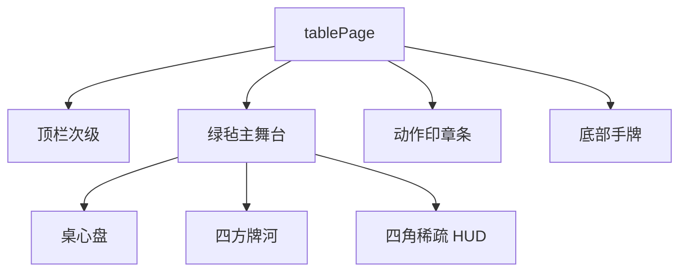

# 设计：麻将 Web 局内桌三抬顶（自绘高保真）

> **状态**：W1 已毕业（2026-11-19 人批「批准毕业」）；聊天设计三段与落盘规格均已人审  
> **日期**：2026-11-19  
> **决策**：范围 A+B+C · 毕业线竞品并排 · 视口桌面先 / 移动防回退 · 路径 **② 全自绘高保真**  
> **脊骨**：`docs/product/spines/majiang-web-table-v3-target.md`  
> **波次**：`docs/product/waves/majiang-web-table-v3-W1.md`  
> **流程**：`docs/product/delivery-flow.md`  
> **原型**：`docs/majiang/web-ui-prototype/` `#tablePage`  
> **大厅**：`majiang-web-lobby-target` 已毕业，**本设计不改大厅**

## 1. 问题

大厅商业启动页已毕业；进入对局后的 `#tablePage` 虽有 W8 竞品毕业账本，但玩家观感仍偏「Web 生成桌」——桌心 HUD、动作条、手牌/牌河、毡材质与大厅气质未形成连续沉浸。继续在旧实现上微调无法达到可并排竞品的编码目标图。

## 2. 目标（封顶）

| 目标 | 可观察验收 |
|------|------------|
| 整桌沉浸 | 1440×900 第一眼锁桌心关键动作，而非扫信息墙 |
| 桌心 + 操作 | 风向局/余牌/最近打出可读；胡/过/碰/杠印章条贴手牌，胡为主路径 |
| 手牌 + 牌河 | 牌是主角；选中抬起；四方弃牌有序；最近一张高亮 |
| 材质连续 | 绿毡 + 金强调与大厅色板同族（可复用 `--table-felt-*` / `--gold-*`） |
| 竞品并排 | 桌面帧可与立直城等商业局内截图同框对照，作为编码目标图 |
| 闸门 | 阶段 A 自绘高保真人批后方可大改实现；功能/e2e 绿 ≠ 视觉毕业 |

## 3. 硬不做

- 改 `#lobbyPage` 或重开大厅毕业账本  
- 前端重写 `src/majiang/core/` 胡吃碰杠/计分权威  
- 用旧 W8 截图冒充本波阶段 A 目标  
- 用标注竞品原图代替自绘目标交付（竞品只作学架构参考）  
- 本波将移动 390×844 纳入视觉毕业（仅防回退抽检）  
- Agent / `/loop` 自批毕业  
- 功能自动化绿冒充视觉通过  

## 4. 信息架构（U0）

| 区 | 内容 | 优先级 |
|----|------|--------|
| 桌心 | 风向局、余牌、必要分位提示 | 第一眼 |
| 牌河 | 四方弃牌 + 最近牌高亮 | 局势 |
| 手牌 | 近大实体牌；选中态 | 操作主角 |
| 动作 | 胡 / 过 / 碰 / 杠（及可见动作） | 贴手牌 |
| 角区 | 头像 + 昵称/风 + 分数胶囊 | 稀疏 |
| 顶栏/诊断 | 次级；不抢桌心 | 默认弱化 |

## 5. 视觉合同（U2）

| 项 | 合同 |
|----|------|
| 路径 | **② 全自绘高保真**（非竞品标注冻帧、非跳过冻帧直接改码） |
| 主帧 | 阶段 A：`docs/majiang/design-freeze/stage-a-v3-table/` 至少 1 张 **1440×900**；建议含可响应态（胡高亮可见） |
| 桌心 | 自绘统一一种中心盘形态（方/六边择一写进目标图）；禁止半透明说明墙 |
| 动作 | 印章/胶囊条；胡最大；禁止 Web 工具条圆钮排 |
| 牌面 | 实体感图集或等价资产；禁止色点矩形回潮 |
| 材质 | 绿毡纹理 + 金强调；禁止紫霓虹 / 平板灰面板 |
| 竞品用法 | 立直城等只学空间与节奏，不抄资产、不把竞品截图当交付目标图 |
| 移动 | 本波不冻移动毕业帧；阶段 B 后抽检 390×844 不比现网明显恶化 |

## 6. 切片（本波）

| 切片 | 内容 | UI 层 | 状态 |
|------|------|-------|------|
| `MJ-T3-LEDGER-01` | 脊骨 + 本规格 + W1 蓝图 + 任务表 | 流程 | **已落地** |
| `MJ-T3-STAGEA-01` | 1440×900 自绘主帧冻结并人批 | U2·视觉 | **已落地** |
| `MJ-T3-CENTER-01` | 桌心盘 + 动作印章条对照目标 | U2·结构/视觉 | **已落地** |
| `MJ-T3-TILE-01` | 手牌 / 牌河 / 副露 / 最近牌 | U2·视觉 | **已落地** |
| `MJ-T3-FELT-01` | 毡光影与大厅色板连续 | U2·视觉 | **已落地** |
| `MJ-T3-GRAD-01` | 桌面竞品并排毕业（人批） | 收官 | **已落地**（2026-11-19） |

施工顺序：账本 → 阶段 A 人批 → CENTER → TILE → FELT → GRAD；移动抽检挂在 GRAD 前或后均可，但不计入毕业。

## 7. 与旧账本关系

| 账本 | 关系 |
|------|------|
| `majiang-webui-target` / W8 | 二段 COMP 已关，**只读防回退**；本设计另立三抬顶，不回写「重开 COMP」偷渡 |
| `majiang-web-lobby-target` | 大厅已毕业；本设计消费同族材质变量，不改大厅 DOM |
| `majiang-dual-surface-target` | 引擎/快照契约不改；本设计纯 Web 局内观感 |

## 8. 风险

| 风险 | 缓解 |
|------|------|
| 自绘再次画成 Web 面板 | 阶段 A 人批闸门；对照竞品架构 checklist 后再开实现 |
| 与大厅色板漂移 | FELT 切片强制复用毡/金 CSS 变量 |
| 微调陷阱 | 禁止跳过 STAGEA；打回则重产目标图，不堆 CSS 小修冒充抬顶 |

## 9. 下一步

W1 已毕业。未要求前不 `git commit`；新抬顶另开波次。
