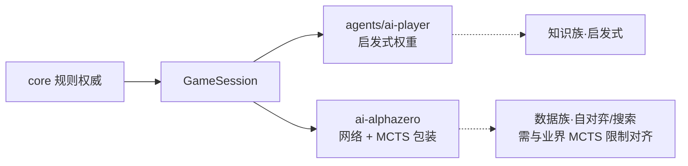

# 设计：成熟麻将 AI 算法调研与本仓对照

> **状态**：待用户审阅（路径 A · 2026-11-20「A」）  
> **日期**：2026-11-20  
> **类型**：调研 + 选型建议（本文件不授权改码）  
> **相关代码**：`src/majiang/strategy/agents/ai-player.ts`、`src/majiang/strategy/ai-alphazero/`  
> **规范**：`docs/standards/rules/superpowers-artifacts.md`、`AGENTS.md`（UI/策略不重写 `core/` 权威判定）

## 1. 问题

本仓麻将已有对局引擎与两套策略入口（启发式 AI、AlphaZero/MCTS 栈），但缺少一份**业界已验证算法族**的统一对照，难以回答：

- 哪些路线在公开对战/竞赛中已被证明「成熟」？
- 哪些可开源复用、哪些只能学方法？
- 下一步若加强 AI，应优先接哪一族，而不是重复造轮？

## 2. 目标（封顶）

| 目标 | 可观察验收 |
|------|------------|
| 算法族清单 | 覆盖知识型与数据型主流路线，含代表系统与成熟度信号 |
| 本仓对照 | 标明现有 `agents` / `ai-alphazero` 落在哪一族 |
| 选型建议 | 给出 1 条推荐下一阶段路线 + 明确硬不做 |
| 规则边界 | 不暗示前端或 Session 重写 `core/` 胡吃碰杠权威 |

## 3. 硬不做

- 本 spec **不**引入新依赖、不改 `src/majiang/core/`、不改对局 Session 行为  
- **不**承诺复现 Suphx / LuckyJ 级训练成本  
- **不**把日麻（Riichi，立直麻将）或国标（MCR）权重直接当本仓规则权重使用  
- **不**把「有论文/有段位」等同于「本仓可一键接入」

## 4. 成熟算法族总览

行业共识（IJCAI Botzone 国标赛、微软 Suphx 论文、腾讯 LuckyJ 公开材料）：

- **监督学习（Supervised Learning，监督学习）** 与 **强化学习（Reinforcement Learning，强化学习）** 整体强于纯人类启发式  
- 麻将是**四人非完备信息**博弈：经典围棋式 MCTS（Monte Carlo Tree Search，蒙特卡洛树搜索）不能直接套用；需对手建模、期望值搜索，或参数化运行时适应（如 Suphx 的 pMCPA）  
- 「成熟」判定优先看：**公开段位/竞赛成绩、可复现描述、是否有可运行开源**

## 5. 代表系统卡片

稳定段位数字主要引自 [Mahjong Engines](https://mahjongengines.com/) 汇总及各原论文/公告；跨年代平台与样本不可直接横向「谁更强一分」。

| 系统 | 规则 | 算法要点 | 成熟度信号 | 可用性 |
|------|------|----------|------------|--------|
| 启发式 / Long Cat 系 | 各变体 | 向听数、有效牌、末期蒙特卡洛防铳 | 工业基线；学术早期常见 | 方法公开，实现简单 |
| **Bakuuchi**（爆打） | 日麻 | 听牌/待牌/打点对手模型 + 弃牌蒙特卡洛；早期用监督模型建牌 | 天凤峰值九段；稳定约 6.59（Suphx 论文对照） | 研究向，论文可学 |
| **Akochan** | 日麻 | 期望排名点（pt）+ 统计听牌估计 + 动态规划（Dynamic Programming，动态规划）推/守 | 社区审牌引擎；对战弱于 Mortal | 开源，非商业许可 |
| **NAGA** | 日麻 | CNN（Convolutional Neural Network，卷积神经网络）监督：打牌/鸣牌/立直/杠 | 天凤十段级服务 | 闭源付费审牌 |
| **Suphx**（微软亚洲研究院） | 日麻 | 监督预训练 → 策略梯度自对弈；全局奖励预测、先知教练、运行时策略适应（pMCPA） | 天凤十段；稳定约 8.74（2019 对照） | 论文 [arXiv:2003.13590](https://arxiv.org/abs/2003.13590)，无开源权重 |
| **Mortal** | 日麻 | Rust 对局逻辑 + PyTorch；ResNet 特征 + Dueling DQN（Deep Q-Network，深度 Q 网络） | 社区主流开源；mjai 审牌常用 | [GitHub AGPL-3.0](https://github.com/Equim-chan/Mortal) |
| **LuckyJ**（腾讯） | 日麻 + 国标 | ACH（Actor-Critic Hedge）：自对弈 + 反事实遗憾最小化；隐信息乐观价值搜索 | 天凤稳定约 10.68（2023）；国标战胜顶尖职业有公开宣传 | 研究向，无公开模型 |
| **Kanachan** | 雀魂规则 | Transformer 训练框架 | 框架成熟，默认无强权重 | 开源框架，许可需自查 |
| **Botzone / IJCAI 国标赛** | 国标 MCR | 参赛队以 SL/RL 为主；复式+瑞士轮降方差 | 多届竞赛；结论：SL/RL ≫ 纯启发式 | 平台与数据集可参考 |

### 5.1 算法要点（人话）

| 族 | 它在算什么 | 强在哪 | 弱在哪 |
|----|------------|--------|--------|
| 启发式 / 向听 | 「离听牌还差几步、哪张牌更没用」 | 可解释、CPU 轻、易接规则引擎 | 难打高番、易被针对、攻守切换僵 |
| 蒙特卡洛 + 对手模型 | 「打这张后，模拟到局终期望」 | 防守与推放可量化（Bakuuchi） | 依赖模型质量；算力随候选牌上升 |
| 期望值 / DP | 「最大化最终排名点期望」 | 审牌、推守决策清晰（Akochan） | 早期常退回规则；工程量大 |
| 监督学习 | 「高手在这种局面会怎么打」 | 启动快、牌风像人类（NAGA） | 难超训练集天花板；分布外脆 |
| 深度强化学习 | 「自对弈后长期期望更高的动作」 | 当前公开最强主路径（Suphx/Mortal） | 特征、算力、规则对齐成本高 |
| 遗憾最小化 | 「逼近不易被剥削的混合策略」 | LuckyJ 公开成绩顶尖 | 实现与理论门槛高；几乎无开源成品 |

### 5.2 Suphx 三件套（选型时常被引用）

1. **全局奖励预测**：单局得点 ≠ 半庄最终排名奖励，用序列模型估「这局对最终段位/得分的贡献」  
2. **先知教练（Oracle Guiding）**：训练早期让智能体看到墙牌/他家手牌，再逐步去掉，加速收敛  
3. **pMCPA**：因麻将行动顺序不固定，难建标准博弈树；用参数化蒙特卡洛在对局中适应策略，而非裸 MCTS

## 6. 本仓对照

| 本仓模块 | 对应算法族 | 说明 |
|----------|------------|------|
| `strategy/agents/ai-player.ts` | 知识·启发式 | 对子/刻子/顺子等手牌权重；无向听精确搜索、无对手听牌模型 |
| `strategy/ai-alphazero/*` | 数据·自对弈 + MCTS 包装 | 命名与围棋 AlphaZero 同构；业界对麻将强调「不规则树 → 慎用经典 MCTS」 |
| Session / Web | 编排与表现 | 只消费策略与 `core` 结果，不重写判定 |

**差距（有证据）**

- 缺少公开成熟的「对手听牌概率 + 弃牌期望」层（Bakuuchi / Akochan 核心）  
- 缺少可加载的监督/RL 权重与特征合同（Mortal/Suphx 级）  
- `ai-alphazero` 与 Suphx/Mortal 的主流实现细节**未对齐**；不能默认等同「已达业界成熟深度 RL」

## 7. 对本仓的选型建议

### 7.1 三条候选路径

| 路径 | 内容 | 代价 | 回报 |
|------|------|------|------|
| **P1 加固启发式** | 向听数、有效牌、简单危险度；可选轻量蒙特卡洛 | 低 | 立刻改善人机对局「不像瞎打」 |
| **P2 期望值审牌层** | 借鉴 Akochan：候选动作期望 pt / 点炮率（规则适配本仓） | 中 | 可解释、可单测、不依赖 GPU |
| **P3 深度 RL 对齐** | 特征合同 + 监督冷启动 + 自对弈；参考 Mortal/Suphx 方法，**不**抄权重 | 高 | 长期上限；与现有 `ai-alphazero` 目录可收敛或替换 |

### 7.2 推荐（本 spec 结论）

**下一阶段默认推荐：P1 → 可选 P2；P3 单独立项。**

理由：

1. 本仓当前瓶颈更像「可用、可测的对手」，不是「天凤十段」  
2. P1/P2 不碰 `core` 权威，易挂回归；符合懒人阶梯（先复用规则层输出）  
3. P3 需单独冻结：规则变体、特征、许可（AGPL）、训练预算；不宜与调研混做

### 7.3 与现有 AlphaZero 栈的关系

- **短期**：人机对局主路径继续可用启发式；AlphaZero 作实验/训练入口，不默认冒充「业界成熟 RL」  
- **若做 P3**：先写特征与动作空间合同，再决定「改造 `ai-alphazero`」还是「新 agent + 适配器」；禁止 UI 内嵌策略

## 8. 资料索引（落盘时引用）

| 资料 | 用途 |
|------|------|
| [Suphx 项目页 / 论文](https://www.microsoft.com/en-us/research/project/suphx-mastering-mahjong-with-deep-reinforcement-learning/) | 深度 RL 方法权威描述 |
| [Mahjong Engines 目录](https://mahjongengines.com/) | 引擎对比与段位汇总 |
| [麻将博弈 AI 构建方法综述](https://html.rhhz.net/tis/html/202211028.htm) | 知识型 vs 数据型中文综述 |
| [Official International Mahjong / Botzone](https://www.mdpi.com/1999-4893/16/5/235) | 国标竞赛结论：SL/RL 优于启发式 |
| [IJCAI 2024 Mahjong AI Competition](https://ijcai.org/Proceedings/2024/1020.pdf) | 竞赛形式与平台 |
| [Mortal](https://github.com/Equim-chan/Mortal) | 开源深度 RL 参考实现 |
| ACH / LuckyJ 公开说明 | 遗憾最小化路线（无完整开源成品） |

## 9. 验收（本文件本身）

- [x] 算法族 + 代表系统表完整  
- [x] 本仓模块对照表完整  
- [x] 推荐路径写死为 P1→P2，P3 单独立项  
- [x] 硬不做与规则边界明确  
- [x] 用户要求写计划后，已开 `writing-plans`（P1）：`docs/superpowers/plans/2026-11-20-majiang-ai-p1-heuristic-plan.md`
- [ ] P1 实现交付验收（人确认）：计划已执行、代码在工作区、回归测绿；**未**勾「已交付」——待用户确认后再勾
- [x] P2 期望值审牌层：已另开独立 plan（不并入 P1）→ `docs/superpowers/plans/2026-11-20-majiang-ai-p2-ev-discard-plan.md`（用户拍板 A · 2026-11-20）
- [ ] P2 实现交付验收（人确认）：计划执行、对战 `p2WinRateAmongDecidedPct`≥25、回归测绿后再勾
- [ ] P3 深度 RL：须单独立项 brainstorm，不在本调研包施工

## 10. 后续闸门

1. **P1**：按 `docs/superpowers/plans/2026-11-20-majiang-ai-p1-heuristic-plan.md` 执行（向听 / 有效牌 / 现物危险度）  
   - 事实备注（2026-11-20）：plan 已执行并入库；1×P1 vs 3×legacy 1000 局决出胜负胜率约 **14.55%**（弱于均势）→ 人审认定效果不足，改走 P2
2. **P2**：按 `docs/superpowers/plans/2026-11-20-majiang-ai-p2-ev-discard-plan.md` 执行（期望值 − 点炮代价）；不与 P1 plan 合并  
3. **P3**：先开新 brainstorm（算力、许可、规则变体）再写 plan  
4. 提交时机按 `commit-policy.md`：用户明确要求提交时再 commit
